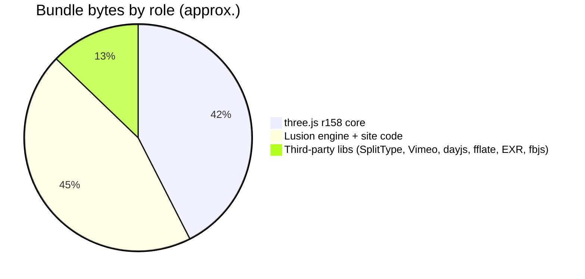

> **Read in Notion:** [1. Stack and bundle anatomy](https://shifatmasud.notion.site/3fd48559569d8124ab68d56b80867ef5) · Part of [Lusion.co Decoded](https://shifatmasud.notion.site/Lusion-co-Decoded-Client-Side-Handbook-3fd48559569d81dd80b4c7407caf27cc) · [Repo home](https://github.com/shifatmasud/lusion-decoded)

# 1. Stack and bundle anatomy

## What ships to the browser
<table header-row="true">
<tr>
<td>Layer</td>
<td>File</td>
<td>What it is</td>
</tr>
<tr>
<td>HTML</td>
<td>`/`, `/about`, `/projects`, `/projects/<slug>`</td>
<td>Static pages built by Astro. Every route has the same shell: `#canvas`, `#transition-overlay`, `#preloader`, `#header`, `#page-container > #page-container-inner`</td>
</tr>
<tr>
<td>CSS</td>
<td>`/_astro/about.CNa9RfUh.css`</td>
<td>One stylesheet for the whole site</td>
</tr>
<tr>
<td>JS</td>
<td>`/_astro/hoisted.CUO_IjfL.js`</td>
<td>One ES module that holds everything (Astro's "hoisted" script)</td>
</tr>
<tr>
<td>Assets</td>
<td>`https://lusion.dev/assets/...`</td>
<td>CDN: textures (KTX2, webp, EXR), meshes (`.buf`), audio (mp3), video (Vimeo)</td>
</tr>
</table>
**Confirmed:** unknown routes (e.g. `/playground`) return the home HTML, and there's no sitemap. So the client router decides what each page is.
## Inside the one bundle (byte map)
I parsed the bundle with acorn and split it into 142 study modules by top-level class.
<table header-row="true">
<tr>
<td>Byte range</td>
<td>Contents</td>
</tr>
<tr>
<td>0 to 532,149</td>
<td>three.js r158 core (the bundle sets `window.__THREE__ = REVISION`)</td>
</tr>
<tr>
<td>532,149 to 564,134</td>
<td>Engine foundation: MathUtils, Browser, Settings, Properties, Signal</td>
</tr>
<tr>
<td>564,134</td>
<td>fbjs `normalizeWheel` (smooths wheel and trackpad deltas)</td>
</tr>
<tr>
<td>565k to 634k</td>
<td>SecondOrderDynamics, Input, ScrollDomRange, Tween, FboHelper, TaskManager, Page, Stage3D, Blur, BlueNoise, ScreenPaint, Visuals</td>
</tr>
<tr>
<td>634,675</td>
<td>SplitType (splits text into lines, words and chars for animation)</td>
</tr>
<tr>
<td>677,071</td>
<td>Vimeo Player SDK</td>
</tr>
<tr>
<td>704k to 1,106k</td>
<td>Pages and sections: Home, About, Projects, Project details, Header, UI, transitions, all scene classes</td>
</tr>
<tr>
<td>1,106,805</td>
<td>day.js (dates)</td>
</tr>
<tr>
<td>1,114k to 1,206k</td>
<td>ScrollPane, ScrollManager, Postprocessing, Smaa, Bloom, ScreenPaintDistortion, Final, Fsr, loaders</td>
</tr>
<tr>
<td>1,206,033</td>
<td>fflate (unzip, used by EXR)</td>
</tr>
<tr>
<td>1,210,273</td>
<td>three.js EXRLoader</td>
</tr>
<tr>
<td>1,230k to end</td>
<td>TextureItem, Support, App, Preloader, Links, UI, FontItem, `preRun`, `run`</td>
</tr>
</table>

## Why this matters for you
- **No framework at runtime.** There's no React or Vue. Astro just emits static HTML, and plain ES classes do the rest.
- **Singletons over components.** Most systems are one instance exported in lower camel case: `properties`, `settings`, `fboHelper`, `scrollManager`, `postprocessing`, `input`, `taskManager`.
- **Class names kept.** The minifier mangled local variables but left class and method names alone, which is why this decode reads so cleanly.
## Confirmed vs inference
- Confirmed: the libraries, versions and byte ranges above come from parsing the shipped file.
- Inference: the singleton naming suggests one hand-written source file per system, merged by Vite/Astro. I can't see the original file names.

## Figures

These figures were added to the Notion page after this Markdown was written. In Notion each one sits next to the section it explains, with its caption.

