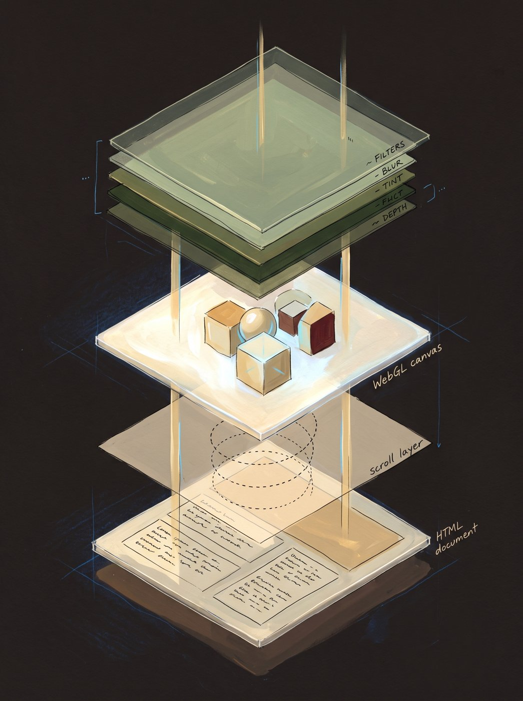
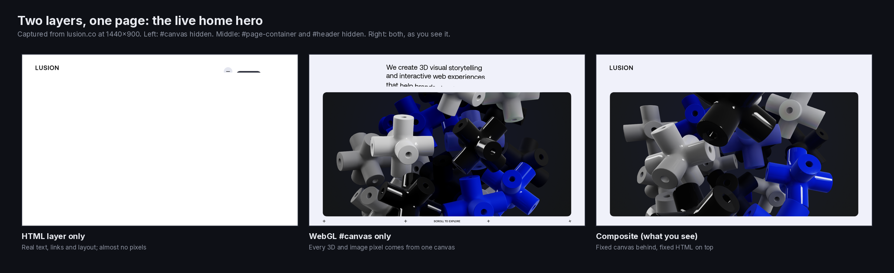
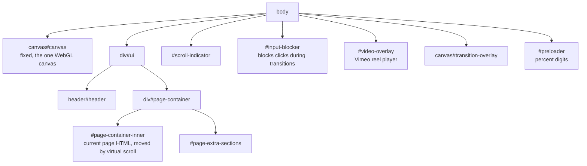
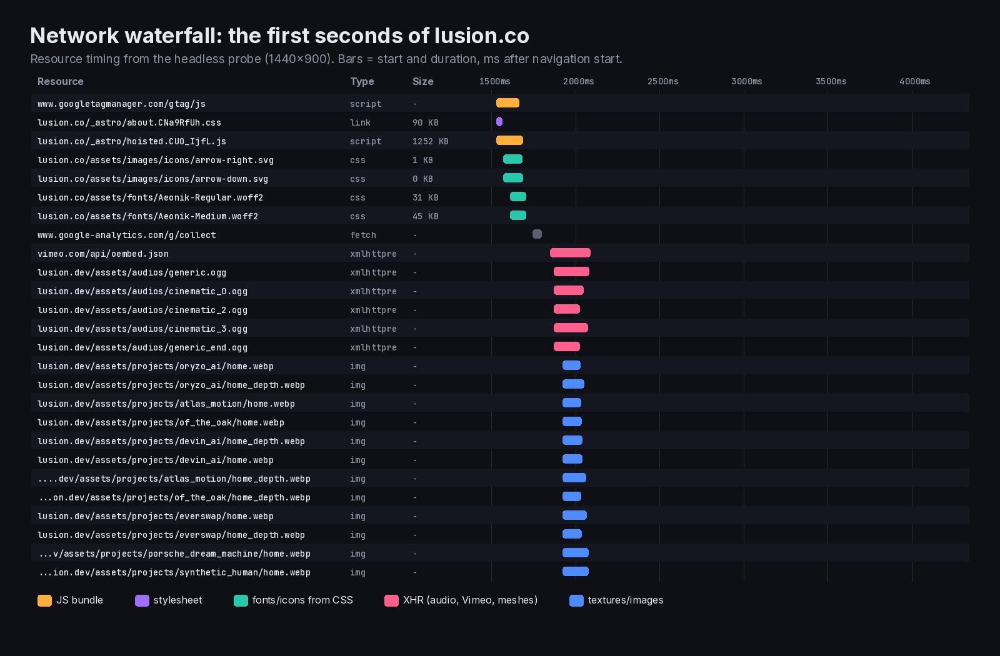
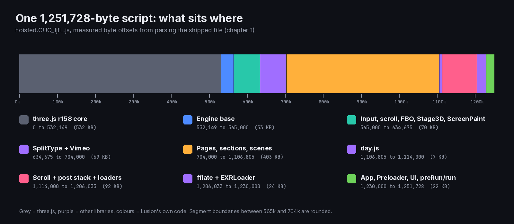
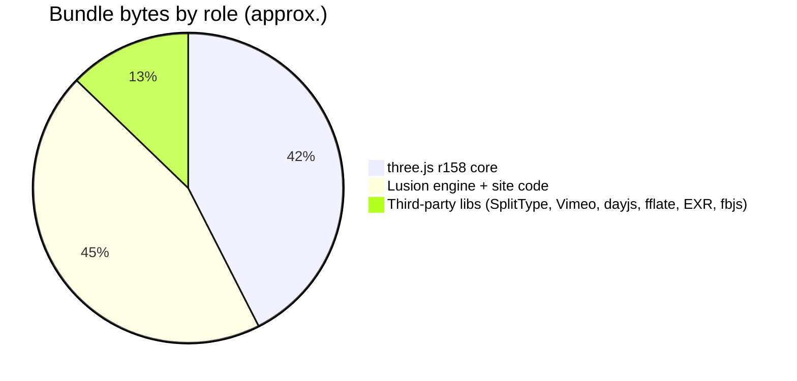

> **Read in Notion:** [1. Stack and bundle anatomy](https://shifatmasud.notion.site/3fd48559569d8124ab68d56b80867ef5) · Part of [Lusion.co Decoded: Frontend Handbook](https://shifatmasud.notion.site/3fd48559569d81dd80b4c7407caf27cc) · [Repo home](https://github.com/shifatmasud/lusion-decoded)

# 1. Stack and bundle anatomy

*Concept: HTML layer, virtual-scroll layer, one WebGL canvas, post-processing sheets*

## What ships to the browser

| Layer | File | What it is |
|---|---|---|
| HTML | `/`, `/about`, `/projects`, `/projects/<slug>` | Static pages built by Astro. Every route has the same shell: `#canvas`, `#transition-overlay`, `#preloader`, `#header`, `#page-container > #page-container-inner` |
| CSS | `/_astro/about.CNa9RfUh.css` | One stylesheet for the whole site |
| JS | `/_astro/hoisted.CUO_IjfL.js` | One ES module that holds everything (Astro's "hoisted" script) |
| Assets | `https://lusion.dev/assets/...` | CDN: textures (KTX2, webp, EXR), meshes (`.buf`), audio (mp3), video (Vimeo) |

**Confirmed:** unknown routes (e.g. `/playground`) return the home HTML, and there's no sitemap. So the client router decides what each page is.

### See it live: the two layers

*Live capture of the home hero: hide the canvas and almost nothing is left; hide the HTML and the whole picture stays. The look is WebGL, the structure is HTML.*

### The page shell, as captured from the live DOM

The live DOM wraps `#header` and `#page-container` in a `#ui` div; everything else sits directly in `body`.

### What loads first (Network panel view)

*Resource timing from the probe: the CSS and the one JS bundle start together, fonts follow from the CSS, then audio, Vimeo and textures stream in from [lusion.dev](http://lusion.dev).*

## Inside the one bundle (byte map)

I parsed the bundle with acorn and split it into 142 study modules by top-level class.

*Byte map of the bundle: three.js takes the first 42%, Lusion's own engine and pages fill most of the rest, small libraries sit in between.*

| Byte range | Contents |
|---|---|
| 0 to 532,149 | three.js r158 core (the bundle sets `window.__THREE__ = REVISION`) |
| 532,149 to 564,134 | Engine foundation: MathUtils, Browser, Settings, Properties, Signal |
| 564,134 | fbjs `normalizeWheel` (smooths wheel and trackpad deltas) |
| 565k to 634k | SecondOrderDynamics, Input, ScrollDomRange, Tween, FboHelper, TaskManager, Page, Stage3D, Blur, BlueNoise, ScreenPaint, Visuals |
| 634,675 | SplitType (splits text into lines, words and chars for animation) |
| 677,071 | Vimeo Player SDK |
| 704k to 1,106k | Pages and sections: Home, About, Projects, Project details, Header, UI, transitions, all scene classes |
| 1,106,805 | day.js (dates) |
| 1,114k to 1,206k | ScrollPane, ScrollManager, Postprocessing, Smaa, Bloom, ScreenPaintDistortion, Final, Fsr, loaders |
| 1,206,033 | fflate (unzip, used by EXR) |
| 1,210,273 | three.js EXRLoader |
| 1,230k to end | TextureItem, Support, App, Preloader, Links, UI, FontItem, `preRun`, `run` |

## Why this matters for you

- **No framework at runtime.** There's no React or Vue. Astro just emits static HTML, and plain ES classes do the rest.
- **Singletons over components.** Most systems are one instance exported in lower camel case: `properties`, `settings`, `fboHelper`, `scrollManager`, `postprocessing`, `input`, `taskManager`.
- **Class names kept.** The minifier mangled local variables but left class and method names alone, which is why this decode reads so cleanly.

## Confirmed vs inference

- Confirmed: the libraries, versions and byte ranges above come from parsing the shipped file.
- Inference: the singleton naming suggests one hand-written source file per system, merged by Vite/Astro. I can't see the original file names.
