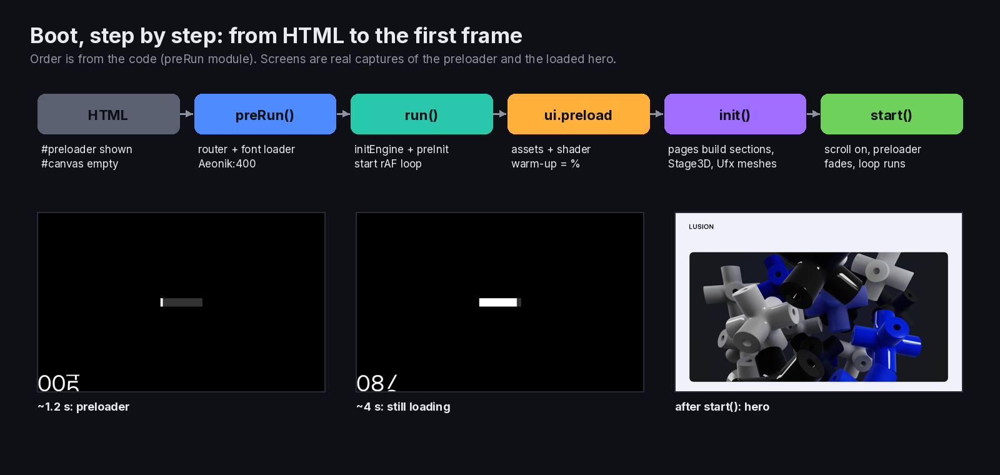
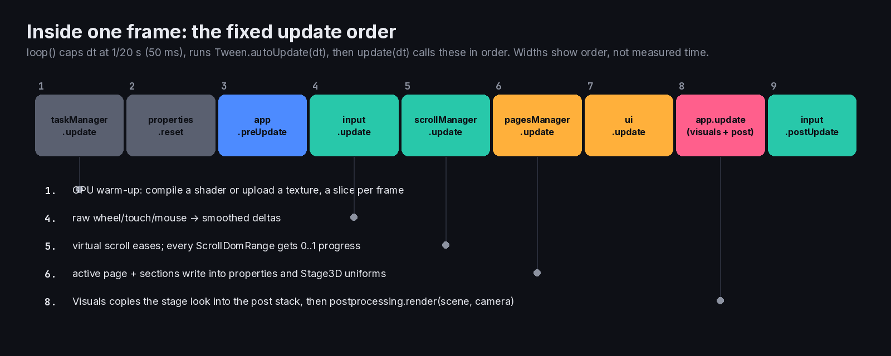
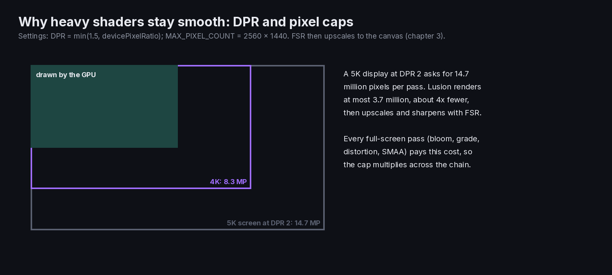

> **Read in Notion:** [2. Boot sequence and main loop](https://shifatmasud.notion.site/3fd48559569d811e94b1cd6359ec9594) · Part of [Lusion.co Decoded](https://shifatmasud.notion.site/Lusion-co-Decoded-Client-Side-Handbook-3fd48559569d81dd80b4c7407caf27cc) · [Repo home](https://github.com/shifatmasud/lusion-decoded)

# 2. Boot sequence and main loop

## The boot story
1. HTML arrives with `#preloader` visible and an empty `#canvas`.
2. The bundle ends by calling `preRun()`. It sets the CDN cross-origin rules, starts the router (`routeManager.init()`), registers the font loader and loads one weight of the brand font (`Aeonik:400`). When that font is in, it calls `run()`.
3. `run()` queues the remaining fonts, then pre-initialises everything in a fixed order: `app.initEngine()`, `input.preInit()`, `scrollManager.init()`, `pagesManager.preInit()`, `ui.preInit()`, `app.preInit()`. It starts the frame loop and hands over to `ui.preload(init, start)`, which shows the percent progress.
4. `app.initEngine()` creates the three.js renderer, scene, camera and post stack, and registers loaders.
5. `init()` runs `input.init()`, `pagesManager.init()`, `ui.init()` and `app.init()`. The pages build their sections, Stage3D scenes and Ufx meshes.
6. `TaskManager` warms the GPU (compiles shaders and uploads textures) a little each frame. `taskManager.update()` is the first call in every frame.
7. `start()` runs `ui.start()`, `pagesManager.start()` and `app.start()`, then switches scroll on. The preloader fades out, the first page shows, and the main loop runs forever.
```mermaid
sequenceDiagram
  participant HTML
  participant preRun
  participant Loader as QuickLoader
  participant run as run()
  participant UI as ui.preload
  participant Tasks as TaskManager
  participant Loop as rAF loop
  HTML->>preRun: module executes
  preRun->>Loader: routeManager.init(), register(FontItem), add("Aeonik:400")
  Loader-->>run: progress = 1
  run->>run: initEngine(), input / scroll / pages / ui / app preInit
  run->>Loop: loop()
  run->>UI: preload(init, start)
  UI->>Tasks: shader compiles and texture uploads
  UI-->>run: init(), then start()
  loop every frame (dt capped at 1/20 s)
    Loop->>Loop: taskManager, input, scroll, pages, ui, app update
  end
```
## Quoted: engine creation (`App.initEngine`)
```javascript
properties.loader.register(BufItem),
properties.loader.register(EXRItem),
properties.loader.register(TextureItem),
properties.loader.register(ThreeLoaderItem),
(properties.renderer = new WebGLRenderer({
  canvas: properties.canvas,
  context: properties.gl,
  premultipliedAlpha: !1,
})),
(properties.scene = new Scene()),
(properties.camera = new PerspectiveCamera(45, 1, 0.1, 200)),
...
fboHelper.init(properties.renderer, settings.RENDER_TARGET_FLOAT_TYPE),
textureHelper.init(),
(properties.postprocessing = new Postprocessing()),
properties.postprocessing.init(),
blueNoise.preInit(),
```
Note `context: properties.gl`. They create the WebGL2 context themselves first, check support (`support.isSupported()`), and only then hand it to three.js. One scene and one camera serve the whole site.
## Quoted: settings defaults, overridable from the URL
```javascript
class Settings {
  CDN_PATH = "";
  MODEL_PATH = "/assets/models/";
  TEXTURE_PATH = "/assets/textures/";
  USE_WEBGL2 = !0;
  DPR = Math.min(1.5, browser$1.devicePixelRatio) || 1;
  USE_PIXEL_LIMIT = !0;
  MAX_PIXEL_COUNT = 2560 * 1440;
  MOBILE_WIDTH = 812;
  USE_HD = !1;
  LOG = !1;
  SKIP_ANIMATION = !1;
  WEBGL_OFF = !1;
  LOOK_DEV_MODE = !1;
  TEST_TUNNEL = !1;
```
The constructor reads `new URLSearchParams(window.location.search)` and calls `this.override(...)`. So any of these flags can be set from the address bar, like `?LOG&USE_HD`. This is their own debug switchboard.
**Lessons:** the DPR is capped at 1.5, and the total pixel count at 2560×1440. That's a large part of how they keep heavy shaders smooth.
## The frame (from `loop()` and `update()` in the preRun module)
`loop()` measures the time step, caps it at 1/20 of a second, runs `Tween.autoUpdate(dt)`, then `update(dt)` calls, in order: `taskManager.update()`, `properties.reset()`, `app.preUpdate`, `input.update`, `scrollManager.update`, `pagesManager.update`, `ui.update`, `app.update`, `input.postUpdate`.
- `input` turns raw pointer and wheel events into smoothed values.
- `scrollManager` moves the virtual scroll, and every `ScrollDomRange` recomputes its 0 to 1 progress.
- `pagesManager` updates the active page. Its sections write into `properties` and Stage3D uniforms.
- `visuals` copies the active stage's look (bloom, vignette, colors) into the post stack.
- `postprocessing.render(scene, camera)` draws the frame.
**Measured:** after load and 10 scroll steps, the headless probe counted 48 linked programs and 96 shader sources on one WebGL2 context.


## Figures

These figures were added to the Notion page after this Markdown was written. In Notion each one sits next to the section it explains, with its caption.






