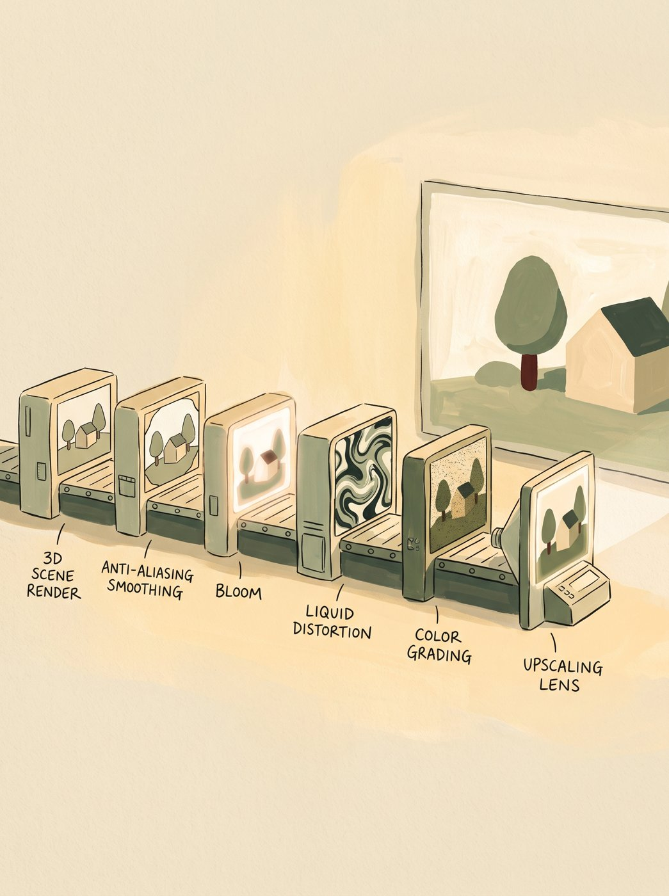
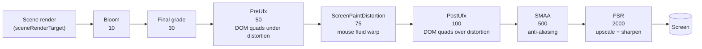
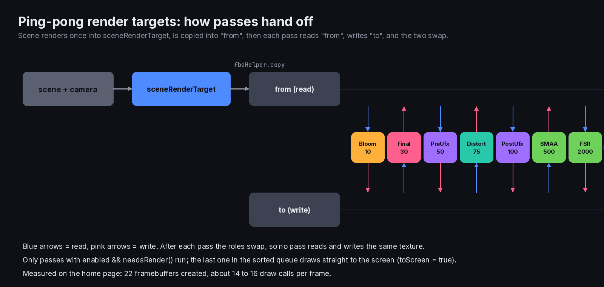

> **Read in Notion:** [3. Rendering engine and post-processing](https://shifatmasud.notion.site/3fd48559569d810bb1f9d6e4e072ee8a) · Part of [Lusion.co Decoded](https://shifatmasud.notion.site/Lusion-co-Decoded-Client-Side-Handbook-3fd48559569d81dd80b4c7407caf27cc) · [Repo home](https://github.com/shifatmasud/lusion-decoded)

# 3. Rendering engine and post-processing


## The three engine pieces
- **FboHelper** is a toolbox for full-screen GPU work. It holds one triangle and one orthographic camera, and offers `copy`, `render(material, target)`, `clearColor`, render-target factories, and saving and restoring color state.
- **Postprocessing** owns the scene render target and a ping-pong pair (`fromRenderTarget` and `toRenderTarget`). It renders the scene once, then runs a queue of effects.
- **PostEffect** is the base class for every pass. Each pass has `renderOrder`, `enabled`, `needsRender()` and `render(postprocessing, toScreen)`.
## Quoted: the whole post pipeline (`Postprocessing.render`)
```javascript
const n = this.queue.filter(this._filterQueue),
  a = this.sharedUniforms;
if (
  (n.sort((l, c) => (l.renderOrder == c.renderOrder ? 0 : l.renderOrder - c.renderOrder)),
  this.checkSceneRt(),
  (a.u_cameraNear.value = t.near),
  (a.u_cameraFar.value = t.far),
  (a.u_cameraFovRad.value = (t.fov / 180) * Math.PI),
  this.onBeforeSceneRendered.dispatch(),
  n.length)
) {
  (fboHelper.renderer.setRenderTarget(this.sceneRenderTarget),
    fboHelper.renderer.render(e, t),
    fboHelper.renderer.setRenderTarget(null),
    fboHelper.copy(this.sceneRenderTarget.texture, this.fromRenderTarget),
    this.onAfterSceneRendered.dispatch(this.sceneRenderTarget));
  ...
  for (let c = 0, u = n.length; c < u; c++) {
    const f = c === u - 1 && r,
      p = n[c];
    (p.setPostprocessing(this), p.render(this, f));
  }
```
Where `_filterQueue(e) { return e.enabled && e.needsRender(); }`. Passes that are switched off cost nothing, and only the last pass draws to the screen.
## The pass order (confirmed `renderOrder` values)

- **Bloom (10):** a high-pass filter, then a blurred mip chain added back.
- **Final (30):** color grading, vignette and blue-noise grain, driven by values that `Visuals` copies from the active stage.
- **PreUfx (50) / PostUfx (100):** DOM elements drawn as GPU quads, either before or after the fluid distortion. So some text bends with the mouse and some stays crisp. See chapter 4.
- **ScreenPaintDistortion (75):** samples the ScreenPaint velocity texture and offsets UVs. See chapter 7.
- **SMAA (500):** edge, weight and blend passes for anti-aliasing.
- **FSR (2000):** AMD FidelityFX Super Resolution style EASU upscale plus RCAS sharpening (uniform `u_sharpness`). The scene renders at a capped resolution and FSR enlarges it to the canvas.
## Why the order is clever
- Distortion runs **after** grading, so the warp moves graded pixels.
- DOM text can sit on either side of the warp, which is a design choice per element.
- Anti-aliasing and upscaling run last, on the final image, which is the cheapest place for them.
## Original teaching skeleton (mine, not theirs)
```javascript
class PostEffect { renderOrder = 0; enabled = true; needsRender() { return true } render(pp, toScreen) {} }
class Post {
  queue = [];
  render(renderer, scene, camera) {
    const passes = this.queue.filter(p => p.enabled && p.needsRender()).sort((a, b) => a.renderOrder - b.renderOrder);
    renderer.setRenderTarget(this.sceneRT); renderer.render(scene, camera);
    this.read = this.sceneRT;
    passes.forEach((p, i) => p.render(this, i === passes.length - 1));
  }
  swap() { [this.read, this.write] = [this.write, this.read] }
}
```


## Figures

These figures were added to the Notion page after this Markdown was written. In Notion each one sits next to the section it explains, with its caption.




