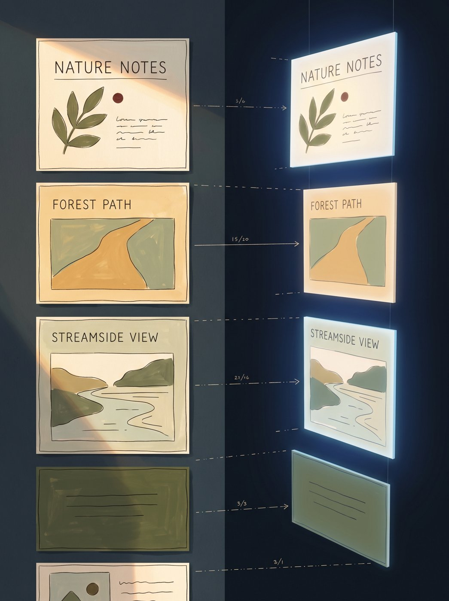
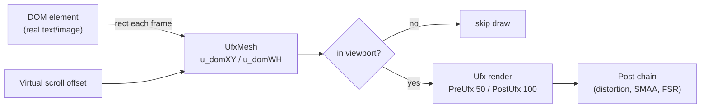
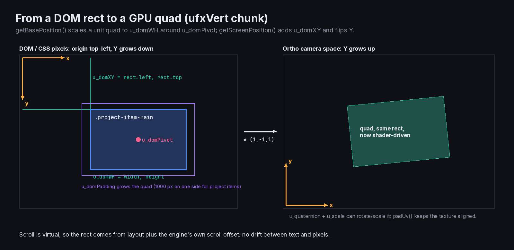
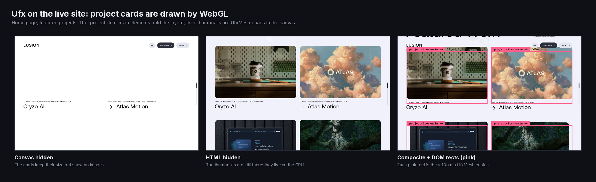

> **Read in Notion:** [4. DOM to WebGL sync (Ufx)](https://shifatmasud.notion.site/3fd48559569d816eb890f8d968ec1fae) · Part of [Lusion.co Decoded](https://shifatmasud.notion.site/Lusion-co-Decoded-Client-Side-Handbook-3fd48559569d81dd80b4c7407caf27cc) · [Repo home](https://github.com/shifatmasud/lusion-decoded)

# 4. DOM to WebGL sync (Ufx)


## The idea
Text and images stay in the HTML for SEO, accessibility and layout. But the pixels you see can come from **WebGL quads that copy each element's rectangle every frame**. That lets shaders dissolve, warp, color or reveal real page content. Lusion calls this system **Ufx** (UI effects).
## The pieces
- **UfxMesh**: one quad bound to one DOM element. It reads `getBoundingClientRect`-style values, converts them to pixels relative to the viewport, and tests whether the element is on screen (`testViewport`).
- **Ufx**: a container that renders a list of UfxMeshes into the post chain.
- **PreUfx** (`renderOrder 50`) and **PostUfx** (`100`): the two slots on either side of the fluid distortion.
- **UfxTextMesh, text helpers and SplitType**: lines, words and characters get their own rects for staggered reveals.
## Quoted: the shared vertex chunk that maps a DOM rect to screen space
```glsl
// shaders_by_owner/shared__ufxVert.chunk.glsl (verbatim, line breaks added)
uniform vec3 u_position; uniform vec4 u_quaternion; uniform vec3 u_scale;
uniform vec2 u_domXY; uniform vec2 u_domWH; uniform vec2 u_domPivot; uniform vec4 u_domPadding;
vec3 qrotate(vec4 q,vec3 v){return v+2.*cross(q.xyz,cross(q.xyz,v)+q.w*v);}
vec3 getBasePosition(in vec3 pos){
  vec3 basePos=vec3((pos.xy)*u_domWH-u_domPivot,pos.z);
  basePos.xy+=mix(-u_domPadding.xz,u_domPadding.yw,pos.xy);
  return basePos;
}
vec3 getScreenPosition(in vec3 basePos){
  vec3 screenPos=qrotate(u_quaternion,basePos*u_scale)+vec3(u_domPivot.xy,0.);
  screenPos=(screenPos+vec3(u_domXY.xy,0.)+u_position)*vec3(1.,-1.,1.);
  return screenPos;
}
vec2 padUv(in vec2 uv){vec2 paddedUv=uv+mix(-u_domPadding.xz,u_domPadding.yw,uv)/u_domWH;paddedUv.y=1.-paddedUv.y;return paddedUv;}
```
The `UfxMesh` quad shader (`UfxMesh__quadVert.vert.glsl`) includes this chunk and calls `getBasePosition`, `getScreenPosition` and `padUv`. The DOM's position and size go in as `u_domXY` and `u_domWH`. The shader scales a unit quad to that rectangle around a pivot, adds padding, can rotate and scale it with `u_quaternion` and `u_scale`, and flips Y (the DOM measures down, GL measures up) before the usual `projectionMatrix * modelViewMatrix`. This is the core trick.

## Why it works smoothly
- Scroll is virtual (chapter 5), so the engine **knows** the scroll offset at render time. DOM and GL never drift apart the way they would with native scroll.
- Rects are measured on resize and layout changes, and the scroll offset is added on the GPU each frame. That's cheap.
- Elements off screen are skipped.
## Original teaching version
```javascript
class DomQuad {
  constructor(el, material) { this.el = el; this.mat = material; this.measure(); }
  measure() { const r = this.el.getBoundingClientRect(); this.base = { x: r.left, y: r.top + scroll.current, w: r.width, h: r.height }; }
  update() { const y = this.base.y - scroll.current; this.mat.uniforms.u_domXYWH.value.set(this.base.x, y, this.base.w, this.base.h); this.visible = y < innerHeight && y + this.base.h > 0; }
}
```


## Figures

These figures were added to the Notion page after this Markdown was written. In Notion each one sits next to the section it explains, with its caption.




