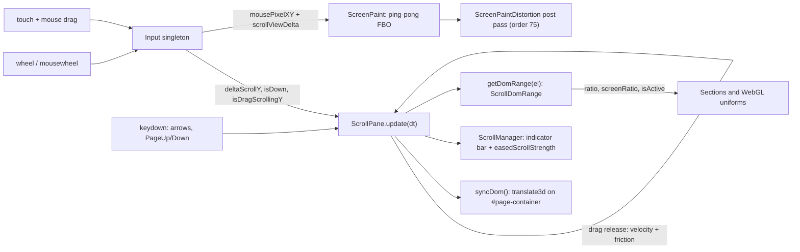
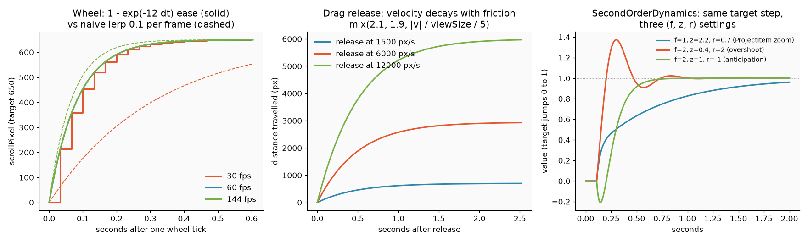
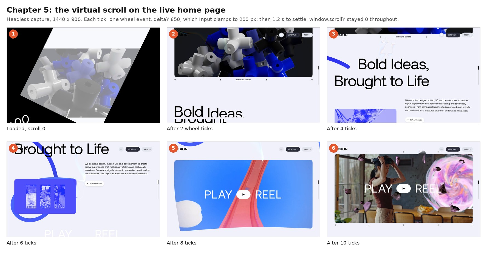
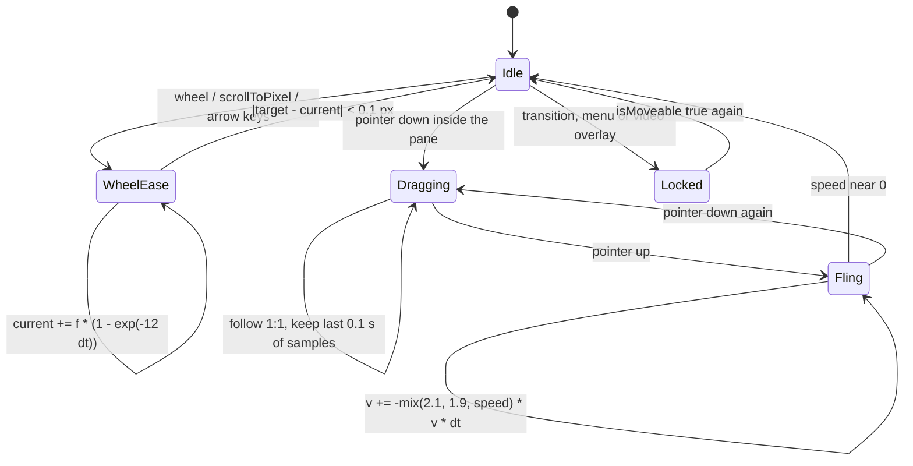
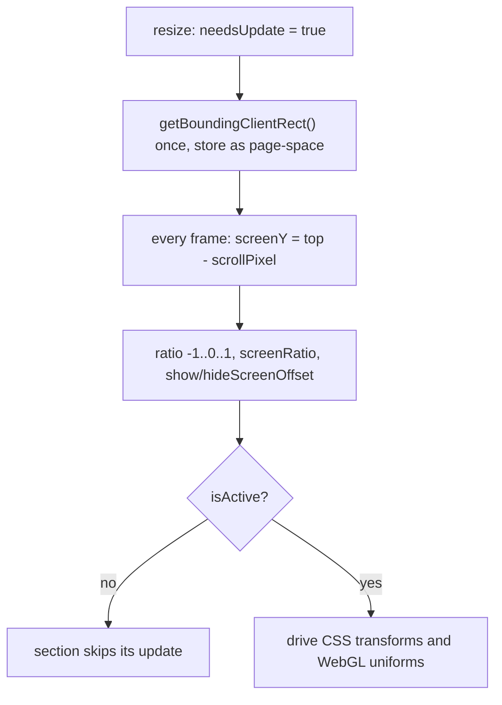

> **Read in Notion:** [5. Scroll, input and motion](https://shifatmasud.notion.site/3fd48559569d816d8a50c22e35b3ce7b) · Part of [Lusion.co Decoded: Frontend Handbook](https://shifatmasud.notion.site/3fd48559569d81dd80b4c7407caf27cc) · [Repo home](https://github.com/shifatmasud/lusion-decoded)

# 5. Scroll, input and motion

> 🎯 Lusion never lets the browser scroll. One `Input` singleton collects wheel, touch, mouse and keys; `ScrollPane` turns them into a virtual scroll position with its own physics; `ScrollManager` moves `#page-container` with a single `translate3d`; and `ScrollDomRange` tells every section where it is on screen as a number between -1 and 1. The same pointer data also paints a velocity field on the GPU (ScreenPaint) that later bends the whole frame.


*Concept: pointer and scroll input painted into a GPU velocity field*

## The flow in one diagram



## 5.1 Input: one place for every pointer event

**What it does.** `Input` attaches listeners once and exposes plain numbers that the rest of the app reads inside the frame loop. Nothing else listens to wheel or touch.

**Confirmed (quoted, module `008_Input.js`):**

```javascript
e.addEventListener("mousedown", this._onDown.bind(this)),
e.addEventListener("touchstart", this._getTouchBound(this, this._onDown)),
e.addEventListener("mousemove", this._onMove.bind(this)),
e.addEventListener("touchmove", this._getTouchBound(this, this._onMove)),
e.addEventListener("mouseup", this._onUp.bind(this)),
e.addEventListener("touchend", this._getTouchBound(this, this._onUp)),
e.addEventListener("wheel", this._onWheel.bind(this)),
e.addEventListener("mousewheel", this._onWheel.bind(this)),
```

Wheel input is normalized across browsers with the bundled fbjs `normalizeWheel`, then clamped so one hard flick can't teleport the page:

```javascript
_onWheel(e) {
  let t = normalizeWheel$1(e).pixelY;
  ((t = math.clamp(t, -200, 200)),
    (this.deltaWheel += t),
    (this.deltaScrollY = this.deltaDragScrollY + this.deltaWheel),
    ...
    (this.isWheelScrolling = !0),
    this.onWheeled.dispatch(e.target),
```

Drag direction is decided **once per gesture** from the first movement, then locked:

```javascript
this.needsCheckDragScrollDirection &&
  ((this.isDragScrollingX = Math.abs(this.deltaPixelXY.x) > Math.abs(this.deltaPixelXY.y)),
  (this.isDragScrollingY = !this.isDragScrollingX),
  (this.needsCheckDragScrollDirection = !1)),
```

- Deltas accumulate between frames and are reset in `postUpdate`, so the loop always reads "how much happened since last frame".
- `hasThroughElem(el, "down")` records which elements the pointer went down through, so a scroll pane only moves when the gesture started inside it.

**Inference.** Collecting events into numbers and reading them in `requestAnimationFrame` keeps all motion in one clock. Event handlers never touch the DOM, which avoids layout thrash.

## 5.2 ScrollPane: virtual scroll with two physics modes

**What it does.** It holds `scrollPixel` (where the page is) and `targetScrollPixel` (where it wants to be). Each frame it moves one toward the other with one of three behaviours.

**Confirmed tuning values (quoted fields, `120_ScrollPane.js`):**

```javascript
dragHistoryMaxTime = 0.1;
frictionCoeffFrom = 2.1;
frictionCoeffTo = 1.9;
frictionCoeffWeightDivisor = 5;
wheelEaseCoeff = 12;
minScrollPixel = 0.1;
```

**Mode 1: wheel or `scrollToPixel`, frame-rate independent exponential ease.**

```javascript
(this.targetScrollPixel += l),
(this.targetScrollPixel = this._clampScrollPixel(this.targetScrollPixel)));
let f = this.targetScrollPixel - this.scrollPixel;
((a = f * (1 - Math.exp(-this.wheelEaseCoeff * e))),
  Math.abs(f) < this.minScrollPixel && ((a = f), (this.isWheelScrolling = !1)));
```

`1 - Math.exp(-k * dt)` is the key line: it gives the same feel at 30, 60 or 144 fps, unlike `lerp(a, b, 0.1)`.

**Mode 2: finger down, 1:1 follow.** While dragging, each delta is pushed into `dragHistory` and samples older than 0.1 s are dropped.

**Mode 3: finger released, inertia with speed-dependent friction.** Velocity is a time-weighted average of the last 0.1 s of drag samples (newer samples weigh more), then it decays:

```javascript
let p =
  -math.mix(
    this.frictionCoeffFrom,
    this.frictionCoeffTo,
    math.clamp(
      Math.abs(this.velocityPixel / this.viewSizePixel / this.frictionCoeffWeightDivisor),
      0,
      1,
    ),
  ) * this.velocityPixel;
((this.velocityPixel += p * e), (a = this.velocityPixel * e));
```

Fast flicks get slightly lower friction (1.9) than slow ones (2.1), so a big throw glides further.

The three modes, plotted by running the quoted formulas with Lusion's own constants:



*Left: the wheel ease reaches the same place at 30, 60 and 144 fps, while a naive per-frame lerp (dashed) does not. Middle: drag release with 2.1 to 1.9 friction. Right: three SecondOrderDynamics settings from 5.5 (computed in Python from the quoted code).*

**Writing to the DOM: one transform per frame.**

```javascript
syncDom() {
  this.contentDom &&
    ((this.x = 0),
    (this.y = 0),
    this.isVertical ? (this.y = -this.scrollPixel) : (this.x = -this.scrollPixel),
    (this.contentDom.style.transform = `translate3d(${this.x}px, ${this.y}px, 0px)`));
}
```

**Size and keyboard.** A `ResizeObserver` on the content marks a resize, which is applied on the next tick; `contentSize` is stored in viewport units (`height / viewport - 1`) and `progress` is kept across resizes. Arrow keys move 100 px and PageUp/PageDown move one viewport, both through `scrollToPixel` so they ease too.

**Global lock (quoted).** Scrolling is refused while a page transition, the menu or the video overlay is open:

```javascript
get isMoveable() {
  return (
    this.isActive &&
    !videoOverlay.isOpened &&
    pagesManager.isIdle &&
    !header.menu.opened &&
    this.contentSize > 0 &&
    (!this.viewDom || input.hasThroughElem(this.viewDom, "down"))
  );
}
```

What this looks like on the live site: the page content moves, the browser never scrolls.



*Six frames of the live home page as wheel ticks drive ScrollPane; window.scrollY stayed 0 while #page-container was translated.*



*ScrollPane's modes as a state machine, from the code in 5.2.*

## 5.3 ScrollManager: the page's scroll pane

`ScrollManager extends ScrollPane` and binds it to the real DOM: `#page-container` as the moving content, plus `#scroll-indicator` and `#scroll-indicator-bar`. Each frame it also computes `easedScrollStrength`, a 0–1 "how hard are we scrolling" signal other effects can read:

```javascript
(this.easedScrollStrength += Math.abs(this.scrollViewDelta)),
(this.easedScrollStrength += (0 - this.easedScrollStrength) * (1 - Math.exp(-10 * e))),
(this.easedScrollStrength = Math.min(this.easedScrollStrength, 1)),
```

The custom scrollbar fades in while scrolling, fades out 0.5 s after it stops, and has a minimum thumb size of 20% (`MIN_BAR_SCALE_Y = 2 / 10`).

## 5.4 ScrollDomRange: where is this element, as numbers

**What it does.** `scrollManager.getDomRange(el)` returns a cached object per element. It measures `getBoundingClientRect()` only when `needsUpdate` is set (on resize), then each frame offsets those cached values by the scroll position. No layout reads during scrolling.

**Confirmed (quoted, `009_ScrollDomRange.js`):**

```javascript
((this.ratio = Math.min(0, math.unClampedFit(a, t, t - l, -1, 0))),
  (this.ratio += Math.max(0, math.unClampedFit(a, 0, -l, 0, 1))),
  (this.screenRatio = math.fit(a, t, -l, -1, 1)),
  (this.showScreenOffset = -(a - t) / t),
  (this.hideScreenOffset = -(a + l) / t),
  (this.isActive = this.ratio >= -1 && this.ratio <= 1));
```

- `ratio`: -1 while the element enters from below, 0 while it fully covers its range, +1 as it leaves at the top.
- `screenRatio`: one linear -1→1 across the whole time it is visible.
- `isActive`: on screen at all. Sections use it to skip work.

**How sections use it (quoted, `031_HomeHeroSection.js`).** The hero feeds DOM position straight into shader uniforms and into the balloon scene:

```javascript
this.sectionDomRange = scrollManager.getDomRange(this.domContainer);
let t = this.sectionDomRange.isActive,
  r = scrollManager.getDomRange(this.domVisualContainer),
  n = this.frameMesh.material.uniforms;
(n.u_domXY.value.set(r.screenX, r.screenY),
  n.u_domWH.value.set(r.width, r.height),
  (homeBalloons.ratio = math.fit(this.sectionDomRange.ratio, 0, 1, 1, 0) * (t ? 1 : 0)),
```

`ScrollPane.getEaseInOutOffset()` is the other helper: the reel section uses it to make a block "stick" while you scroll past, by adding a cubic-bezier offset to its position.



## 5.5 SecondOrderDynamics: the spring behind every "alive" motion

**What it does.** A critically tunable second-order system (the f, ζ, r spring popularised by t3ssel8r). You give it a target; it follows with frequency `f`, damping `z` and initial response `r` (r > 1 overshoots, r &lt; 0 anticipates).

**Confirmed (quoted, `007_SecondOrderDynamics.js`):**

```javascript
setFZR(e = this._f, t = this._z, r = this._r) {
  let n = Math.PI * 2 * e;
  ...
  (this.k1 = t / (Math.PI * e)),
  (this.k2 = 1 / (n * n)),
  (this.k3 = (r * t) / n));
}
_updateNumber(e, t = this.target) {
  if (e > 0) {
    let r = (t - this.prevTarget) / e;
    ((this.prevTarget = t),
      this.computeStableCoefficients(e),
      (this.valueVel +=
        (t + this.k3 * r - this.value - this._k1Stable * this.valueVel) * (e / this._k2Stable)),
      (this.value += this.valueVel * e));
  }
}
```

`computeStableCoefficients` clamps `k2` (or uses the exact pole-matching version when `isRobust`) so a long frame can't make the spring explode.

**Where it is used (confirmed by search):** `Input.addEasedInput()` for eased mouse vectors, `ProjectItem` focus/zoom/border motion (`new SecondOrderDynamics(1, 2.2, 0.7, 3)` for zoom), the astronauts in the goal tunnel, and cursor rotation in the team section and video overlay.

## 5.6 ScreenPaint: the pointer becomes a velocity texture

**What it does.** Every frame it draws a capsule from the previous pointer position to the current one into a quarter-resolution render target. Each pixel stores velocity and weight, which fade over time. Two targets swap each frame (ping-pong), and an eighth-resolution blurred copy feeds back as a soft "push".

**Confirmed (quoted, `020_ScreenPaint.js`):**

```javascript
maxRadius = 100;
radiusDistanceRange = 100;
pushStrength = 25;
accelerationDissipation = 0.8;
velocityDissipation = 0.985;
weight1Dissipation = 0.985;
weight2Dissipation = 0.5;
...
resize(e, t) {
  let r = e >> 2,
    n = t >> 2,
    a = e >> 3,
    l = t >> 3;
```

Scrolling counts as movement, so the trail smears when you scroll even with the mouse still:

```javascript
let a = scrollManager.scrollViewDelta * properties.screenPaintOffsetRatio,
  l = scrollManager.isVertical ? 0 : a,
  c = scrollManager.isVertical ? a : 0;
(_v$4.copy(input.mousePixelXY),
  (_v$4.x += l * properties.viewportWidth * 3),
  (_v$4.y += c * properties.viewportHeight * 3));
let u = _v$4.distanceTo(input.prevMousePixelXY),
  f = math.fit(u, 0, this.radiusDistanceRange, this.minRadius, this.maxRadius);
```

The brush radius grows with pointer speed. The end of `update()` renders, downsamples and blurs:

```javascript
fboHelper.render(this._material, this._currPaintRenderTarget),
fboHelper.copy(this._currPaintRenderTarget.texture, this._lowRenderTarget),
blur.blur(8, 1, this._lowRenderTarget, this._lowBlurRenderTarget));
```

In the fragment shader (quoted from `ScreenPaint__fragSn`), the stroke is a distance-to-segment test, and fading is one multiply:

```glsl
vec2 sdSegment(in vec2 p,in vec2 a,in vec2 b){vec2 pa=p-a,ba=b-a; ...
void main(){vec2 res=sdSegment(gl_FragCoord.xy,u_drawFrom.xy,u_drawTo.xy);
...
vec4 lowData=texture2D(u_lowPaintTexture,v_uv-u_scrollOffset);
vec2 velInv=(0.5-lowData.xy)*u_pushStrength;
...
vec4 delta=(u_dissipations.xxyz-1.0)*data;
```

The paint texture is cleared to `(0.5, 0.5, 0, 0)`, so 0.5 means "no velocity" and values above or below encode direction. Chapter 7 shows how `ScreenPaintDistortion` (render order 75) reads it to bend and colour-shift the final frame.

## Reusable pattern: "input as data, motion as physics"

1. **One input singleton.** Listen once. Store accumulated deltas and flags. Reset them after each frame. Never mutate the DOM from an event handler.
2. **Virtual scroll pane.** Keep `current` and `target`. Wheel and programmatic jumps use `current += (target - current) * (1 - exp(-k*dt))`. Drag follows 1:1. Release uses a velocity from the last ~100 ms with friction. Write one `translate3d` per frame. Lock it during transitions and overlays.
3. **Cached rect ranges.** Measure on resize only. Each frame derive `screenY`, a -1..1 `ratio` and `isActive`. Sections and shaders read these numbers instead of using `IntersectionObserver` or scroll events.
4. **Springs for feel.** Use one `SecondOrderDynamics` type (f, ζ, r) for every eased value, so all motion on the site shares one vocabulary.
5. **Pointer to GPU.** Paint pointer velocity into a low-res ping-pong FBO and let post effects read it.

**Original teaching code (not Lusion's):**

```javascript
class VirtualScroll {
  current = 0; target = 0; velocity = 0; max = 0; ease = 12;
  constructor(el) { this.el = el; this.measure(); new ResizeObserver(() => this.measure()).observe(el); }
  measure() { this.max = Math.max(0, this.el.offsetHeight - innerHeight); }
  wheel(dy) { this.target = Math.min(this.max, Math.max(0, this.target + Math.max(-200, Math.min(200, dy)))); }
  update(dt) {
    this.current += (this.target - this.current) * (1 - Math.exp(-this.ease * dt));
    if (Math.abs(this.target - this.current) < 0.1) this.current = this.target;
    this.el.style.transform = `translate3d(0, ${-this.current}px, 0)`;
  }
  range(rect) { // rect measured on resize, in page space
    const y = rect.top - this.current, vh = innerHeight;
    return { screenRatio: ((vh - y) / (vh + rect.height)) * 2 - 1, isActive: y < vh && y + rect.height > 0 };
  }
}
```

## Confirmed vs inference

| Confirmed in code or at runtime | Inference |
|---|---|
| `window.scrollY` stays 0 and `body` overflow is hidden; `#page-container` is moved with `translate3d` by `syncDom()`. | Virtual scroll was chosen so DOM and WebGL read the exact same scroll value in the same frame, with no jitter between them. |
| Wheel clamp ±200 px, `wheelEaseCoeff = 12`, friction 2.1→1.9, 0.1 s drag history. | The friction blend is tuned so long flicks feel like native iOS momentum. |
| `ScrollDomRange` reads layout only when `needsUpdate` is true. | This is the main reason scrolling stays smooth with dozens of tracked elements. |
| ScreenPaint runs at 1/4 and 1/8 resolution and includes scroll delta in the brush position. | Low resolution is enough because the result is blurred and used as a displacement field, not shown directly. |
