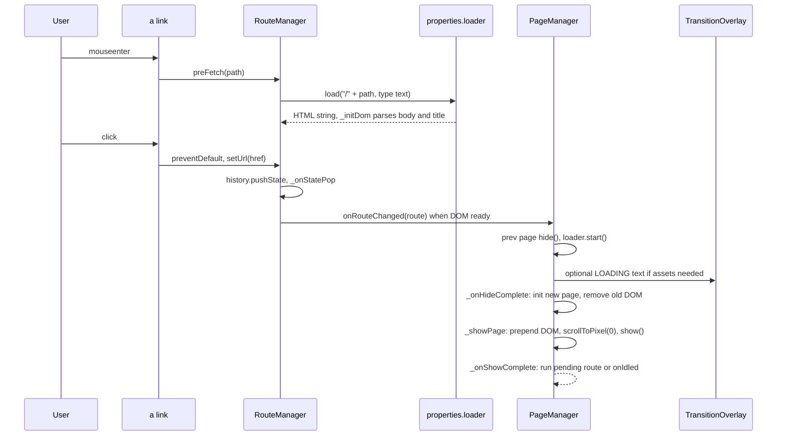
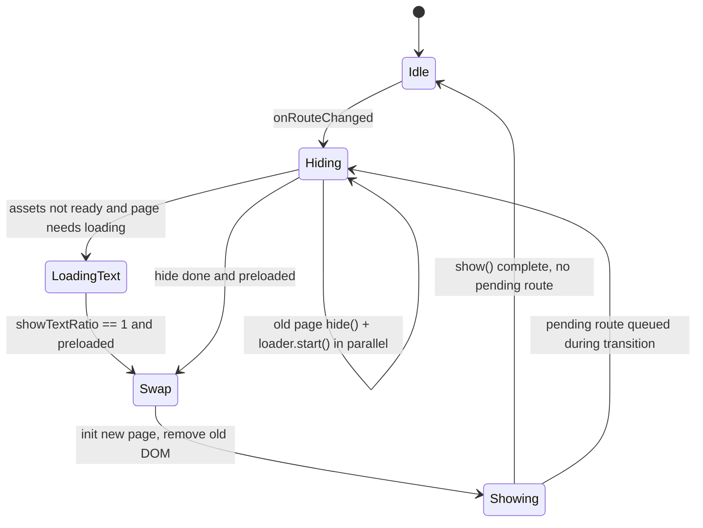
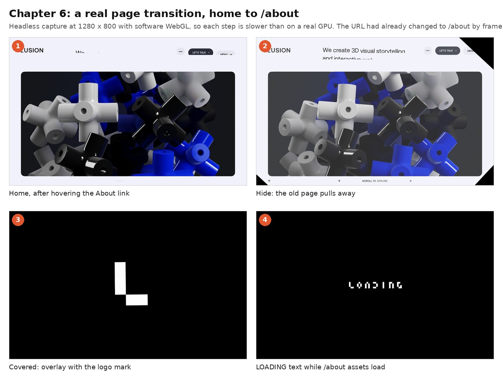

> **Read in Notion:** [6. Routing, pages and sections](https://shifatmasud.notion.site/3fd48559569d817280f5e9676aca01db) · Part of [Lusion.co Decoded](https://shifatmasud.notion.site/Lusion-co-Decoded-Client-Side-Handbook-3fd48559569d81dd80b4c7407caf27cc) · [Repo home](https://github.com/shifatmasud/lusion-decoded)

# 6. Routing, pages and sections

<callout icon="🎯" color="blue_bg">
	Lusion is a multi-page Astro site that behaves like a single-page app. A tiny hand-written router (`Route` + `RouteManager`) intercepts internal links, prefetches the next page's HTML on hover, parses it into a detached document, and hands the `.page` element to `PageManager`. `PageManager` runs a strict hide → load → show state machine with a canvas-drawn transition overlay. Each `Page` is a list of `Section` singletons that share one lifecycle: `preInit → init → resize → update → show/hide`.
</callout>

## The flow in one diagram

## 6.1 Route and RouteManager: a 150-line router
**Confirmed (quoted, `068_RouteManager.js`).** Pages register a path pattern; strings become anchored regexes:
```javascript
addPath(e, t) {
  this.matchList.push({ regExp: e instanceof RegExp ? e : new RegExp("^" + e + "$"), target: t });
}
```
The five pages and their patterns (quoted class fields):
<table header-row="true">
<tr>
<td>Page class</td>
<td>`id`</td>
<td>`path`</td>
</tr>
<tr>
<td>HomePage</td>
<td>home</td>
<td>`""`</td>
</tr>
<tr>
<td>AboutPage</td>
<td>about</td>
<td>`"about"`</td>
</tr>
<tr>
<td>ProjectsPage</td>
<td>projects</td>
<td>`"projects"`</td>
</tr>
<tr>
<td>ProjectPage</td>
<td>project</td>
<td>`/projects\/([^\/]+)$/`</td>
</tr>
<tr>
<td>PlaygroundPage</td>
<td>playground</td>
<td>`"playground"`</td>
</tr>
</table>
Every internal `<a>` is wired once (`__hasClickParsed`). Hover prefetches; click goes through the router. External Vimeo links open the in-site video overlay instead:
```javascript
l
  ? (a.addEventListener("mouseenter", (c) => {
      this.preFetch(this.parseUrl(a.href));
    }),
    a.addEventListener("click", this._onInternalLinkClick.bind(this, a)))
  : a.addEventListener("click", this._onRegularLinkClick.bind(this, a)));
```
A link can veto navigation with an `_onPreClick` hook (the header logo uses it):
```javascript
_onInternalLinkClick(e, t) {
  t.preventDefault();
  let r = !0;
  (e._onPreClick && (r = e._onPreClick() !== !1), r && this.setUrl(e.href));
}
```
**HTML is fetched as text and parsed off-screen.** Only the `<body>` and `<title>` are used; the new page is the first `.page` element. The "next page" link data comes from `#scroll-nav-section`:
```javascript
_initDom(e, t) {
  let r = document,
    n = r.title;
  if (t) {
    ((r = r.implementation.createHTMLDocument()),
      (r.body.innerHTML = /<body[^>]*>((.|[\n\r])*)<\/body>/im.exec(t)[1]));
    let u = /<title[^>]*>((.|[\n\r])*)<\/title>/im.exec(t);
    n = u ? u[1] : "";
  }
  let a = r.getElementById("scroll-nav-section"),
  ...
  e.setTitleDom(n, r.querySelector(".page"), l, c),
```
Routes are cached in `routes[path]`, so a page is fetched once per session. `setPath` uses `history.pushState`, and `popstate` (back/forward) goes through the same `_onStatePop`. The route only fires `onRouteChanged` when its DOM is ready **and** it is still the pending path, so a slow fetch for a page you already left is ignored:
```javascript
_onDomReady(e) {
  this._pendingPath == e.path && ((this._pendingPath = null), this.onRouteChanged.dispatch(e));
}
```
**First load is special.** On the first route there is no fetch: `_initDom` runs against the live `document`, so the server-rendered HTML becomes the first page with no flash.
## 6.2 PageManager: the transition state machine
**Confirmed (quoted, `119_PageManager.js`).** Four flags define whether the site is busy:
```javascript
get isIdle() {
  return !this._isHiding && this._hasPreloaded && !this._isShowing && !this._needsShowLoading;
}
```
A route change during a transition is queued, not dropped, and replayed in `_onShowComplete`:
```javascript
_onRouteChanged(e) {
  if (!this.isIdle) this._pendingRoute = e;
  else if (this.currRoute !== e) {
```
Hiding the old page and loading the new page's assets run **in parallel**; whichever finishes last moves the machine on:
```javascript
r.hide(this.prevRoute, this.currRoute, () => {
  ((this._isHiding = !1),
    this._needsShowLoading
      ? (transitionOverlay.needsShowText = !0)
      : this._hasPreloaded && this._onHideComplete());
}),
...
properties.loader.start((n) => {
  n == 1 &&
    ((this._hasPreloaded = !0),
    this._isHiding ||
      (this._needsShowLoading
        ? transitionOverlay.showTextRatio == 1 && this._onHideComplete()
        : this._onHideComplete()));
}));
```
Showing resets scroll before the page animates in, and only one page DOM lives in `#page-container-inner` after the swap:
```javascript
(this.domContainerInner.prepend(e.domContainer), (e.time = 0)),
(document.title = this.currRoute.title),
...
scrollManager.resize(properties.viewportWidth, properties.viewportHeight),
scrollManager.scrollToPixel(0, !0),
e.resize(properties.viewportWidth, properties.viewportHeight),
e.onShowStarted.dispatch(),
e.show(this.prevRoute, this.currRoute, this._onShowComplete.bind(this)),
```
In `_onHideComplete` the old page's DOM is removed and its WebGL layers hidden: `e.domContainer.remove(), (e.preUfxContainer.visible = !1), (e.postUfxContainer.visible = !1)`.

## 6.3 Page: the base class every page extends
**Confirmed (quoted, `014_Page.js`).** A page is a tweened 0→1 `showRatio` and `hideRatio`, plus two WebGL layers it owns:
```javascript
preUfxContainer = new Object3D();
postUfxContainer = new Object3D();
...
get activeRatio() {
  return this.showRatio * (1 - this.hideRatio);
}
...
show(e, t, r) {
  (this._showPageTween.kill(),
    (this._showPageTween.onComplete = r),
    (this.hideRatio = 0),
    this._showPageTween.fromTo(this.showDuration, { showRatio: 0 }, { showRatio: 1 }));
}
```
Lifecycle hooks, in call order: `preInit(route)` (grab DOM), `preInitContent`, `init` (build WebGL, register with `taskManager`), `initContent`, then `resize`, `update(dt)` each frame, and `show`/`hide`. Per-page flags such as `useGenericTransition`, `hasEndVisual` and `endVisualColor` let a page opt out of the default transition.
**Context-aware transitions (quoted, `078_HomePage.js`).** Going from a project page back home skips the generic overlay, jumps the scroll to that project's card, and takes 1.5 s so the shared visual can morph:
```javascript
let n = e.pathNodes[1];
(e.target === projectPage && this.hasProject(n) && this.isFirstShown
  ? ((this.useGenericTransition = !1),
    (this.showDuration = 1.5),
    scrollManager.scrollToPixel(
      homeFeaturedSection.projectItemList.getProjectItemTop(n) - properties.viewportHeight * 0.25,
      !0,
    ),
    (homeFeaturedSection.projectItemList.selectedId = n))
  : (this.showDuration = 1),
```
## 6.4 Sections: singletons composed by pages
HomePage does almost nothing itself. It forwards each lifecycle call to its sections (quoted):
```javascript
preInit() {
  let e = this.domContainer;
  (homeHeroSection.preInit(e),
    homeReelSection.preInit(e),
    homeFeaturedSection.preInit(e),
    homeGoalSection.preInit(e));
}
```
Each section reads its own `ScrollDomRange` in `update()` and skips work when `isActive` is false (see chapter 5).
**Scroll-to-next-page (quoted, `116_ScrollNavSection.js`).** At the bottom of every page, continuing to scroll fills a bar; when it reaches 1, the router navigates to the next page named in the HTML:
```javascript
(this.overScrollRatio = r
  ? math.saturate(
      this.overScrollRatio +
        e *
          (n && a > 0 ? 2 : this.downWaitTime > 0 ? 0 : a < 0 ? -5 : -0.2) *
          (pagesManager.isIdle ? 1 : 0),
    )
  : 0),
...
this.overScrollRatio == 1 && routeManager.setPath(this.path)));
```
## 6.5 TransitionOverlay: a 2D canvas, not WebGL
`#transition-overlay` is a separate 2D canvas. It fills black, rotates a grid of pixel bars by `contentShowRatio`/`contentHideRatio`, draws a load bar, and, only when a page needs a real asset load, spells "LOADING" from a `LOADING_RECTS` rectangle table. Its text phases (show at `e * 1.25` per second, wait, hide) dispatch `onShowTextCompleted` and `onHideTextCompleted`, which `PageManager` listens to. Pixel size is `~~Math.min(42, properties.viewportWidth / 30)`.
## Reusable pattern: "prefetching router + transition state machine"
1. **Router.** Register `{regex, page}` pairs. Intercept internal links, prefetch on `mouseenter`, fetch HTML as text, parse into `document.implementation.createHTMLDocument()`, cache per path. Fire "route ready" only if it is still the pending path.
2. **Manager.** One `isIdle` getter from explicit flags. Queue route changes that arrive mid-transition. Run "hide old" and "load assets" in parallel; continue when both finish. Swap DOM, reset scroll, resize, then show.
3. **Pages.** One base class with tweened `showRatio`/`hideRatio`, hooks `preInit / init / resize / update / show / hide`, and per-transition overrides chosen from `(fromRoute, toRoute)`.
4. **Sections.** Singletons that own their DOM and WebGL objects, driven by their page and gated by scroll range.
5. **Lock the world.** Scrolling, menus and overlays all check `pagesManager.isIdle`.
**Original teaching code (not Lusion's):**
```javascript
class Router {
  routes = []; cache = new Map(); pending = null; onReady = () => {};
  add(pattern, page) { this.routes.push({ re: typeof pattern === "string" ? new RegExp(`^${pattern}$`) : pattern, page }); }
  async fetch(path) {
    if (!this.cache.has(path)) this.cache.set(path, fetch("/" + path).then(r => r.text()).then(html => {
      const doc = document.implementation.createHTMLDocument();
      doc.body.innerHTML = /<body[^>]*>([\s\S]*)<\/body>/i.exec(html)[1];
      return { title: /<title>([\s\S]*?)<\/title>/i.exec(html)?.[1] ?? "", dom: doc.querySelector(".page") };
    }));
    return this.cache.get(path);
  }
  async go(path) {
    history.pushState(null, "", "/" + path); this.pending = path;
    const data = await this.fetch(path);
    if (this.pending !== path) return; // user already went elsewhere
    const page = this.routes.find(r => r.re.test(path))?.page;
    this.onReady({ path, page, ...data });
  }
}
```
## Confirmed vs inference
<table header-row="true">
<tr>
<td>Confirmed in code</td>
<td>Inference</td>
</tr>
<tr>
<td>Internal links prefetch HTML on hover and navigate with `pushState`; each route's HTML is fetched once and cached.</td>
<td>Hover prefetch hides most network latency, so the transition animation is usually the only wait.</td>
</tr>
<tr>
<td>Only one page's DOM stays in `#page-container-inner` after a swap; the old one is `remove()`d but its JS object and WebGL stay initialised (`hasInitialized`).</td>
<td>Keeping page objects alive makes revisits instant, at the cost of GPU memory.</td>
</tr>
<tr>
<td>Route changes during a transition are queued in `_pendingRoute`.</td>
<td>This prevents the half-swapped states that SPA routers often get when users click fast.</td>
</tr>
<tr>
<td>Unknown paths log `route not found` and redirect to the origin.</td>
<td>There is no client-side 404 page; the static host handles real 404s.</td>
</tr>
</table>


## Figures

These figures were added to the Notion page after this Markdown was written. In Notion each one sits next to the section it explains, with its caption.


