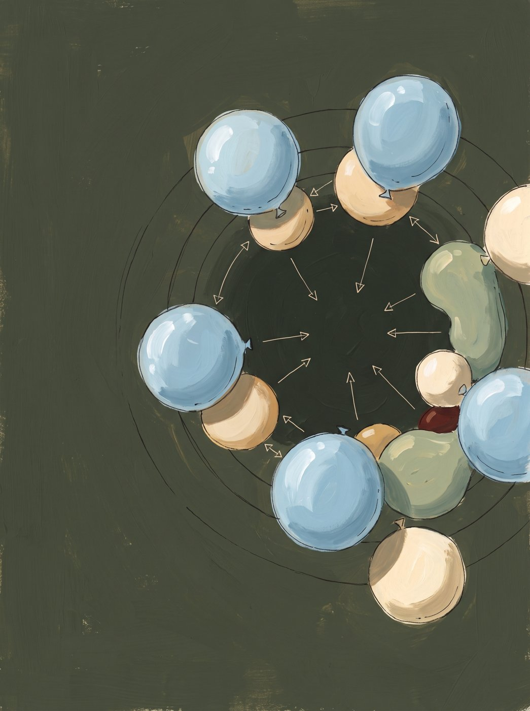
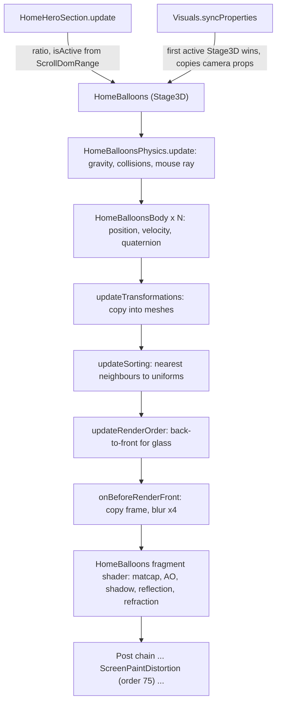
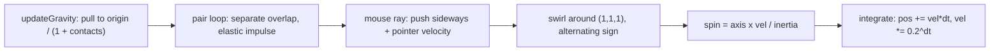
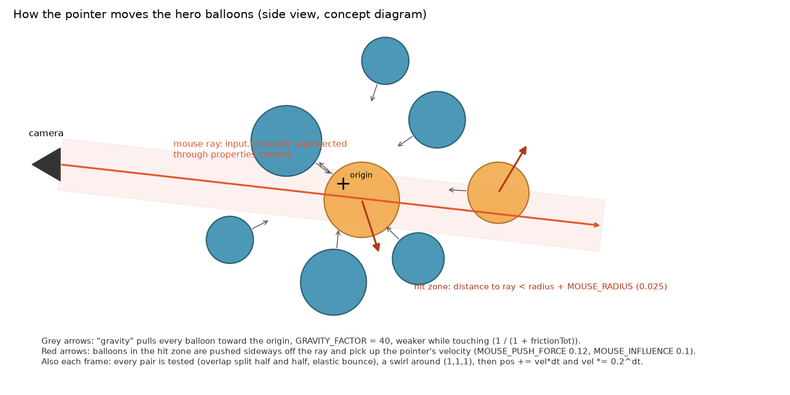
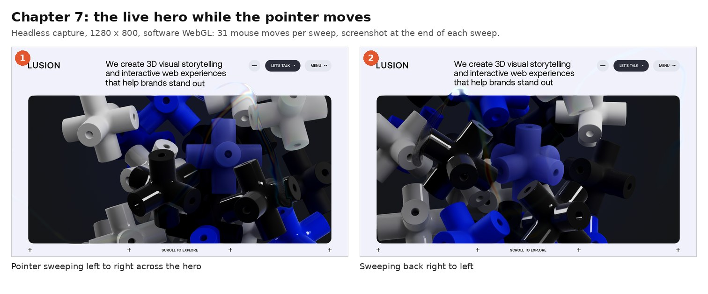

> **Read in Notion:** [7. Effects and scenes](https://shifatmasud.notion.site/3fd48559569d81549fa5ff6c49d305fb) · Part of [Lusion.co Decoded: Frontend Handbook](https://shifatmasud.notion.site/3fd48559569d81dd80b4c7407caf27cc) · [Repo home](https://github.com/shifatmasud/lusion-decoded)

# 7. Effects and scenes

> 🎯 A "scene" on Lusion is a `Stage3D` subclass registered with the `Visuals` switcher; the active one takes over the camera. The home hero is the best example: `HomeBalloons` runs a small custom physics world (no physics library), shades each sphere with analytic ray tests against its neighbours, and fakes glass refraction by blurring a copy of the frame into four levels. A second, screen-wide effect, `ScreenPaintDistortion`, bends the final image with the pointer velocity field from chapter 5.



*Concept: the hero balloon scene, physics bodies feeding shaded spheres*

## The scene in one diagram



## 7.1 Visuals: which 3D scene owns the camera

**Confirmed (quoted, `025_Visuals.js`).** Scenes push themselves into `stage3DList`. Each frame, the last active one becomes `currentStage3D`, and its `properties` (camera position, FOV, offsets) are copied into the global `properties` object that the renderer reads:

```javascript
syncProperties(e) {
  this.currentStage3D = this.defaultStage3D;
  for (let t = 0; t < this.stage3DList.length; t++) {
    let r = this.stage3DList[t];
    if (r.isActive === !0) {
      ((this.currentStage3D = r), r.syncProperties(e));
      for (let n in r.properties) properties[n] = r.properties[n];
    } else r.isActive = !1;
  }
}
```

The hero section registers the balloons and switches them on only while the hero is on screen (quoted, `031_HomeHeroSection.js`):

```javascript
visuals.stage3DList.push(homeBalloons),
homeBalloons.preInit(),
...
(homeBalloons.ratio = math.fit(this.sectionDomRange.ratio, 0, 1, 1, 0) * (t ? 1 : 0)),
(homeBalloons.isActive = homeBalloons.ratio > 0),
```

On intro the camera dollies in with a back-out ease tied to page time (quoted, `HomeBalloons.syncProperties`):

```javascript
((this.properties.defaultCameraPosition.z = math.fit(homePage.time, 0.3, 2, 25, 17.5, ease.backOut)),
  (this.properties.cameraDollyZoomFovOffset = math.fit(homePage.time, 0.3, 3, 100, 0, ease.backOut)));
```

Clicking the hero visual dispatches `changeHomeHeroColorSignal` and plays a click sound, which cycles the balloon palette (`COLORS$1[properties.balloonsColorIndex]`).

## 7.2 HomeBalloonsBody and HomeBalloonsPhysics: a hand-written physics world

**Body (quoted, `022_HomeBalloonsBody.js`).** Spheres start scattered and fly inward. Mass and inertia come from radius and density; velocity is damped in a frame-rate-independent way:

```javascript
(this.position0.set(
  (random() - 0.5) * 12,
  (random() - 0.5) * 12,
  a ? 7 + random() : (random() - 0.5) * 6,
),
  this.velocity0.copy(this.position0).multiplyScalar(-2),
...
(this.mass = this.volume * this.radius * this.radius * this.density),
(this.inertia = this.mass * this.radius * this.radius * 0.4),
...
update(e) {
  (this.position.addScaledVector(this.velocity, e), this.velocity.multiplyScalar(Math.pow(0.2, e)));
}
```

"Gravity" pulls toward the origin, not down, with `GRAVITY_FACTOR = 40`, and is weakened while a body is in contact (`1 / (1 + this.frictionTot)`):

```javascript
updateGravity(e) {
  (this.gravityForce.copy(this.position).negate().multiplyScalar(GRAVITY_FACTOR),
    this.gravityAcc.copy(this.gravityForce).multiplyScalar(1 / this.mass),
    this.gravityAcc.multiplyScalar(1 / (1 + this.frictionTot)),
    this.velocity.addScaledVector(this.gravityAcc, e),
    (this.frictionTot *= 0.5));
}
```

Material presets come from `SPHERES_DATA` entries such as `radius: 1, ...SOFT_PLASTIC` or `...HARD_PLASTIC`, plus flags `isSemitransparent`, `isRough`, `isColored`, `isBlackWhite`, `sss` and `sssColor`.

**World (quoted, `023_HomeBalloonsPhysics.js`).** Every pair is tested (O(n²), fine for a few dozen spheres). Overlap is split half-and-half, then a 1D elastic collision along the contact normal uses each body's restitution:

```javascript
if (v < _) {
  const T = Math.sqrt(l.friction * g.friction, 2);
  ...
  _normal.multiplyScalar(0.5 * (v - _)),
  _pos.sub(_normal),
  _p1$1.add(_normal),
  ...
  E = (b * M + C * S - C * (M - S) * w) / (b + C),
  I = (b * M + C * S - b * (S - M) * R) / (b + C);
  (_vel.addScaledVector(_normal, (E - M) / (1 + T)),
    _v1$6.addScaledVector(_normal, (I - S) / (1 + T)),
```

**The mouse is a ray, not a point.** The pointer is unprojected into a ray from the camera; any sphere closer to that ray than its radius plus `MOUSE_RADIUS` is pushed sideways, and the pointer's own velocity is added:

```javascript
MOUSE_RADIUS = 0.025;
MOUSE_INFLUENCE = 0.1;
MOUSE_PUSH_FORCE = 0.12;
...
(_p1$1.set(input.mouseXY.x, input.mouseXY.y, 0.5),
  _p1$1.unproject(properties.camera),
  _p1$1.sub(properties.camera.position).normalize());
```

Two extras give the cluster life: a swirl around the (1,1,1) axis whose direction alternates by index (`(a % 2) * 2 - 1`), and spin derived from `axis × velocity / inertia`, applied as a quaternion.



The same step as a picture:



*Concept diagram: the pointer becomes a ray from the camera, balloons inside the hit zone are pushed sideways, and every balloon is pulled back toward the origin.*

And on the live site:



*The real hero at the end of two pointer sweeps, left to right and back.*

## 7.3 HomeBalloons: shading spheres with their neighbours

**Per-frame order (quoted, `024_HomeBalloons.js`):**

```javascript
(homeBalloonsBackground.update(e), homeBalloonsPhysics.update(e), ...
(this.updateTransformations(),
  this.updateColor(),
  this.updateUniforms(),
  this.updateSorting(),
  this.updateRenderOrder(),
  this.prePassMeshList.sort(this._sortMeshDist2));
```

**Neighbours as uniforms.** For each sphere, the others are sorted by distance and the nearest `NEIGHBOUR_COUNT` (= `NUM_BALLOONS - 1`) are written as `vec4(position, radius)`, rotation, colour, and a (transparency, luma) pair:

```javascript
t.mesh.material.uniforms.u_nearPositionRadiusList.value[r].set(
  n.mesh.position.x,
  n.mesh.position.y,
  n.mesh.position.z,
  n.mesh.scale.x,
),
```

The fragment shader then loops over those spheres analytically for ambient occlusion, shadows, coloured bounce light (GI) and the nearest reflection (quoted from `HomeBalloons__fragSp`):

```glsl
for(int i=0;i<NEIGHBOUR_COUNT;i++){vec3 nearColor=u_nearColorList[i];
...
vec3 aoShadowIntersect=getCrossAoShadowIntersect(v_worldPosition,N,worldToLight,reflectViewBN,u_nearPositionRadiusList[i],u_nearRotationList[i],reflections.w);
...
ao*=_ao;
shadow*=aoShadowIntersect.g;
gi+=(1.0-0.9*nearTransparencyLuma.y)*nearColor*3.0*min(1.,(1.0-_ao*_ao)/0.7);
```

Base lighting comes from a matcap loaded as EXR (`home/matcap.exr`, `matcap_ld.exr` on mobile), and roughness is `0.8` for rough spheres, `0.1` otherwise.

**Fake glass refraction.** Before the front layer renders, the frame so far is copied and blurred four times in a chain. The glass shader picks two neighbouring blur levels by a computed LOD and blends them (`float ior=2.4`):

```javascript
fboHelper.copy(t.texture, this.cacheRT),
blur.blur(6, 0.5, this.cacheRT, this.cacheInterRT0, this.cacheRTBlur0, !0),
blur.blur(6, 0.5, this.cacheRTBlur0, this.cacheInterRT1, this.cacheRTBlur1, !0),
blur.blur(6, 0.5, this.cacheRTBlur1, this.cacheInterRT2, this.cacheRTBlur2, !0),
blur.blur(6, 0.5, this.cacheRTBlur2, this.cacheInterRT3, this.cacheRTBlur3, !0),
```

```glsl
if(lodFloor<1.5){mapFrom=textureBicubic(u_blurredTextures[0],uv,u_blurredTextureSizes[0]);
mapTo=textureBicubic(u_blurredTextures[1],uv,u_blurredTextureSizes[1]);
```

**Transparency sorting.** Semi-transparent spheres have a back-face mesh and a front mesh. `updateRenderOrder` sorts by camera distance and interleaves render orders (`r * 3` for the back, `r * 3 + 2` for the front) so glass composites correctly over opaque spheres.

## 7.4 ScreenPaintDistortion: bending the whole frame

**Confirmed (quoted, `125_ScreenPaintDistortion.js`).** A `PostEffect` at `renderOrder = 75` reads the paint texture from chapter 5. It is skipped entirely when `amount` is 0:

```javascript
amount = 20;
rgbShift = 1;
multiplier = 1.25;
colorMultiplier = 1;
shade = 1.25;
renderOrder = 75;
...
needsRender(e) {
  return this.amount > 0;
}
```

The shader (quoted, `ScreenPaintDistortion__fragS1`) decodes velocity around 0.5, takes 9 samples along it (a directional motion blur jittered by blue noise), then adds a rainbow fringe where the trail is fading:

```glsl
vec4 data=texture2D(u_screenPaintTexture,v_uv);
float weight=(data.z+data.w)*0.5;
vec2 vel=(0.5-data.xy-0.001)*2.*weight;
vec2 velocity=vel*u_amount/4.0*u_screenPaintTexelSize*u_multiplier;
vec2 uv=v_uv+bnoise.xy*velocity;
for(int i=0;i<9;i++){color+=texture2D(u_texture,uv);uv+=velocity;}color/=9.;
color.rgb+=sin(vec3(vel.x+vel.y)*40.0+vec3(0.0,2.0,4.0)*u_rgbShift)*smoothstep(0.4,-0.9,weight)*u_shade*max(abs(vel.x),abs(vel.y))*u_colorMultiplier;
```

## Reusable patterns

**A. Scene switcher.** Each 3D scene is a `Stage3D` with its own `properties` (camera, FOV, offsets) and `isActive`. A `Visuals` registry picks the active one each frame and copies its properties into the renderer's globals. DOM sections decide `isActive` from their scroll ratio.

**B. Tiny bespoke physics.** For a small number of spheres, skip the library: central attraction, pairwise overlap correction, elastic impulse along the normal, exponential damping `vel *= k^dt`, and a pointer ray that pushes bodies sideways. You get exact control of feel and no extra bundle weight.

**C. Neighbour-aware analytic shading.** Pass the nearest N spheres as uniform arrays; in the shader, do ray–sphere tests for AO, shadow, bounce colour and reflection. It looks ray-traced at raster cost because spheres are cheap to intersect.

**D. Blur-pyramid refraction.** Copy the frame before transparent objects draw, build a blur chain, and sample between levels by roughness or thickness. This gives frosted or clear glass without a real refraction pass.

**E. Velocity-field post effect.** Store pointer velocity in a low-res FBO (chapter 5), then march along it in a post pass with a few samples and add a hue-shift fringe.

**Original teaching code (not Lusion's):**

```javascript
function stepSpheres(bodies, dt, G = 40) {
  for (const b of bodies) b.vel.addScaledVector(b.pos.clone().negate(), (G / b.mass) * dt);
  for (let i = 0; i < bodies.length; i++) for (let j = i + 1; j < bodies.length; j++) {
    const a = bodies[i], c = bodies[j], n = a.pos.clone().sub(c.pos), d = n.length(), r = a.radius + c.radius;
    if (d >= r || d === 0) continue;
    n.divideScalar(d);
    a.pos.addScaledVector(n, (r - d) * 0.5); c.pos.addScaledVector(n, -(r - d) * 0.5);
    const va = a.vel.dot(n), vc = c.vel.dot(n), e = Math.min(a.restitution, c.restitution);
    const pa = (a.mass * va + c.mass * vc - c.mass * (va - vc) * e) / (a.mass + c.mass);
    const pc = (a.mass * va + c.mass * vc - a.mass * (vc - va) * e) / (a.mass + c.mass);
    a.vel.addScaledVector(n, pa - va); c.vel.addScaledVector(n, pc - vc);
  }
  for (const b of bodies) { b.pos.addScaledVector(b.vel, dt); b.vel.multiplyScalar(Math.pow(0.2, dt)); }
}
```

## Confirmed vs inference

| Confirmed in code or at runtime | Inference |
|---|---|
| No physics library ships in the bundle; `HomeBalloonsPhysics` is about 100 lines of pairwise collision code. | Hand-rolling it kept the bundle small and let them tune the "squishy toy" feel directly. |
| Each sphere's shader gets every other sphere as uniforms and loops over them for AO, shadow, GI and reflection. | This only scales because the sphere count is small; a larger scene would need a spatial structure or screen-space tricks. |
| Refraction samples a 4-level blur chain of the frame captured in `onBeforeRenderFront`; IOR constant is 2.4. | 2.4 is roughly diamond, chosen for a strong, readable bend rather than physical accuracy. |
| `ScreenPaintDistortion` runs at render order 75 and is skipped when `amount` is 0. | Placing it after the Ufx layer means DOM text drawn into WebGL bends together with the 3D scene. |
