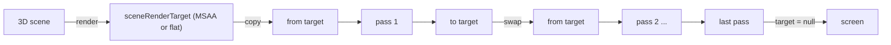
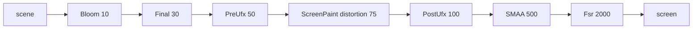
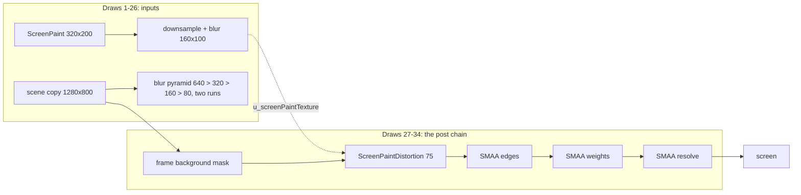
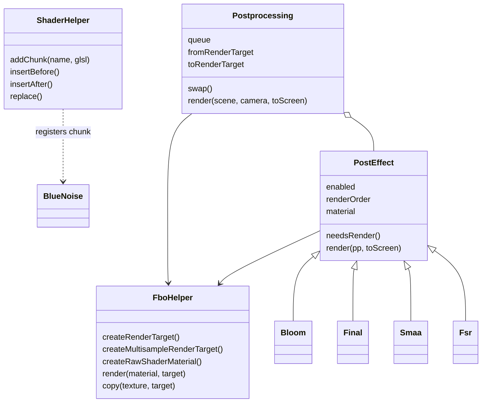

> **Read in Notion:** [8. Shaders and the post-processing pipeline](https://shifatmasud.notion.site/3fd48559569d81daa932c9558ddf8b9a) · Part of [Lusion.co Decoded: Frontend Handbook](https://shifatmasud.notion.site/3fd48559569d81dd80b4c7407caf27cc) · [Repo home](https://github.com/shifatmasud/lusion-decoded)

# 8. Shaders and the post-processing pipeline

## The idea in one sentence

Every visual on Lusion goes through **one shared post-processing chain**: the 3D scene is drawn into an off-screen texture, then a sorted list of small full-screen shader passes (anti-aliasing, bloom, mouse distortion, colour grading, UI effects, upscaling) ping-pong between two render targets until the last one draws to the screen.

## 8.1 The building block: PostEffect

Each pass is a tiny class with a material, an on/off switch and a `renderOrder` number.

```javascript
// 045_PostEffect.js
class PostEffect {
  sharedUniforms = {};
  enabled = !0;
  material = null;
  renderOrder = 0;
  needsRender() { return !0; }
  render(e, t = !1) {
    this.material.uniforms.u_texture && (this.material.uniforms.u_texture.value = e.fromTexture),
    fboHelper.render(this.material, t ? null : e.toRenderTarget),
    e.swap();
  }
}
```

What it does: read the previous result (`fromTexture`), draw the effect into the other target (`toRenderTarget`), or straight to the screen when it is the last pass (`t` is true, target `null`), then `swap()` so the next pass reads what was just written.

Why: every effect has the same three-line contract. Adding a new look means writing one fragment shader and one small class, nothing else.

## 8.2 Postprocessing: ping-pong and sorting

`Postprocessing` (module 122) owns two render targets and swaps them:

```javascript
// 122_Postprocessing.js (fragments)
this.fromRenderTarget = fboHelper.createRenderTarget(1, 1),
this.toRenderTarget = this.fromRenderTarget.clone(),
...
swap() {
  const e = this.fromRenderTarget;
  this.fromRenderTarget = this.toRenderTarget, this.toRenderTarget = e,
  this.fromTexture = this.fromRenderTarget.texture, this.toTexture = this.toRenderTarget.texture;
}
```

Each frame it filters the queue, sorts it by `renderOrder`, draws the scene once, and runs the passes:

```javascript
render(e, t, r) {
  const n = this.queue.filter(this._filterQueue);          // enabled && needsRender()
  n.sort((l, c) => (l.renderOrder == c.renderOrder ? 0 : l.renderOrder - c.renderOrder)),
  this.checkSceneRt(),
  a.u_cameraNear.value = t.near, a.u_cameraFar.value = t.far,
  ...
  fboHelper.renderer.setRenderTarget(this.sceneRenderTarget),
  fboHelper.renderer.render(e, t),
  fboHelper.renderer.setRenderTarget(null),
  fboHelper.copy(this.sceneRenderTarget.texture, this.fromRenderTarget),
  ...
  for (let c = 0, u = n.length; c < u; c++) {
    const f = c === u - 1 && r, p = n[c];
    p.setPostprocessing(this), p.render(this, f);           // last pass draws to screen
  }
}
```

If no pass is active, it simply renders the scene straight to the screen. Camera near, far and field of view are pushed into `sharedUniforms` so any pass can reconstruct depth.

Two details worth copying:

- **One triangle, not a quad.** The full-screen geometry is a single oversized triangle: positions `(-1,-1)`, `(4,-1)`, `(-1,4)`. It covers the screen with no diagonal seam and fewer vertices.
- **Two scene targets.** `checkSceneRt()` picks a multisample (MSAA) target normally, or a flat target when SMAA is enabled, so the scene is never anti-aliased twice.

```javascript
this.sceneRenderTarget = properties.isSmaaEnabled ? this.sceneFlatRenderTarget : this.sceneMsRenderTarget;
```



## 8.3 The actual chain on [lusion.co](http://lusion.co)

`App` (module 136) builds the queue once at start-up:

```javascript
// 136_App.js (fragments)
properties.smaa = new Smaa(), ...
properties.smaa.setTextures(
  properties.loader.add(settings.TEXTURE_PATH + "smaa-area.png", { weight: 32 }).content,
  properties.loader.add(settings.TEXTURE_PATH + "smaa-search.png", { weight: 0.1 }).content),
properties.postprocessing.queue.push(properties.smaa));
let e = !browser$1.isMobile || settings.USE_HD;
properties.bloom = new Bloom(), properties.bloom.init({ USE_CONVOLUTION: e, USE_HD: e }),
properties.postprocessing.queue.push(properties.bloom),
properties.screenPaintDistortion = new ScreenPaintDistortion(), ...
properties.final = new Final(), ...
settings.UP_SCALE > 1 && (properties.upscaler = new Fsr(), ...),
preUfx.init(), properties.postprocessing.queue.push(preUfx),
postUfx.init(), properties.postprocessing.queue.push(postUfx));
```

Note the loader weights: the SMAA lookup image counts 32 times a normal file on the progress bar (see chapter 9).

The `renderOrder` values found in each class decide the real order, not the push order:

| Pass | renderOrder | Module | What it does |
|---|---|---|---|
| Bloom | 10 | 124 | Glow around bright areas |
| Final | 30 | 126 | Colour grading, vignette, dithering |
| PreUfx | 50 | 054 | UI/text effects drawn before distortion |
| ScreenPaintDistortion | 75 | 125 | Bends the image using the mouse paint texture (chapter 5 and 7) |
| PostUfx | 100 | 103 | UI/text effects drawn on top, undistorted |
| Smaa | 500 | 123 | Anti-aliasing |
| Fsr (upscaler) | 2000 (written `2e3` in the bundle) | 127 | Only added when settings.UP\_SCALE &gt; 1; upscales with a sharpness value, last |



What one real frame of the hero actually ran, read back pass by pass from the live site:


*One captured frame of [lusion.co](http://lusion.co): 34 full-screen draws, from the ScreenPaint field and the off-screen scene, through the blur pyramid, the frame background and ScreenPaintDistortion, to SMAA's three passes ending on screen. Bloom and Final did not run in this frame.*



*The captured frame as a graph. Effects whose amount is zero, like Bloom here, appear to be skipped rather than run as no-ops (inferred from the capture).*

## 8.4 Bloom: two quality levels

```javascript
// 124_Bloom.js (fields and init fragments)
ITERATION = 5;
USE_CONVOLUTION = !0;
USE_HD = !0;
amount = 1;
...
this.highPassRenderTarget = fboHelper.createRenderTarget(1, 1, !this.USE_HD, t),
...
this.USE_CONVOLUTION && (
  this.highPassMaterial.defines.USE_CONVOLUTION = !0,
  this.highPassMaterial.uniforms.u_convolutionBuffer = { value: 0.15 },
  this.fftSrcRT = fboHelper.createRenderTarget(1, 1, !0, t), ...
```

What it does: a high-pass shader extracts what should glow. On desktop (or when HD is forced) the glow is made with an **FFT convolution** (shaders `fftFrag`, `convolutionFrag`, `convolutionMixFrag`), which gives a physically shaped, wide glow. On mobile it falls back to a cheaper chain of blur passes (`ITERATION = 5` levels). The App decides with `!browser.isMobile || settings.USE_HD`.

Why: the same effect class serves both a high-end and a low-end path, chosen once at start-up.

## 8.5 Final: the colour grade in one shader

The `Final` pass is a compact grading shader. The core (formatted):

```glsl
// Final fragment shader (126_Final.js)
vec3 color = texture2D(u_texture, uv).rgb;
float luma = dot(color, vec3(0.299, 0.587, 0.114));
color = mix(vec3(luma), color, 1.0 + u_saturation);          // saturation
color = 0.5 + (1.0 + u_contrast) * (color - 0.5);            // contrast
color += u_brightness;                                       // brightness
color = mix(color, screen(colorDodge(color, u_tintColor), u_tintColor), u_tintOpacity); // tint
float d = length((uv - 0.5) * u_vignetteAspect) * 2.0;
color = mix(color, u_vignetteColor, smoothstep(u_vignetteFrom, u_vignetteTo, d));       // vignette
gl_FragColor = vec4(mix(u_bgColor, color, u_opacity) + hash13(vec3(gl_FragCoord.xy, u_ditherSeed)) / 255.0, 1.0);
```

Line by line: saturation via luma mix, contrast around mid-grey, brightness offset, a tint using Photoshop-style screen and colour-dodge blends, an aspect-corrected vignette, a fade from a background colour (`u_opacity`, used for page transitions), and finally **one level of random noise (1/255) to break up banding** in dark gradients.

## 8.6 Shared shader plumbing

**ShaderHelper** (module 018) lets any module register GLSL snippets as Three.js `#include` chunks and splice code into existing shaders:

```javascript
// 018_ShaderHelper.js (fragments)
addChunk(e, t) { ShaderChunk[e] = this.glslifyStrip(t); }
_wrapInclude(e) { return "#include <" + e + ">"; }
insertBefore(e, t, r, n) { ... }
insertAfter(e, t, r, n) { ... }
replace(e, t, r, n) { ... }
```

**Blue noise** (module 019) is registered this way, so any shader can `#include <getBlueNoise>`:

```glsl
uniform sampler2D u_blueNoiseTexture; uniform vec2 u_blueNoiseTexelSize; uniform vec2 u_blueNoiseCoordOffset;
vec3 getBlueNoise(vec2 coord){ return texture2D(u_blueNoiseTexture, coord*u_blueNoiseTexelSize + u_blueNoiseCoordOffset).rgb; }
vec3 getStaticBlueNoise(vec2 coord){ return texture2D(u_blueNoiseTexture, coord*u_blueNoiseTexelSize).rgb; }
```

```javascript
// 019_BlueNoise.js
shaderHelper.addChunk("getBlueNoise", getBlueNoiseShader);
update(e) { this.sharedUniforms.u_blueNoiseCoordOffset.value.set(Math.random(), Math.random()); }
```

The texture is `LDR_RGB1_0.png`. Each frame the offset jumps randomly, so per-pixel jitter (for example, in the depth-based effect inside `045_PostEffect.js`, which samples depth at `v_uv + bnoise.yz*0.01`) changes every frame and averages out instead of forming fixed patterns.

**FboHelper** (module 011) is the low-level layer: it creates render targets, owns the full-screen draw (`render(material, target)`), `copy(texture, target)`, and `createRawShaderMaterial`, which also registers the material as a loading task (chapter 9).



## 8.7 Where the shaders live

The bundle contains the shaders as plain strings beginning with `#define GLSLIFY 1` (they were written as separate files and inlined by glslify at build time). In the evidence folder they were extracted per owner, for example `Bloom__fftFrag`, `Fsr__easuFrag`, `Final__fragmentShader`, `AboutHeroParticlesSimulation__fragSim`. The About page hero alone has separate shaders for fog, ground, halo, letters, light field, particles, rocks and a final composite, so each scene is a small set of single-purpose shaders rather than one big one.

## 8.8 How to reuse this

- **Make effects data, not code paths.** A pass = material + `enabled` + `renderOrder` + `render(pp, toScreen)`. Sort every frame; toggling a pass is one boolean.
- **Ping-pong two targets** and let the last pass draw to the screen, so there is no extra copy at the end.
- **Use one oversized triangle** for full-screen passes.
- **Choose MSAA or SMAA, never both.**
- **Keep a high and a low path** inside the same effect (FFT bloom vs blur bloom) and pick once by device.
- **End with dithering** to kill banding, and **use blue noise with a per-frame offset** for any jitter.
- **Register GLSL chunks** so utilities like noise are an `#include` away.

## 8.9 Original example (not Lusion's code)

```typescript
import * as THREE from 'three';

export interface Pass { enabled: boolean; order: number; material: THREE.ShaderMaterial }

export class Chain {
  passes: Pass[] = [];
  private a = new THREE.WebGLRenderTarget(1, 1, { type: THREE.HalfFloatType });
  private b = this.a.clone();
  private quad: THREE.Mesh;
  private cam = new THREE.Camera();

  constructor(private gl: THREE.WebGLRenderer) {
    const g = new THREE.BufferGeometry();
    g.setAttribute('position', new THREE.Float32BufferAttribute([-1, -1, 0, 3, -1, 0, -1, 3, 0], 3));
    this.quad = new THREE.Mesh(g);
    this.quad.frustumCulled = false;
  }

  setSize(w: number, h: number) { this.a.setSize(w, h); this.b.setSize(w, h); }

  render(scene: THREE.Scene, camera: THREE.Camera) {
    const list = this.passes.filter(p => p.enabled).sort((x, y) => x.order - y.order);
    this.gl.setRenderTarget(list.length ? this.a : null);
    this.gl.render(scene, camera);
    list.forEach((p, i) => {
      p.material.uniforms.u_texture.value = this.a.texture;
      this.quad.material = p.material;
      this.gl.setRenderTarget(i === list.length - 1 ? null : this.b);
      this.gl.render(this.quad, this.cam);
      [this.a, this.b] = [this.b, this.a]; // swap
    });
  }
}
```

## 8.10 Confirmed vs inferred

| Point | Status | Evidence |
|---|---|---|
| Passes share a PostEffect contract and ping-pong two targets | Confirmed | 045\_PostEffect.js, 122\_Postprocessing.js |
| Queue is filtered by enabled/needsRender and sorted by renderOrder each frame | Confirmed | 122\_Postprocessing.js |
| Full-screen geometry is one triangle (-1,-1), (4,-1), (-1,4) | Confirmed | 122\_Postprocessing.js |
| Scene target is flat when SMAA is on, multisample otherwise | Confirmed | 122\_Postprocessing.js checkSceneRt() |
| renderOrder values: Bloom 10, Final 30, PreUfx 50, ScreenPaintDistortion 75, PostUfx 100, Smaa 500, Fsr 2000 | Confirmed | Class fields in modules 127, 124, 126, 054, 125, 103, 123 |
| FFT convolution bloom on desktop / USE\_HD, blur bloom otherwise | Confirmed | 136\_App.js, 124\_Bloom.js |
| Final pass: saturation, contrast, brightness, tint, vignette, fade, 1/255 dither | Confirmed | Final fragment shader |
| Blue noise is an include chunk with a random offset each frame | Confirmed | 019\_BlueNoise.js |
| Fsr at order 2000 means upscaling happens last, so every earlier pass runs at the capped render size | Inferred | Only the order number is visible; the intent is not stated in the code |
| SMAA at 500 is handled specially (e.g. not literally last on every page) | Inferred / open | Order value confirmed; how it interacts with the toScreen flag on each page was not traced |
| Shaders were authored as separate files and inlined with glslify | Inferred | #define GLSLIFY 1 markers in every shader string |
