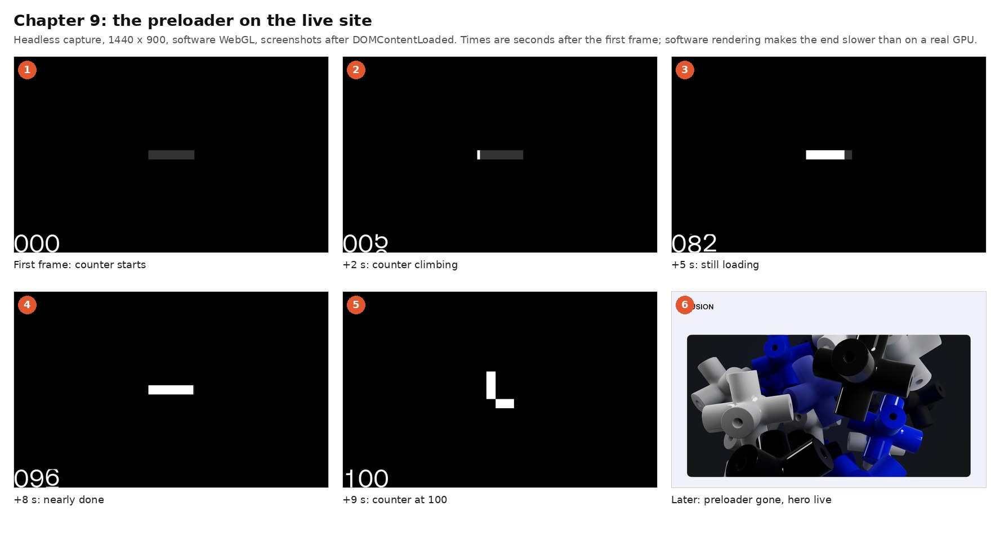
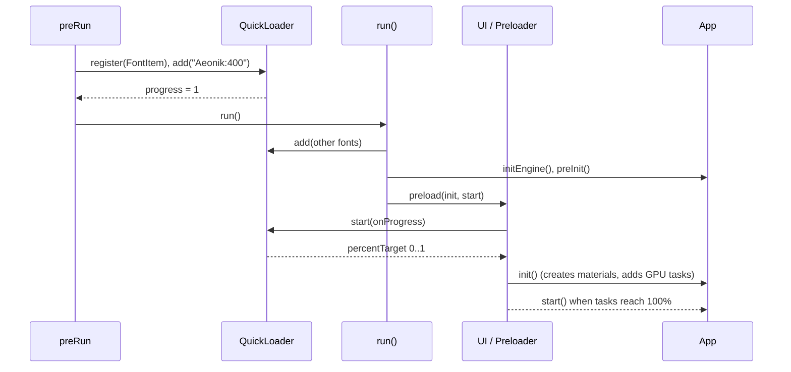
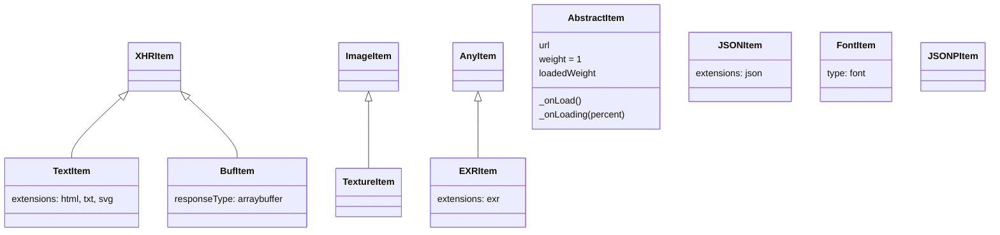
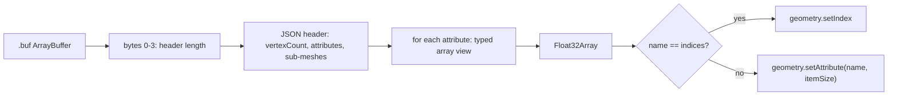
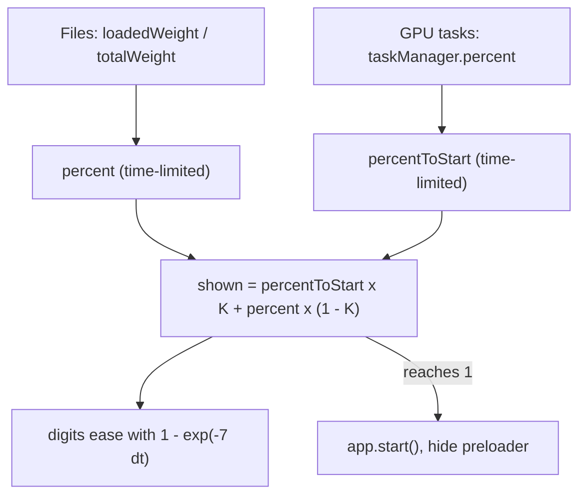

> **Read in Notion:** [9. Assets and loading](https://shifatmasud.notion.site/3fd48559569d81b397c9f275470e9b7a) · Part of [Lusion.co Decoded: Frontend Handbook](https://shifatmasud.notion.site/3fd48559569d81dd80b4c7407caf27cc) · [Repo home](https://github.com/shifatmasud/lusion-decoded)

# 9. Assets and loading


*Assets flow: one loader, many item types, weighted progress, then GPU warm-up before the site starts.*

## The idea in one sentence

Lusion loads everything (fonts, HTML, textures, HDR images, custom binary meshes) through **one small loader with pluggable item types**, adds shader compilation as extra "tasks", and drives the preloader counter from both, so the site only starts when the GPU is actually warm.

## 9.1 Boot order: fonts first, then the rest

The entry point (module `preRun`) does the absolute minimum before anything else: register the font item type, load one weight of the brand font, and only then run the app.

```javascript
// 141_preRun.js (lightly formatted)
function preRun() {
  for (const [o, e] of Object.entries(settings.CROSS_ORIGINS)) properties.loader.setCrossOrigin(o, e);
  routeManager.init(),
  properties.loader.register(FontItem),
  properties.loader.add("Aeonik:400", { type: "font" }),
  properties.loader.start((o) => { o === 1 && run(); });
}
```

What it does: `start()` reports progress from 0 to 1; when it reaches 1 the first font is ready and `run()` begins. Inside `run()` the remaining fonts are queued, then the engine, input, scroll, pages and UI are pre-initialised, and `ui.preload(init, start)` takes over:

```javascript
properties.loader.add("Aeonik:500,Aeonik:400:italic,IBMPlexMono:400,IBMPlexMono:500,LusionMono:400", { type: "font" }),
app.initEngine(), input.preInit(), scrollManager.init(), pagesManager.preInit(), ui.preInit(), app.preInit(),
...
ui.preload(init, start);
```

The same sequence as seen on the live site, from first paint to the hero:



*The three-digit preloader counter (#preloader-percent-digits) climbing to 100 on [lusion.co](http://lusion.co), then giving way to the hero.*

Why: the preloader digits use the brand font. Loading one weight first means the very first thing the visitor sees is already in the right typeface, with no flash of fallback text.



## 9.2 QuickLoader: a registry of item types

`QuickLoader` (module 004) keeps a map from a type name to an item class. Each item class declares which file extensions it handles, so the loader can guess the type from the URL.

```javascript
// 004_QuickLoader.js (fragments)
ITEM_CLASSES[o.type] || (ITEM_CLASS_LIST.push(o), (ITEM_CLASSES[o.type] = o));        // register()
this.itemUrls[o] || ((this.itemUrls[o] = t), this.itemList.push(t), (this.totalWeight += t.weight)); // add()
return new ITEM_CLASSES[e](o, t);                                                       // create item by type
for (var t = _getExtension(o), r = e.extensions, n = r.length; n--;) if (t === r[n]) return !0; // match by extension
```

What each line does:

- `register()` adds an item class once, keyed by its `type`.
- `add()` de-duplicates by URL (`itemUrls`) and adds the item's `weight` to a running total.
- The factory creates the right class for the type.
- If no type is given, the loader compares the URL's extension with each class's `extensions` list.

It also keeps a `crossOriginMap`: if a URL starts with a registered origin, the item gets that `crossOrigin` setting automatically. This is how assets from another host can be used as WebGL textures without CORS errors (see 9.5).

The item classes the bundle defines (only the parent links marked in the code are drawn):



## 9.3 Weighted progress

Every item has `weight = 1` by default and a `loadedWeight` that grows as it downloads:

```javascript
// AbstractItem
this.url = o; this.loadedWeight = 0; this.weight = 1; this.postPercent = 0;
...
function _onLoading(o) { this.loadedWeight = this.weight * this.getCombinedPercent(o); }
```

The loader then reports `loadedWeight / totalWeight` to whoever called `start()`:

```javascript
this._onLoading(o, e, a, 1, this.loadedWeight / this.totalWeight)
```

So a big file can be given a bigger weight and count more on the progress bar. `postPercent` leaves room for work done after download (for example, decoding), which is folded in by `getCombinedPercent`.

What the loader actually fetched on the home page, as DevTools would show it:


*Network capture of the home page: 48 textures (about 6 MB), 20 .buf meshes (about 2 MB), 16 audio clips, 6 fonts, one 1.2 MB script, one EXR (matcap.exr) and a showreel video. Sizes are Content-Length; the waterfall shows the CSS and the script first, then fonts, then the burst of audio, textures and meshes.*

## 9.4 Custom binary meshes: BufItem

The 3D models are not glTF. `BufItem` loads a `.buf` file as an `ArrayBuffer` with its own simple layout: a 4-byte header length, a JSON header, then raw attribute data.

```javascript
// 128_BufItem.js (fragments)
class BufItem extends XHRItem {
  constructor(e, t) { super(e, { ...t, responseType: "arraybuffer" }); }
  ...
  let t = new Uint32Array(e, 0, 1)[0],                                   // header length in bytes
      r = JSON.parse(String.fromCharCode.apply(null, new Uint8Array(e, 4, t))), // JSON header
      n = r.vertexCount,
      u = r.attributes;
  ...
  I = new Float32Array(b * C);
  S === "indices" ? c.setIndex(new BufferAttribute(I, 1)) : c.setAttribute(S, new BufferAttribute(I, C));
```

What it does: it reads the header to learn the vertex count and the list of attributes, then turns each block of bytes into a Three.js `BufferAttribute`. The header can also describe several sub-meshes in one file (when a sub-mesh has `vertexCount == 0`, an empty `Object3D` is used as a group node).

Why it matters: there is no glTF parser, no scene graph to walk, almost no decode cost. The file is exactly what the GPU needs.



## 9.5 Textures, HDR images and asset hosts

`TextureItem` wraps an image in a Three.js `Texture` and sets sensible defaults, including maximum anisotropy and `flipY` unless the caller overrides them:

```javascript
// 132_TextureItem.js (fragments)
let r = t.content || new Texture(new Image());
...
r.anisotropy = t.anisotropy || properties.renderer.capabilities.getMaxAnisotropy();
r.flipY = t.flipY === void 0 ? !0 : t.flipY;
```

`EXRItem` hands `.exr` files (high dynamic range images) to Three's `EXRLoader`:

```javascript
// 131_EXRItem.js
this.EXRLoader.load(this.url, this._onLoad.bind(this), this._onGLTFLoading.bind(this));
EXRItem.extensions = ["exr"];
```

`preRun` registers every entry of `settings.CROSS_ORIGINS` with the loader before anything loads. In the captured build that map has one entry, and every setting ending in `_PATH` can be prefixed with a CDN path:

```javascript
// 003_Settings.js (fragments)
CDN_PATH = "";
MODEL_PATH = "/assets/models/";
TEXTURE_PATH = "/assets/textures/";
CROSS_ORIGINS = { "https://lusion.dev/": "anonymous" };
r.indexOf("_PATH") > -1 && ((this["LOCAL_" + r] = this[r]), (this[r] = CDN_PATH + this[r]));
```

So assets can move to another host by changing one value, and anything loaded from [lusion.dev](http://lusion.dev) automatically gets `crossOrigin = "anonymous"`, which WebGL needs to use an image from another origin as a texture.

## 9.6 Shader compilation counts as loading

This is the clever part. Downloading files is not the only slow step on a WebGL site; compiling shaders on the GPU is too. Lusion makes every material creation a *task* in a `TaskManager`:

```javascript
// 011_FboHelper.js (inside createRawShaderMaterial)
taskManager.add(t);
```

The preloader then mixes two progress values: file loading (`percent`) and task progress (`taskManager.percent`):

```javascript
// 137_Preloader.js (fragments)
properties.loader.start((r) => { this.percentTarget = r; });
...
this.percent = Math.min(this.percentTarget, this.percent + (...) / this.MIN_PRELOAD_DURATION);
...
Math.min(taskManager.percent, this.percentToStart + e / this.MIN_DURATION_BETWEEN_INIT_AND_START)
...
this.percentToStart * this.PERCENT_BETWEEN_INIT_AND_START + this.percent * (1 - this.PERCENT_BETWEEN_INIT_AND_START)
```

What it does:

- The displayed percentage can never run ahead of real progress (`Math.min(target, ...)`).
- It also can never move faster than a minimum duration, so the intro animation always has time to play.
- The last slice of the bar (`PERCENT_BETWEEN_INIT_AND_START`) is reserved for GPU tasks after `init()`.
- Each digit eases toward its value with `math.mix(l._easedVal, c, 1 - Math.exp(-7 * e))`, a frame-rate independent smoothing.



## 9.7 How to reuse this

- **One loader, typed items.** Make a base item with `load`, `weight`, `loadedWeight`, `onLoad`. Add item types (font, image, texture, json, binary mesh, hdr) by registering classes with an `extensions` list.
- **Weighted progress.** Give big files bigger weights so the bar feels honest.
- **Load the font your loader UI uses first**, before the main queue.
- **Treat GPU warm-up as loading.** Compile materials (or call `renderer.compile`) during the preloader and count it as tasks.
- **Clamp and smooth the number.** Never show more than is real, and never animate faster than your intro needs.
- **Consider a custom binary mesh format** when you control the export pipeline and need instant decode.

## 9.8 Original example (not Lusion's code)

```typescript
type Item = { url: string; weight: number; loaded: number; load(onP: (p: number) => void): Promise<unknown> };

const types = new Map<string, (url: string) => Item>();
export const registerType = (ext: string, make: (url: string) => Item) => types.set(ext, make);

export async function loadAll(urls: string[], tasks: Array<() => Promise<void>>, onProgress: (p: number) => void) {
  const items = urls.map((u) => types.get(u.split('.').pop()!)!(u));
  const fileTotal = items.reduce((s, i) => s + i.weight, 0);
  let filePct = 0, taskPct = 0;
  const K = 0.2; // last 20% of the bar is GPU warm-up
  const report = () => onProgress(filePct * (1 - K) + taskPct * K);

  await Promise.all(items.map((i) => i.load((p) => {
    i.loaded = i.weight * p;
    filePct = items.reduce((s, x) => s + x.loaded, 0) / fileTotal;
    report();
  })));

  for (let n = 0; n < tasks.length; n++) {
    await tasks[n]();                       // e.g. renderer.compile(scene, camera)
    taskPct = (n + 1) / tasks.length;
    report();
    await new Promise(requestAnimationFrame); // spread work over frames
  }
}
```

## 9.9 Confirmed vs inferred

| Point | Status | Evidence |
|---|---|---|
| Fonts load first, then run() queues the rest | Confirmed | 141\_preRun.js |
| Loader picks item class by type or file extension; de-duplicates by URL | Confirmed | 004\_QuickLoader.js |
| Progress is loadedWeight / totalWeight, default weight 1 | Confirmed | 004\_QuickLoader.js |
| .buf = 4-byte length + JSON header + raw attribute arrays | Confirmed | 128\_BufItem.js |
| Textures default to max anisotropy and flipY true | Confirmed | 132\_TextureItem.js |
| [lusion.dev](http://lusion.dev) is the one registered cross-origin host; CDN\_PATH empty in this build | Confirmed | 003\_Settings.js |
| Material creation is added to the TaskManager | Confirmed | 011\_FboHelper.js |
| Preloader blends file progress with task progress and enforces minimum durations | Confirmed | 137\_Preloader.js |
| The .buf files are exported by an in-house tool from their 3D software | Inferred | Format is custom; exporter not visible client-side |
| The main reason for the task step is avoiding first-frame shader stutter | Inferred | Common WebGL practice; intent not stated in code |
| EXR files are used for lighting / environment maps | Inferred | Typical use of HDR images; the scenes that use them are not traced here |
