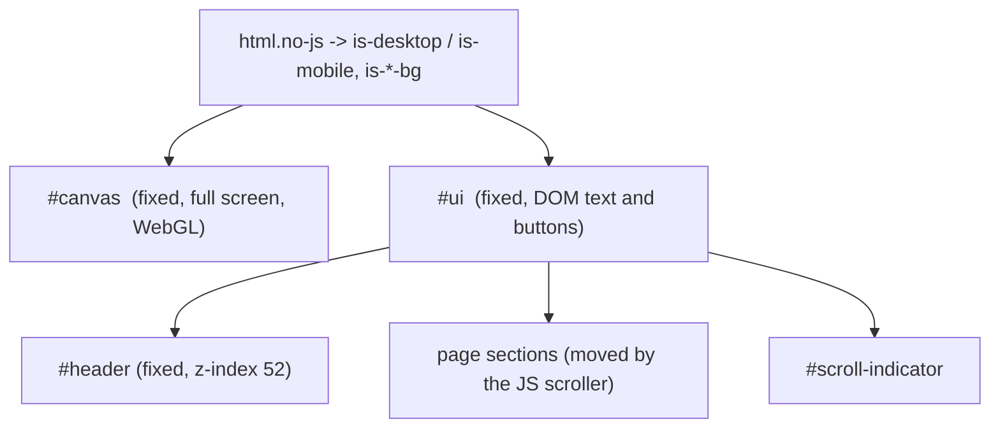
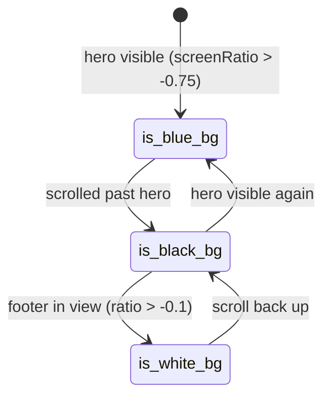
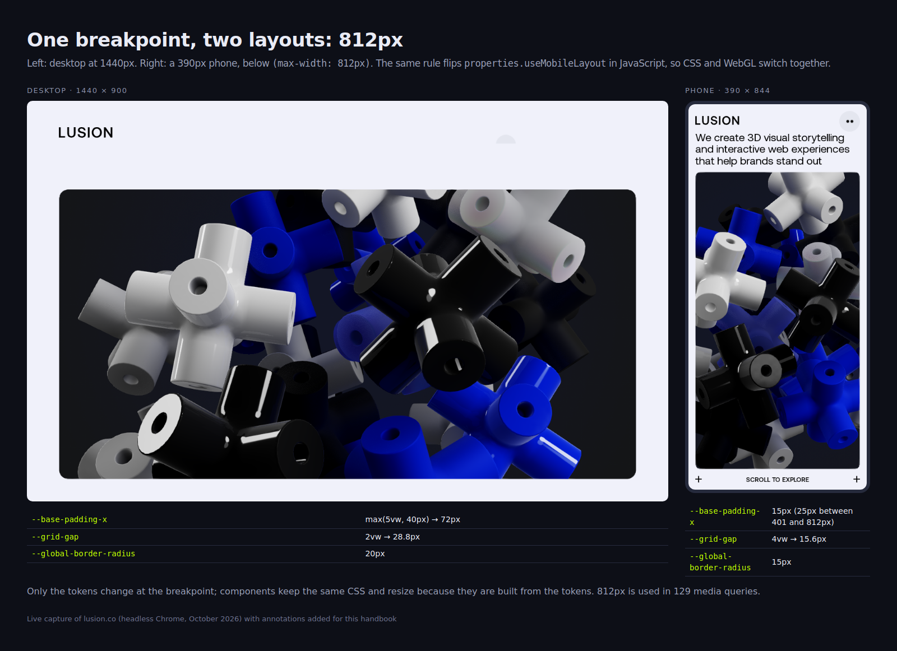
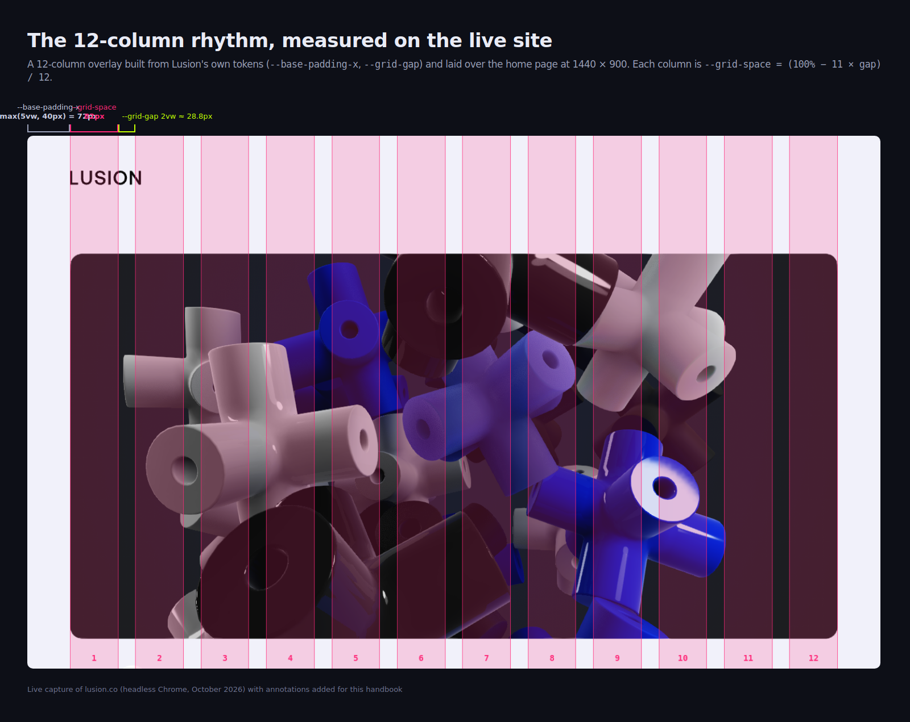
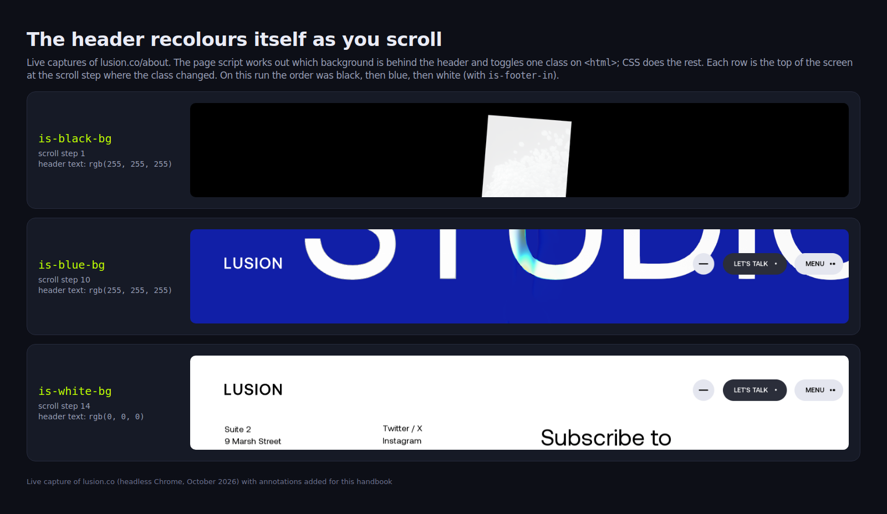
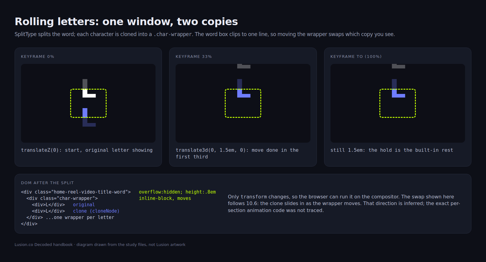

> **Read in Notion:** [10. CSS, layout and DOM state](https://shifatmasud.notion.site/3fd48559569d81289d5ff6769e1f1d55) · Part of [Lusion.co Decoded](https://shifatmasud.notion.site/Lusion-co-Decoded-Client-Side-Handbook-3fd48559569d81dd80b4c7407caf27cc) · [Repo home](https://github.com/shifatmasud/lusion-decoded)

# 10. CSS, layout and DOM state

## The idea in one sentence
The CSS is deliberately plain: **one fixed full-screen canvas behind one fixed UI layer**, a small set of design tokens in `:root`, fluid sizes with `clamp()` and `vw`, and JavaScript that only flips **state classes** and one CSS variable. All the heavy visuals stay in WebGL.
## 10.1 The page shell
The HTML is an Astro build (`/_astro/about.CNa9RfUh.css`, one stylesheet). The document starts as `<html lang="en" class="no-js">`, and the body order is `#canvas`, then `#ui`, then `#header` and the rest of the interface.
```css
/* about.css: the canvas layer */
#canvas {
  position: fixed; top: 0; left: 0; width: 100%; height: 100%;
  margin: 0; padding: 0; border: 0; overflow: hidden;
  overscroll-behavior: none;
  touch-action: none;
}
#canvas { pointer-events: auto; display: none; }
.is-ready #canvas { display: block; }

#ui { position: fixed; width: 100%; color: var(--color-black); user-select: none; /* + vendor prefixes */ }
```
What it does: the WebGL canvas covers the viewport and never scrolls itself (`overscroll-behavior: none`, `touch-action: none`), because scrolling is simulated in JavaScript (chapter 5). It stays hidden until the UI adds `is-ready`, so the visitor never sees an empty or half-drawn canvas.
```javascript
// 139_UI.js
classList.add("is-ready")
```

## 10.2 Design tokens in :root
```css
:root {
  --color-error: #e90000;
  --color-off-white: #f0f1fa;
  --color-white: #fff;
  --color-dark-white: #e4e6ef;
  --color-off-white-semi: rgba(240, 241, 250, 0.7);
  --color-black: #000000;
  --color-green: #c1ff00;
  --color-blue: #1a2ffb;
  --color-red: #ff4c41;
  --color-grey-blue: #2b2e3a;
  --color-dark-blue: #071bdf;
  --color-purple: #8832f7;
  --grid-space: calc((100% - 11 * var(--grid-gap)) / 12);
  --grid-gap: 2vw;
  --global-border-radius: 20px;
  --base-padding-x: max(5vw, 40px);
  --base-padding-y: clamp(30px, 4vw, 50px);
  --header-color: #0016ec;
  --header-text-color: #000000;
  ...
}
```
What stands out:
- **A 12-column grid as one variable.** `--grid-space` is the width of one column: the full width minus 11 gaps, divided by 12. Elements are sized as multiples of `--grid-space` and `--grid-gap` instead of using CSS Grid everywhere.
- **Fluid spacing with floors and ceilings.** `max(5vw, 40px)` and `clamp(30px, 4vw, 50px)` scale with the screen but never get too small or too big.
- **Responsive design changes tokens, not components.** Breakpoints mostly override the variables:
```css
@media (max-width: 812px) { :root { --grid-gap: 4vw; --global-border-radius: 15px; } }
@media (min-aspect-ratio: 21/9) { :root { --base-padding-x: max(6vw, 60px); } }
@media (max-width: 812px) { :root { --base-padding-x: 25px; --base-padding-y: 25px; } }
@media (max-width: 400px) { :root { --base-padding-x: 15px; --base-padding-y: 15px; } }
```
## 10.3 Breakpoints
Counting the `@media` rules in the stylesheet:
<table header-row="true">
<tr>
<td>Query</td>
<td>Times used</td>
<td>Meaning</td>
</tr>
<tr>
<td>(max-width: 812px)</td>
<td>129</td>
<td>The main mobile layout switch</td>
</tr>
<tr>
<td>(min-aspect-ratio: 21/9)</td>
<td>31</td>
<td>Ultra-wide screens get extra side padding and adjusted sizes</td>
</tr>
<tr>
<td>(hover: hover)</td>
<td>17</td>
<td>Hover styles only on devices that can hover</td>
</tr>
<tr>
<td>(max-width: 1000px)</td>
<td>16</td>
<td>Tablet / small laptop</td>
</tr>
<tr>
<td>(max-width: 560px)</td>
<td>15</td>
<td>Small phones</td>
</tr>
<tr>
<td>(max-width: 380px)</td>
<td>7</td>
<td>Very small phones</td>
</tr>
<tr>
<td>(max-width: 480px)</td>
<td>6</td>
<td>Small phones</td>
</tr>
</table>
The 812px value matches the JavaScript: `properties.useMobileLayout = e <= settings.MOBILE_WIDTH` is recomputed on every resize, so CSS and WebGL switch layouts together.
**Hover only where hover exists:**
```css
@media (hover: hover) {
  #header-right-talk-btn:not(.--is-contact-active):hover {
    background: var(--header-color);
    color: var(--project-details-btn-text-hover);
  }
}
```
This avoids the "sticky hover" problem on phones, where a tapped button stays in its hover state.
## 10.4 The --vh fix and resize
Mobile browsers change the height of `100vh` as their toolbars show and hide. Lusion measures the real height in JavaScript and writes it into a CSS variable:
```javascript
// 141_preRun.js (_onResize)
document.documentElement.style.setProperty("--vh", t * 0.01 + "px");
```
```css
#end-section-outer { position: absolute; width: 100%; height: calc(var(--vh, 1vh) * 100); }
#scroll-indicator { position: fixed; height: calc(var(--vh, 1vh) * 20); top: calc(var(--vh, 1vh) * 40); }
```
The `1vh` fallback keeps the layout working before JavaScript runs. The same resize function also limits the WebGL resolution: device pixel ratio is capped at 1.5 (`DPR = Math.min(1.5, devicePixelRatio)`), and if width x height x DPR is above `MAX_PIXEL_COUNT = 2560 * 1440`, the drawing size is scaled down while keeping the aspect ratio.
```javascript
if (settings.USE_PIXEL_LIMIT === !0 && r * n > settings.MAX_PIXEL_COUNT) {
  let a = r / n;
  n = Math.sqrt(settings.MAX_PIXEL_COUNT / a), r = Math.ceil(n * a), n = Math.ceil(n);
}
```
## 10.5 State lives in classes
JavaScript never writes inline styles for layout state. It toggles classes, and CSS reacts. The classes found in the code:
<table header-row="true">
<tr>
<td>Class</td>
<td>Set by</td>
<td>Purpose</td>
</tr>
<tr>
<td>no-js (removed)</td>
<td>141_preRun.js</td>
<td>Shows JS-only UI once scripts run</td>
</tr>
<tr>
<td>is-mobile / is-desktop</td>
<td>141_preRun.js</td>
<td>Device type on html</td>
</tr>
<tr>
<td>not-supported not-supported--browser</td>
<td>141_preRun.js</td>
<td>Fallback screen for unsupported browsers</td>
</tr>
<tr>
<td>is-ready</td>
<td>139_UI.js</td>
<td>Reveals the canvas after loading</td>
</tr>
<tr>
<td>is-white-bg / is-black-bg / is-blue-bg</td>
<td>107_AboutPage.js, 110_ProjectsPage.js</td>
<td>Which background colour is behind the UI right now</td>
</tr>
<tr>
<td>is-project-view</td>
<td>036_VideoOverlay.js</td>
<td>Video overlay open</td>
</tr>
<tr>
<td>--opened</td>
<td>069_Header.js</td>
<td>Menu open</td>
</tr>
<tr>
<td>--is-active, --active, --hover</td>
<td>037_HomeReelSection.js, 112_PlaygroundPage.js</td>
<td>Component states</td>
</tr>
</table>
Notice the naming: **page-level states start with `is-`** and live on `<html>`; **component modifiers start with `--`** and live on the element itself (for example `#header-background.--opened`).
The background classes are the most interesting. The page works out from scroll position which colour is behind the header, then toggles one class:
```javascript
// 107_AboutPage.js (fragment)
a.screenRatio > -0.75 ? ((n = !0), (r = !1)) : ((n = !1), (r = !0)),
footerSection.getDomRange().ratio > -0.1 && ((t = !0), (r = !1), (n = !1)),
document.documentElement.classList.toggle("is-black-bg", r),
document.documentElement.classList.toggle("is-white-bg", t),
document.documentElement.classList.toggle("is-blue-bg", n);
```
```css
html.is-white-bg #end-section { color: var(--color-black); }
html.is-black-bg #scroll-indicator,
html.is-blue-bg #scroll-indicator { background-color: #ffffff1a; }
```
So the header, scroll bar and text recolour themselves automatically as you scroll from a dark 3D section into a white footer, with no per-element JavaScript.

## 10.6 Type and text animation
**Fonts** are self-hosted with `font-display: block`, so text waits for the brand font instead of flashing a fallback (matching the font-first loading in chapter 9):
```css
@font-face {
  font-family: Aeonik;
  src: url(/assets/fonts/Aeonik-Regular.woff2) format("woff2"), url(/assets/fonts/Aeonik-Regular.woff) format("woff");
  font-weight: 400; font-style: normal; font-display: block;
}
```
**Sizing in em.** The header sets one fluid font size, `font-size: clamp(1rem, 1vw, 1.5rem)`, and children are sized in `em` (for example `#header-logo svg { width: 7.5em; }`). Changing one number scales the whole component.
**Rolling letters.** Text is split into characters with the SplitType library. Each character is cloned, and the original and the clone are put in a `.char-wrapper`:
```javascript
// 115_EndSection.js (fragment)
r = new SplitType(t, { types: "chars" });
for (let n = 0; n < t._chars.length; n++) {
  let a = t._chars[n], l = a.cloneNode(!0), c = document.createElement("div");
  c.classList.add("char-wrapper"), c.style.display = "inline-block",
  a._wrapper = c, c.append(a), c.append(l), t.append(c);
}
```
```css
.home-reel-video-title-word { position: relative; overflow: hidden; display: flex !important; height: 0.8em; will-change: transform; }
.home-reel-video-title-word .char-wrapper { position: relative; top: -0.15em; width: 0.6em; }
```
The word box clips to one line (`overflow: hidden`), so moving the wrapper up shows the clone sliding in from below: the classic "rolling letter" hover. The keyframes follow the same idea with a pause built in:
```css
@keyframes text-animation {
  0%  { transform: translateZ(0); }
  33% { transform: translate3d(0, 1.5em, 0); }
  to  { transform: translate3d(0, 1.5em, 0); }
}
```
The move happens in the first third, then it holds, so a looping animation gets a natural rest between rolls.
## 10.7 Motion details
- One easing curve repeats across transitions: `cubic-bezier(0.4, 0, 0.1, 1)` (fast start, long soft landing).
- `will-change: transform` is set only on the parts that actually move (`#header-right`, the menu link groups, rolling words).
- Movement uses `translate3d` / `translateZ(0)` so it runs on the compositor.
- The base layer is `modern-normalize v2.0.0`.
## 10.8 How to reuse this
- **Two fixed layers:** canvas behind, DOM UI in front; hide the canvas until the first good frame.
- **Tokens first:** colours, grid gap, padding and radius in `:root`; breakpoints override tokens.
- **`--grid-space` for a 12-column rhythm** without forcing CSS Grid onto every block.
- **Fluid but bounded sizes** with `clamp()` and `max()`.
- **`--vh` from JavaScript** with a `1vh` fallback.
- **State classes, not inline styles:** `is-*` on html for page state, `--*` on elements for component state.
- **Hover inside `@media (hover: hover)`.**
- **Clone-and-clip** for rolling text.
## 10.9 Original example (not Lusion's code)
```css
:root {
  --gap: 2vw;
  --col: calc((100% - 11 * var(--gap)) / 12);
  --pad-x: max(5vw, 40px);
  --ease: cubic-bezier(0.4, 0, 0.1, 1);
}
@media (max-width: 812px) { :root { --gap: 4vw; --pad-x: 24px; } }

.stage  { position: fixed; inset: 0; display: none; touch-action: none; }
html.is-ready .stage { display: block; }
.screen { height: calc(var(--vh, 1vh) * 100); }

html.is-dark-bg .header { color: #fff; }

.roll { display: inline-flex; overflow: hidden; height: 1em; }
.roll > span { display: flex; flex-direction: column; transition: transform .5s var(--ease); }
@media (hover: hover) { .roll:hover > span { transform: translateY(-1em); } }
```
```typescript
const setVh = () => document.documentElement.style.setProperty('--vh', `${innerHeight * 0.01}px`);
addEventListener('resize', setVh); setVh();

// each letter: <span><i>a</i><i>a</i></span>
export function rollify(el: HTMLElement) {
  el.classList.add('roll');
  el.innerHTML = [...el.textContent!].map(c => `<span><i>${c}</i><i>${c}</i></span>`).join('');
}
```
## 10.10 Confirmed vs inferred
<table header-row="true">
<tr>
<td>Point</td>
<td>Status</td>
<td>Evidence</td>
</tr>
<tr>
<td>Fixed full-screen #canvas, hidden until .is-ready</td>
<td>Confirmed</td>
<td>about.css, 139_UI.js</td>
</tr>
<tr>
<td>:root tokens and the --grid-space formula</td>
<td>Confirmed</td>
<td>about.css</td>
</tr>
<tr>
<td>Breakpoint counts (812px used 129 times, etc.)</td>
<td>Confirmed</td>
<td>Counted in about.css</td>
</tr>
<tr>
<td>--vh written on resize; DPR capped at 1.5; pixel limit 2560x1440</td>
<td>Confirmed</td>
<td>141_preRun.js, 003_Settings.js</td>
</tr>
<tr>
<td>is-white/black/blue-bg toggled from scroll position</td>
<td>Confirmed</td>
<td>107_AboutPage.js, 110_ProjectsPage.js</td>
</tr>
<tr>
<td>SplitType + cloned characters in .char-wrapper</td>
<td>Confirmed</td>
<td>115_EndSection.js, 037_HomeReelSection.js</td>
</tr>
<tr>
<td>font-display: block for self-hosted Aeonik</td>
<td>Confirmed</td>
<td>about.css</td>
</tr>
<tr>
<td>The 812px CSS breakpoint equals `settings.MOBILE_WIDTH`</td>
<td>Confirmed</td>
<td>003_Settings.js sets `MOBILE_WIDTH = 812` (quoted in chapter 2)</td>
</tr>
<tr>
<td>The clone slides in from below on hover</td>
<td>Inferred</td>
<td>Structure and CSS fit this; the exact JS animation per section was not traced</td>
</tr>
<tr>
<td>The other pages share the same stylesheet</td>
<td>Inferred</td>
<td>Only the About page stylesheet was decoded in full</td>
</tr>
</table>


## Figures

These figures were added to the Notion page after this Markdown was written. In Notion each one sits next to the section it explains, with its caption.








