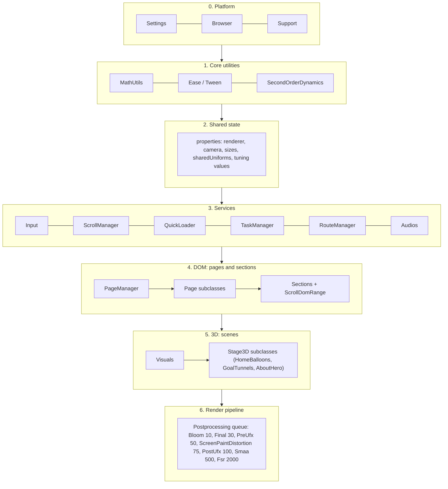
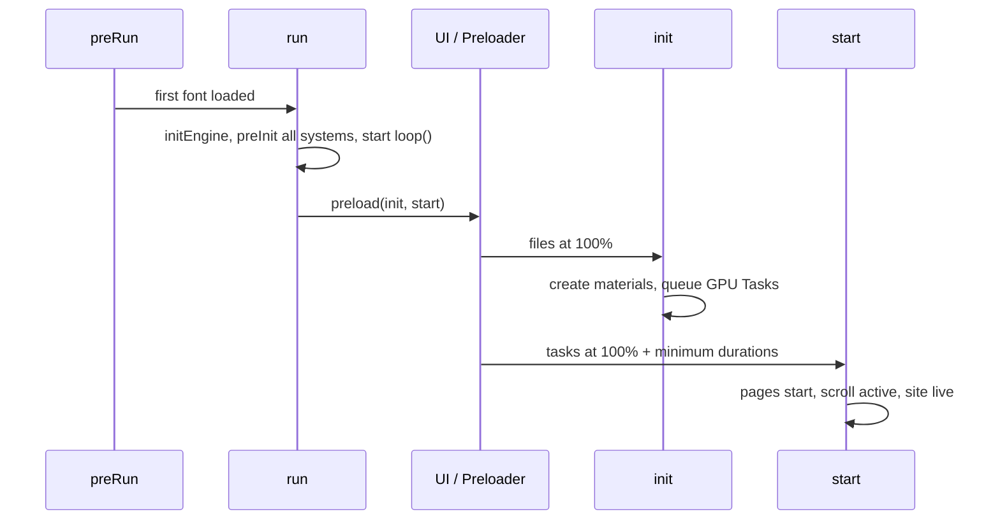
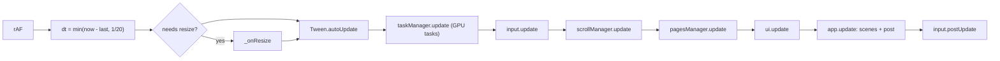
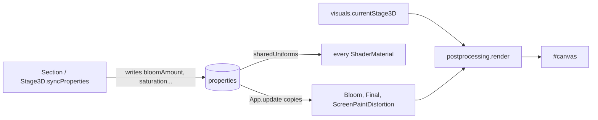
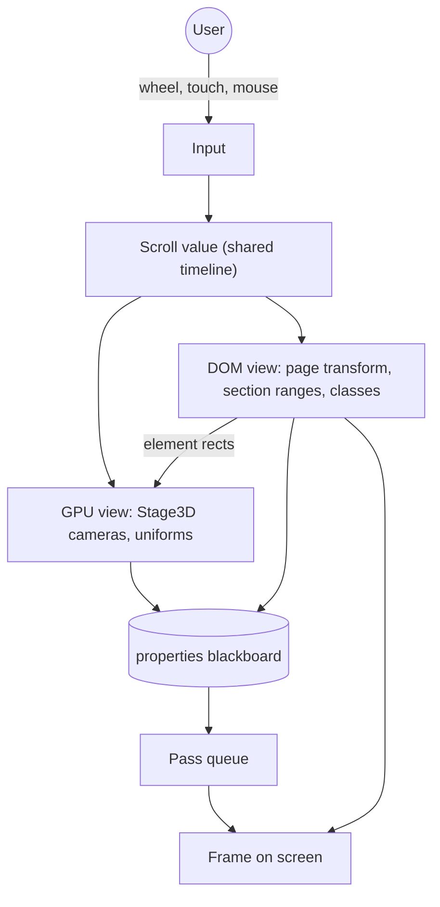

> **Read in Notion:** [11. System architecture plan and conceptual model](https://shifatmasud.notion.site/3fd48559569d81c1b174e921471bcaf6) · Part of [Lusion.co Decoded: Frontend Handbook](https://shifatmasud.notion.site/3fd48559569d81dd80b4c7407caf27cc) · [Repo home](https://github.com/shifatmasud/lusion-decoded)

# 11. System architecture plan and conceptual model


*The whole machine on one sheet: input and scroll feed state, state drives pages and 3D scenes, and one ordered pass queue turns the scene into the final frame.*

## The idea in one sentence

Lusion is **one clock, one state bag, one lifecycle contract, and one render queue**: a single `requestAnimationFrame` loop ticks every system in a fixed order, every system shares the same `preInit / init / start / resize / update` shape, all tuning lives in `properties`, and the frame ends with the current 3D stage pushed through a sorted list of full-screen passes.

This chapter pulls chapters 1 to 10 together into a blueprint you can rebuild in your own projects.


*Architecture poster: the seven layers with their modules and rules, the properties blackboard, the per-frame update order, the three boot phases and the two-views model on one sheet.*

## 11.1 The layers



| Layer | Job | Lusion modules | Rule |
|---|---|---|---|
| 0. Platform | Know the device before anything runs | Settings, Browser, Support | Read-only after boot |
| 1. Core utilities | Pure maths and motion | MathUtils, Ease, Tween, SecondOrderDynamics, Simple1DNoise | No DOM, no WebGL, no state |
| 2. Shared state | One place for every value systems share | Properties | Systems read and write it; nobody owns it |
| 3. Services | Input, scroll, loading, GPU tasks, routing, audio | Input, ScrollPane/ScrollManager, QuickLoader, TaskManager, RouteManager, Audios | Singletons, ticked by the loop |
| 4. DOM | Real HTML pages and sections, the layout source of truth | PageManager, Page, \*Section, Header, UI | Layout lives in CSS; JS only toggles classes and transforms |
| 5. 3D | Scenes that mirror what the DOM says is on screen | Visuals, Stage3D, HomeBalloons, GoalTunnels, AboutHero | One active stage renders per frame |
| 6. Render pipeline | Turn the stage into the final image | Postprocessing, PostEffect subclasses, FboHelper | Passes sorted by a number; each can switch off |

## 11.2 Boot: three phases

The entry code has three named phases: `run` (build everything), `init` (create content once files are in), `start` (go live once the GPU is warm).

```javascript
// 141_preRun.js (prettified)
function run() {
  // ...sizes...
  properties.loader.add("Aeonik:500,Aeonik:400:italic,IBMPlexMono:400,IBMPlexMono:500,LusionMono:400", { type: "font" }),
  app.initEngine(), input.preInit(), scrollManager.init(), pagesManager.preInit(), ui.preInit(), app.preInit(),
  window.addEventListener("resize", onResize), _onResize(), loop(),
  ui.preload(init, start);
}
function init() {
  input.init(), pagesManager.init(), ui.init(), app.init(), (properties.hasInitialized = !0);
}
function start() {
  ui.start(), pagesManager.start(), app.start(), (properties.hasStarted = !0), _onResize(!0),
  (scrollManager.isActive = !0);
}
```

What it shows: the loop starts **before** loading finishes (`loop()` is called inside `run`), so the preloader is animated by the same clock as the site. `ui.preload(init, start)` hands the two later phases to the preloader, which calls them when files and then GPU tasks reach 100% (chapter 9).



## 11.3 The frame loop

One function owns `requestAnimationFrame`. Every other system is ticked from it, in a fixed order.

```javascript
// 141_preRun.js (prettified)
function loop() {
  window.requestAnimationFrame(loop);
  let o = performance.now(), e = (o - dateTime) / 1e3;
  (dateTime = o), (e = Math.min(e, 1 / 20)),
  _needsResize && _onResize(),
  properties.hasStarted && (properties.startTime += e),
  Tween.autoUpdate(e), update(e), (_needsResize = !1);
}
function update(o) {
  taskManager.update(), properties.reset(), app.preUpdate(o),
  input.update(o), scrollManager.update(o), pagesManager.update(o),
  ui.update(o), app.update(o), input.postUpdate(o);
}
```

What it does: delta time is capped at 1/20 s, so a frozen tab does not make springs explode. Resize is deferred to the next frame (`_needsResize`). The order is **input, then scroll, then pages (DOM), then UI, then the engine**, so the 3D frame always uses this frame's scroll and DOM positions. `input.postUpdate` runs last to clear per-frame deltas.



## 11.4 Inside app.update: sync, simulate, render

```javascript
// 136_App.js App.update (prettified, trimmed)
properties.time = properties.sharedUniforms.u_time.value += e,
properties.deltaTime = properties.sharedUniforms.u_deltaTime.value = e,
visuals.syncProperties(e), blueNoise.update(e), screenPaint.update(e),
cameraControls.update(e), visuals.update(e), audios.update(e),
(properties.bloom.amount = properties.bloomAmount),
(properties.final.saturation = properties.saturation),
(screenPaint.maxRadius = Math.max(40, properties.viewportWidth / 20)),
// ...about 40 more property -> effect assignments...
transitionOverlay.activeRatio < 1 &&
  properties.postprocessing.render(visuals.currentStage3D, properties.camera, !0);
```

Three ideas are hiding here:

- **Shared uniforms.** `u_time`, `u_deltaTime`, `u_resolution` and friends are single objects that every material references, so updating one value updates every shader.
- **Property-bag tuning.** Scenes write the look they want (`bloomAmount`, `saturation`, `vignetteFrom`) into `properties`; `App.update` copies those values into the effects every frame. Scenes never talk to effects directly, so a section can change the grade of the whole site by setting numbers.
- **Skip work you cannot see.** When the transition overlay fully covers the screen (`activeRatio` is 1), the whole 3D render is skipped.



## 11.5 The engine is assembled in one place

`App.initEngine` builds the renderer and pushes every pass into the queue. Reading this one method tells you the whole render architecture.

```javascript
// 136_App.js App.initEngine (prettified, trimmed)
properties.loader.register(BufItem), properties.loader.register(EXRItem),
properties.loader.register(TextureItem), properties.loader.register(ThreeLoaderItem),
properties.renderer = new WebGLRenderer({ canvas: properties.canvas, context: properties.gl, premultipliedAlpha: !1 }),
properties.scene = new Scene(), properties.camera = new PerspectiveCamera(45, 1, 0.1, 200),
fboHelper.init(properties.renderer, settings.RENDER_TARGET_FLOAT_TYPE),
properties.postprocessing = new Postprocessing(), properties.postprocessing.init(),
properties.smaa = new Smaa(), properties.postprocessing.queue.push(properties.smaa);
let e = !browser$1.isMobile || settings.USE_HD;
properties.bloom = new Bloom(), properties.bloom.init({ USE_CONVOLUTION: e, USE_HD: e }),
properties.postprocessing.queue.push(properties.bloom),
// ScreenPaintDistortion, Final, Fsr (only if settings.UP_SCALE > 1), preUfx, postUfx follow
```

The runtime probe (chapter 12) confirms the result on the home page: one **WebGL2** context on `#canvas` with `antialias: false, alpha: false, powerPreference: "high-performance"`, 48 linked programs, 84 textures, 22 framebuffers, and about 14 to 16 draw calls per frame once the hero is idle. Anti-aliasing is off in the context because SMAA does it as a pass.

## 11.6 Resize and the resolution budget

```javascript
// 141_preRun.js _onResize (prettified, trimmed)
properties.useMobileLayout = e <= settings.MOBILE_WIDTH,
document.documentElement.style.setProperty("--vh", t * 0.01 + "px");
let r = e * settings.DPR, n = t * settings.DPR;
if (settings.USE_PIXEL_LIMIT === !0 && r * n > settings.MAX_PIXEL_COUNT) {
  let a = r / n; n = Math.sqrt(settings.MAX_PIXEL_COUNT / a); r = Math.ceil(n * a); n = Math.ceil(n);
}
// ...scrollManager, pagesManager, ui resize...
app.resize(Math.ceil(r * properties.upscalerAmount), Math.ceil(n * properties.upscalerAmount));
```

What it does: the canvas size is a **pixel budget**, not just width times DPR. If the device pixel count goes over `MAX_PIXEL_COUNT`, the size is scaled down keeping the aspect ratio, and an optional upscaler (FSR, priority 2000, the last pass) can render smaller and sharpen back up. One resize also sets the CSS `--vh` variable and the mobile layout flag for every system.


*Pixel budget: DPR is capped at 1.5 and the drawing size at 2560 × 1440, so a 4K screen asking for 8.3 million pixels draws about 3.7 million, roughly 44%.*

## 11.7 The conceptual model

Think of the site as **two synchronized views of the same document**.

- The **DOM view** is the truth for content, layout, accessibility and SEO. Real HTML pages, real links, CSS grid and variables.
- The **GPU view** is a mirror that reads positions from the DOM view (through scroll ranges) and adds what HTML cannot do: physics, light, distortion.
- **Scroll is the shared timeline.** One custom scroll value drives both views in the same frame.
- **State is a blackboard.** Systems post values to `properties`; others read them. No event soup between scenes and effects.
- **Time is owned once.** A single loop and a capped delta time give every system the same clock.



## 11.8 Patterns to carry into your projects

| Pattern | Where in Lusion | Why it works |
|---|---|---|
| Lifecycle contract: preInit, init, start, resize, update | App, UI, Page, Stage3D, every Section | Any module can be added without new wiring; boot and resize are predictable |
| Single rAF owner with capped dt | loop() in preRun | One clock, fixed update order, no runaway springs |
| Blackboard state | Properties + sharedUniforms | Decouples scenes from effects; values are easy to tune or expose in a debug panel |
| DOM as layout source, WebGL as mirror | ScrollDomRange, UfxMesh | Responsive layout stays in CSS; 3D follows |
| Ordered pass queue with priorities | Postprocessing + PostEffect | Effects can be added, skipped or reordered by number |
| Time-sliced GPU warm-up | Task, TaskManager | No shader-compile stutter after the preloader |
| Pixel budget + upscaler | \_onResize, Fsr | Stable frame rate on high-DPR screens |
| Prefetching custom router | RouteManager, PageManager | Page switches feel instant and can be animated in WebGL |

## 11.9 Blueprint for your own baseline

A folder layout that maps one-to-one onto the layers:

```
src/
  platform/   settings.ts  device.ts  support.ts
  core/       math.ts  ease.ts  tween.ts  spring.ts
  state/      props.ts            (blackboard + shared uniforms)
  services/   input.ts  scroll.ts  loader.ts  tasks.ts  router.ts  audio.ts
  dom/        pageManager.ts  pages/  sections/
  gl/         engine.ts  stage.ts  visuals.ts  fbo.ts  shaderChunks/
  post/       pipeline.ts  passes/ (bloom, grade, distortion, smaa, upscale)
  main.ts     boot: run -> init -> start, single loop
```

Build it in this order, so every step runs on its own:

1. **Clock and state.** main.ts with the loop, capped dt, deferred resize, and the props blackboard.
2. **Input and scroll.** One input service, one custom scroll that moves a single container with a transform.
3. **Pages and router.** Real HTML pages, a router that prefetches on hover, a page manager with hide, load, show steps.
4. **Engine and one Stage.** Renderer, camera, a Stage base class, Visuals that renders the current stage.
5. **Pass queue.** Start with grade (Final) and SMAA; add bloom and pointer distortion later.
6. **Loader and GPU tasks.** Weighted loader, then compile materials as tasks before start.
7. **Budgets.** Pixel limit, mobile flags, cheap mobile variants of each pass.


## 11.10 Original example (not Lusion's code)

A minimal skeleton of the same architecture in TypeScript: lifecycle contract, single loop, blackboard, and ordered passes.

```typescript
export interface Lifecycle {
  preInit?(): void; init?(): void; start?(): void;
  resize?(w: number, h: number): void; update?(dt: number): void;
}

export const props = {
  time: 0, width: 0, height: 0, scroll: 0,
  uniforms: { u_time: { value: 0 }, u_resolution: { value: [0, 0] } },
  look: { bloom: 0.6, saturation: 1 },            // scenes write, passes read
};

export interface Pass { priority: number; enabled: boolean; render(input: unknown): unknown }

export class Pipeline {
  private passes: Pass[] = [];
  add(p: Pass) { this.passes.push(p); this.passes.sort((a, b) => a.priority - b.priority); }
  render(scene: unknown) { return this.passes.filter((p) => p.enabled).reduce((img, p) => p.render(img), scene); }
}

export function boot(systems: Lifecycle[], frame: (dt: number) => void) {
  systems.forEach((s) => s.preInit?.());
  let last = performance.now(), needsResize = true;
  addEventListener('resize', () => (needsResize = true));
  const loop = (now: number) => {
    requestAnimationFrame(loop);
    const dt = Math.min((now - last) / 1000, 1 / 20); last = now;
    if (needsResize) {
      props.width = innerWidth; props.height = innerHeight;
      systems.forEach((s) => s.resize?.(innerWidth, innerHeight)); needsResize = false;
    }
    props.time = props.uniforms.u_time.value += dt;
    systems.forEach((s) => s.update?.(dt));        // fixed order: input, scroll, pages, ui, engine
    frame(dt);
  };
  requestAnimationFrame(loop);
  return { init: () => systems.forEach((s) => s.init?.()), start: () => systems.forEach((s) => s.start?.()) };
}
```

## 11.11 Confirmed vs inferred

| Point | Status | Evidence |
|---|---|---|
| Boot runs in three phases: run, init, start | Confirmed | 141\_preRun.js |
| One rAF loop, dt capped at 1/20 s, fixed update order | Confirmed | loop() and update() in 141\_preRun.js |
| App.update copies tuning values from properties into effects each frame | Confirmed | 136\_App.js |
| 3D render is skipped while the transition overlay fully covers the screen | Confirmed | 136\_App.js (activeRatio &lt; 1 check) |
| Pass queue assembled in App.initEngine; Fsr only when UP\_SCALE &gt; 1 | Confirmed | 136\_App.js |
| Canvas size is capped by MAX\_PIXEL\_COUNT and scaled by upscalerAmount | Confirmed | \_onResize in 141\_preRun.js |
| WebGL2, 48 programs, 84 textures, 22 framebuffers, about 14 to 16 draws per frame on home | Confirmed (one headless run) | runtime/home\_report.json; software GPU, so counts may differ on real hardware |
| "Two synchronized views" and "blackboard" as the mental model | Inferred | My reading of the structure; Lusion does not name it this way |
| The build order in 11.9 is the order Lusion built it | Inferred | A suggested order for your projects, not a history |
