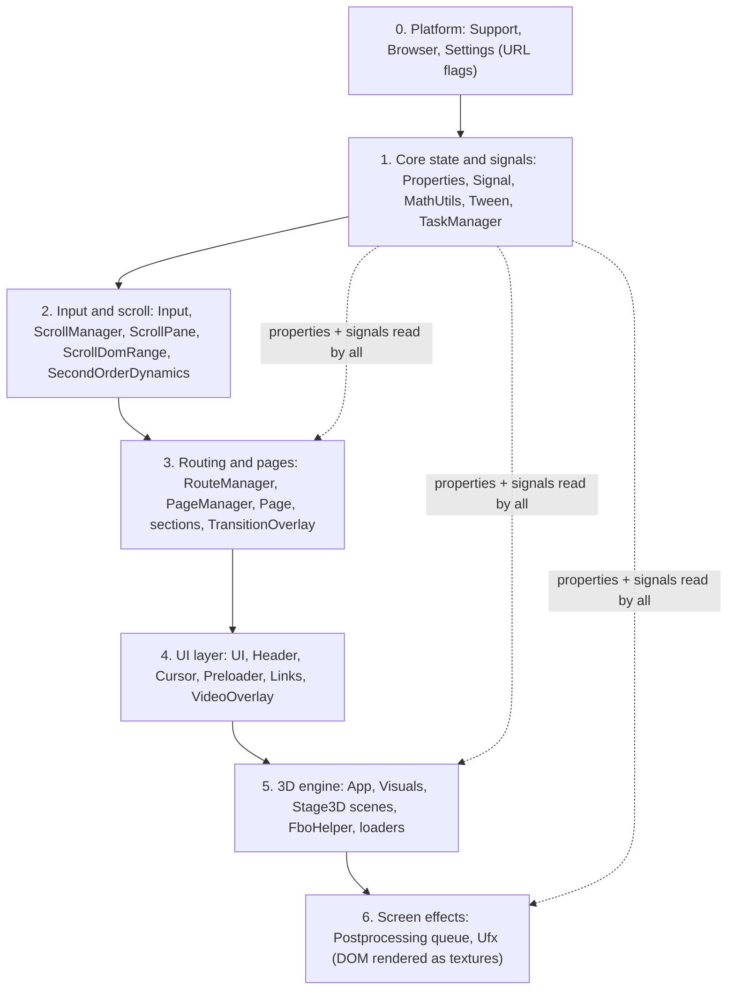
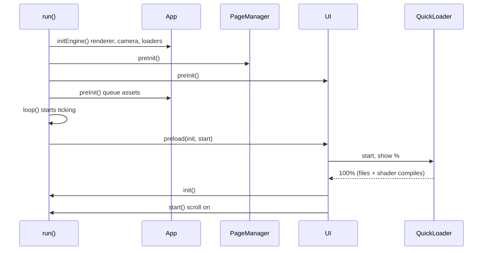
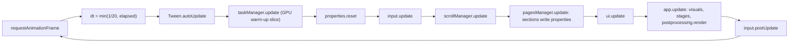
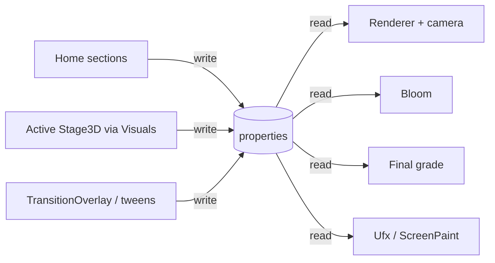
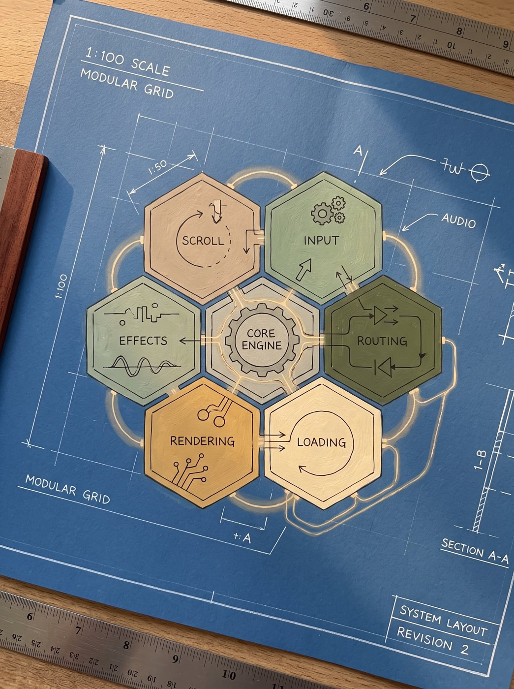
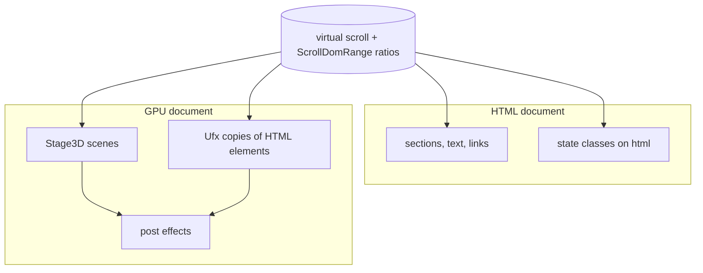
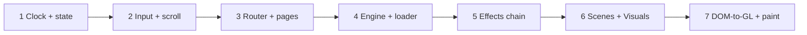
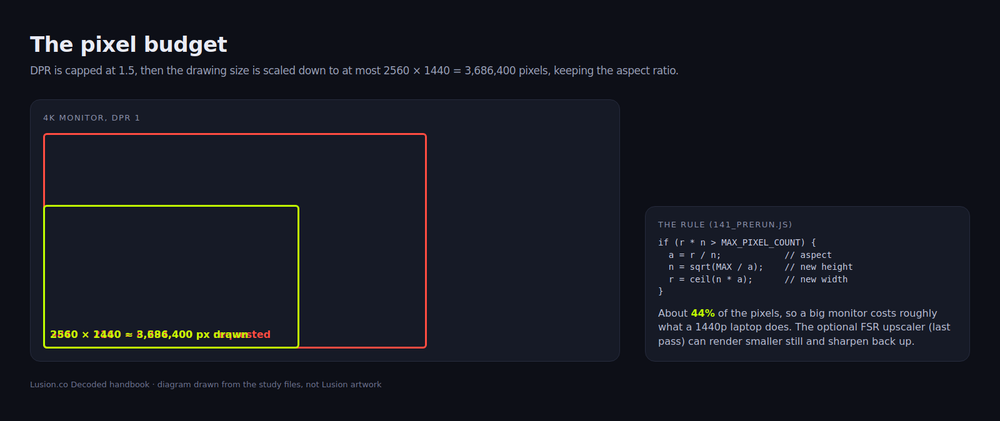
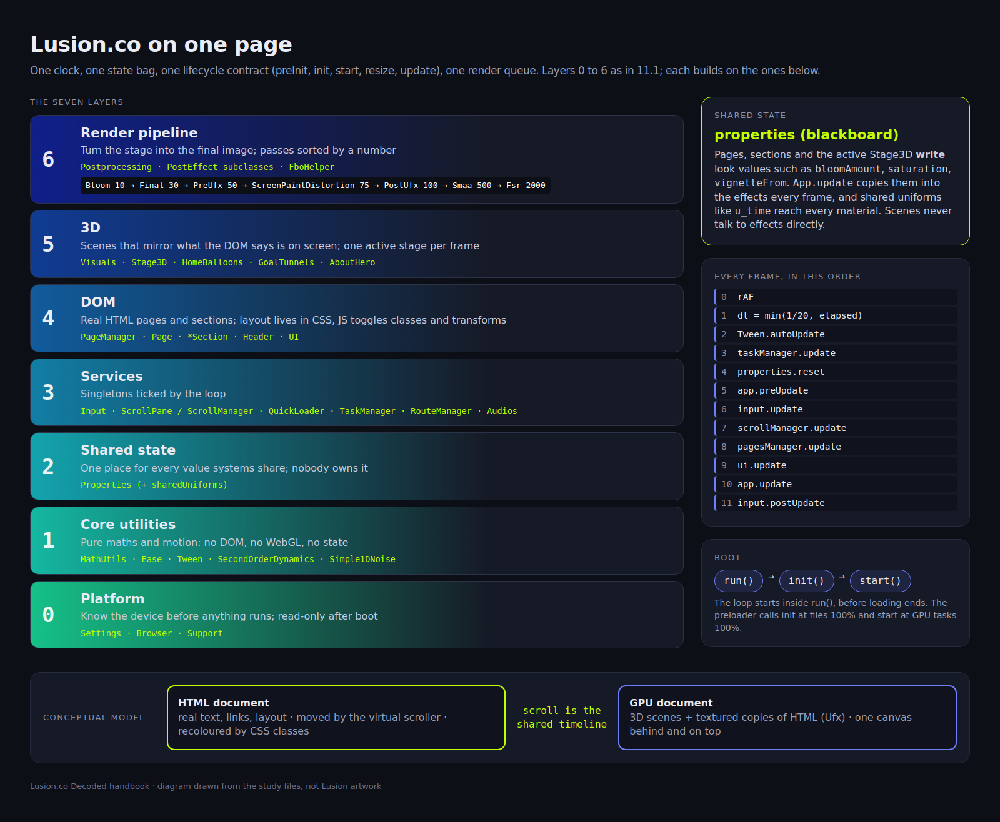

> **Read in Notion:** [11. System architecture plan and conceptual model](https://shifatmasud.notion.site/3fd48559569d81c1b174e921471bcaf6) · Part of [Lusion.co Decoded](https://shifatmasud.notion.site/Lusion-co-Decoded-Client-Side-Handbook-3fd48559569d81dd80b4c7407caf27cc) · [Repo home](https://github.com/shifatmasud/lusion-decoded)

# 11. System architecture plan and conceptual model

## 11.1 The idea in one sentence
Lusion is **one clock, one shared state, one lifecycle and one ordered effects chain**. Every page, section, 3D scene and screen effect plugs into the same four things, so a 3D studio site behaves like a small game engine wearing a website.

## 11.2 The seven layers
Each layer only talks to the one below it, except the shared state, which everyone reads.

<table header-row="true">
<tr>
<td>Layer</td>
<td>Owns</td>
<td>Key classes (module)</td>
<td>Chapter</td>
</tr>
<tr>
<td>0 Platform</td>
<td>Can this device run it, what flags are on</td>
<td>Support (135), Browser (002), Settings (003)</td>
<td>2</td>
</tr>
<tr>
<td>1 Core</td>
<td>Shared numbers, events, timing, GPU warm-up</td>
<td>Properties (004), Signal (005), Tween, TaskManager (013)</td>
<td>2, 9</td>
</tr>
<tr>
<td>2 Input and scroll</td>
<td>Pointer, wheel, virtual scroll, element visibility</td>
<td>Input (008), ScrollPane (120), ScrollManager (121), ScrollDomRange (009)</td>
<td>5</td>
</tr>
<tr>
<td>3 Pages</td>
<td>URLs, page swaps, sections</td>
<td>RouteManager (068), PageManager (119), Page (014)</td>
<td>6</td>
</tr>
<tr>
<td>4 UI</td>
<td>HTML interface and loading screen</td>
<td>UI (139), Header (069), Preloader (137)</td>
<td>6, 9, 10</td>
</tr>
<tr>
<td>5 3D engine</td>
<td>Renderer, camera, scenes, assets</td>
<td>App (136), Visuals (025), Stage3D (015), FboHelper (011)</td>
<td>3, 7, 9</td>
</tr>
<tr>
<td>6 Screen effects</td>
<td>Full-screen passes and DOM-to-texture</td>
<td>Postprocessing (122), PostEffect (045), Ufx</td>
<td>4, 8</td>
</tr>
</table>
## 11.3 Boot: run, init, start
Start-up is three steps, and every module answers the same calls. Quoted from `141_preRun.js`:
```javascript
async function run() {
  // ...extra font weights queued...
  app.initEngine(),
  input.preInit(),
  scrollManager.init(),
  pagesManager.preInit(),
  ui.preInit(),
  app.preInit(),
  loop(),
  ui.preload(init, start);
}
function init() {
  input.init(), pagesManager.init(), ui.init(), app.init(),
  window.addEventListener("resize", _onResize), _onResize();
}
function start() {
  ui.start(), pagesManager.start(), app.start(), (scrollManager.isActive = !0), _onResize();
}
```
The order matters: `initEngine()` comes first, so the renderer exists before anything asks for materials; `preInit()` builds objects but loads nothing; `ui.preload()` shows the loading screen, then calls `init` when assets are in and `start` when the intro begins. Scroll is switched on last, in `start()`, so the visitor cannot scroll before the page is ready.

## 11.4 The frame: one clock, fixed order
Quoted from `141_preRun.js`:
```javascript
function update(e) {
  taskManager.update(),
  properties.reset(),
  app.preUpdate(e),
  input.update(e),
  scrollManager.update(e),
  pagesManager.update(e),
  ui.update(e),
  app.update(e),
  input.postUpdate(e);
}
function loop() {
  let e = performance.now(),
    t = (e - (time || e)) / 1e3;
  (t = Math.min(1 / 20, t)),
  (time = e),
  Tween.autoUpdate(t),
  update(t),
  window.requestAnimationFrame(loop);
}
```
Three rules come out of this:
- **One time step for everyone.** It is capped at 1/20 s, so a dropped tab or a slow frame never makes physics or springs jump.
- **Reset, then read, then render.** `properties.reset()` clears the per-frame visual values first; input, scroll and pages then write fresh values; the 3D engine reads them last and draws.
- **Input has a before and after.** `input.update` reads the new pointer state at the top; `input.postUpdate` clears one-frame flags at the bottom.

## 11.5 Shared state: the Properties blackboard
`Properties` (module 004) is one object that holds the canvas, renderer, scene, camera, viewport size and every "look" value: bloom, vignette, colour grading, saturation, background colour and more. Pages and scenes **write** to it; the 3D engine and effects **read** it. Nobody calls into anybody else to change how the screen looks.
Quoted from `136_App.js` (`App.update`), where the engine copies the blackboard into the effects:
```javascript
(properties.bloom.amount = properties.bloomAmount),
(properties.bloom.radius = properties.bloomRadius),
(properties.bloom.threshold = properties.bloomThreshold),
...
properties.final.vignetteFrom = properties.vignetteFrom,
properties.final.vignetteTo = properties.vignetteTo,
...
properties.final.saturation = properties.saturation,
properties.final.contrast = properties.contrast,
```
Scenes take part through `Visuals` (module 025): the first active `Stage3D` copies its own `properties` into the global blackboard each frame (chapter 7). So switching scenes also switches the grade, bloom and camera, with no special code.

## 11.6 Rendering budget
The renderer never draws more pixels than a fixed limit. Quoted from `141_preRun.js` (`_onResize`):
```javascript
let t = settings.DPR, r = e * t, n = window.innerHeight * t;
if (settings.USE_PIXEL_LIMIT === !0 && r * n > settings.MAX_PIXEL_COUNT) {
  let a = r / n;
  ((n = Math.sqrt(settings.MAX_PIXEL_COUNT / a)), (r = Math.ceil(n * a)), (n = Math.ceil(n)));
}
```
With `DPR = Math.min(1.5, devicePixelRatio)` and `MAX_PIXEL_COUNT = 2560 * 1440` (chapter 2), a 4K screen renders at about 3.7 million pixels instead of 8.3 million, and an optional upscaler (FSR, priority 2000, the last pass) can render smaller and sharpen back up. This one cap is why the site stays smooth on big monitors.
## 11.7 The conceptual model: two documents, one page
The best mental model is that **every page exists twice**:
1. **The HTML document**: real text, links and layout, readable by search engines and screen readers. It is moved by the virtual scroller and recoloured by CSS classes (chapter 10).
2. **The GPU document**: 3D scenes and textured copies of selected HTML elements (Ufx, chapter 4), drawn behind and on top of the HTML in one canvas.
The virtual scroll position is the **only thing that keeps the two in step**. Each element's `ScrollDomRange` turns its place on screen into numbers between -1 and 1, and those numbers drive both CSS classes and shader uniforms in the same frame.


## 11.8 Architecture plan for your own projects
This is a plan you can adopt directly. It mirrors Lusion's layers but uses names and a folder layout that suit a TypeScript or React-adjacent codebase.
**Folder layout**
```text
src/
  core/        clock.ts, state.ts (blackboard), signal.ts, tasks.ts, settings.ts
  input/       input.ts, scroll-pane.ts, dom-range.ts, spring.ts
  routing/     router.ts, page-manager.ts, page.ts, transition.ts
  ui/          ui.ts, preloader.ts, header.ts, cursor.ts
  gfx/         engine.ts, scene.ts (Stage3D), visuals.ts, fbo.ts, loaders/
  fx/          chain.ts, pass.ts, passes/ (bloom, grade, distort, aa)
  dom-gl/      dom-mesh.ts (Ufx), dom-layer.ts
  pages/       home/, about/, work/   each: page.ts + sections/
  shaders/     chunks/ (noise, blue-noise), passes/, scenes/
```
**Build order (each step runs on its own before the next)**
1. Clock + blackboard + signals. One `requestAnimationFrame` loop with a capped dt and a fixed update order.
2. Input + virtual scroll + DOM ranges. Get smooth scroll working on plain HTML first, no WebGL.
3. Router + page manager + page lifecycle. Prefetch on hover, hide/load/show, queue clicks during a transition.
4. Engine: renderer, one scene, one camera, a loader that counts shader compiles, and the pixel cap.
5. Effects chain: sorted passes, ping-pong targets, start with grade + anti-aliasing only.
6. Scenes via a Visuals switcher that copies each scene's look into the blackboard.
7. DOM-to-GL meshes and pointer paint, the expensive "wow" layer, added last.

**Rules to keep**
- Every module implements the same lifecycle: `preInit, init, start, resize, update(dt)`, plus `show/hide` for pages and sections.
- Visual values live in the blackboard; modules write intent, the engine applies it once per frame.
- Layout is measured on resize only; per frame you only offset by scroll.
- Anything that compiles a shader or uploads a texture goes through the task queue, so the loading bar reaches 100% only when the GPU is ready.
- Debug and quality switches come from URL flags (`Settings.override`) so you can test on a phone without rebuilding.
## 11.9 Original starter code (not Lusion's)
```typescript
// core/lifecycle.ts
export interface Module {
  preInit?(): void; init?(): void; start?(): void;
  resize?(w: number, h: number): void;
  update?(dt: number): void;
}

// core/state.ts : the blackboard
export const state = {
  vw: 0, vh: 0, scroll: 0,
  look: { bloom: 0, saturation: 0, vignette: 0.5, bg: '#000' },
  resetLook() { this.look = { bloom: 0, saturation: 0, vignette: 0.5, bg: '#000' }; },
};

// core/clock.ts : one clock, fixed order
export function startLoop(order: Module[]) {
  let last = 0;
  const tick = (now: number) => {
    const dt = Math.min(1 / 20, last ? (now - last) / 1000 : 0);
    last = now;
    state.resetLook();
    for (const m of order) m.update?.(dt);
    requestAnimationFrame(tick);
  };
  requestAnimationFrame(tick);
}

// boot.ts
const modules: Module[] = [engine, input, scroll, pages, ui, fx];
modules.forEach(m => m.preInit?.());
await loader.loadAll();            // files + shader warm-up
modules.forEach(m => m.init?.());
modules.forEach(m => m.start?.());
startLoop([input, scroll, pages, ui, engine, fx]);
```
## 11.10 Confirmed vs inferred
<table header-row="true">
<tr>
<td>Point</td>
<td>Status</td>
<td>Evidence</td>
</tr>
<tr>
<td>Boot is run, init, start, with initEngine first and scroll switched on in start</td>
<td>Confirmed</td>
<td>141_preRun.js</td>
</tr>
<tr>
<td>Frame order: tasks, reset, input, scroll, pages, UI, app, input.postUpdate</td>
<td>Confirmed</td>
<td>141_preRun.js update()</td>
</tr>
<tr>
<td>Time step capped at 1/20 s</td>
<td>Confirmed</td>
<td>141_preRun.js loop()</td>
</tr>
<tr>
<td>Look values flow from properties into Bloom and Final each frame</td>
<td>Confirmed</td>
<td>136_App.js update()</td>
</tr>
<tr>
<td>Active Stage3D copies its properties into the global blackboard</td>
<td>Confirmed</td>
<td>025_Visuals.js (chapter 7)</td>
</tr>
<tr>
<td>Pixel cap: DPR at most 1.5, total at most 2560 x 1440</td>
<td>Confirmed</td>
<td>003_Settings.js, 141_preRun.js</td>
</tr>
<tr>
<td>Seven-layer split</td>
<td>Inferred</td>
<td>My grouping of the modules; the code has no folders or labels</td>
</tr>
<tr>
<td>"Two documents, one page" model</td>
<td>Inferred</td>
<td>A description of how chapters 4, 5 and 10 fit together, not a term from the code</td>
</tr>
<tr>
<td>Folder layout and build order in 11.8</td>
<td>Original</td>
<td>My recommendation for your projects</td>
</tr>
</table>


## Figures

These figures were added to the Notion page after this Markdown was written. In Notion each one sits next to the section it explains, with its caption.




