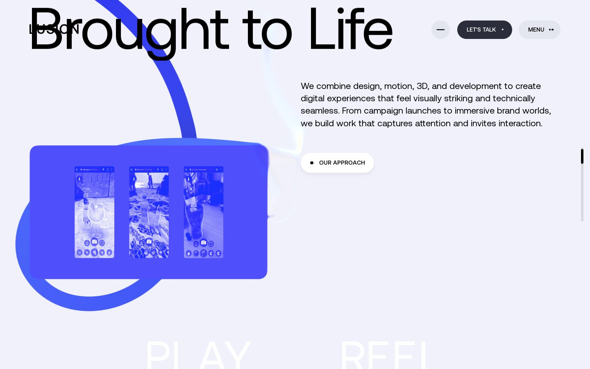
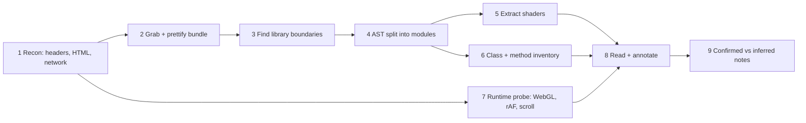
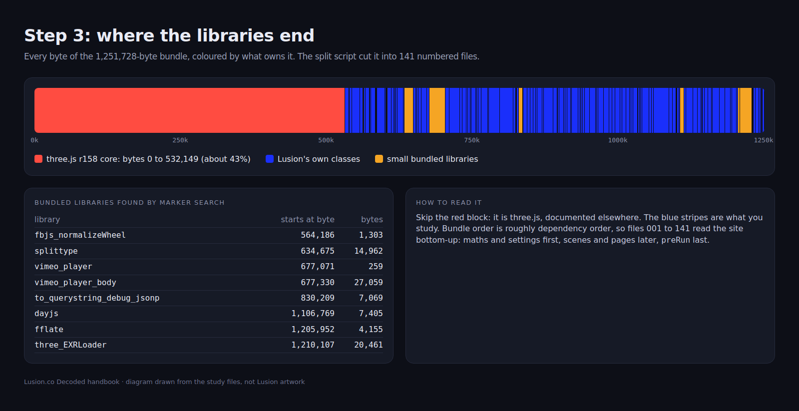
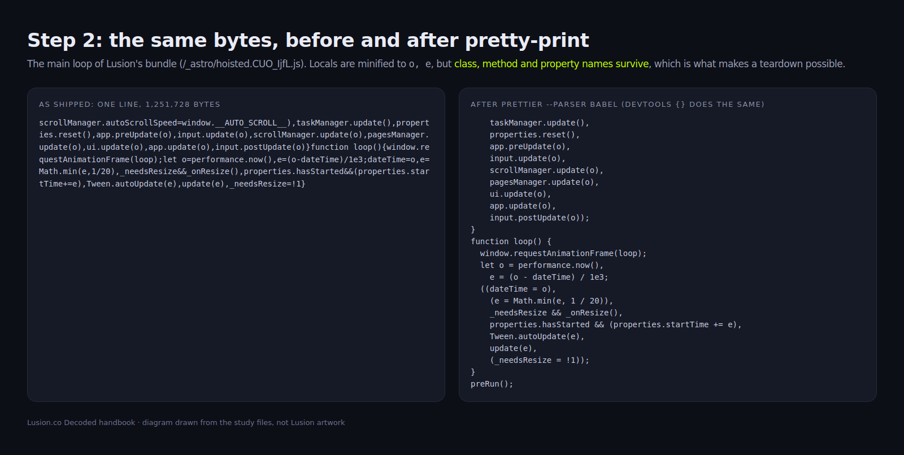
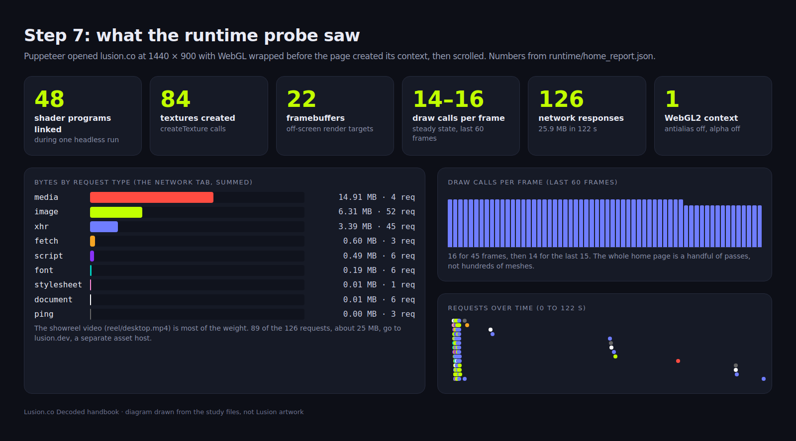

> **Read in Notion:** [12. Teardown guide](https://shifatmasud.notion.site/3fd48559569d8160ba22f0f918a83fec) · Part of [Lusion.co Decoded](https://shifatmasud.notion.site/Lusion-co-Decoded-Client-Side-Handbook-3fd48559569d81dd80b4c7407caf27cc) · [Repo home](https://github.com/shifatmasud/lusion-decoded)

# 12. Teardown guide: how to reverse engineer a site like this


## The idea in one sentence
A client-side teardown is **five passes over the same site**: look at what the server sends, split the bundle into readable modules, pull out the shaders and classes, watch the page run with instrumented WebGL, then write down only what the code proves.
This is exactly how this handbook was made. Every script below was used on [lusion.co](http://lusion.co) and is in the study folder.

## 12.0 Ground rules
- **Client-side only.** Read what the browser already downloads. No login bypass, no server probing, no brute forcing URLs.
- **Learn the patterns, do not ship their code or assets.** Write your own implementation (every chapter has an original example for this reason).
- **Be gentle.** Download each file once and work offline from the copy.
- **Separate proof from guesses.** Every claim gets a source file or a runtime number, or it is marked as inferred.
## 12.1 Recon: what does the server send?
In DevTools: **Network** tab, tick *Disable cache*, reload, sort by size. From a terminal:
```bash
curl -sI https://lusion.co/ > headers.txt
curl -s https://lusion.co/ > index.html
```
What we learned from the real response:
```plain text
HTTP/2 200
cache-status: "Netlify Edge"; fwd=miss; fwd-status=200; stored
server: Netlify
x-frame-options: deny
content-length: 59671
```
So the site is static HTML on Netlify, and all the behaviour is in one script under `/_astro/` (the file `hoisted.CUO_IjfL.js`, 1,251,728 bytes). The `/_astro/` folder name suggests an Astro build. Save the HTML of each page type too (home, about, projects, a project, playground), because the router swaps real HTML (chapter 6).
Checklist for this step:
- Hosting and caching headers
- Every script, stylesheet, font, model and texture URL
- Which requests happen on hover or scroll (prefetching shows up here)
- The HTML skeleton: canvas elements, page container, preloader
## 12.2 Grab and prettify the bundle
In DevTools: **Sources**, open the script, press the `{}` pretty-print button. For real work, save it and format it so you can grep and diff:
```bash
npx prettier --parser babel js/hoisted.js > js/hoisted.pretty.js
```
Names of locals are minified (`e`, `t`, `r`), but **class names, method names and property names usually survive** minification, because they are used across modules. That is what makes this kind of study possible.
## 12.3 Find the library boundaries
Bundles put dependencies first. Search for known strings (`REVISION`, library license headers, unique function names) to find where each library ends. In this bundle, three.js r158 occupies the first 532,149 bytes; after that are Lusion's own classes, with a few small libraries in between:
```javascript
// split.mjs (our script)
const APP_START = 532149; // end of the bundled three.js r158 core
const libMarkers = [[564134,'lib_fbjs_normalizeWheel'],[634675,'lib_splittype'],[677071,'lib_vimeo_player'],
  [830209,'lib_to_querystring_debug_jsonp'],[1106805,'lib_dayjs'],[1206033,'lib_fflate'],[1210273,'lib_three_EXRLoader']];
```
Why it matters: you skip about 40% of the file that you can read in the library's own docs, and you know which wheel normalizer, text splitter and decompressor they chose.
## 12.4 Split the bundle into modules with an AST
Regex is not enough for 1.2 MB of JavaScript. Parse it with **acorn** and cut at every top-level class declaration:
```javascript
// split.mjs (our script, trimmed)
const ast = acorn.parse(src, { ecmaVersion: 'latest', sourceType: 'module' });
for (const n of ast.body) {
  if (n.start >= APP_START) {
    let cname = null;
    if (n.type === 'ClassDeclaration') cname = n.id.name;
    if (cname) startGroup(cname);          // new file: 001_MathUtils.js, 002_Browser.js ...
  }
  cur.parts.push(n);
}
fs.writeFileSync(`modules/${g.name}.js`, `// bytes ${s}-${e} of /_astro/hoisted.CUO_IjfL.js\n` + src.slice(s, e));
```
Result: **141 module files**, numbered in bundle order, each starting with its byte range so you can always trace a quote back to the original file. Bundle order is roughly dependency order, so reading `001` to `141` reads the site bottom-up: maths, settings, input, scroll, engine, scenes, pages, post, boot.
## 12.5 Extract every shader
WebGL shaders are just strings. Walk the AST, keep template literals and strings that look like GLSL, and name each one after the variable or class property it is assigned to:
```javascript
// split.mjs (our script, trimmed)
if (!/(void\s+main|gl_FragColor|gl_Position|uniform\s+\w+|varying\s+\w+|#include|precision\s+\w+p)/.test(text)) return;
const kind = /gl_Position/.test(s.text) ? 'vert' : (/gl_FragColor|out\s+vec4|discard/.test(s.text) ? 'frag' : 'chunk');
fs.writeFileSync(`shaders/${n}.${kind}.glsl`, `// extracted ... at byte ${s.start}\n` + s.text);
```
Result: **122 GLSL sources** with an index of their uniforms, then regrouped by owning class into 122 files (plus an index) such as `HomeBalloons__fragSp.frag.glsl`, `Bloom__highPassFrag.frag.glsl`, `ScreenPaintDistortion__fragS1.frag.glsl`. The owner prefix tells you which scene or pass each shader belongs to.
## 12.6 Inventory every class and method
The same AST gives you the full API surface: class name, parent class, fields with initial values, and every method with its parameter list and size.
```javascript
// methods.mjs (our script, trimmed)
walk.full(ast, (n) => {
  if ((n.type === 'ClassDeclaration' || n.type === 'ClassExpression') && n.start >= APP_START) {
    for (const m of n.body.body) {
      if (m.type === 'MethodDefinition') {
        const ps = m.value.params.map((p) => src.slice(p.start, p.end)).join(', ');
        methods.push(`${m.static ? 'static ' : ''}${key}(${ps})  [${m.end - m.start}b]`);
      }
    }
  }
});
```
Result: **135 classes** (130 Lusion's own, 5 third-party) and **971 methods**. Chapter 13 is this inventory, sorted by layer. Method size in bytes is a great reading guide: `App.update` is 3,045 bytes, so it is worth reading line by line; a 15-byte `update` is just a forwarder.
To read one method nicely formatted, we used a small helper:
```bash
node snip.mjs App.update App.initEngine 200   # prints prettified source of each method
```
## 12.7 Watch it run: the runtime probe
Static reading tells you what can happen; the runtime tells you what does. We drove the live site with **Puppeteer** and wrapped the WebGL context before the page created it:
```javascript
// probe.mjs (our script, trimmed)
await page.evaluateOnNewDocument(() => {
  window.__gl = { contexts: [], shaders: [], programs: 0, draws: 0, frames: 0, dpf: [], textures: 0, fbos: 0, ext: [] };
  const og = HTMLCanvasElement.prototype.getContext;
  HTMLCanvasElement.prototype.getContext = function (type, attrs) {
    const ctx = og.call(this, type, attrs);
    if (ctx && /webgl/.test(type) && !ctx.__hooked) {
      ctx.__hooked = 1;
      window.__gl.contexts.push({ type, attrs: attrs || {}, canvasId: this.id });
      const wrap = (n, f) => { const o = ctx[n].bind(ctx); ctx[n] = function () { f && f.apply(null, arguments); return o.apply(null, arguments); }; };
      wrap('shaderSource', (s, src) => window.__gl.shaders.push(src));
      wrap('linkProgram', () => window.__gl.programs++);
      ['drawElements', 'drawArrays', 'drawElementsInstanced', 'drawArraysInstanced'].forEach((n) => wrap(n, () => window.__gl.draws++));
    }
    return ctx;
  };
});
```
Then it scrolls and moves the mouse in steps, takes screenshots, and reads DOM state:
```javascript
for (let i = 0; i < steps; i++) {
  await page.mouse.move(400 + i * 50, 350 + (i % 3) * 90, { steps: 8 });
  await page.mouse.wheel({ deltaY: 650 });
  await new Promise((r) => setTimeout(r, 1200));
  if (i % 2 === 1) await page.screenshot({ path: `runtime/${tag}_${i + 1}_scroll.png` });
}
```
What the home page run reported:
<table header-row="true">
<tr>
<td>Measure</td>
<td>Value</td>
<td>What it tells you</td>
</tr>
<tr>
<td>WebGL context</td>
<td>webgl2 on #canvas, antialias false, alpha false, high-performance</td>
<td>AA is done in post (SMAA); opaque canvas</td>
</tr>
<tr>
<td>Programs / shader sources</td>
<td>48 / 96</td>
<td>Final compiled shaders, saved to runtime/home_compiled_shaders</td>
</tr>
<tr>
<td>Textures / framebuffers</td>
<td>84 / 22</td>
<td>Many render targets: the post pipeline and simulations</td>
</tr>
<tr>
<td>Draw calls per frame (idle hero)</td>
<td>about 14 to 16</td>
<td>Very lean scene; most of the look comes from passes</td>
</tr>
<tr>
<td>Extensions</td>
<td>EXT_color_buffer_float, OES_texture_float_linear, EXT_color_buffer_half_float, KHR_parallel_shader_compile and more</td>
<td>Float render targets; parallel compile used during warm-up</td>
</tr>
<tr>
<td>Network responses</td>
<td>126 (52 images, 45 XHR, 6 fonts, 6 documents, 4 media)</td>
<td>XHR includes the custom .buf meshes and prefetched pages</td>
</tr>
<tr>
<td>html classes after load</td>
<td>is-desktop is-ready is-white-bg</td>
<td>State is exposed as classes for CSS (chapter 10)</td>
</tr>
<tr>
<td>body / html overflow</td>
<td>hidden / hidden</td>
<td>Native scroll is off; custom scroll drives the page</td>
</tr>
</table>
Note: this ran headless with a software GPU (SwiftShader), so frame rate means nothing, and counts can differ slightly on real hardware.
## 12.8 The same steps by hand in DevTools
<table header-row="true">
<tr>
<td>Question</td>
<td>DevTools tool</td>
<td>What to do</td>
</tr>
<tr>
<td>What loads, and when?</td>
<td>Network</td>
<td>Disable cache, reload, filter by Fetch/XHR, hover links to catch prefetches</td>
</tr>
<tr>
<td>Where is a behaviour coded?</td>
<td>Sources + Search (Ctrl/Cmd+Shift+F)</td>
<td>Search for a class name you saw in the DOM or a CSS variable</td>
</tr>
<tr>
<td>What runs each frame?</td>
<td>Performance</td>
<td>Record 3 seconds, open the rAF task, read the call tree (loop, update, App.update)</td>
</tr>
<tr>
<td>What does a frame draw?</td>
<td>Spector.js extension</td>
<td>Capture one frame: every draw call, shader and render target in order</td>
</tr>
<tr>
<td>How is the page layered?</td>
<td>Layers / Elements</td>
<td>Find the fixed canvas behind the fixed content layer</td>
</tr>
<tr>
<td>Which state classes change?</td>
<td>Elements</td>
<td>Watch the html element's classes while scrolling and navigating</td>
</tr>
<tr>
<td>What does a value do?</td>
<td>Console + breakpoints</td>
<td>Pause in App.update and inspect properties, or set a logpoint</td>
</tr>
</table>
## 12.9 Reading order that works
1. **The boot file** (here `141_preRun.js`): it lists every system and the frame order.
2. **The engine** (`136_App.js`): renderer, pass queue, per-frame sync.
3. **Shared state** (`005_Properties.js`, `003_Settings.js`): every tunable value in one place.
4. **Base classes** (Page, Stage3D, PostEffect, ScrollPane): learn the contract once.
5. **One concrete feature end to end**, such as HomeBalloons with its shaders.
6. **Everything else by size**, biggest methods first.
## 12.10 Original example (not Lusion's code)
Paste this into the DevTools console **before** the page creates its canvas (use a Snippet plus a breakpoint on the first script line, or run it as a local override) to count draw calls per frame on any WebGL site:
```javascript
(() => {
  const stats = { frames: 0, draws: 0, perFrame: [] };
  let lastDraws = 0;
  const get = HTMLCanvasElement.prototype.getContext;
  HTMLCanvasElement.prototype.getContext = function (type, opts) {
    const gl = get.call(this, type, opts);
    if (gl && type.startsWith('webgl') && !gl.__counted) {
      gl.__counted = true;
      for (const fn of ['drawArrays', 'drawElements', 'drawArraysInstanced', 'drawElementsInstanced']) {
        const orig = gl[fn]; if (!orig) continue;
        gl[fn] = function (...a) { stats.draws++; return orig.apply(this, a); };
      }
      console.log('[probe] context', type, opts);
    }
    return gl;
  };
  const raf = window.requestAnimationFrame.bind(window);
  window.requestAnimationFrame = (cb) => raf((t) => {
    stats.frames++; stats.perFrame.push(stats.draws - lastDraws); lastDraws = stats.draws;
    if (stats.perFrame.length > 300) stats.perFrame.shift();
    cb(t);
  });
  window.__probe = stats; // later: __probe.perFrame.slice(-30)
})();
```
## 12.11 Turning findings into notes
For every chapter we used the same template, and it is worth keeping:
- **The idea in one sentence.**
- **Quoted code** with the module file name, then "What it does" and "Why".
- **A Mermaid diagram** of the flow.
- **How to reuse it** in your own stack.
- **An original example** you wrote, never their code.
- **Confirmed vs inferred table**, with the file or runtime number behind each confirmed row.
## 12.12 Confirmed vs inferred
<table header-row="true">
<tr>
<td>Point</td>
<td>Status</td>
<td>Evidence</td>
</tr>
<tr>
<td>Served by Netlify with x-frame-options deny</td>
<td>Confirmed</td>
<td>headers.txt</td>
</tr>
<tr>
<td>One 1,251,728-byte bundle; three.js r158 in the first 532,149 bytes</td>
<td>Confirmed</td>
<td>js/hoisted.js, split.mjs</td>
</tr>
<tr>
<td>141 modules, 122 shaders, 135 classes, 971 methods</td>
<td>Confirmed</td>
<td>modules/INDEX.tsv, shaders/INDEX.tsv, class_inventory.txt</td>
</tr>
<tr>
<td>Runtime numbers in 12.7</td>
<td>Confirmed (one headless run)</td>
<td>runtime/home_report.json</td>
</tr>
<tr>
<td>Site is built with Astro</td>
<td>Inferred</td>
<td>The /_astro/ asset folder; no other check done</td>
</tr>
<tr>
<td>Spector.js and Performance panel steps give the same picture</td>
<td>Inferred</td>
<td>Standard tools; this study used the scripted probe instead</td>
</tr>
</table>


## Figures

These figures were added to the Notion page after this Markdown was written. In Notion each one sits next to the section it explains, with its caption.






