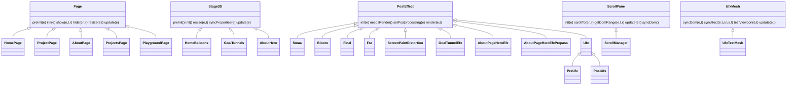
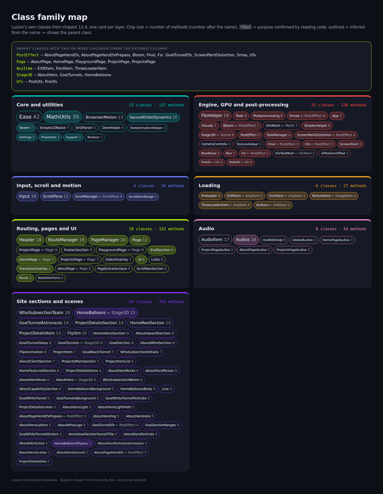

> **Read in Notion:** [13. Class and method inventory](https://shifatmasud.notion.site/3fd48559569d81709a8ecf7dc5c65d23) · Part of [Lusion.co Decoded](https://shifatmasud.notion.site/Lusion-co-Decoded-Client-Side-Handbook-3fd48559569d81dd80b4c7407caf27cc) · [Repo home](https://github.com/shifatmasud/lusion-decoded)

# 13. Class and method inventory

## The idea in one sentence
This is the **full API surface of Lusion's own code**: all 130 classes they wrote, grouped by layer, with every method signature exactly as it ships in the bundle, a one-line purpose, and whether that purpose is confirmed by reading the code or inferred from names.
<callout icon="📌">
	**How to read the status column.** Class names, parent classes, module numbers and method signatures are always **confirmed**: they come straight from parsing the bundle (chapter 12.6). The *Purpose* column is **Confirmed** only when the class was read in chapters 5 to 11; otherwise it is **Inferred** from the class name, its methods and where it sits in the bundle. Parameter names like `e, t, r` are minified; default values such as `t=1.5` and `!0` (true) are the real shipped defaults.
</callout>
## 13.1 Numbers
<table header-row="true">
<tr>
<td>Measure</td>
<td>Value</td>
</tr>
<tr>
<td>Classes in the app part of the bundle</td>
<td>135 (130 Lusion's own, 5 third-party)</td>
</tr>
<tr>
<td>Methods, getters and setters</td>
<td>971</td>
</tr>
<tr>
<td>Module files after the split</td>
<td>141 (the Module column below is the file number, for example 136 = 136_App.js)</td>
</tr>
<tr>
<td>Purposes confirmed by reading code</td>
<td>48 of 130</td>
</tr>
<tr>
<td>Biggest single method</td>
<td>App.update, 3,045 bytes</td>
</tr>
</table>
## 13.2 The family tree
Most of the codebase is a few base classes and many small subclasses that fill in the same lifecycle methods.

Sections (HomeHeroSection, GoalSection, AboutWhoSection and the rest) do not extend a shared base class in the bundle, but almost all of them repeat the same shape: `preInit(e), init(), resize(e, t), update(e)`, often with `_splitText()` and `_reset()`. That is a convention, not inheritance.
## 13.3 Recurring method names and what they mean
<table header-row="true">
<tr>
<td>Method</td>
<td>Meaning across the codebase</td>
<td>Status</td>
</tr>
<tr>
<td>preInit()</td>
<td>Build DOM refs, queue file loads; runs before files are in</td>
<td>Confirmed (boot order, chapter 11.2)</td>
</tr>
<tr>
<td>init()</td>
<td>Create materials and meshes once files are loaded</td>
<td>Confirmed</td>
</tr>
<tr>
<td>start()</td>
<td>Go live after GPU warm-up</td>
<td>Confirmed</td>
</tr>
<tr>
<td>resize(e, t)</td>
<td>Width and height in CSS pixels; recompute layout-dependent values</td>
<td>Confirmed</td>
</tr>
<tr>
<td>update(e)</td>
<td>Per-frame tick; e is delta time in seconds (capped at 1/20)</td>
<td>Confirmed</td>
</tr>
<tr>
<td>syncProperties(e)</td>
<td>A scene writes its wanted look into properties before effects read it</td>
<td>Confirmed (App.update, chapter 11.4)</td>
</tr>
<tr>
<td>syncDom() / syncRect()</td>
<td>Copy a DOM element's rect into a WebGL object, or write transforms back to the DOM</td>
<td>Confirmed for ScrollPane; inferred for UfxMesh and project items</td>
</tr>
<tr>
<td>needsRender()</td>
<td>A pass returns false to skip itself this frame</td>
<td>Confirmed (Postprocessing filters the queue)</td>
</tr>
<tr>
<td>show(e, t, r) / hide(e, t, r)</td>
<td>Page or section transition in and out</td>
<td>Confirmed for Page and PageManager</td>
</tr>
<tr>
<td>_splitText() / _reset()</td>
<td>Split headings into lines or letters for reveal animations, then reset them</td>
<td>Inferred</td>
</tr>
<tr>
<td>_on\*Load(e)</td>
<td>Loader callbacks for models, textures and animations</td>
<td>Inferred from names</td>
</tr>
</table>
## 13.4 The inventory, by layer
## Core and utilities

<table header-row="true">
<tr><td>Class</td><td>Module</td><td>Purpose</td><td>Purpose status</td><td>Methods (signatures as shipped)</td></tr>
<tr><td>**MathUtils**</td><td>001</td><td>Scalar math helpers: clamp, mix, fit, smoothstep, hash, bezier</td><td>Confirmed</td><td>linearStep(e, t, r), step(e, t), clamp(e, t, r), mod(e, t), mix(e, t, r), cMix(e, t, r), unMix(e, t, r), cUnMix(e, t, r), saturate(e), fit(e, t, r, n, a, l), unClampedFit(e, t, r, n, a, l), lerp(e, t, r), loop(e, t, r), normalize(e, t, r), smoothstep(e, t, r), fract(e), hash(e), hash2(e, t), sign(e), isPowerOfTwo(e), powerTwoCeilingBase(e), powerTwoCeiling(e), powerTwoFloorBase(e), powerTwoFloor(e), latLngBearing(e, t, r, n), distanceTo(e, t), distanceSqrTo(e, t), distanceTo3(e, t, r), distanceSqrTo3(e, t, r), latLngDistance(e, t, r, n), cubicBezier(e, t, r, n, a), cubicBezierFn(e, t, r, n), normalizeAngle(e), closestAngleTo(e, t), randomRange(e, t), randomRangeInt(e, t), padZero(e, t), lerpColor(e, t, r), getSeedRandomFn(e)</td></tr>
<tr><td>**Browser**</td><td>002</td><td>UA/device flags (isMobile, isSafari...)</td><td>Inferred</td><td>constructor()</td></tr>
<tr><td>**Settings**</td><td>003</td><td>Global config flags (DPR, MOBILE_WIDTH, UP_SCALE, paths)</td><td>Confirmed</td><td>constructor(), override(e)</td></tr>
<tr><td>**Properties**</td><td>005</td><td>Shared state bag: renderer, camera, sizes, shared uniforms, tuning values</td><td>Confirmed</td><td>constructor(), reset()</td></tr>
<tr><td>**SecondOrderDynamics**</td><td>007</td><td>Spring (frequency, damping, response) used for most motion</td><td>Confirmed</td><td>constructor(e, t=1.5, r=.8, n=2, a=!0), update(e, t=0), reset(e=null), _resetVector(`e=this.target0`), _resetNumber(`e=this.target0`), setFZR(e=this._f, t=this._z, r=this._r), _computeStableCoefficients(e), _computeRobustStableCoefficients(e), _updateVector(`e, t=this.target`), _updateNumber(`e, t=this.target`)</td></tr>
<tr><td>**Ease**</td><td>015</td><td>Easing curves</td><td>Inferred</td><td>quadIn(e), quadOut(e), quadOutIn(e), quadInOut(e), cubicIn(e), cubicOut(e), cubicOutIn(e), cubicInOut(e), quartIn(e), quartOut(e), quartOutIn(e), quartInOut(e), quintIn(e), quintOut(e), quintOutIn(e), quintInOut(e), sineIn(e), sineOut(e), sineOutIn(e), sineInOut(e), expoIn(e), expoOut(e), expoOutIn(e), expoInOut(e), circIn(e), circOut(e), circOutIn(e), circInOut(e), elasticIn(e), elasticOut(e), elasticOutIn(e), elasticInOut(e), backIn(e), backOut(e), backOutIn(e), backInOut(e), bounceIn(e), bounceOut(e), bounceOutIn(e), bounceInOut(e), lusion(e), cubicBezier(e, t, r, n, a)</td></tr>
<tr><td>**Tween**</td><td>010</td><td>Tiny tween, ticked by Tween.autoUpdate(dt) in the loop</td><td>Confirmed</td><td>constructor(e, t), static autoUpdate(e), restart(), kill(), to(e, t, r=null), fromTo(e, t, r, n), update(e=0, t=!1)</td></tr>
<tr><td>**Simple1DNoise**</td><td>043</td><td>1D value noise</td><td>Inferred</td><td>constructor(e), getVal(e), getFbm(e, t), get amplitude(), set amplitude(e), get scale(), set scale(e)</td></tr>
<tr><td>**BrownianMotion**</td><td>044</td><td>Noise-driven camera/object drift</td><td>Inferred</td><td>constructor(), rehash(), update(e), get positionAmplitude(), set positionAmplitude(e), get positionFrequency(), set positionFrequency(e), get rotationAmplitude(), set rotationAmplitude(e), get rotationFrequency(), set rotationFrequency(e), get matrix(), set matrix(e)</td></tr>
<tr><td>**DomHelper**</td><td>038</td><td>DOM utility helpers</td><td>Inferred</td><td>clone(e), _collapseWhiteSpace(e), getLinesFromText(e), getLinesFromTextNode(e)</td></tr>
<tr><td>**Support**</td><td>135</td><td>WebGL/browser support check</td><td>Confirmed</td><td>isSupported(), checkSupportWebGL()</td></tr>
<tr><td>**TextAnimationHelper**</td><td>098</td><td>Text reveal helper</td><td>Inferred</td><td>setMatrixText(e, t, r=0, n=40, a=2, l=1/15), resetMatrixTextTime(e), updateMatrixText(e, t=properties.deltaTime)</td></tr>
<tr><td>**SVGParser**</td><td>102</td><td>Parses SVG paths into geometry</td><td>Inferred</td><td>parse(e), createShapes(e), getStrokeStyle(e, t, r, n, a), pointsToStroke(e, t, r, n), pointsToStrokeWithBuffers(e, t, r, n, a, l, c, u)</td></tr>
</table>

## Engine, GPU and post-processing

<table header-row="true">
<tr><td>Class</td><td>Module</td><td>Purpose</td><td>Purpose status</td><td>Methods (signatures as shipped)</td></tr>
<tr><td>**App**</td><td>136</td><td>Engine: initEngine, frame update, post queue</td><td>Confirmed</td><td>initEngine(), preInit(), init(), start(), resize(e, t), preUpdate(e=0), update(e=0)</td></tr>
<tr><td>**FboHelper**</td><td>011</td><td>Render targets, blits, shader material factory</td><td>Confirmed</td><td>init(e, t), copy(e, t), uvCopy(e, t), render(e, t), renderGeometry(e, t, r), renderMesh(e, t, r=this._camera), debugTo(e, t, r, n, a), parseDefines(e), clearColor(e, t, r, n, a), getColorState(), setColorState(e), createRawShaderMaterial(e), createDataTexture(e, t, r, n=!1, a=!0), createRenderTarget(e, t, r=!1, n=!1, a=0), createMultisampleRenderTarget(e, t, r=!1, n=!1, a=8), clearMultisampleRenderTargetState(e)</td></tr>
<tr><td>**ShaderHelper**</td><td>018</td><td>Registers reusable GLSL chunks (#include)</td><td>Confirmed</td><td>glslifyStrip(e), addChunk(e, t), _wrapInclude(e), insertBefore(e, t, r, n), insertAfter(e, t, r, n), replace(e, t, r, n)</td></tr>
<tr><td>**TextureHelper**</td><td>042</td><td>Texture utilities, channel mixer</td><td>Inferred</td><td>init(), _createPixelTexture(e), mixChannels(e, t, r=-1, n=-1, a=-1, l=-1)</td></tr>
<tr><td>**BlueNoise**</td><td>019</td><td>Blue-noise texture + shared GLSL chunk</td><td>Confirmed</td><td>preInit(), update(e)</td></tr>
<tr><td>**Blur**</td><td>017</td><td>Separable 9-tap blur pass</td><td>Confirmed</td><td>getBlur9Material(), blur(e, t, r, n, a, l)</td></tr>
<tr><td>**Task**</td><td>012</td><td>One unit of deferred GPU work (compile, init texture)</td><td>Confirmed</td><td>constructor(e), get isCompleted(), run(), createMultiCallbackFunc(e), _onComplete(), createCallbackFunc(e), createShaderMaterialFunc(e), createCompileSceneFunc(e), createInitTextureFunc(e)</td></tr>
<tr><td>**TaskManager**</td><td>013</td><td>Runs Tasks a few per frame; feeds preloader %</td><td>Confirmed</td><td>start(), _start(), add(e), update()</td></tr>
<tr><td>**Stage3D** extends Scene</td><td>016</td><td>Base 3D scene (extends three.js Scene) with lifecycle hooks</td><td>Confirmed</td><td>constructor(e={}), preInit(), init(), resize(e, t), syncProperties(e), update(e)</td></tr>
<tr><td>**Visuals**</td><td>025</td><td>Holds all Stage3D scenes; picks currentStage3D</td><td>Confirmed</td><td>preInit(), init(), start(), resize(e, t), deactivateAll(), syncProperties(e), update(e)</td></tr>
<tr><td>**PostEffect**</td><td>045</td><td>Base post-processing pass (render, needsRender)</td><td>Confirmed</td><td>init(e), needsRender(), warn(e), setPostprocessing(e), render(e, t=!1)</td></tr>
<tr><td>**Postprocessing**</td><td>122</td><td>Sorted pass queue, ping-pong targets</td><td>Confirmed</td><td>init(e), swap(), setSize(e, t), dispose(), _filterQueue(e), renderMaterial(e, t), checkSceneRt(), render(e, t, r)</td></tr>
<tr><td>**Smaa** extends PostEffect</td><td>123</td><td>SMAA anti-aliasing, priority 500</td><td>Confirmed</td><td>init(e), setTextures(e, t), updateTextures(), setPostprocessing(e), dispose(), needsRender(), render(e, t), _createTexture(e)</td></tr>
<tr><td>**Bloom** extends PostEffect</td><td>124</td><td>Bloom (convolution on desktop, blur on mobile)</td><td>Confirmed</td><td>init(e), setDirtTexture(e), setPostprocessing(e), dispose(), needsRender(), renderFFT(e, t, r), render(e, t=!1)</td></tr>
<tr><td>**ScreenPaintDistortion** extends PostEffect</td><td>125</td><td>Mouse distortion pass, priority 75</td><td>Confirmed</td><td>init(e), needsRender(e), syncCamera(e), render(e, t=!1)</td></tr>
<tr><td>**Final** extends PostEffect</td><td>126</td><td>Colour grading/vignette, priority 30</td><td>Confirmed</td><td>init(e), needsRender(), render(e, t=!1)</td></tr>
<tr><td>**Fsr** extends PostEffect</td><td>127</td><td>FSR upscaler, priority 2000 (the last pass)</td><td>Confirmed</td><td>init(e), render(e, t=!1)</td></tr>
<tr><td>**Ufx** extends PostEffect</td><td>053</td><td>Base for DOM-synced UI effects pass</td><td>Confirmed</td><td>init(), setPostprocessing(e), render(e, t=!1)</td></tr>
<tr><td>**PreUfx** extends Ufx</td><td>054</td><td>UI effects pass, priority 50</td><td>Confirmed</td><td>(fields only)</td></tr>
<tr><td>**PostUfx** extends Ufx</td><td>103</td><td>Top-layer UI effects pass, priority 100</td><td>Confirmed</td><td>(fields only)</td></tr>
<tr><td>**UfxMesh** extends Mesh</td><td>032</td><td>Mesh that draws a DOM-aligned UI effect quad</td><td>Inferred</td><td>constructor(e={}), _onBeforeRender(), _initMaterial(e), syncDom(e=0, t=0), syncRect(e, t, r, n, a=0, l=0), testViewport(e=0, t=0), update(e=0, t=0)</td></tr>
<tr><td>**UfxTextMesh** extends UfxMesh</td><td>071</td><td>Text variant of UfxMesh</td><td>Inferred</td><td>constructor(e={}), syncText()</td></tr>
<tr><td>**GlPositionOffset**</td><td>134</td><td>Shared vertex offset chunk</td><td>Inferred</td><td>init(), setOffset(e, t)</td></tr>
<tr><td>**(anon)**</td><td>126</td><td>Anonymous class (unnamed in bundle)</td><td>Inferred</td><td>constructor(), render(e, t)</td></tr>
<tr><td>**CameraControls**</td><td>050</td><td>Camera rig: orbit/device orientation, look offset</td><td>Inferred</td><td>preInit(e), init(), resize(e, t), update(e)</td></tr>
<tr><td>**ScreenPaint**</td><td>020</td><td>Paints pointer motion into a GPU velocity texture</td><td>Confirmed</td><td>init(), resize(e, t), update(e)</td></tr>
</table>

## Input, scroll and motion

<table header-row="true">
<tr><td>Class</td><td>Module</td><td>Purpose</td><td>Purpose status</td><td>Methods (signatures as shipped)</td></tr>
<tr><td>**Input**</td><td>008</td><td>Unified wheel/touch/mouse input, eased pointer values</td><td>Confirmed</td><td>preInit(), init(), resize(), update(e), addEasedInput(e, t=1.5, r=.8, n=2), postUpdate(e), _onWheel(e), _onDown(e), _onMove(e), _onUp(e), _getTouchBound(e, t, r), _getInputXY(e, t), _getInputPixelXY(e, t), _setThroughElementsByEvent(e, t), hasThroughElem(e, t), hasThroughElemWithClass(e, t)</td></tr>
<tr><td>**ScrollDomRange**</td><td>009</td><td>Tracks one element's on-screen range vs scroll</td><td>Confirmed</td><td>constructor(e, t), update(e, t, r, n)</td></tr>
<tr><td>**ScrollPane**</td><td>120</td><td>Custom scroll: easing, fling, one transform per frame</td><td>Confirmed</td><td>init(e={}), _onResizeObserve(), getDomRange(e, t=0, r=!1), scrollTo(e, t=0, r=!1), scrollToPixel(e=0, t=!1), getEaseInOutOffset(e, t, r=0, n=.5), resize(e, t), _clampScrollPixel(e), resetScroll(e), update(e, t), syncDom(), get isMoveable()</td></tr>
<tr><td>**ScrollManager** extends ScrollPane</td><td>121</td><td>Main page ScrollPane</td><td>Confirmed</td><td>init(), resize(e, t), update(e), get isMoveable()</td></tr>
</table>

## Loading

<table header-row="true">
<tr><td>Class</td><td>Module</td><td>Purpose</td><td>Purpose status</td><td>Methods (signatures as shipped)</td></tr>
<tr><td>**BufItem** extends XHRItem</td><td>128</td><td>Loads custom .buf binary meshes</td><td>Confirmed</td><td>constructor(e, t), retrieve(), _onLoad()</td></tr>
<tr><td>**EXRItem** extends AnyItem</td><td>131</td><td>Loads EXR HDR textures</td><td>Confirmed</td><td>constructor(e, t), retrieve(), _onLoad(e), loadFunc(), _onGLTFLoading(e)</td></tr>
<tr><td>**TextureItem** extends ImageItem</td><td>132</td><td>Loads textures</td><td>Confirmed</td><td>constructor(e, t), retrieve(), load(), _onLoad()</td></tr>
<tr><td>**ThreeLoaderItem** extends AnyItem</td><td>133</td><td>Wraps three.js loaders</td><td>Confirmed</td><td>constructor(e, t), _loadFunc(e, t, r), _onLoaderLoad(e, t), _onLoaderLoading(e, t)</td></tr>
<tr><td>**FontItem** extends AnyItem</td><td>140</td><td>Loads web fonts</td><td>Confirmed</td><td>constructor(e, t), static initDom(), _loadFunc(e, t, r), _onLoaderLoad(e, t), _onLoaderLoading(e, t)</td></tr>
<tr><td>**Preloader**</td><td>137</td><td>Preloader counter and timing</td><td>Confirmed</td><td>preInit(), init(), show(e, t), hide(), resize(e, t, r), update(e)</td></tr>
</table>

## Routing, pages and UI

<table header-row="true">
<tr><td>Class</td><td>Module</td><td>Purpose</td><td>Purpose status</td><td>Methods (signatures as shipped)</td></tr>
<tr><td>**Route**</td><td>067</td><td>One route: path, title, target page</td><td>Confirmed</td><td>constructor(e), setTitleDom(e, t, r, n), setTarget(e)</td></tr>
<tr><td>**RouteManager**</td><td>068</td><td>Custom router: prefetch on hover, history, link capture</td><td>Confirmed</td><td>get currRoute(), init(), addPath(e, t), _createRoute(e), _fetchHtml(e), _initDom(e, t), _attachEvents(e), _onRegularLinkClick(e, t), _onInternalLinkClick(e, t), _onDomReady(e), parseUrl(e=loc.href), parsePath(e), setUrl(e=loc.href), setPath(e), preFetch(e), _onStatePop(e)</td></tr>
<tr><td>**PageManager**</td><td>119</td><td>Runs page switch steps: hide, load, show</td><td>Confirmed</td><td>constructor(), preInit(), get isIdle(), _onRouteChanged(e), _onShowTextComplete(), _onHideTextComplete(), _onTaskComplete(), init(), _initPage(), _onHideComplete(), resize(e, t), start(), _showPage(), _onShowComplete(), update(e), _log(e)</td></tr>
<tr><td>**TransitionOverlay**</td><td>118</td><td>Canvas overlay for page transitions</td><td>Confirmed</td><td>init(), resize(e, t), isReadyToHide(), get activeRatio(), update(e)</td></tr>
<tr><td>**Page**</td><td>014</td><td>Base page: preInit/init/show/hide/resize/update</td><td>Confirmed</td><td>constructor(), get activeRatio(), hasProject(e), get isScrollTarget(), preInit(e), preInitContent(e), init(e), initContent(e), show(e, t, r), hide(e, t, r), resize(e, t), update(e)</td></tr>
<tr><td>**HomePage** extends Page</td><td>078</td><td>Home page (extends Page)</td><td>Confirmed</td><td>preInit(), init(), hasProject(e), show(e, t, r), hide(e, t, r), resize(e, t), update(e)</td></tr>
<tr><td>**ProjectPage** extends Page</td><td>076</td><td>Project page</td><td>Inferred</td><td>preInit(), preInitContent(e), init(), show(e, t, r), hide(e, t, r), resize(e, t), update(e), _onContentShowComplete(), _onNextProjectComplete()</td></tr>
<tr><td>**AboutPage** extends Page</td><td>107</td><td>About page</td><td>Inferred</td><td>preInit(), init(), resize(e, t), show(e, t, r), update(e)</td></tr>
<tr><td>**ProjectsPage** extends Page</td><td>110</td><td>Projects page</td><td>Inferred</td><td>preInit(), init(), hasProject(e), show(e, t, r), hide(e, t, r), resize(e, t), update(e)</td></tr>
<tr><td>**PlaygroundPage** extends Page</td><td>112</td><td>Playground page</td><td>Inferred</td><td>preInit(), init(), resize(e, t), update(e), _onTunnelLoad(e), _onDomTimelineClick(e), _onDomDotMouseenter(e), _onDomDotMouseleave(e)</td></tr>
<tr><td>**UI**</td><td>139</td><td>UI root: preload, init, start</td><td>Confirmed</td><td>preInit(), preload(e, t), init(), start(), resize(e, t, r), update(e)</td></tr>
<tr><td>**Header**</td><td>069</td><td>Header UI, recolours per background</td><td>Confirmed</td><td>preInit(), init(), show(), hideTalkBtn(), changeSection(e), _onDomRightSoundBtn(), _onRouteChanged(), _domRightMenuBtnClick(), _onDomMenuLinkContact(), _enableMenu(e), _domRightMenuListMouseenter(), _domRightMenuListMouseleave(), _onWindowClick(e), _onPageScrollTargetChange(e), resize(e, t), updateSoundWave(e), update(e), _hexToRgb(e)</td></tr>
<tr><td>**Links**</td><td>138</td><td>Link hover effects</td><td>Inferred</td><td>preInit(), init(), resize(), update(e), _onLinkMouseenter(e), _onLinkMouseleave(e)</td></tr>
<tr><td>**PageExtraSections**</td><td>117</td><td>Shared extra sections per page</td><td>Inferred</td><td>preInit(), init(), resize(e, t), update(e)</td></tr>
<tr><td>**EndSection**</td><td>115</td><td>Scroll-to-next-page end section</td><td>Confirmed</td><td>preInit(), init(), resize(e, t), update(e), _splitText(), _reset(), _onDomTitleMouseenter(), _onDomTitleMouseleave()</td></tr>
<tr><td>**ScrollNavSection**</td><td>116</td><td>Scroll nav section</td><td>Inferred</td><td>preInit(), init(), resize(e, t), update(e)</td></tr>
<tr><td>**FooterSection**</td><td>058</td><td>Footer section</td><td>Inferred</td><td>preInit(), init(), resize(e, t), getDomRange(), update(e), _splitText(), _createWrapper(e, t), _reset(), _onDomUpBtnClick()</td></tr>
<tr><td>**NewletterForm**</td><td>057</td><td>Newsletter form logic</td><td>Inferred</td><td>constructor(e, t, r), _onFormSubmit(e)</td></tr>
<tr><td>**VideoOverlay**</td><td>036</td><td>Fullscreen video player overlay (Vimeo)</td><td>Inferred</td><td>preInit(), initAndPlayVideo(e=VIDEO_LIST.MAIN_VIDEO_REEL, t=!1), init(), resize(), update(e), open(), close()</td></tr>
</table>

## Audio

<table header-row="true">
<tr><td>Class</td><td>Module</td><td>Purpose</td><td>Purpose status</td><td>Methods (signatures as shipped)</td></tr>
<tr><td>**Audios**</td><td>030</td><td>Audio system root, ticked in App.update</td><td>Confirmed</td><td>preInit(), _parseCountText(e), init(), on(), off(), toggle(), pause(), resume(), getListener(e), _onBodyClick(), addHoverClickEvents(e), addHoverEvent(e, t="hover"), addClickEvent(e, t="click"), countPlay(e), fadeBgMusic(e, t=1, r=void0), update(e)</td></tr>
<tr><td>**AudioGroup**</td><td>027</td><td>Groups audio items</td><td>Inferred</td><td>init(e), update(e), add(e), remove(e), play(), stop()</td></tr>
<tr><td>**AudioItem**</td><td>028</td><td>One sound with volume/fade</td><td>Inferred</td><td>preInit(e), init(e), load(e), setFinalVolume(e), activateFilter(), deactivateFilter(), setFilterFrequency(e=MAX_FREQ), setFilterFrequencyViaRatio(e=1), setPositionObjectParent(e), decodeAudioData(), onEnd(), play(), stop(), setRefDistance(e), setFadeIn(e=1), setFadeOut(e=1), update(e)</td></tr>
<tr><td>**GlobalAudios**</td><td>029</td><td>Site-wide sounds (UI, ambience)</td><td>Inferred</td><td>constructor(), init(), update()</td></tr>
<tr><td>**HomePageAudios**</td><td>077</td><td>Home page sounds</td><td>Inferred</td><td>constructor(), init(), update()</td></tr>
<tr><td>**ProjectPageAudios**</td><td>075</td><td>Project page sounds</td><td>Inferred</td><td>constructor(), init(), update()</td></tr>
<tr><td>**AboutPageAudios**</td><td>106</td><td>About page sounds</td><td>Inferred</td><td>constructor(), init(), update(e)</td></tr>
<tr><td>**ProjectsPageAudios**</td><td>109</td><td>Projects page sounds</td><td>Inferred</td><td>constructor(), init(), update()</td></tr>
</table>

## Site sections and scenes (home, about, projects, playground)

<table header-row="true">
<tr><td>Class</td><td>Module</td><td>Purpose</td><td>Purpose status</td><td>Methods (signatures as shipped)</td></tr>
<tr><td>**HomeBalloonsBackground**</td><td>021</td><td>Backdrop behind hero balloons</td><td>Inferred</td><td>constructor(), preInit(), init(), resize(e, t), update(e)</td></tr>
<tr><td>**HomeBalloonsBody**</td><td>022</td><td>Per-balloon body state</td><td>Inferred</td><td>constructor(e=1, t=1, r=.5, n=.5, a=!1), reset(), applyImpulse(), updateGravity(e), update(e)</td></tr>
<tr><td>**HomeBalloonsPhysics**</td><td>023</td><td>Hand-written balloon physics</td><td>Confirmed</td><td>initWorld(), reset(), update(e)</td></tr>
<tr><td>**HomeBalloons** extends Stage3D</td><td>024</td><td>Hero balloons scene: physics, sorting, glass lighting</td><td>Confirmed</td><td>constructor(), preInit(), init(), onBeforeRenderFront(), onBeforeRenderBack(), resize(e, t), _sortDist2(e, t), _sortMeshDist2(e, t), syncProperties(e), updateColor(), updateUniforms(), updateSorting(), updateRenderOrder(), updateTransformations(), update(e)</td></tr>
<tr><td>**HomeHeroSection**</td><td>031</td><td>Home hero DOM section</td><td>Inferred</td><td>preInit(e), init(), initEvent(), resize(e, t), _updateUi(e), _onWheel(), update(e), hide(), _reset()</td></tr>
<tr><td>**Line**</td><td>033</td><td>Animated line mesh</td><td>Inferred</td><td>constructor(e=0), preInit(), init(), resize(e, t), update(e, t, r=0)</td></tr>
<tr><td>**HomeReelSection**</td><td>037</td><td>Home showreel section</td><td>Inferred</td><td>preInit(e), init(), _onPageHideStarted(), resize(e, t), update(e), _updateUI(e, t, r), _onDomVideoButtonClick(), _onDomVideoButtonMouseenter(), _onDomVideoButtonMouseleave(), _onVideoMeshMouseEnter(), _onVideoMeshMouseLeave(), _splitText(), _reset()</td></tr>
<tr><td>**ProjectItem**</td><td>039</td><td>One project card (DOM + WebGL)</td><td>Inferred</td><td>constructor(e, t, r, n), _onMouseEnter(), _onMouseLeave(), syncDom(), _findIndexFromThresholds(e), update(e), preloadImage()</td></tr>
<tr><td>**ProjectItemList**</td><td>040</td><td>List of project cards</td><td>Inferred</td><td>constructor(e, t), hasProject(e), getProjectItemTop(e), _onDomItemMouseEnter(e), _onDomItemMouseLeave(e), update(e)</td></tr>
<tr><td>**HomeFeaturedSection**</td><td>041</td><td>Featured projects section</td><td>Inferred</td><td>preInit(e), init(), resize(e, t), update(e), _reset(), _splitText()</td></tr>
<tr><td>**GoalTunnelEfx** extends PostEffect</td><td>046</td><td>Post pass for the tunnel section</td><td>Inferred</td><td>init(e), needsRender(e), syncCamera(e), render(e, t=!1)</td></tr>
<tr><td>**GoalBlackTunnel**</td><td>047</td><td>Black tunnel mesh</td><td>Inferred</td><td>preInit(), _onGeometryLoad(e, t, r), _onAfterRender(), _onGreebleTextureLoad(e, t), init(), resize(e, t), update(e)</td></tr>
<tr><td>**GoalTunnelAstronauts**</td><td>051</td><td>Astronaut figures in the tunnel</td><td>Inferred</td><td>preInit(), _initLedTexture(), initGui(), _onTextureLoad(e, t, r), _onGeometryLoad(e, t, r), _onBeforeRender(e, t, r), _onAfterRender(e, t, r), _onAnimationLoad(e), init(), resize(e, t), updateTransforms(e), updateAnimation(e), updateCard(e), update(e)</td></tr>
<tr><td>**GoalWhiteTunnel**</td><td>052</td><td>White tunnel mesh</td><td>Inferred</td><td>preInit(), _onTunnelBlockLoad(e, t), init(), resize(e, t), update(e)</td></tr>
<tr><td>**GoalTunnelGlass**</td><td>055</td><td>Glass in the tunnel</td><td>Inferred</td><td>preInit(), _onModelLoad(e), _onBeforeRender(e, t, r), _onAfterRender(e, t, r), _onAnimationLoad(e), init(), resize(e, t), update(e)</td></tr>
<tr><td>**GoalSectionRanges**</td><td>059</td><td>Scroll ranges for the goal section</td><td>Inferred</td><td>init(e), resize(e, t), update(e), getRange(e, t=e)</td></tr>
<tr><td>**GoalTunnelsBackground**</td><td>060</td><td>Tunnel background</td><td>Inferred</td><td>constructor(), preInit(), init(), resize(e, t), update(e)</td></tr>
<tr><td>**GoalWhiteTunnelParticles**</td><td>061</td><td>Tunnel particles</td><td>Inferred</td><td>constructor(), preInit(), init(), resize(e, t), update(e)</td></tr>
<tr><td>**GoalWhiteTunnelStickers**</td><td>062</td><td>Tunnel stickers</td><td>Inferred</td><td>preInit(), init(), resize(e, t), update(e)</td></tr>
<tr><td>**GoalTunnels** extends Stage3D</td><td>063</td><td>Tunnel scene (Stage3D)</td><td>Inferred</td><td>constructor(), preInit(), init(), resize(e, t), updateRatios(), syncProperties(e), resetAstronautLayer(), update(e)</td></tr>
<tr><td>**HomeGoalSectionTunnelTitle**</td><td>064</td><td>Title over the tunnel</td><td>Inferred</td><td>init(e), resize(e, t), _resetWords(), update(e)</td></tr>
<tr><td>**GoalSection**</td><td>065</td><td>Home goal/tunnel section</td><td>Inferred</td><td>preInit(e), init(), show(), hide(), resize(e, t), update(e), _splitText(), _reset()</td></tr>
<tr><td>**ProjectDetailsScreen**</td><td>066</td><td>Project details WebGL screen</td><td>Inferred</td><td>preInit(e), init(), _onPlantMeshRender(e), resize(), update(e)</td></tr>
<tr><td>**ProjectDetailsData**</td><td>070</td><td>Project detail data</td><td>Inferred</td><td>constructor(e, t)</td></tr>
<tr><td>**ProjectDetailsItem**</td><td>072</td><td>One project detail block</td><td>Inferred</td><td>constructor(e="image"), activate(e), deactivate(), _initVideo(), _initImage(), _initText(), _onMouseEnter(), _onMouseLeave(), _onClick(), resize(e, t, r), syncDom(), playPauseVideo(e), update(e)</td></tr>
<tr><td>**ProjectDetailsItems**</td><td>073</td><td>List of detail blocks</td><td>Inferred</td><td>useItem(e), deactivateAll(), pauseAllVideos(), resizeAll(e, t, r), syncDoms(), update(e, t, r)</td></tr>
<tr><td>**ProjectDetailsSection**</td><td>074</td><td>Project page details section</td><td>Inferred</td><td>preInit(e), preInitContent(e), _onModelLoad(e), init(), show(e), updatePreviewUI(e, t=!0), _disposeLayout(), _initLayout(e), _onBackBtnClick(), _splitText(), hide(e, t, r), resize(e, t), update(e, t=!1), _onWindowWheel()</td></tr>
<tr><td>**AboutHeroLight**</td><td>079</td><td>About hero light</td><td>Inferred</td><td>preInit(), init(), update(e), renderMesh(e), postUpdate(e)</td></tr>
<tr><td>**AboutHeroLightField**</td><td>080</td><td>About hero light field</td><td>Inferred</td><td>preInit(), init(), update(e), renderMesh(e), postUpdate(e)</td></tr>
<tr><td>**AboutHeroParticlesSimulation**</td><td>081</td><td>GPU particle simulation</td><td>Inferred</td><td>preInit(), init(), update(e)</td></tr>
<tr><td>**AboutHeroScatter**</td><td>082</td><td>Scatter helper</td><td>Inferred</td><td>constructor(), init(), update(e)</td></tr>
<tr><td>**AboutPageHeroEfxPrepass** extends PostEffect</td><td>083</td><td>About hero pre-pass effect</td><td>Inferred</td><td>init(e), needsRender(), setPostprocessing(e), renderMotion(e, t, r, n), render(e, t=!1)</td></tr>
<tr><td>**AboutHeroParticles**</td><td>084</td><td>About hero particles</td><td>Inferred</td><td>preInit(), _onGeometryLoad(e, t), init(), update(e)</td></tr>
<tr><td>**AboutHeroRocks**</td><td>085</td><td>Rocks</td><td>Inferred</td><td>preInit(), loadRock(e), _onRockLoad(e, t, r), _onRockAnimationLoad(e, t), init(), update(e)</td></tr>
<tr><td>**AboutHeroGround**</td><td>086</td><td>Ground</td><td>Inferred</td><td>preInit(), init(), update(e)</td></tr>
<tr><td>**AboutHeroLines**</td><td>087</td><td>Lines</td><td>Inferred</td><td>preInit(), _onLineLoad(e), init(), update(e)</td></tr>
<tr><td>**aboutHeroPerson**</td><td>088</td><td>Person figure</td><td>Inferred</td><td>preInit(), _onTextureLoad(), _onModelLoad(e), _onAnimationLoad(e), init(), update(e)</td></tr>
<tr><td>**AboutHeroFog**</td><td>089</td><td>Fog</td><td>Inferred</td><td>preInit(), init(), onBeforeRender(), resize(e, t), update(e)</td></tr>
<tr><td>**AboutHeroHalo**</td><td>090</td><td>Halo</td><td>Inferred</td><td>preInit(), _onGeometryLoad(e), init(), resize(e, t), update(e)</td></tr>
<tr><td>**AboutHeroFaces**</td><td>091</td><td>Faces</td><td>Inferred</td><td>preInit(), load(e), _onModelLoaded(e, t), init(), resize(e, t), update(e)</td></tr>
<tr><td>**AboutPageHeroEfx** extends PostEffect</td><td>092</td><td>About hero post effect</td><td>Inferred</td><td>init(e), needsRender(), render(e, t=!1)</td></tr>
<tr><td>**AboutHeroLetters**</td><td>093</td><td>3D letters</td><td>Inferred</td><td>preInit(), _onGeometryLoad(e), init(), _onBeforeRender(), update(e)</td></tr>
<tr><td>**AboutHero** extends Stage3D</td><td>094</td><td>About hero scene (Stage3D)</td><td>Inferred</td><td>constructor(), preInit(), init(), resize(e, t), syncProperties(e), update(e)</td></tr>
<tr><td>**AboutWhoLogo**</td><td>095</td><td>Logo in Who section</td><td>Inferred</td><td>preInit(e), _onGeometryLoad(e), init(), resize(e, t), update(e, t, r, n, a)</td></tr>
<tr><td>**WhoSubsectionWeAre**</td><td>096</td><td>Who: we are</td><td>Inferred</td><td>preInit(e), init(), show(), hide(), resize(e, t), update(e, t, r, n, a)</td></tr>
<tr><td>**WhoSubsectionDetails**</td><td>097</td><td>Who: details</td><td>Inferred</td><td>preInit(e), _parseDomText(e), init(), show(), hide(), resize(e, t), update(e, t, r)</td></tr>
<tr><td>**WhoSubsectionTeam**</td><td>099</td><td>Who: team</td><td>Inferred</td><td>preInit(e), init(), onPageShow(), prev(), next(), _clearTween(), updateTeamNumberUI(), onTweenComplete(), reset(), resize(e, t), _updateRect(e, t, r), _changeFaceUIByIndex(e), _createUIElements(), syncContainerOffset(), _splitText(), preUpdate(), onSwipe(), update(e, t, r, n, a, l)</td></tr>
<tr><td>**AboutWhoSection**</td><td>100</td><td>About who section</td><td>Inferred</td><td>preInit(e), init(), resize(e, t), show(), getMoveRatio(), getScrollRatio(), syncSubsectionContainerTransform(), update(e)</td></tr>
<tr><td>**AboutClientSection**</td><td>101</td><td>Clients section</td><td>Inferred</td><td>preInit(e), init(), resize(e, t), update(e), _createCarousel(), _splitText(), _reset()</td></tr>
<tr><td>**AboutAwardSection**</td><td>104</td><td>Awards section</td><td>Inferred</td><td>preInit(e), _generateEdgeIndices(e), init(), show(), hide(), resize(e, t), update(e), _splitText(), _reset()</td></tr>
<tr><td>**AboutCapabilitySection**</td><td>105</td><td>Capabilities section</td><td>Inferred</td><td>preInit(e), init(), resize(e, t), update(e), _splitText(), _reset()</td></tr>
<tr><td>**ProjectsMainSection**</td><td>108</td><td>Projects list section</td><td>Inferred</td><td>preInit(e), init(), hasProject(e), resize(e, t), update(e), _reset(), _splitText()</td></tr>
<tr><td>**FlipSim**</td><td>113</td><td>FLIP fluid/particle simulation (name)</td><td>Inferred</td><td>constructor(), init(e, t, r, n, a, l), integrateParticles(e, t), pushParticlesApart(e), handleParticleCollisions(e, t, r, n, a, l), updateParticleDensity(), transferVelocities(e, t), solveIncompressibility(e, t, r, n=!0), resetParticles(), simulate(e, t, r, n, a, l, c, u, f, p, g, v, _)</td></tr>
<tr><td>**FlipAnimation**</td><td>114</td><td>Animation driven by FlipSim</td><td>Inferred</td><td>preInit(), init(), reInitTank(), resize(), convertDomRectToTankRect(e), convertPixelSizeToTankSize(e, t), convertPixelXYToTankXY(e, t), update(e)</td></tr>
</table>
## 13.5 The raw inventory file
The full machine output, including class fields with their initial values and the byte size of every method, is attached here. Search it for any name; the byte offsets point back into the original bundle.
<file src="notion-file-block://cb7527be-cc48-403c-af49-2764e742d21e/df862cf9-67ff-4132-8b0e-bb5932097a07?space_id=a921d031-0df2-4c0c-9414-5bd40ce86180&name=lusion_class_inventory.txt">lusion_class_inventory.txt</file>

(Local copy: /home/sprite/lusion/class_inventory.txt)
## 13.6 How to reuse this
- **Steal the vocabulary, not the code.** The method names are a ready-made API design: `preInit / init / start / resize / update / syncProperties / needsRender / syncDom`. Use the same names in your own engine and every module becomes predictable.
- **Keep base classes few.** Lusion has about five real bases (Page, Stage3D, PostEffect, ScrollPane, UfxMesh). Everything else is a convention. That keeps inheritance shallow and easy to read.
- **Size tells priority.** When you study any bundle, sort methods by byte size and read the top 20 first.
## 13.7 Original example (not Lusion's code)
The recurring signatures written as TypeScript contracts, so your own modules (or Shade DSL output) can be checked by the compiler:
```typescript
export interface Module {
  preInit?(): void;                 // DOM refs, queue loads
  init?(): void;                    // build once assets are ready
  start?(): void;                   // go live after GPU warm-up
  resize?(w: number, h: number): void;
  update?(dt: number): void;        // dt in seconds, capped
}

export interface Page extends Module {
  readonly activeRatio: number;     // 0 hidden .. 1 fully shown
  show(from?: string, done?: () => void): void;
  hide(to?: string, done?: () => void): void;
}

export interface Stage extends Module {
  syncProperties(dt: number): void; // write wanted look into the blackboard
}

export interface PostPass {
  priority: number;                 // lower runs first
  needsRender(): boolean;           // false = skip this frame
  render(input: WebGLTexture, toScreen: boolean): WebGLTexture | null;
}

export interface DomSynced {
  syncDom(scrollY: number): void;   // read element rect, place GPU object
}
```
## 13.8 Confirmed vs inferred
<table header-row="true">
<tr>
<td>Point</td>
<td>Status</td>
<td>Evidence</td>
</tr>
<tr>
<td>Class names, parents, module numbers and method signatures</td>
<td>Confirmed</td>
<td>AST parse of the bundle (methods.mjs), class_inventory.txt</td>
</tr>
<tr>
<td>135 classes, 971 methods, 5 third-party</td>
<td>Confirmed</td>
<td>class_inventory.txt</td>
</tr>
<tr>
<td>Purposes marked Confirmed (48 classes)</td>
<td>Confirmed</td>
<td>Read in chapters 5 to 11</td>
</tr>
<tr>
<td>Purposes marked Inferred (82 classes)</td>
<td>Inferred</td>
<td>Class and method names and bundle position; not read line by line</td>
</tr>
<tr>
<td>Sections follow a shared shape without a shared base class</td>
<td>Confirmed for the shape</td>
<td>Signatures in the tables above</td>
</tr>
<tr>
<td>Third-party usage (OrbitControls, DeviceOrientationControls)</td>
<td>Inferred</td>
<td>Present in the bundle; call sites not traced</td>
</tr>
</table>


## Figures

These figures were added to the Notion page after this Markdown was written. In Notion each one sits next to the section it explains, with its caption.


