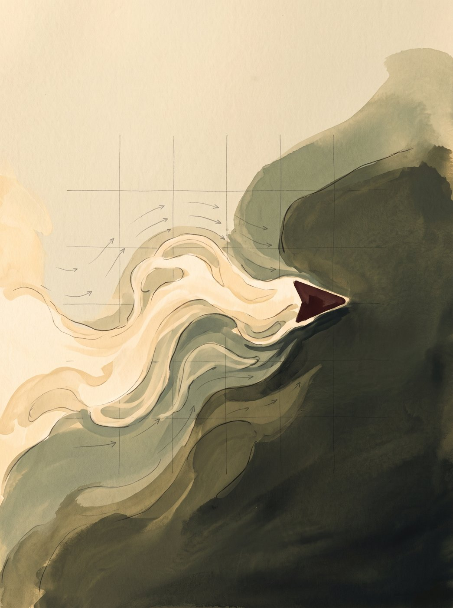
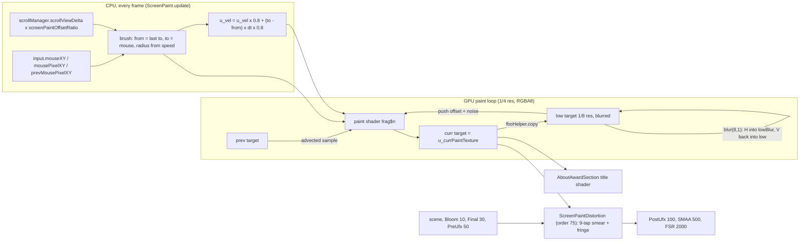
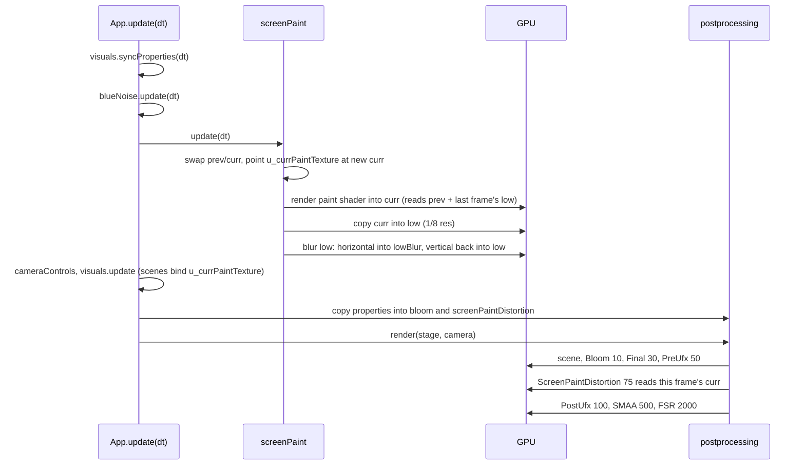

> **Read in Notion:** [14. Special: the ScreenPaint cursor trail](https://shifatmasud.notion.site/3fe48559569d81a98b50c232287e3463) · Part of [Lusion.co Decoded](https://shifatmasud.notion.site/Lusion-co-Decoded-Client-Side-Handbook-3fd48559569d81dd80b4c7407caf27cc) · [Repo home](https://github.com/shifatmasud/lusion-decoded)

<callout icon="💧" color="purple_bg">
	**Special chapter.** The liquid-glass cursor trail on lusion.co isn't a fluid solver and isn't a refraction shader in the physics sense. It's two small GPU passes. **ScreenPaint** (module 020) turns the pointer into an 8-bit velocity-and-weight texture that keeps moving and fading by itself. **ScreenPaintDistortion** (module 125, render order 75) reads that texture and smears the finished frame along the stored velocity with 9 taps, then adds a rainbow fringe on the fading edges. Chapter 5 (section 5.6) introduced the brush and chapter 8 placed the pass in the chain. This chapter covers everything else: every uniform, every channel, the live tuning values, the frame order, who else reads the texture, and how to build your own.
</callout>

## S.1 Where it lives
<table header-row="true">
<tr>
<td>Piece</td>
<td>File in the study archive</td>
<td>Role</td>
</tr>
<tr>
<td>`ScreenPaint` class (singleton `screenPaint`)</td>
<td>`modules/020_ScreenPaint.js` (5,400 bytes; bundle bytes 612138–616322)</td>
<td>Owns 4 render targets, builds the brush, runs the paint shader once per frame</td>
</tr>
<tr>
<td>Paint shader `frag$n`</td>
<td>`shaders_by_owner/ScreenPaint__fragSn.frag.glsl` (2,083 bytes; bundle byte 610092)</td>
<td>Draws the capsule, advects, decays, injects velocity</td>
</tr>
<tr>
<td>`ScreenPaintDistortion extends PostEffect`</td>
<td>`modules/125_ScreenPaintDistortion.js` (2,962 bytes; bundle bytes 1193397–1195910)</td>
<td>Post pass at render order 75 that bends the final frame</td>
</tr>
<tr>
<td>Distortion shader `frag$1`</td>
<td>`shaders_by_owner/ScreenPaintDistortion__fragS1.frag.glsl` (907 bytes; bundle byte 1192549). Compiled at runtime as program `runtime/home_compiled_shaders/037.glsl`</td>
<td>9-tap directional smear plus colour fringe</td>
</tr>
<tr>
<td>Separable blur</td>
<td>`modules/017_Blur.js`</td>
<td>Softens the 1/8-resolution copy that feeds back as the "push"</td>
</tr>
<tr>
<td>Render target factory</td>
<td>`modules/011_FboHelper.js`</td>
<td>`createRenderTarget(1, 1)` defaults to `UnsignedByteType`, linear filtering, clamp, no depth</td>
</tr>
<tr>
<td>Wiring and per-frame tuning</td>
<td>`modules/136_App.js` (init, resize, update, lines 132–146)</td>
<td>Creates both, pushes the queue, copies `properties.*` values into them every frame</td>
</tr>
<tr>
<td>Default tuning values</td>
<td>`modules/005_Properties.js`</td>
<td>`screenPaint*` and `screenPaintDistortion*` defaults</td>
</tr>
<tr>
<td>Scenes that change the tuning</td>
<td>`065_GoalSection.js`, `094_AboutHero.js`, `105_AboutCapabilitySection.js`</td>
<td>Change `screenPaintOffsetRatio` and the RGB shift per section</td>
</tr>
<tr>
<td>Shaders that bind or read the texture</td>
<td>`AboutAwardSection__titleFrag` (reads it), plus `021`, `032`, `037`, `071`, `072`, `019` (bind or declare it)</td>
<td>See S.8</td>
</tr>
</table>
A bundle-splitting quirk: the distortion shader string sits at the end of the `124_Bloom.js` slice (its bytes come just before the class), and the `125_ScreenPaintDistortion.js` slice ends with the `Final` grade shader. The minified names `frag$1` and `frag$n` connect each class to its shader.
## S.2 The whole system in one diagram

## S.3 Render targets and the texel layout
**Confirmed (quoted, `020_ScreenPaint.js`):**
```javascript
resize(e, t) {
  let r = e >> 2,
    n = t >> 2,
    a = e >> 3,
    l = t >> 3;
  ...
    (this._currPaintRenderTarget.setSize(r, n),
    this._prevPaintRenderTarget.setSize(r, n),
    this._lowRenderTarget.setSize(a, l),
    this._lowBlurRenderTarget.setSize(a, l),
```
```javascript
clear = () => {
  (fboHelper.clearColor(0.5, 0.5, 0, 0, this._lowRenderTarget),
  ...
```
- **Four targets.** `prev` and `curr` at a quarter of the render size (360×225 for a 1440×900 render size) swap roles every frame. `low` and `lowBlur` at an eighth of the render size (180×112) hold the blurred feedback copy. `lowBlur` is only the blur's scratch buffer.
- **8-bit storage.** `fboHelper.createRenderTarget(1, 1)` passes no float flag, so every target is `UnsignedByteType`. Values can only be 0 to 1 in steps of 1/255.
- **Channel meaning** (from the clear colour and both shaders):

<table header-row="true">
<tr>
<td>Channel</td>
<td>Stores</td>
<td>Rest value</td>
<td>Live fade per frame</td>
</tr>
<tr>
<td>R, G</td>
<td>velocity x and y, biased: 0.5 means still</td>
<td>0.5</td>
<td>× 0.975 (`screenPaintVelocityDissipation`)</td>
</tr>
<tr>
<td>B</td>
<td>weight 1: the long tail</td>
<td>0</td>
<td>× 0.95 (`screenPaintWeight1Dissipation`)</td>
</tr>
<tr>
<td>A</td>
<td>weight 2: the short bright head</td>
<td>0</td>
<td>× 0.8 (`screenPaintWeight2Dissipation`)</td>
</tr>
</table>
At 60 fps those fades mean half-lives of about 27 frames (0.45 s) for velocity, 13.5 frames (0.23 s) for the tail and 3 frames (0.05 s) for the head. That gap between B and A is why the trail has a crisp leading stroke and a long soft wake.
## S.4 The CPU side: from pointer to brush
**Confirmed (quoted, `020_ScreenPaint.update`):**
```javascript
let t = this._currPaintRenderTarget.width,
  r = this._currPaintRenderTarget.height,
  n = this._prevPaintRenderTarget;
((this._prevPaintRenderTarget = this._currPaintRenderTarget),
  (this._currPaintRenderTarget = n),
  (this.sharedUniforms.u_prevPaintTexture.value = this._prevPaintRenderTarget.texture),
  (this.sharedUniforms.u_currPaintTexture.value = this._currPaintRenderTarget.texture));
```
**1. Ping-pong swap first.** Last frame's output becomes `prev`, and the shared uniform `u_currPaintTexture` is pointed at the target about to be written. Every consumer holds a reference to that same uniform object, so they always read this frame's paint without being told.
```javascript
let u = _v$4.distanceTo(input.prevMousePixelXY),
  f = math.fit(u, 0, this.radiusDistanceRange, this.minRadius, this.maxRadius);
(Math.abs(scrollManager.scrollViewDelta) == 0 &&
  (!input.hadMoved ||
    !this.drawEnabled ||
    ((this.needsMouseDown || browser$1.isMobile) && (!input.isDown || !input.wasDown))) &&
  (f = 0),
  (f = (f / properties.viewportHeight) * r),
```
**2. Radius from speed.** The distance the pointer moved this frame (in CSS pixels) is mapped from 0–100 to `minRadius`–`maxRadius`. `App` sets `maxRadius = Math.max(40, properties.viewportWidth / 20)`, so on a 1440-wide window a fast flick paints a 72 px brush. That is 18 texels in the 225-row paint target after the last line converts CSS pixels to paint pixels. A still pointer gives radius 0, so nothing is drawn.

**3. When it refuses to paint.** If the page isn't scrolling and the pointer hasn't moved, or drawing is off, or the device is mobile (or `needsMouseDown` is set) and the finger isn't held down for two frames in a row, the radius is forced to 0. On phones the trail only appears while you drag.
```javascript
this._fromDrawData.copy(this._toDrawData),
_v$4.copy(input.mouseXY),
(_v$4.x += l),
(_v$4.y += c),
this._toDrawData.set(((_v$4.x + 1) * t) / 2, ((_v$4.y + 1) * r) / 2, f, 1),
_v$4
  .set(this._toDrawData.x - this._fromDrawData.x, this._toDrawData.y - this._fromDrawData.y)
  .multiplyScalar(e * 0.8),
this._material.uniforms.u_vel.value.multiplyScalar(this.accelerationDissipation).add(_v$4),
```
**4. The brush is a segment, not a dot.** `u_drawFrom` is last frame's `u_drawTo`, and `u_drawTo` is the pointer converted from -1…1 to paint pixels. Packed as `(x, y, radius, weight)`, with weight always 1. Drawing the whole segment means a fast mouse never leaves gaps.

**5. Brush velocity is a leaky integrator.** The movement in paint pixels, times `dt × 0.8`, is added to `u_vel` after the old value is multiplied by `accelerationDissipation` (0.8). Under steady motion it settles at about 5× one frame's step. That smooths jitter and gives the stroke a little momentum after you stop.

**6. Scroll is part of the input.** `scrollViewDelta × properties.screenPaintOffsetRatio` is added to the pointer, scaled ×3 viewport for the radius test, so scrolling with a still mouse still paints a vertical streak. Sections change the ratio: `GoalSection` sets it to `1 - E` from its own progress, `AboutCapabilitySection` multiplies it down near its edges, and `AboutHero` sets it to 0.
```javascript
fboHelper.render(this._material, this._currPaintRenderTarget),
fboHelper.copy(this._currPaintRenderTarget.texture, this._lowRenderTarget),
blur.blur(8, 1, this._lowRenderTarget, this._lowBlurRenderTarget));
```
**7. Three GPU calls.** Paint into `curr`, copy it down to 1/8 resolution, then blur that copy. In `017_Blur.js`, `blur(radius, scale, input, intermediate)` with no output argument renders horizontally into `lowBlur` and vertically back into `low`, so `low` is blurred in place. The paint shader reads it next frame.
## S.5 The paint shader, line by line
**Confirmed (quoted, `ScreenPaint__fragSn`, whitespace added):**
```glsl
vec2 sdSegment(in vec2 p, in vec2 a, in vec2 b){
  vec2 pa = p - a, ba = b - a;
  float h = clamp(dot(pa, ba) / dot(ba, ba), 0.0, 1.0);
  return vec2(length(pa - ba * h), h);
}
void main(){
  vec2 res = sdSegment(gl_FragCoord.xy, u_drawFrom.xy, u_drawTo.xy);
  vec2 radiusWeight = mix(u_drawFrom.zw, u_drawTo.zw, res.y);
  float d = 1.0 - smoothstep(-0.01, radiusWeight.x, res.x);
  vec4 lowData = texture2D(u_lowPaintTexture, v_uv - u_scrollOffset);
  vec2 velInv = (0.5 - lowData.xy) * u_pushStrength;
#ifdef USE_NOISE
  vec3 noise3 = noised(gl_FragCoord.xy * u_curlScale * (1.0 - lowData.xy));
  vec2 noise = noised(gl_FragCoord.xy * u_curlScale * (2.0 - lowData.xy * (0.5 + noise3.x) + noise3.yz * 0.1)).yz;
  velInv += noise * (lowData.z + lowData.w) * u_curlStrength;
#endif
  vec4 data = texture2D(u_prevPaintTexture, v_uv - u_scrollOffset + velInv * u_paintTexelSize);
  data.xy -= 0.5;
  vec4 delta = (u_dissipations.xxyz - 1.0) * data;
  vec2 newVel = u_vel * d;
  delta += vec4(newVel, radiusWeight.yy * d);
  delta.zw = sign(delta.zw) * max(vec2(0.004), abs(delta.zw));
  data += delta;
  data.xy += 0.5;
  gl_FragColor = clamp(data, vec4(0.0), vec4(1.0));
}
```
- **`sdSegment`.** Distance from this texel to the line from `drawFrom` to `drawTo`, plus `h`, how far along the line (0 to 1) the closest point sits. This is the classic capsule distance function.
- **`radiusWeight`.** Radius and weight blended along the segment, so a stroke can taper if the two ends differ. In practice `from.z` is last frame's radius, so a speeding-up stroke widens toward its head.
- **`d`.** The brush mask: 1 on the line, fading to 0 at the radius. The `-0.01` lower edge makes a radius of 0 give `d = 0` everywhere.
- **`lowData` and `velInv`.** Read the blurred 1/8 copy and flip its velocity, scaled by `u_pushStrength` (25). This is the "spread": each texel samples its old value 25 texels upstream along the blurred flow, so painted motion keeps travelling and the wake widens. This is semi-Lagrangian advection, done once, with no pressure solve.
- **Noise (on in production).** `noised` is a gradient noise that returns its value and its analytic derivative. The derivative (`.yz`) bends the advection offset, scaled by how much paint is there (`z + w`) and by `u_curlStrength` (3). The input coordinates are warped by the velocity itself, so the swirls follow the stroke. Live values: `screenPaintUseNoise: true`, `curlScale 0.02`, `curlStrength 3`. Class defaults (`false`, 0.1, 5) are overwritten each frame by `App`.
- **`data` and the bias.** Sample `prev` at the advected position, then remove the 0.5 bias so velocity is signed.
- **`delta = (u_dissipations.xxyz - 1.0) * data`.** One line applies all three fades. Adding `(k - 1) × value` to a value is the same as multiplying it by `k`: velocity by `.x`, B by `.y`, A by `.z`.
- **Injection.** Inside the brush, add the smoothed brush velocity to xy and the brush weight to both z and w.
- **`max(0.004, …)`.** Forces every weight change to be at least 0.004, about 1/255. In an 8-bit target a multiply like `0.012 × 0.95` rounds back to the same value forever, so without this the trail would never fully fade (or fill). With it, weights always step to exactly 0 or 1.
- **Re-bias and clamp.** Back to 0–1 so it fits the RGBA8 target.
## S.6 The distortion pass, line by line
**Confirmed (quoted, `ScreenPaintDistortion__fragS1`, whitespace added):**
```glsl
#include <getBlueNoise>
void main(){
  vec3 bnoise = getBlueNoise(gl_FragCoord.xy + vec2(17., 29.));
  vec4 data = texture2D(u_screenPaintTexture, v_uv);
  float weight = (data.z + data.w) * 0.5;
  vec2 vel = (0.5 - data.xy - 0.001) * 2. * weight;
  vec4 color = vec4(0.0);
  vec2 velocity = vel * u_amount / 4.0 * u_screenPaintTexelSize * u_multiplier;
  vec2 uv = v_uv + bnoise.xy * velocity;
  for(int i = 0; i < 9; i++){ color += texture2D(u_texture, uv); uv += velocity; }
  color /= 9.;
  color.rgb += sin(vec3(vel.x + vel.y) * 40.0 + vec3(0.0, 2.0, 4.0) * u_rgbShift)
             * smoothstep(0.4, -0.9, weight) * u_shade * max(abs(vel.x), abs(vel.y)) * u_colorMultiplier;
  gl_FragColor = color;
}
```
- **`data` at `v_uv`.** The paint texture covers the screen exactly, so the full-screen UV reads the right texel. Bilinear filtering upsamples it from 1/4 resolution for free.
- **`weight`.** The average of the long tail and the short head.
- **`vel`.** Signed velocity in -1…1, flipped, times weight, so the effect fades out with the paint even if a little velocity is left. The `-0.001` nudges away 8-bit rounding around 0.5.
- **`velocity`.** One step in UV units. With the live values (`amount` 3, `multiplier` 5) one step is `vel × 3.75` paint texels, so at full strength the 9 taps span about 30 paint texels, roughly 120 pixels at a 1:1 render scale.
- **Blue-noise start.** The first tap is jittered by up to one step. That turns the banding you'd get from 9 fixed taps into fine grain.
- **The 9-tap loop.** It averages samples along the velocity. The average both moves the picture (the mean offset is 4 steps) and blurs it along the motion. That moved-and-smeared look is what your eye reads as liquid glass. No normals, no index of refraction.
- **The fringe.** `sin(phase + (0, 2, 4) × rgbShift)` gives three phase-shifted sine waves, one per colour channel, which is a cheap rainbow like oil on water. `smoothstep(0.4, -0.9, weight)` has its edges reversed, so it is strongest where weight is low and gone above 0.4: the colour only shows in the fading wake, not the fresh stroke. It is scaled by `shade` (1.25), by speed, and by `colorMultiplier` (10 live).
- **Skipped when idle?** `needsRender()` returns `amount > 0`, so a section can switch the pass off by setting the amount to 0. With the default amount of 3 it runs every frame, even with an empty paint texture.

**Confirmed (quoted, `136_App.update`):** the pass is re-tuned every frame from `properties`, which sections can change:
```javascript
(properties.screenPaintDistortion.amount = properties.screenPaintDistortionAmount),
(properties.screenPaintDistortion.rgbShift = properties.screenPaintDistortionRGBShift),
(properties.screenPaintDistortion.colorMultiplier = properties.screenPaintDistortionColorMultiplier),
(properties.screenPaintDistortion.multiplier = properties.screenPaintDistortionMultiplier),
```
`AboutHero` blends the RGB shift from 0 up to the default (0.5) as you leave its section, so the about-page hero gets a clean, colourless smear.
## S.7 Frame order

Two consequences. The paint is written before the scene draws, so the distortion and any scene shader see the current frame. The push field, though, is one frame old, because `low` is refreshed after the paint render. And the distortion runs before PostUfx (100), so whatever PostUfx draws on top is not smeared.
## S.8 Who else uses the texture
The shared uniform object `screenPaint.sharedUniforms.u_currPaintTexture` is passed into other materials, so they all follow the swap automatically.
- **Reads it (confirmed): `AboutAwardSection__titleFrag`.** It samples with bicubic filtering, at screen position, and uses it to colour the award titles:

```glsl
vec2 screenPaintUv = gl_FragCoord.xy / u_resolution;
vec4 screenPaintData = textureBicubic(u_screenPaintTexture, screenPaintUv, u_screenPaintTextureSize);
...
float hue = (screenPaintData.x + screenPaintData.y) * 1.5 + d * 2.;
vec3 color = mix(baseColor, texture2D(u_gradientTexture, vec2(hue, 0.0)).rgb,
                 max(screenPaintData.z, screenPaintData.w) * screenPaintStrength + constantStrength) + noise.x * 0.004;
```
  Velocity picks a hue from a gradient strip, and weight decides how much of it shows (`screenPaintStrength` is 1, raised to 4 in one branch of the shader). The cursor literally paints colour into the type. Bicubic sampling hides the 1/4-resolution texels on large letters.
- **Bind or declare it, but the shipped `main()` doesn't sample it (confirmed by search):** `HomeBalloonsBackground` (021, also live as runtime program 069), `HomeReelSection` video (037, runtime program 089), `ProjectDetailsItem` (072), `UfxMesh` (032), `UfxTextMesh` (071), and a shader string in the `019_BlueNoise` slice. Their uniform lists include `u_screenPaintTexture`, but nothing reads it.
- **Uses the tuning only:** `GoalSection` (065), `AboutCapabilitySection` (105) and `AboutHero` (094) change the scroll ratio and the RGB shift, not the texture.
- **Not a reader, despite the file:** `124_Bloom.js` only contains the distortion shader text because of where the bundle split fell.
## S.9 Reuse it: a cursor liquid trail for three.js and React
The pattern: **paint pointer motion into a small texture that advects and fades by itself, then use that texture as a displacement field in one post pass.** The code below is my own teaching version, not Lusion's. It uses half-float targets, so velocity is signed and needs no 0.5 bias or 1/255 floor, and it makes the fades frame-rate independent with `pow(k, dt × 60)`.

**Original: `cursorPaint.ts`**
```typescript
import * as THREE from 'three';
import { FullScreenQuad } from 'three/examples/jsm/postprocessing/Pass.js';

const paintFrag = /* glsl */ `
uniform sampler2D uPrev; uniform vec2 uTexel, uA, uB, uVel;
uniform float uRadius, uAdvect; uniform vec3 uDecay;
varying vec2 vUv;
void main() {
  vec2 px = vUv / uTexel, ab = uB - uA;
  float t = clamp(dot(px - uA, ab) / max(dot(ab, ab), 1e-4), 0., 1.);
  float brush = uRadius > 0. ? 1. - smoothstep(0., uRadius, length(px - uA - ab * t)) : 0.;
  vec2 flow = texture2D(uPrev, vUv).xy;                 // signed, float target
  vec4 s = texture2D(uPrev, vUv - flow * uAdvect * uTexel); // carry paint along its motion
  s.xy *= uDecay.x; s.z *= uDecay.y; s.w *= uDecay.z;
  s.xy += uVel * brush;
  s.zw = min(s.zw + brush, 1.);
  gl_FragColor = s;
}`;

export const distortFrag = /* glsl */ `
uniform sampler2D tDiffuse, uPaint; uniform vec2 uTexel; uniform float uStrength;
varying vec2 vUv;
void main() {
  vec4 p = texture2D(uPaint, vUv);
  float w = 0.5 * (p.z + p.w);
  vec2 stepUv = -p.xy * w * uStrength * uTexel;
  vec3 c = vec3(0.); vec2 uv = vUv;
  for (int i = 0; i < 8; i++) { c += texture2D(tDiffuse, uv).rgb; uv += stepUv; }
  c /= 8.;
  float wake = (1. - smoothstep(0., .5, w)) * min(length(p.xy) * .05, 1.);
  c += wake * .15 * (.5 + .5 * cos(6.2831 * (dot(p.xy, vec2(.02)) + vec3(0., .33, .67))));
  gl_FragColor = vec4(c, 1.);
}`;

const vert = `varying vec2 vUv; void main(){ vUv = uv; gl_Position = vec4(position.xy, 0., 1.); }`;

export class CursorPaint {
  private a: THREE.WebGLRenderTarget; private b: THREE.WebGLRenderTarget;
  private quad: FullScreenQuad; private mat: THREE.ShaderMaterial;
  private last = new THREE.Vector2(-1, -1); private vel = new THREE.Vector2();
  texture!: THREE.Texture;

  constructor(private gl: THREE.WebGLRenderer, w: number, h: number, private scale = 0.25) {
    const opts = { type: THREE.HalfFloatType, depthBuffer: false };
    this.a = new THREE.WebGLRenderTarget(1, 1, opts);
    this.b = new THREE.WebGLRenderTarget(1, 1, opts);
    this.mat = new THREE.ShaderMaterial({
      vertexShader: vert, fragmentShader: paintFrag,
      uniforms: { uPrev: { value: null }, uTexel: { value: new THREE.Vector2() },
        uA: { value: new THREE.Vector2() }, uB: { value: new THREE.Vector2() },
        uVel: { value: new THREE.Vector2() }, uRadius: { value: 0 },
        uAdvect: { value: 0.6 }, uDecay: { value: new THREE.Vector3() } },
    });
    this.quad = new FullScreenQuad(this.mat);
    this.setSize(w, h);
  }

  setSize(w: number, h: number) {
    const pw = Math.max(1, Math.floor(w * this.scale)), ph = Math.max(1, Math.floor(h * this.scale));
    this.a.setSize(pw, ph); this.b.setSize(pw, ph);
    this.mat.uniforms.uTexel.value.set(1 / pw, 1 / ph);
  }

  /** pointer in 0..1 UV (y up), dt in seconds */
  update(pointer: THREE.Vector2, dt: number, maxRadiusPx = 18) {
    [this.a, this.b] = [this.b, this.a];                     // ping-pong
    const u = this.mat.uniforms, pw = this.a.width, ph = this.a.height;
    const to = new THREE.Vector2(pointer.x * pw, pointer.y * ph);
    if (this.last.x < 0) this.last.copy(to);
    const move = to.clone().sub(this.last);
    const f = dt * 60;
    this.vel.multiplyScalar(Math.pow(0.8, f)).add(move);      // smoothed brush velocity
    u.uA.value.copy(this.last); u.uB.value.copy(to);
    u.uRadius.value = THREE.MathUtils.clamp(move.length() / 10, 0, 1) * maxRadiusPx;
    u.uVel.value.copy(this.vel);
    u.uDecay.value.set(Math.pow(0.975, f), Math.pow(0.95, f), Math.pow(0.8, f));
    u.uPrev.value = this.b.texture;
    this.gl.setRenderTarget(this.a); this.quad.render(this.gl); this.gl.setRenderTarget(null);
    this.texture = this.a.texture;
    this.last.copy(to);
  }
}
```
**Original: React Three Fiber wiring**
```tsx
import { useFrame, useThree } from '@react-three/fiber';
import { EffectComposer, RenderPass, ShaderPass } from 'three-stdlib';
import { useEffect, useMemo } from 'react';
import * as THREE from 'three';
import { CursorPaint, distortFrag } from './cursorPaint';

export function CursorLiquid({ strength = 12 }) {
  const { gl, scene, camera, size, pointer } = useThree();
  const paint = useMemo(() => new CursorPaint(gl, size.width, size.height), [gl]);
  const [composer, pass] = useMemo(() => {
    const c = new EffectComposer(gl);
    c.addPass(new RenderPass(scene, camera));
    const p = new ShaderPass({
      uniforms: { tDiffuse: { value: null }, uPaint: { value: null },
        uTexel: { value: new THREE.Vector2() }, uStrength: { value: strength } },
      vertexShader: `varying vec2 vUv; void main(){ vUv = uv; gl_Position = projectionMatrix * modelViewMatrix * vec4(position, 1.); }`,
      fragmentShader: distortFrag,
    });
    c.addPass(p);
    return [c, p];
  }, [gl, scene, camera]);

  useEffect(() => {
    paint.setSize(size.width, size.height);
    composer.setSize(size.width, size.height);
    pass.uniforms.uTexel.value.set(4 / size.width, 4 / size.height); // paint texel at 1/4 res
  }, [size]);

  const uv = useMemo(() => new THREE.Vector2(), []);
  useFrame((_, dt) => {
    uv.set(pointer.x * 0.5 + 0.5, pointer.y * 0.5 + 0.5);
    paint.update(uv, Math.min(dt, 1 / 20));
    pass.uniforms.uPaint.value = paint.texture;
    composer.render(dt);
  }, 1); // priority 1: R3F stops its own render, we render through the composer
  return null;
}
```
**Upgrades in Lusion's order of value:**
1. **Blurred push field.** Copy the paint to 1/8 resolution, blur it, and advect from that instead of from the sharp texel. That gives the soft, widening wake.
2. **Noise in the advection.** Add a gradient-noise offset scaled by the paint weight, so the wake curls instead of sliding straight.
3. **Scroll as input.** Add your scroll delta to the pointer and shift the advection lookup by it, so the trail sticks to the page while you scroll.
4. **Share the texture.** Pass the same `{ value }` uniform object into other materials (titles, images) so they can tint or warp themselves where the cursor has been.
5. **Mobile rule.** Only paint while a finger is down, as Lusion does.
## S.10 Confirmed vs inference
<table header-row="true">
<tr>
<td>Observation</td>
<td>Status</td>
<td>Evidence</td>
</tr>
<tr>
<td>Paint targets are 1/4 render size (`>> 2`), feedback targets 1/8 (`>> 3`)</td>
<td>Confirmed</td>
<td>`ScreenPaint.resize`</td>
</tr>
<tr>
<td>All four targets are RGBA8 (`UnsignedByteType`), linear, clamp, no depth</td>
<td>Confirmed</td>
<td>`FboHelper.createRenderTarget` defaults; ScreenPaint calls it with `(1, 1)` only</td>
</tr>
<tr>
<td>R,G = biased velocity, B and A = two weights; cleared to (0.5, 0.5, 0, 0)</td>
<td>Confirmed</td>
<td>`clear()`, paint shader `data.xy -= 0.5`, `u_dissipations.xxyz`</td>
</tr>
<tr>
<td>Live values: push 25, velocity 0.975, weight1 0.95, weight2 0.8, noise on, curlScale 0.02, curlStrength 3, distortion amount 3, RGB shift 0.5, colour multiplier 10, multiplier 5</td>
<td>Confirmed</td>
<td>`005_Properties` defaults, copied each frame in `136_App` lines 132–146</td>
</tr>
<tr>
<td>`maxRadius = max(40, viewportWidth / 20)`; radius 0 when idle; mobile paints only while held</td>
<td>Confirmed</td>
<td>`136_App`, `ScreenPaint.update`</td>
</tr>
<tr>
<td>Paint renders before the scene; the distortion pass is order 75, before PostUfx 100</td>
<td>Confirmed</td>
<td>`App.update` order, `renderOrder = 75`</td>
</tr>
<tr>
<td>The distortion shader is compiled on the home page</td>
<td>Confirmed</td>
<td>`runtime/home_compiled_shaders/037.glsl` matches `frag$1`</td>
</tr>
<tr>
<td>Only `AboutAwardSection` title and the distortion pass sample the texture; six other shaders declare it unused</td>
<td>Confirmed for shipped shader strings</td>
<td>Search for `texture2D(u_screenPaintTexture` and `textureBicubic(u_screenPaintTexture` in `shaders_by_owner/`</td>
</tr>
<tr>
<td>Both `u_scrollOffset` assignments write `.y`, so the horizontal case never sets `.x`</td>
<td>Confirmed (code); a bug that is harmless on vertical pages (inference)</td>
<td>`ScreenPaint.update`</td>
</tr>
<tr>
<td>Fades are per frame, not scaled by `dt`, so a 120 Hz screen fades about twice as fast</td>
<td>Confirmed (code); visual effect is inference</td>
<td>`u_dissipations` set from raw constants</td>
</tr>
<tr>
<td>The `0.004` floor exists to beat 8-bit rounding</td>
<td>Inference</td>
<td>0.004 ≈ 1/255 and the targets are RGBA8</td>
</tr>
<tr>
<td>The "refraction" is perceptual: a velocity-directed smear plus a sine rainbow, not a physical IOR model</td>
<td>Inference from confirmed shader</td>
<td>No normals or refraction math in `frag$1`</td>
</tr>
<tr>
<td>The noise is a gradient (not a true curl) field</td>
<td>Inference from confirmed shader</td>
<td>Uses `noised().yz` directly; a curl would rotate it 90°</td>
</tr>
<tr>
<td>Unused texture uniforms are leftovers from earlier designs or shared material templates</td>
<td>Inference</td>
<td>Declared and bound, never sampled</td>
</tr>
</table>
