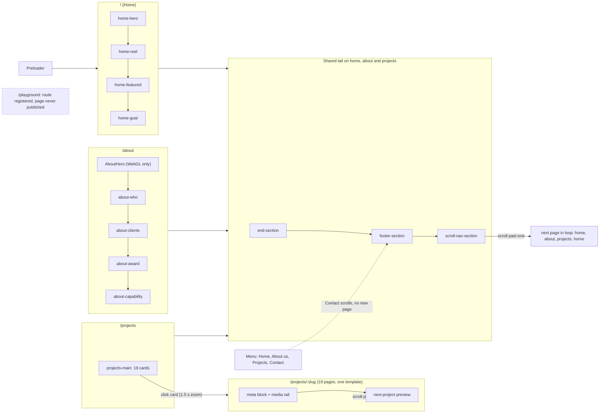

> **Read in Notion:** [15. Screenshot atlas: overview](https://shifatmasud.notion.site/3fe48559569d81069c7ff759ffc2bb9a) · Part of [Lusion.co Decoded](https://shifatmasud.notion.site/Lusion-co-Decoded-Client-Side-Handbook-3fd48559569d81dd80b4c7407caf27cc) · [Repo home](https://github.com/shifatmasud/lusion-decoded)

<callout icon="📸" color="gray_bg">
	A visual atlas of [lusion.co](http://lusion.co), page by page and section by section, written for an AI coding agent that has to rebuild the site faithfully. Chapters 1 to 14 explain how the engine works. This chapter shows what every page looks like and gives the measured values to match it: annotated screenshots, a rebuild spec per section, the exact CSS and the DOM outline.
</callout>
## What this atlas is for and how to read it
- **Purpose:** Give an agent a ground truth to build against and to check its work. Each page below walks the site in scroll order, one section at a time, at desktop 1440×900 and mobile 390×844.
- **Screenshots:** Every section has one image, desktop frames on top and mobile frames underneath. Numbered pink callouts mark the elements that were measured.
- **Callout tables:** Each number in the image has a row under it: selector, text, computed font, size, weight, letter spacing, colour and background, and its box (x, y, width × height) as measured in the live page.
- **Rebuild spec:** A short written spec of what the section does, then a line on what changes on mobile.
- **Driver facts:** The module that drives the section, the DOM elements it hooks, its easing curves and shader inputs, with links to the chapters that explain them.
- **Exact CSS and DOM outline:** Copied from the shipped stylesheet (desktop rules, then the 812px and 560px overrides) and the served HTML.
- **Confirmed vs inferred:** Selectors, computed styles, boxes, CSS rules, easing names, uniforms and DOM hooks come straight from the live page, `css/` or `modules/`. Anything marked *(inferred)* is a reading of the code or the picture.
## How the screenshots were made
- **Capture:** A Puppeteer script (`handbook/ch15/cap.mjs`) ran headless Chrome with SwiftShader WebGL. Mobile used an iPhone user agent and simulated finger swipes (`Input.synthesizeScrollGesture`).
- **Scrolling:** Lusion uses its own transform-based scroll (<mention-page url="https://shifatmasud.notion.site/3fd48559569d816d8a50c22e35b3ce7b">5. Scroll, input and motion</mention-page>), so `window.scrollTo` does nothing. The script waits for `#preloader` to clear, then scrolls with real wheel or touch input until each `.section` reaches the top, waits about 2 seconds for easing and WebGL to settle, and captures one frame per 900px of the section, up to three.
- **Callouts from measurement:** For each frame the script stored the boxes and computed styles of the visible elements in `#page-container`. `annotate.py` draws the numbered boxes from that data, not by hand. Header elements are left out of section frames and covered once below.
- **Files:** Raw PNGs, annotated JPGs, per-frame `meta.json` and `legend.json`, the composites and the Markdown for each page are in `/home/sprite/lusion/handbook/ch15/`.
## Site map

## Global elements
These sit outside the page content and appear on every page, so they're described once here.
- **Header (`#header`, module 069):** `position: fixed`, z-index 52, padding `var(--base-padding-y) var(--base-padding-x)`, font size `clamp(1rem, 1vw, 1.5rem)`. Black by default; `html.is-black-bg` and `html.is-blue-bg` switch it to white with a 0.25s transition. Logo SVG on the left, 7.5em wide (6em at 812px and below). On the right: a sound button (canvas waveform, hidden on mobile), "Let's talk" (`#header-right-talk-btn`, `--color-grey-blue` pill, 6.25em radius; on hover it turns `--header-color` #0016ec and the text slides 1.5em over 0.3s `cubic-bezier(0.4,0,0.1,1)`), and "Menu" (`#header-right-menu-btn`, `--color-dark-white` pill; the dots turn 270 degrees on hover or when open). On project pages the header also shows `#header-center-project-back-btn`. See <mention-page url="https://shifatmasud.notion.site/3fd48559569d81289d5ff6769e1f1d55">10. CSS, layout and DOM state</mention-page>.
- **Menu (`#header-menu`):** The panel opens from the right. `#header-background` is a 50vw gradient (`linear-gradient(270deg, #0b0b1280, #0b0b1200)`), full width in `--header-color` on mobile. It holds the links (Home, About us, Projects, Contact), a Labs card, the newsletter form and a talk button. Adding `--menu-opened` triggers the stagger, using `ease.lusion`, `cubicInOut` and `sineInOut`. See <mention-page url="https://shifatmasud.notion.site/3fd48559569d81289d5ff6769e1f1d55">10. CSS, layout and DOM state</mention-page>.
- **Contact is a scroll action:** The Contact link is a button with `data-scroll-to="contact"`. It scrolls the current page down to the footer contact block instead of opening a page. See <mention-page url="https://shifatmasud.notion.site/3fd48559569d816d8a50c22e35b3ce7b">5. Scroll, input and motion</mention-page>.
- **Loader (`#preloader`, module 137):** Fixed, z-index 200, black. A rolling percent counter `#preloader-percent-digits` sits bottom-left at `clamp(7em, 8vw, 20em)` (13vw on mobile); its digits roll with `ease.expoInOut`. When `html.is-ready` is set, the background goes transparent and the WebGL intro starts underneath. See <mention-page url="https://shifatmasud.notion.site/3fd48559569d81b397c9f275470e9b7a">9. Assets and loading</mention-page> and <mention-page url="https://shifatmasud.notion.site/3fd48559569d811e94b1cd6359ec9594">2. Boot sequence and main loop</mention-page>.
- **Cursor trail and distortion (ScreenPaint, modules 020 and 125):** Mouse movement is painted into a low-res fluid texture, and the post-processing distortion pass (order 75) uses it to bend the whole frame. See <mention-page url="https://shifatmasud.notion.site/3fe48559569d81a98b50c232287e3463">Special: Cursor fluid trail (ScreenPaint)</mention-page> and <mention-page url="https://shifatmasud.notion.site/3fd48559569d81daa932c9558ddf8b9a">8. Shaders and the post-processing pipeline</mention-page>.
- **Page transition (`#transition-overlay`, module 118):** Fixed, z-index 100. A WebGL wipe runs on `expoIn` going out and `expoOut` coming in, with an `expoInOut` scale dip to 0.2 in the middle; the router fetches the next page's HTML and swaps it in between. Projects to a project page uses its own 1.5 s card zoom instead. See <mention-page url="https://shifatmasud.notion.site/3fd48559569d817280f5e9676aca01db">6. Routing, pages and sections</mention-page>.
- **End section (`#end-section`, module 115):** The big closing call to action on home, about and projects, 350vh tall. The title is split into chars that roll in with `ease.lusion`, and the decoration crosses rotate 0 to 180 degrees. Specs in 15.1, section 5.
- **Footer (`#footer-section`, module 058):** White band (`#footer-bg` is `--color-white`, text black) with contact details, the newsletter form and a bottom row with copyright, tagline, Labs link and back-to-top. When it comes in it sets `html.is-footer-in`. Specs in 15.1, section 6; see <mention-page url="https://shifatmasud.notion.site/3fd48559569d81289d5ff6769e1f1d55">10. CSS, layout and DOM state</mention-page>.
- **Next-page bar (`#scroll-nav-section`, module 116):** The last strip on every page: #121416 background, white uppercase text, `#scroll-nav-text` at 3.5em naming the next page. Keep scrolling and `#scroll-nav-next-bar-inner` fills straight from the section's scroll ratio, with no easing; at the end the router moves to the next page in the loop (home, about, projects, home). See <mention-page url="https://shifatmasud.notion.site/3fd48559569d817280f5e9676aca01db">6. Routing, pages and sections</mention-page>.
- **DOM to WebGL sync (Ufx):** The reel, project thumbnails, goal frame, awards and project media are WebGL meshes that copy the size and position of empty HTML boxes. See <mention-page url="https://shifatmasud.notion.site/3fd48559569d816eb890f8d968ec1fae">4. DOM to WebGL sync (Ufx)</mention-page>.
- **Fonts and tokens:** Aeonik 400, 500 and 400 italic, all `font-display: block`; IBM Plex Mono for small numerals such as the projects count. Colours: `--color-black` #000000, `--color-white` #fff, `--color-off-white` #f0f1fa, `--color-dark-white` #e4e6ef, `--color-blue` #1a2ffb, `--header-color` #0016ec, `--color-grey-blue` #2b2e3a, `--color-green` #c1ff00, `--color-red` #ff4c41, `--color-purple` #8832f7. Grid: 12 columns, `--grid-gap: 2vw` (6 columns and 4vw at 812px and below). Corner radius: `--global-border-radius` 20px (10 to 15px on mobile). Padding: `--base-padding-x: max(5vw, 40px)` (25px, or 15px under 400px) and `--base-padding-y: clamp(30px, 4vw, 50px)`.
## Rebuild order for an agent
1. **Tokens and grid:** Copy the `:root` variables, the `@font-face` rules, the 12-column grid with its 812px switch to 6 columns, and the `--vh` mobile height fix (<mention-page url="https://shifatmasud.notion.site/3fd48559569d81289d5ff6769e1f1d55">10. CSS, layout and DOM state</mention-page>).
2. **Shell:** A fixed WebGL canvas behind a fixed `#ui` layer with `#header`, `#page-container` > `#page-container-inner`, and `#preloader` and `#transition-overlay` on top (<mention-page url="https://shifatmasud.notion.site/3fd48559569d8124ab68d56b80867ef5">1. Stack and bundle anatomy</mention-page>).
3. **Core loop:** One clock, the input object, the custom transform scroll, and `ScrollDomRange`, which gives every section an enter/exit ratio (<mention-page url="https://shifatmasud.notion.site/3fd48559569d811e94b1cd6359ec9594">2. Boot sequence and main loop</mention-page>, <mention-page url="https://shifatmasud.notion.site/3fd48559569d816d8a50c22e35b3ce7b">5. Scroll, input and motion</mention-page>, <mention-page url="https://shifatmasud.notion.site/3fd48559569d81c1b174e921471bcaf6">11. System architecture plan and conceptual model</mention-page>).
4. **Static HTML for every section:** Build each from the DOM outline and exact CSS in 15.1 to 15.4. Check it against the screenshots with WebGL turned off.
5. **Ufx layer:** Meshes that copy DOM boxes for the reel, project thumbnails, goal frame, awards and project media (<mention-page url="https://shifatmasud.notion.site/3fd48559569d816eb890f8d968ec1fae">4. DOM to WebGL sync (Ufx)</mention-page>).
6. **Section motion:** SplitType lines, words and chars, plus `fit(ratio, a, b, from, to, ease.lusion)` timelines, using the values in each section's driver facts.
7. **Scenes:** The home balloons, the goal tunnels, the about hero and the project-page plant shadows (<mention-page url="https://shifatmasud.notion.site/3fd48559569d81549fa5ff6c49d305fb">7. Effects and scenes</mention-page>).
8. **Post stack and ScreenPaint distortion** (<mention-page url="https://shifatmasud.notion.site/3fd48559569d810bb1f9d6e4e072ee8a">3. Rendering engine and post-processing</mention-page>, <mention-page url="https://shifatmasud.notion.site/3fd48559569d81daa932c9558ddf8b9a">8. Shaders and the post-processing pipeline</mention-page>, <mention-page url="https://shifatmasud.notion.site/3fe48559569d81a98b50c232287e3463">Special: Cursor fluid trail (ScreenPaint)</mention-page>).
9. **Router and shared tail:** Transition overlay, end section, footer and next-page loop, then the project-page template with its per-project data from 15.4 and 15.5 (<mention-page url="https://shifatmasud.notion.site/3fd48559569d817280f5e9676aca01db">6. Routing, pages and sections</mention-page>).
10. **Loader and assets:** Preloader counter and asset queue (<mention-page url="https://shifatmasud.notion.site/3fd48559569d81b397c9f275470e9b7a">9. Assets and loading</mention-page>).
11. **Mobile pass:** Check each page against the 390-wide frames.
## Pages in this chapter
- <mention-page url="https://shifatmasud.notion.site/3fe48559569d817bb6bfdc1a46b69d91">15.1 Home</mention-page>: hero with balloons, showreel, featured work, goal tunnel, then the shared end section, footer and next-page bar.
- <mention-page url="https://shifatmasud.notion.site/3fe48559569d810a98a2ee47788dcbb5">15.2 About</mention-page>: WebGL hero, the sideways "who we are" story, clients, awards and capability flip cards.
- <mention-page url="https://shifatmasud.notion.site/3fe48559569d815884e7f0f2ddd6a104">15.3 Projects</mention-page>: title block, the 19-card grid, hover state, the click into a project page, and mobile.
- <mention-page url="https://shifatmasud.notion.site/3fe48559569d816381a1cb2ae37987bd">15.4 Project page template</mention-page>: worked through on Oryzo AI: meta block, media rail, next-project preview, colour theming and plant-shadow background.
- <mention-page url="https://shifatmasud.notion.site/3fe48559569d817a9a25eb56b9252c63">15.5 Project pages gallery (the other 18)</mention-page>: first screen and one screen below of every other project page, with its measured per-project data.
## The unfinished Playground page
The site's code still registers a `playground` route next to home, about and projects (`PlaygroundPage`, module 112), but the page was never published. `lusion.co/playground` returns the home page's HTML byte for byte (59,671 bytes, the same as a made-up address). Loading it crashes within a second with `Cannot read properties of null (reading 'append')`, because `#playground-main-timeline` isn't in the served page, and the loader stays at 000.

The stylesheet and module show what it would have been: a black section three screens tall with a sticky inner screen, a clickable timeline across the middle with a progress bar driven by scroll, three dated dots (25 January 2019, 25 September 2019 and 25 April 2022) that turn `--color-blue` when reached or hovered, and a small `tunnel.buf` mesh drawn with `MeshNormalMaterial` behind it. Don't build it as a public page. Findings and crash logs: `ch15/15_6_playground_findings.md`.
## Verification checklist
Go section by section and compare your build with the screenshot at the same viewport (1440×900 and 390×844).

**Global**
- [ ] Preloader: black screen, rolling percent counter bottom-left, fading out to the hero as the balloons drop in.
- [ ] Header: logo left; sound, "Let's talk" and "Menu" pills right. Turns white over black or blue sections. The menu panel opens from the right and its links stagger in.
- [ ] Contact in the menu scrolls to the footer; it doesn't change page.
- [ ] Moving the mouse smears the whole frame (ScreenPaint distortion).
- [ ] Page transitions run `expoIn` going out and `expoOut` coming in; projects to a project page zooms the clicked card.

**15.1 Home**
- [ ] Hero: the intro line covers grid columns 4 to 8 at 2.5vw; the balloon frame matches `#home-hero-visual-container`, including its corner radius; the "Scroll to explore" crosses spin.
- [ ] Reel: the 10vw title, line 1 indented two columns, rolls in letter by letter; the thumbnail grows into full-width video and its corners straighten.
- [ ] Featured: 8vw title, 2-column card grid, tags at 0.9vw uppercase over names at 3vw; on hover the media zooms and the name rolls.
- [ ] Goal: 8vw title, and the tunnel frame follows scroll.

**15.2 About**
- [ ] The WebGL hero scene sits behind the first screen of `#about-who` (there is no `#about-hero` element).
- [ ] The who-track moves sideways across 350vw with easing that settles on each panel; the blue face cursor follows the mouse over the team.
- [ ] Client logos sit in 4 columns (3 on tablet and phone) and drift; award rows slide in staggered; capability cards flip from 180 to 0 degrees.

**15.3 Projects**
- [ ] The title rises letter by letter, the count (19) pops with elastic easing, and the cards sit 2 per row, 634×502 at 1440.
- [ ] Each thumbnail is a WebGL mesh over an empty rounded box.

**15.4 and 15.5 Project pages**
- [ ] The meta block sits vertically centred, 34em wide, and the project colour variables apply to the background.
- [ ] On desktop the media rail scrolls sideways by wheel or drag; on mobile it stacks vertically.
- [ ] The next-project preview slides in from the right (from below on mobile), and scrolling past the end opens the next project.
- [ ] Every project in 15.5 matches its measured title, meta list and colours.

**Shared tail**
- [ ] End section: the title rolls in letter by letter and the crosses rotate.
- [ ] Footer: columns rise and `html.is-footer-in` is set.
- [ ] Next-page bar: fills with scroll and moves to the next page in the loop.

**Mobile**
- [ ] 6-column grid, `--base-padding-x` 25px, the who-track stacked, cards in one column, no sound button.
## Caveats and gaps
- **Flat glow and colour:** The screenshots come from a browser with no graphics card (SwiftShader renders WebGL in software), so glow and colour look flatter than on a real screen. Frame timing is slower too, so some frames catch motion partway through and video textures may show an early frame. Layouts, HTML text and the position of every WebGL frame are still exact.
- **No screenshot of the home next-page bar:** Even at maximum scroll its top sits at 924px in a 900px viewport, so it never entered the frame. Its section in 15.1 is written from the CSS and module code.
- **Home end section:** no phone frame.
- **About clients:** the image is a frame showing the full logo grid, borrowed from the awards capture.
- **About awards:** the callout table has only one measured row.
- **About capabilities:** the text colour was measured as black, not white on blue as first written, and is marked unconfirmed.
- **Global states and transitions:** there are no dedicated screenshots of the menu, cursor trail or page transition on this page. Chapter 6 has frames of a real page transition, and chapter 7 has the hero after mouse sweeps.
- **Values not measured** are marked *(inferred)* on each sub-page.
## Sub-pages
<page url="https://shifatmasud.notion.site/3fe48559569d817bb6bfdc1a46b69d91">15.1 Home</page>
<page url="https://shifatmasud.notion.site/3fe48559569d810a98a2ee47788dcbb5">15.2 About</page>
<page url="https://shifatmasud.notion.site/3fe48559569d815884e7f0f2ddd6a104">15.3 Projects</page>
<page url="https://shifatmasud.notion.site/3fe48559569d816381a1cb2ae37987bd">15.4 Project page template</page>
<page url="https://shifatmasud.notion.site/3fe48559569d817a9a25eb56b9252c63">15.5 Project pages gallery (the other 18)</page>
