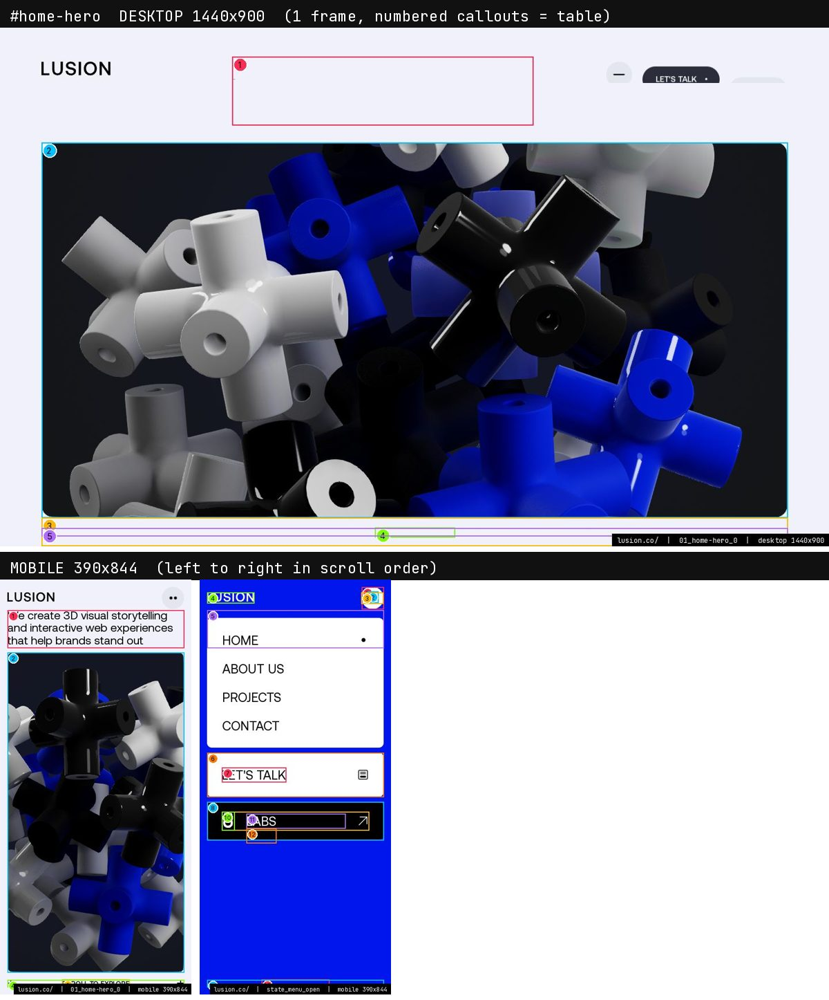
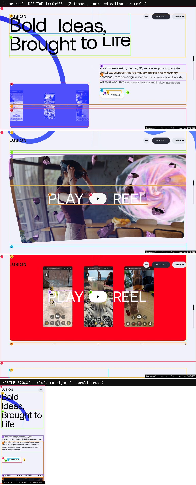
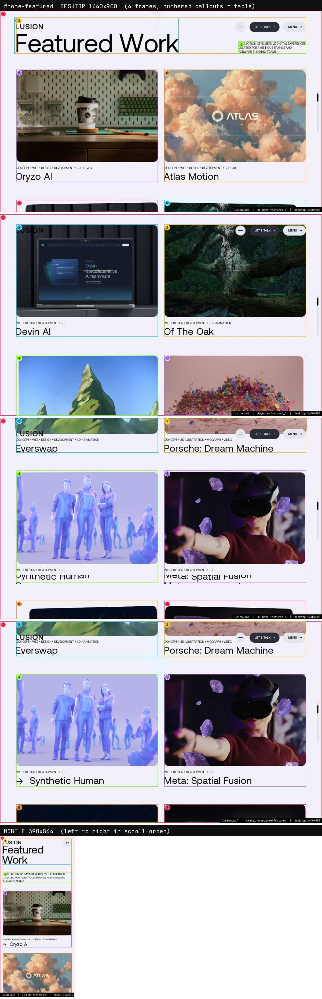
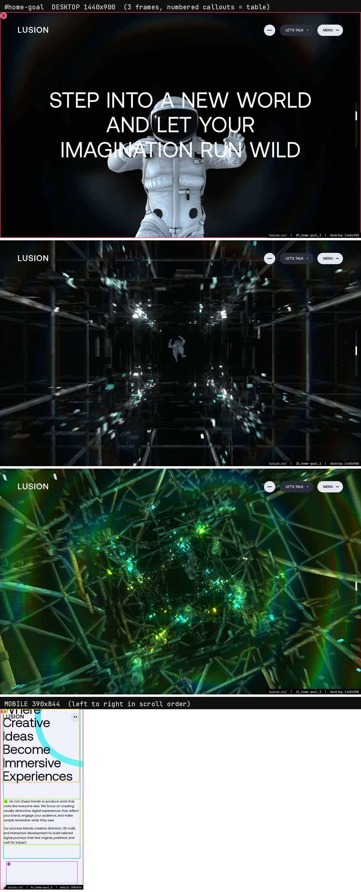
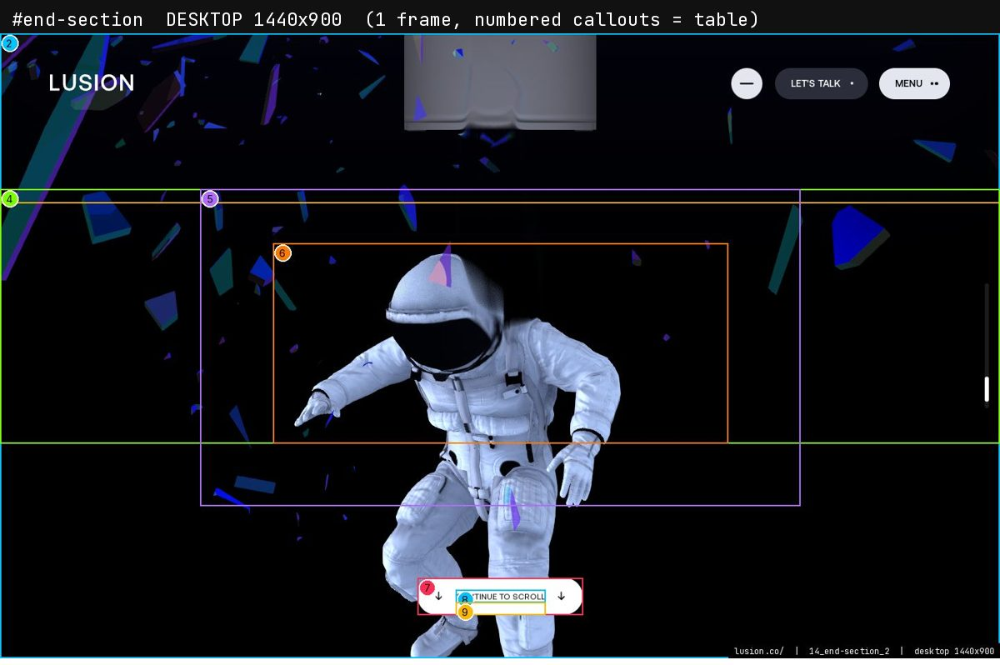
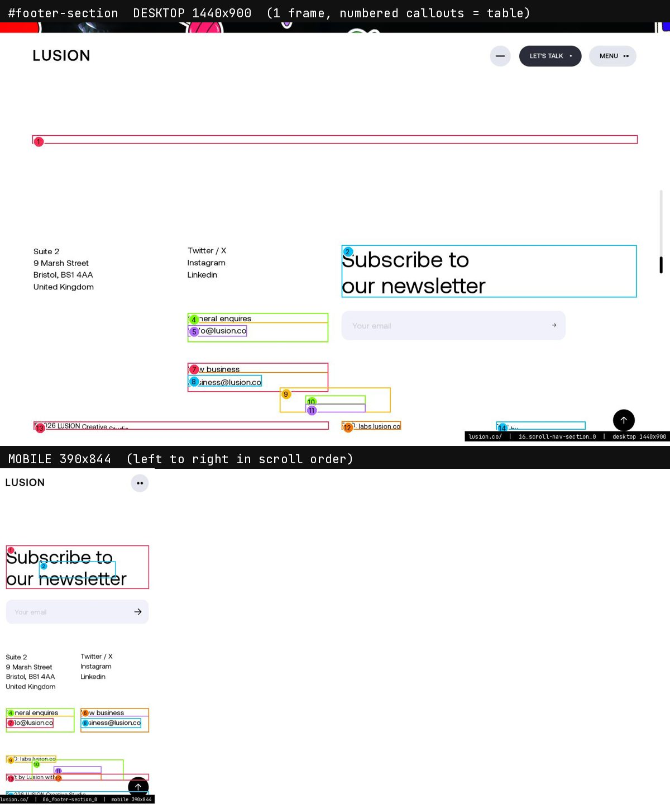

> **Read in Notion:** [15.1 Home](https://shifatmasud.notion.site/3fe48559569d817bb6bfdc1a46b69d91) · Part of [Lusion.co Decoded](https://shifatmasud.notion.site/Lusion-co-Decoded-Client-Side-Handbook-3fd48559569d81dd80b4c7407caf27cc) · [Repo home](https://github.com/shifatmasud/lusion-decoded)

<callout icon="🗺️" color="blue_bg">
	The home page is the flagship: a WebGL balloon hero, a showreel that expands from a thumbnail into a full-screen video, four featured projects, and the goal tunnel. Then come the shared end, footer and next-page sections. The page container is `#home`, and the sections are `.section` children inside `#page-container-inner`.
</callout>

**Sections in scroll order:** `#home-hero` → `#home-reel` → `#home-featured` → `#home-goal` → `#end-section` → `#footer-section` → `#scroll-nav-section`

**How to read this page:** each section has one image (desktop 1440×900 frames on top, mobile 390×844 row below). Numbers in the image match the callout table. Values in code blocks and tables are exact (from the shipped CSS, module source or measured computed styles); anything written as *inferred* is a reading, not a measured value. Screenshots come from a headless browser with software WebGL, so glow and colour can look flatter than on a real GPU.

**Tokens every section below uses (exact, from `:root` in the shipped CSS)**
```css
--color-blue: #1a2ffb;  --color-dark-blue: #071bdf;  --header-color: #0016ec;
--color-black: #000000; --color-white: #fff;  --color-off-white: #f0f1fa;  --color-dark-white: #e4e6ef;
--color-grey-blue: #2b2e3a; --color-green: #c1ff00; --color-red: #ff4c41; --color-purple: #8832f7;
--grid-gap: 2vw;            /* 4vw at max-width 812px */
--grid-space: calc((100% - 11 * var(--grid-gap)) / 12);   /* 12 columns; 6 on mobile */
--base-padding-x: max(5vw, 40px);        /* 25px <=812px, 15px <=400px, max(6vw,60px) at >=21:9 */
--base-padding-y: clamp(30px, 4vw, 50px); /* 25px <=812px, 15px <=400px */
--global-border-radius: 20px;             /* 10px at <=812px */
--header-size: clamp(1rem, 1vw, 2rem);  --cross-size: clamp(0.875rem, 1vw, 2rem);
```
Fonts: Aeonik 400 / 500 / 400 italic (body and display), IBMPlexMono 400 / 500 and LusionMono 400 (labels, counters, crosses), all `font-display: block` from `/assets/fonts/`. Background state is a class on `<html>`: `is-black-bg`, `is-blue-bg` or `is-white-bg`; under the first two the header text and scroll bar turn white.

## 1. Hero: balloons and intro line  `#home-hero`



**Rebuild spec**
Height is `calc(var(--vh) * 100)`. It's a grid with two rows (auto, then 1fr). Row 1 is the intro paragraph `#home-hero-title`: Aeonik 2.5vw, line-height 1.1, grid column 4 through 8 (`4 / span 5`). Row 2 is `#home-hero-visual-container`, a 12-column box that sets the rounded frame for the WebGL balloon scene. A full-screen `Mesh` with `u_domXY` and `u_domWH` uniforms copies that box's position and size, so the canvas always fits the DOM box. The balloons are `HomeBalloons` with hand-written physics (chapter 7). They drop in with `ease.backOut`, and the camera's FOV eases from 25 to 17.5 between page times 0.3 and 2. At the bottom, `#home-hero-scroll` says "Scroll to explore" between two rows of crosses (`.home-hero-scroll-container-cross`). The crosses spin 0 to 180 degrees and the words rise from 1.7em, rotated 15 degrees, with `ease.lusion`. When you scroll out, `homeBalloons.ratio = fit(range.ratio, 0, 1, 1, 0)` turns the scene off. The title is split into lines and words, and each line rises in with `ease.lusion`.

**Mobile (390 wide):** The title spans 6 columns at 6vw (7vw under 380px) and sits below the header. The visual container spans 6 columns, with `2 × base-padding-y` space under it. The scroll hint sits one padding above the bottom.

**Driven by:** `031_HomeHeroSection`, `024_HomeBalloons`, `023_HomeBalloonsPhysics`, `021_HomeBalloonsBackground`. Shaders: `HomeHeroSection__frameFrag.frag.glsl`, `HomeHeroSection__frameVert.vert.glsl`, `HomeBalloons__fragSp.frag.glsl`, `HomeBalloons__prePassVert.vert.glsl`, `HomeBalloons__vertSl.vert.glsl`, `HomeBalloonsBackground__fragSo.frag.glsl`, `HomeBalloonsBackground__vertSk.vert.glsl`. Handbook: [Chapter 7 (Effects and scenes)](https://shifatmasud.notion.site/3fd48559569d81549fa5ff6c49d305fb), [Chapter 4 (DOM to WebGL sync, Ufx)](https://shifatmasud.notion.site/3fd48559569d816eb890f8d968ec1fae).

**Callouts (measured on the live page at capture time)**
<table header-row="true">
<tr><td>Frame · #</td><td>Element</td><td>Text</td><td>Type (computed)</td><td>Colour / bg</td><td>Box x,y w×h</td></tr>
<tr><td>01 · 1</td><td>`h1#home-hero-title`</td><td>We create 3D visual storytelling and int</td><td>Aeonik 36px/39.6px w400 ls normal</td><td>#000000 / transparent</td><td>403,50 523x119</td></tr>
<tr><td>01 · 2</td><td>`div#home-hero-visual-container`</td><td></td><td>Aeonik 16px/18.4px w400 ls normal</td><td>#000000 / transparent</td><td>72,199 1296x651</td></tr>
<tr><td>01 · 3</td><td>`div#home-hero-scroll-container`</td><td>SCROLL TO EXPLORE</td><td>Aeonik 16px/18.4px w400 ls normal</td><td>#000000 / transparent</td><td>72,850 1296x50</td></tr>
<tr><td>01 · 4</td><td>`div#home-hero-scroll`</td><td>SCROLL TO EXPLORE</td><td>Aeonik 14.4px/16.56px w500 ls normal uppercase</td><td>#000000 / transparent</td><td>651,867 139x17</td></tr>
<tr><td>01 · 5</td><td>`div#home-hero-scroll-container-crosses`</td><td></td><td>Aeonik 16px/18.4px w400 ls normal</td><td>#000000 / transparent</td><td>72,868 1296x14</td></tr>
</table>

**Driver facts (from the module source)**
- `031_HomeHeroSection`: DOM hooks: `#home-hero; #home-hero-scroll; #home-hero-title; #home-hero-visual-container; .home-hero-scroll-container-cross` · Easings: `lusion x6; cubcInOut x1` · Uniforms: `u_bgColor; u_domWH; u_domXY; u_globalRadius; u_viewportResolution`
- `024_HomeBalloons`: Easings: `backOut x2` · Uniforms: `u_bgColor; u_blurredTextureSizes; u_blurredTextures; u_color; u_lightPosition; u_matcap; u_nearColorList; u_nearPositionRadiusList; u_nearRotationList; u_nearTr`

**Exact CSS (desktop rules, then 812px / 560px overrides)**
```css
#home-hero { height: calc(var(--vh, 1vh) * 100); align-content: flex-start; grid-template-rows: auto 1fr; }
#home-hero-visual-container { grid-column: 1 / span 12; margin-top: calc(var(--base-padding-y) * 3 / 5); cursor: pointer; }
#home-hero-title { position: relative; grid-column: 4 / span 5; height: fit-content; line-height: 1.1; font-size: 2.5vw; will-change: transform; margin: 0; }
#home-hero-title .word { position: relative; top: -0.1em; transform: translate3d(0, 1.5em, 0) rotate(15deg); }
#home-hero-scroll-container { position: absolute; overflow: hidden; bottom: 0; left: var(--base-padding-x); width: calc(100% - 2 * var(--base-padding-x)); height: var(--base-padding-y); }
#home-hero-scroll-container-crosses { position: absolute; top: calc(50% - var(--cross-size) / 2); width: 100%; height: var(--cross-size); }
#home-hero-scroll { position: absolute; left: 50%; top: 50%; transform: translate(-50%, -50%); text-transform: uppercase; font-size: var(--cross-size); font-weight: 500; }
@media (max-width: 812px) | #home-hero-visual-container { grid-column: 1 / span 6; margin-bottom: calc(2 * var(--base-padding-y)); }
@media (max-width: 812px) | #home-hero-title { grid-column: 1 / span 6; font-size: 6vw; margin-top: calc(var(--base-padding-y) + var(--header-size) * 2); }
@media (max-width: 812px) | #home-hero-scroll-container { bottom: calc(var(--base-padding-y)); }
```
*2 more matching rules in lusion_pretty.css.*

**DOM outline (served HTML, 2 levels)**
```
div#home-hero.section
  h1#home-hero-title
  div#home-hero-visual-container
  div#home-hero-scroll-container
    div#home-hero-scroll-container-crosses
    div#home-hero-scroll
```

## 2. Showreel  `#home-reel`



**Rebuild spec**
The headline `#home-reel-title` is 10vw, line-height 1, tracking -0.02em, spanning all 12 columns. Line 1 is indented two grid columns (`padding-left: calc(var(--grid-space)*2 + var(--grid-gap)*2)`) and the letters roll in one at a time (SplitType chars). Below it are a description (`#home-reel-desc`), a CTA (`#home-reel-cta`) and a small thumbnail (`#home-reel-thumb`). The thumbnail is a `UfxMesh` texture. As you scroll, a second `UfxMesh` playing a `VideoTexture` grows from the thumbnail's position to fill `#home-reel-video-container`, and its corners straighten as it goes (radial centre uniform). Decoration rows above and below (`#home-reel-video-container-top/-bottom`) hold crosses and SVG ticks that spin and fade with `ease.lusion`, staggered `index / 10`. Hovering "Watch" (`#home-reel-video-watch-btn`) runs an `ease.expoInOut` stagger. The header container is also queried here (inferred: it changes colour while the video is full screen). The video is Vimeo (vendor modules 034 and 035).

**Mobile (390 wide):** The title is 13.8vw (20vw under 480px), spans 6 columns and loses the indent. The video frame is full width.

**Driven by:** `037_HomeReelSection`. Shaders: `HomeReelSection__videoFrag.frag.glsl`, `HomeReelSection__videoVert.vert.glsl`. Handbook: [Chapter 4 (DOM to WebGL sync, Ufx)](https://shifatmasud.notion.site/3fd48559569d816eb890f8d968ec1fae), [Chapter 8 (Shaders and post-processing)](https://shifatmasud.notion.site/3fd48559569d81daa932c9558ddf8b9a).

**Callouts (measured on the live page at capture time)**
<table header-row="true">
<tr><td>Frame · #</td><td>Element</td><td>Text</td><td>Type (computed)</td><td>Colour / bg</td><td>Box x,y w×h</td></tr>
<tr><td>02 · 1</td><td>`div#home-reel`</td><td>Bold Ideas, Brought to Life We combine d</td><td>Aeonik 14.4px/16.56px w400 ls normal</td><td>#000000 / transparent</td><td>0,-99 1440x2533</td></tr>
<tr><td>02 · 2</td><td>`div#home-reel-title-line-1`</td><td>Bold Ideas,</td><td>Aeonik 144px/144px w400 ls -2.88px</td><td>#000000 / transparent</td><td>68,54 888x144</td></tr>
<tr><td>02 · 3</td><td>`div#home-reel-title-inner`</td><td>Bold Ideas, Brought to Life</td><td>Aeonik 144px/144px w400 ls -2.88px</td><td>#000000 / transparent</td><td>68,54 1296x318</td></tr>
<tr><td>02 · 4</td><td>`div#home-reel-title-line-2`</td><td>Brought to Life</td><td>Aeonik 144px/144px w400 ls -2.88px</td><td>#000000 / transparent</td><td>68,213 892x144</td></tr>
<tr><td>02 · 5</td><td>`h2#home-reel-desc`</td><td>We combine design, motion, 3D, and devel</td><td>Aeonik 21.6px/30.24px w400 ls normal</td><td>#000000 / transparent</td><td>734,422 634x121</td></tr>
<tr><td>02 · 6</td><td>`div#home-reel-content`</td><td>We combine design, motion, 3D, and devel</td><td>Aeonik 21.6px/30.24px w400 ls normal</td><td>#000000 / transparent</td><td>734,485 634x213</td></tr>
<tr><td>02 · 7</td><td>`div#home-reel-thumb`</td><td></td><td>Aeonik 38.4px/44.16px w400 ls normal</td><td>#000000 / transparent</td><td>72,553 581x327</td></tr>
</table>
*20 more callouts are in the image and in img/home/desktop/legend.json.*

**Driver facts (from the module source)**
- `037_HomeReelSection`: DOM hooks: `#header-container; #home-reel; #home-reel-container; #home-reel-container-inner; #home-reel-content; #home-reel-cta; #home-reel-decoration-bottom-container; #ho` · Easings: `lusion x12; expoInOut x7; expoOut x2` · Uniforms: `u_aspectScale; u_color; u_domWHFrom; u_domXYFrom; u_globalRadius; u_radialCenter; u_resolution; u_screenPaintTexture; u_showRatio; u_texture; u_time` · Classes toggled: `--is-active; --is-visible; char-wrapper`

**Exact CSS (desktop rules, then 812px / 560px overrides)**
```css
#home-reel { font-size: clamp(0.875rem, 1vw, 2rem); }
#home-reel-container { grid-column: 1 / 13; padding-bottom: calc(var(--vh, vh) * 100); margin-bottom: calc(var(--vh, vh) * 10); }
#home-reel-video-cursor-svg { width: 3.6rem; height: 3.6rem; }
#home-reel-container-inner { position: relative; width: 100%; }
#home-reel-video-container { position: relative; width: 100%; will-change: transform; }
#home-reel-video-container-decoration { position: absolute; top: calc(-2 * var(--cross-size)); left: 0; width: 100%; height: calc(100% + 4 * var(--cross-size)); display: flex; flex-direction: column; justify-content: space-between; overflow: hidden; }
#home-reel-video-container-top { position: absolute; top: 0; left: 0; width: 100%; height: var(--cross-size); overflow: hidden; }
@media (max-width: 812px) | #home-reel-container { grid-column: 1 / 7; padding-bottom: 0; }
@media (max-width: 812px) | #home-reel-container-inner { padding: 0; }
@media (max-width: 812px) | #home-reel-video-container-crosses { display: none; }
@media (max-width: 812px) | #home-reel-video-title { display: none; }
```
*43 more matching rules in lusion_pretty.css.*

**DOM outline (served HTML, 2 levels)**
```
div#home-reel.section
  h4#home-reel-title
    div#home-reel-title-inner
  div#home-reel-content
    h2#home-reel-desc
    a#home-reel-cta
  div#home-reel-thumb-wrapper
    div#home-reel-thumb
  div#home-reel-container
    div#home-reel-container-inner
```

## 3. Featured work  `#home-featured`



**Rebuild spec**
The title is "Featured Work" (`#home-featured-title`): 8vw, line-height 0.9, tracking -0.02em. Letters drop 10 units and fade in with `ease.lusion`, staggered `index / 20` at 1.5× speed. A disclaimer is split into lines that slide up from 100%. Below is a 2-column `.project-list` of four `.project-item` cards. Each card is a rounded media box (`.project-item-main`, rendered by a `UfxMesh` that plays the project's video texture) with two lines of text: line 1 is tags at 0.9vw uppercase, line 2 is the name at 3vw with an arrow icon that slides in on hover. On hover the media zooms (`fit(f, 0, 1, 0, 1.5, ease.lusion)`) and the name row scrolls through a list of repeats (`project-item-line-2-inner-list`). The CTA `#home-featured-cta` rises from 150% and turns in.

**Mobile (390 wide):** One card per row. The name is 6.5vw and the tags are 2.5vw. With no hover on touch, the names stay still.

**Driven by:** `041_HomeFeaturedSection`, `039_ProjectItem`, `040_ProjectItemList`. Shaders: `ProjectItem__fragSl.frag.glsl`, `ProjectItem__vertSi.vert.glsl`. Handbook: [Chapter 4 (DOM to WebGL sync, Ufx)](https://shifatmasud.notion.site/3fd48559569d816eb890f8d968ec1fae).

**Callouts (measured on the live page at capture time)**
<table header-row="true">
<tr><td>Frame · #</td><td>Element</td><td>Text</td><td>Type (computed)</td><td>Colour / bg</td><td>Box x,y w×h</td></tr>
<tr><td>05 · 1</td><td>`div#home-featured`</td><td>Featured Work A SELECTION OF IMMERSIVE D</td><td>Aeonik 16px/18.4px w400 ls normal</td><td>#000000 / transparent</td><td>0,-20 1440x3904</td></tr>
<tr><td>05 · 2</td><td>`h4#home-featured-title`</td><td>Featured Work</td><td>Aeonik 115.2px/103.68px w400 ls -2.304px</td><td>#000000 / transparent</td><td>64,30 735x161</td></tr>
<tr><td>05 · 3</td><td>`div#home-featured-title-top`</td><td>Featured Work A SELECTION OF IMMERSIVE D</td><td>Aeonik 16px/0px w400 ls normal</td><td>#000000 / transparent</td><td>72,30 1296x161</td></tr>
<tr><td>05 · 4</td><td>`div#home-featured-disclaimer`</td><td>A SELECTION OF IMMERSIVE DIGITAL EXPERIE</td><td>Aeonik 12.96px/18.144px w400 ls normal uppercase</td><td>#000000 / transparent</td><td>1066,137 302x54</td></tr>
<tr><td>05 · 5</td><td>`a.project-item.project-type-website`</td><td>CONCEPT • WEB • DESIGN • DEVELOPMENT • 3</td><td>Aeonik 16px/18.4px w400 ls normal</td><td>#000000 / transparent</td><td>72,263 634x502</td></tr>
<tr><td>05 · 6</td><td>`a.project-item.project-type-website`</td><td>CONCEPT • WEB • DESIGN • DEVELOPMENT • 3</td><td>Aeonik 16px/18.4px w400 ls normal</td><td>#000000 / transparent</td><td>734,263 634x502</td></tr>
<tr><td>05 · 7</td><td>`a.project-item.project-type-website`</td><td>WEB • DESIGN • DEVEYIWVF D D D D e e e e</td><td>Aeonik 16px/18.4px w400 ls normal</td><td>#000000 / transparent</td><td>72,845 634x502</td></tr>
</table>
*20 more callouts are in the image and in img/home/desktop/legend.json.*

**Driver facts (from the module source)**
- `041_HomeFeaturedSection`: DOM hooks: `#home-featured; #home-featured-cta; #home-featured-disclaimer; #home-featured-title; .project-item; .project-list` · Easings: `lusion x6`
- `039_ProjectItem`: DOM hooks: `.project-item-line-1; .project-item-line-2-icon; .project-item-line-2-inner; .project-item-main` · Easings: `lusion x3; expoOut x2; expoInOut x1` · Uniforms: `u_activeRatio; u_borderRatio; u_brightness; u_colorBg; u_deltaOffset; u_depthTexture; u_dofRangeOffset; u_dofStrength; u_focusPos; u_globalRadius; u_rippleStren`

**Exact CSS (desktop rules, then 812px / 560px overrides)**
```css
.project-list { position: relative; grid-column: 1 / span 12; display: grid; grid-template-columns: repeat(12, minmax(0, 1fr)); column-gap: var(--grid-gap); margin-top: calc(var(--vh, vh) * 8); }
.project-item { position: relative; float: left; grid-column: span 6 / span 6; cursor: pointer; pointer-events: auto; }
.project-item:nth-child(n + 3) { margin-top: 5em; }
.project-item-main { position: relative; padding-top: 65%; }
.project-item-image { position: absolute; top: 0; left: 0; width: 100%; height: 100%; object-fit: contain; border-radius: 15px; }
.project-item-toggle { position: absolute; right: 10px; bottom: 10px; height: 2em; line-height: 2em; background-color: var(--color-off-white); border-radius: 1em; overflow: hidden; font-family: IBMPlexMono; font-weight: 500; }
.project-item-footer { position: relative; width: 100%; }
@media (max-width: 812px) | .project-list { grid-template-columns: repeat(6, minmax(0, 1fr)); grid-column: 1 / span 6; margin-top: 0; }
@media (max-width: 812px) | .project-item:not(:first-child) { margin-top: 2em; }
@media (max-width: 812px) | .project-item-line-1 { font-size: 2.5vw; }
@media (max-width: 812px) | .project-item-line-2 { font-size: 6.5vw; }
```
*29 more matching rules in lusion_pretty.css.*

**DOM outline (served HTML, 2 levels)**
```
div#home-featured.section
  div#home-featured-title-top
    div#home-featured-title-wrapper
    div#home-featured-disclaimer
  div.project-list
    a.project-item.project-type-website  ×12
  a#home-featured-cta
    span#home-featured-cta-dot
    span#home-featured-cta-text
    span#home-featured-cta-arrow
```

## 4. Goal tunnel (home only)  `#home-goal`



**Rebuild spec**
Home-only scroll-driven tunnel. `#home-goal` is a tall section; the HTML carries only the title (`#home-goal-title`, Aeonik 8vw, line-height 1, tracking -0.01em, 12-column span), a context block and two image frames (`#home-goal-image-in` / `-out`). Everything inside the frames is WebGL: `GoalTunnels` renders a black tunnel, a white tunnel with particles and stickers, astronauts and a glass layer, and the image-in frame is a `UfxMesh` whose shader takes `u_frameScale`, `u_frameRotate`, `u_globalRadius` and glow uniforms. Scroll ratio of `#home-goal` (via `GoalSectionRanges`) drives the camera through the tunnel with `ease.sineOut`; title lines rise 100% to 0 with `ease.lusion`, staggered by line. Rebuild as: one pinned WebGL frame whose size and corner radius follow the DOM rect, plus a scroll timeline that swaps tunnel scenes at fixed ratios.

**Mobile (390 wide):** Title drops to 10vw (16vw under 560px) and spans 6 columns; the tunnel frame becomes full width. The scene count and particle budgets are lowered by the device tier (inferred from the global quality settings in chapter 11).

**Driven by:** `065_GoalSection`, `063_GoalTunnels`, `064_HomeGoalSectionTunnelTitle`. Shaders: `GoalSection__frameBgFrag.frag.glsl`, `GoalSection__frameBgVert.vert.glsl`. Handbook: [Chapter 7 (Effects and scenes)](https://shifatmasud.notion.site/3fd48559569d81549fa5ff6c49d305fb), [Chapter 8 (Shaders and post-processing)](https://shifatmasud.notion.site/3fd48559569d81daa932c9558ddf8b9a).

**Callouts (measured on the live page at capture time)**
<table header-row="true">
<tr><td>Frame · #</td><td>Element</td><td>Text</td><td>Type (computed)</td><td>Colour / bg</td><td>Box x,y w×h</td></tr>
<tr><td>09 · 1</td><td>`div#home-goal`</td><td>STEPINTOANEWWORLD ANDLETYOUR IMAGINATION</td><td>Aeonik 14.4px/16.56px w400 ls normal</td><td>#ffffff / transparent</td><td>0,-5376 1440x39855</td></tr>
</table>

**Driver facts (from the module source)**
- `065_GoalSection`: DOM hooks: `#home-goal; #home-goal-context; #home-goal-context-inner; #home-goal-image-in; #home-goal-image-in-inner; #home-goal-image-out; #home-goal-image-out-inner; #hom` · Easings: `lusion x2; cubicInOut x1; sineOut x1` · Uniforms: `u_bgColor; u_dom2Offset; u_dom2Texture; u_dom2WH; u_frameOffset; u_frameRotate; u_frameScale; u_globalRadius; u_glowColor; u_glowPow; u_glowRadius; u_glowTint; ` · Classes toggled: `goal-title-line-wrapper`
- `063_GoalTunnels`: Uniforms: `u_tunnelTime; u_whiteTunnelRatio`

**Exact CSS (desktop rules, then 812px / 560px overrides)**
```css
#home-goal { font-size: clamp(0.875rem, 1vw, 2rem); padding-bottom: calc(var(--vh, 1vh) * 4200); }
html.is-black-bg #home-goal { color: var(--color-white); }
#home-goal:after { content: ""; clear: both; display: block; }
#home-goal-context { position: relative; grid-column: 1 / span 12; }
#home-goal-context-inner { position: relative; display: grid; grid-template-columns: repeat(12, minmax(0, 1fr)); column-gap: var(--grid-gap); }
#home-goal-title { position: relative; line-height: 1; grid-column: 1 / span 12; font-size: 8vw; margin-top: 2.2em; margin-bottom: 0.5em; letter-spacing: -0.01em; left: -0.068em; width: 11em; will-change: transform; }
#home-goal-title .line { position: relative; bottom: 0.135em; }
@media (max-width: 812px) | #home-goal-context { grid-column: 1 / 7; }
@media (max-width: 812px) | #home-goal-context-inner { grid-template-columns: repeat(6, minmax(0, 1fr)); }
@media (max-width: 812px) | #home-goal-title { grid-column: 1 / span 6; font-size: 10vw; width: inherit; margin-top: 0; }
@media (max-width: 560px) | #home-goal-title { width: 100%; font-size: 16vw; margin-top: 0.2em; }
```
*16 more matching rules in lusion_pretty.css.*

**DOM outline (served HTML, 2 levels)**
```
div#home-goal.section
  div#home-goal-context
    div#home-goal-context-inner
  div#home-goal-tunnel-title
    div.home-goal-tunnel-title-line  ×3
  div#home-goal-image-in-outer
    div#home-goal-image-in-inner
  div#home-goal-image-out-outer
    div#home-goal-image-out-inner
```

## 5. End section ("next page" CTA)  `#end-section`



**Rebuild spec**
Big closing call to action shared by every page. `#end-section-title` is split into chars (SplitType) and each char rolls in with `ease.lusion`, staggered by `index * 0.2` over 0.7 of the section's active ratio; the decoration crosses (`.end-section-content-cross`) rotate 0 to 180 degrees with the same ease. The title is a link (`#end-section-title-link`) to the contact flow. Pure HTML/CSS, no WebGL besides the global ScreenPaint distortion.

**Mobile (390 wide):** Same structure; type scales by vw from the CSS block below.

**Driven by:** `115_EndSection`. No section-specific shader files (HTML + shared Ufx/post passes). Handbook: [Chapter 6 (Routing, pages and sections)](https://shifatmasud.notion.site/3fd48559569d817280f5e9676aca01db).

**Callouts (measured on the live page at capture time)**
<table header-row="true">
<tr><td>Frame · #</td><td>Element</td><td>Text</td><td>Type (computed)</td><td>Colour / bg</td><td>Box x,y w×h</td></tr>
<tr><td>14 · 2</td><td>`div#end-section-outer`</td><td>IS YOUR BIG IDEA READY TO GO WILD? L L e</td><td>Aeonik 14.4px/16.56px w400 ls normal</td><td>#ffffff / transparent</td><td>0,0 1440x900</td></tr>
<tr><td>14 · 3</td><td>`div#end-section-subtitle-text`</td><td>IS YOUR BIG IDEA READY TO GO WILD?</td><td>Aeonik 14.4px/20.16px w400 ls normal uppercase</td><td>#ffffff / transparent</td><td>0,224 1440x20</td></tr>
<tr><td>14 · 4</td><td>`div#end-section-content`</td><td>IS YOUR BIG IDEA READY TO GO WILD? L L e</td><td>Aeonik 14.4px/16.56px w400 ls normal</td><td>#ffffff / transparent</td><td>0,224 1440x366</td></tr>
<tr><td>14 · 5</td><td>`div#end-section-content-crosses`</td><td></td><td>Aeonik 14.4px/16.56px w400 ls normal</td><td>#ffffff / transparent</td><td>288,224 864x456</td></tr>
<tr><td>14 · 6</td><td>`div#end-section-title`</td><td>L L e e t t ' ' s s w w o o r r k k t t </td><td>Aeonik 144px/144px w400 ls normal</td><td>#ffffff / transparent</td><td>393,302 655x288</td></tr>
<tr><td>14 · 7</td><td>`div#end-bottom`</td><td>CONTINUE TO SCROLL CONTINUE TO SCROLL</td><td>Aeonik 15.84px/18.216px w400 ls normal</td><td>#ffffff / #ffffff</td><td>601,784 238x53</td></tr>
<tr><td>14 · 8</td><td>`div#end-bottom-text`</td><td>CONTINUE TO SCROLL</td><td>Aeonik 11.88px/17.82px w400 ls normal</td><td>#000000 / transparent</td><td>656,801 129x18</td></tr>
</table>
*1 more callouts are in the image and in img/home/desktop/legend.json.*

**Driver facts (from the module source)**
- `115_EndSection`: DOM hooks: `#end-bottom; #end-section; #end-section-content; #end-section-outer; #end-section-subtitle-text; #end-section-title; #end-section-title-link; #end-section-title` · Easings: `lusion x7; cubicInOut x2` · Classes toggled: `char-wrapper`

**Exact CSS (desktop rules, then 812px / 560px overrides)**
```css
#end-section { height: calc(var(--vh, 1vh) * 350); font-size: clamp(0.875rem, 1vw, 2rem); color: var(--color-white); }
html.is-white-bg #end-section { color: var(--color-black); }
#end-section-outer { position: absolute; width: 100%; height: calc(var(--vh, 1vh) * 100); }
#end-section-inner { position: absolute; width: 100%; height: 100%; }
#end-section-content { position: absolute; left: 50%; top: calc(50% - 3em); transform: translate(-50%, -50%); text-align: center; width: 100%; }
#end-section-content-crosses { position: absolute; width: 60vw; height: calc(100% + 10vh); left: calc(50% - 30vw); }
#end-section-subtitle { overflow: hidden; line-height: 1.4; font-size: 1em; text-transform: uppercase; will-change: transform; }
@media (max-width: 560px) | #end-section-content { top: 40%; }
@media (max-width: 560px) | #end-section-content-crosses { width: calc(100% - 2 * var(--base-padding-x)); left: var(--base-padding-x); }
@media (max-width: 560px) | #end-section-subtitle { font-size: 1.2em; margin: auto; text-align: center; width: 55%; }
@media (max-width: 560px) | #end-section-title { width: 100%; --font-size: 19.5vw; }
```
*16 more matching rules in lusion_pretty.css.*

**DOM outline (served HTML, 2 levels)**
```
div#end-section.section
  div#end-section-outer
    div#end-section-inner
```

## 6. Footer  `#footer-section`



**Rebuild spec**
White footer (`#footer-bg` is `--color-white`, text `--color-black`) with three bands: `#footer-contact` (address, business and enquiries emails, socials), `#footer-middle` (newsletter form `#footer-newsletter-form` with an animated underline and arrow) and `#footer-bottom` (copyright, tagline, Labs link, back-to-top `#footer-bottom-up`). When the footer enters, `html` gets `is-footer-in` and the header flips colour. Each column's words slide up 1.5em to 0 with `ease.lusion`, staggered `index / 10`. The newsletter input draws its line with `ease.lusion` and shows the arrow after 0.8 of its timer. The header menu's "Contact" link scrolls here (`data-scroll-to="contact"`); `/contact` is not its own page and the server returns the home HTML for it.

**Mobile (390 wide):** Columns stack into one; the newsletter field goes full width.

**Driven by:** `058_FooterSection`. No section-specific shader files (HTML + shared Ufx/post passes). Handbook: [Chapter 10 (CSS, layout and DOM state)](https://shifatmasud.notion.site/3fd48559569d81289d5ff6769e1f1d55).

**Callouts (measured on the live page at capture time)**
<table header-row="true">
<tr><td>Frame · #</td><td>Element</td><td>Text</td><td>Type (computed)</td><td>Colour / bg</td><td>Box x,y w×h</td></tr>
<tr><td>16 · 2</td><td>`div#footer-newsletter-header`</td><td>Subscribe to our newsletter</td><td>Aeonik 48.6px/55.89px w400 ls normal</td><td>#000000 / transparent</td><td>734,478 634x112</td></tr>
<tr><td>16 · 3</td><td>`div#footer-enquires-header`</td><td>General enquires</td><td>Aeonik 18px/20.7px w400 ls normal</td><td>#000000 / transparent</td><td>403,624 302x21</td></tr>
<tr><td>16 · 4</td><td>`div#footer-contact-enquires`</td><td>General enquires hello@lusion.co</td><td>Aeonik 18px/20.7px w400 ls normal</td><td>#000000 / transparent</td><td>403,624 302x62</td></tr>
<tr><td>16 · 5</td><td>`a#footer-enquires-link`</td><td>hello@lusion.co</td><td>Aeonik 18px/20.7px w400 ls normal</td><td>#000000 / transparent</td><td>403,650 127x24</td></tr>
<tr><td>16 · 6</td><td>`div#footer-business-header`</td><td>New business</td><td>Aeonik 18px/20.7px w400 ls normal</td><td>#000000 / transparent</td><td>403,731 302x21</td></tr>
<tr><td>16 · 7</td><td>`div#footer-contact-business`</td><td>New business business@lusion.co</td><td>Aeonik 18px/20.7px w400 ls normal</td><td>#000000 / transparent</td><td>403,731 302x62</td></tr>
<tr><td>16 · 8</td><td>`a#footer-business-link`</td><td>business@lusion.co</td><td>Aeonik 18px/20.7px w400 ls normal</td><td>#000000 / transparent</td><td>403,757 159x24</td></tr>
</table>
*3 more callouts are in the image and in img/home/desktop/legend.json.*

**Driver facts (from the module source)**
- `058_FooterSection`: DOM hooks: `#footer-bottom; #footer-bottom-copyright; #footer-bottom-labs; #footer-bottom-tagline; #footer-bottom-up; #footer-business-header; #footer-business-link; #foote` · Easings: `lusion x5` · Classes toggled: `--active; is-footer-in`

**Exact CSS (desktop rules, then 812px / 560px overrides)**
```css
#footer-section { display: flex; flex-direction: column; min-height: calc(var(--vh, 1vh) * 100); color: var(--color-black); font-size: clamp(0.875rem, 1vw, 2rem); }
#footer-bg { position: absolute; left: 50%; top: -2px; width: 100vw; height: calc(100% + 2px); margin-left: -50vw; background-color: var(--color-white); }
#footer-top { position: relative; z-index: 1; flex-grow: 1; margin-top: calc(var(--vh, vh) * 5); }
#footer-middle { position: relative; z-index: 1; display: grid; grid-template-columns: repeat(12, minmax(0, 1fr)); column-gap: var(--grid-gap); }
#footer-middle-contact { display: grid; grid-template-columns: repeat(6, minmax(0, 1fr)); column-gap: var(--grid-gap); grid-column: 1 / span 6; font-size: 1.25em; }
#footer-contact-address { grid-column: 1 / span 3; line-height: 1.4; width: fit-content; will-change: transform; }
#footer-contact-socials { grid-column: 4 / span 3; will-change: transform; }
```
*44 more matching rules in lusion_pretty.css.*

**DOM outline (served HTML, 2 levels)**
```
div#footer-section.section
  div#footer-bg
  div#footer-top
  div#footer-middle
    div#footer-middle-contact
    div#footer-middle-newsletter
  div#footer-bottom
    div#footer-bottom-copyright
    a#footer-bottom-labs
    div#footer-bottom-tagline
  … 1 more nodes
```

## 7. Scroll-to-next-page bar  `#scroll-nav-section`

*No screenshot: in the headless capture this bar stays below the last reachable scroll position (its top measured at 924px in a 900px viewport at maximum scroll), so it never entered the frame. The spec below comes from the CSS and module source.*

**Rebuild spec**
The last strip on every page: a dark band (#121416 background, white text, from the CSS). Keep scrolling and `#scroll-nav-next-bar-inner` fills; at the end the router navigates to the next page in the loop (home, about, projects, back to home). Text in `#scroll-nav-text` names the next page. Its fill is driven straight from the section's scroll ratio, with no easing.

**Mobile (390 wide):** Same, driven by touch scroll.

**Driven by:** `116_ScrollNavSection`. No section-specific shader files (HTML + shared Ufx/post passes). Handbook: [Chapter 6 (Routing, pages and sections)](https://shifatmasud.notion.site/3fd48559569d817280f5e9676aca01db).

**Driver facts (from the module source)**
- `116_ScrollNavSection`: DOM hooks: `#scroll-nav-next-bar-inner; #scroll-nav-section; #scroll-nav-text`

**Exact CSS (desktop rules, then 812px / 560px overrides)**
```css
#scroll-nav-section { display: block; position: relative; background-color: #121416; color: #fff; font-size: clamp(0.875rem, 1vw, 2rem); }
#scroll-nav-content { text-transform: uppercase; }
#scroll-nav-subtitle { padding-top: 1em; }
#scroll-nav-main { position: relative; }
#scroll-nav-text { white-space: nowrap; font-size: 3.5em; padding: 1em 0; line-height: 1em; }
#scroll-nav-next { position: absolute; display: flex; right: 0; top: 50%; margin-top: -0.5em; min-width: 200px; width: 20%; line-height: 1em; }
#scroll-nav-next-text { white-space: nowrap; }
@media (max-width: 812px) | #scroll-nav-next { position: relative; width: 100%; margin-top: 1em; }
@media (max-width: 812px) | #scroll-nav-cross-line { display: none; }
```
*6 more matching rules in lusion_pretty.css.*

**DOM outline (served HTML, 2 levels)**
```
div#scroll-nav-section.section
  div#scroll-nav-content
    div#scroll-nav-subtitle
    div#scroll-nav-main
    div#scroll-nav-cross-line
```
