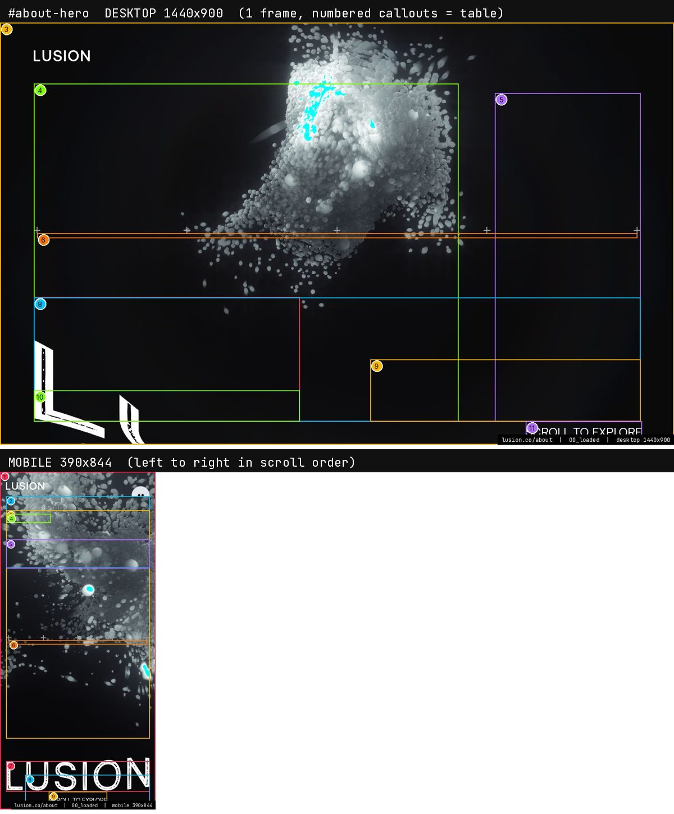
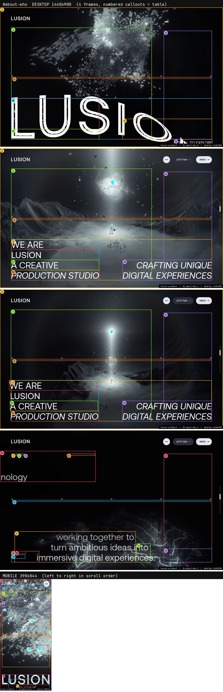
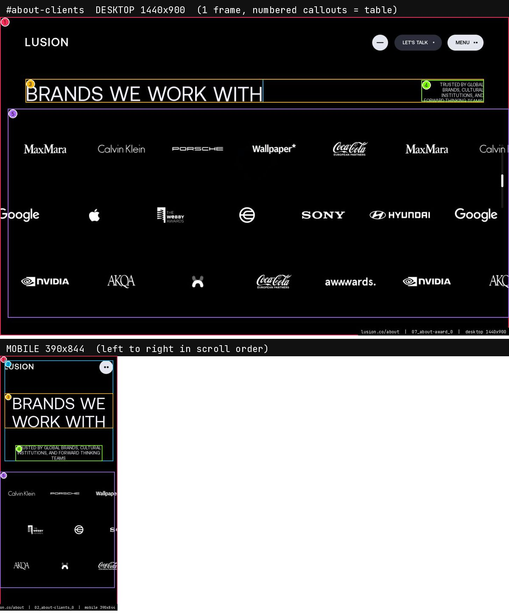
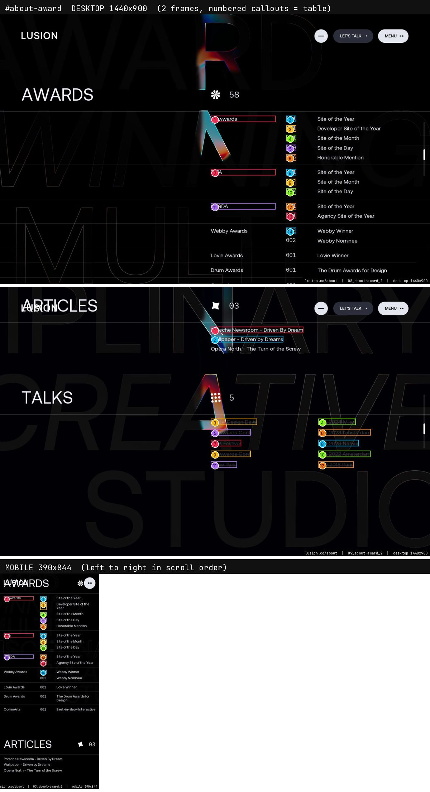
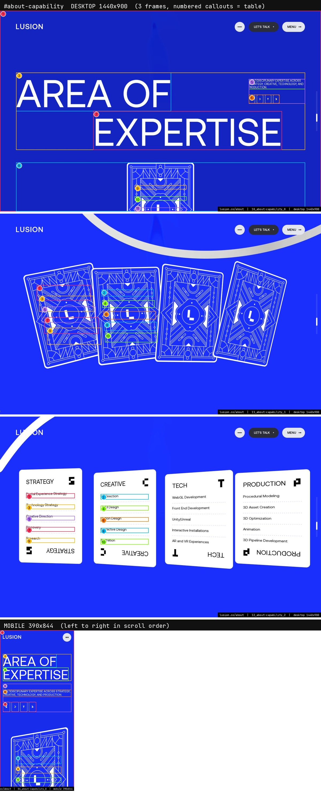

> **Read in Notion:** [15.2 About](https://shifatmasud.notion.site/3fe48559569d810a98a2ee47788dcbb5) · Part of [Lusion.co Decoded: Frontend Handbook](https://shifatmasud.notion.site/3fd48559569d81dd80b4c7407caf27cc) · [Repo home](https://github.com/shifatmasud/lusion-decoded)

# 15.2 About

> 🗺️ The About page opens on a WebGL figure scene and a white-on-blue story. It then runs a sideways "who we are" track with a cursor-following face, a client logo grid, an awards list with WebGL text, and a capabilities band. It ends with the same shared end, footer and next-page sections as Home.

**Sections in scroll order:** `AboutHero` WebGL scene (behind the first screen of `#about-who`, no DOM section) → `#about-who` → `#about-clients` → `#about-award` → `#about-capability` → shared tail (`#end-section`, `#footer-section`, `#scroll-nav-section`, documented on [15.1 Home](15_1_home.md))

**How to read this page:** each section has one image (desktop 1440×900 frames on top, mobile 390×844 row below). Numbers in the image match the callout table. Values in code blocks and tables are exact (from the shipped CSS, module source or measured computed styles); anything written as *inferred* is a reading, not a measured value. Screenshots come from a headless browser with software WebGL, so glow and colour can look flatter than on a real GPU.

**Tokens every section below uses (exact, from `:root` in the shipped CSS)**

```css
--color-blue: #1a2ffb;  --color-dark-blue: #071bdf;  --header-color: #0016ec;
--color-black: #000000; --color-white: #fff;  --color-off-white: #f0f1fa;  --color-dark-white: #e4e6ef;
--color-grey-blue: #2b2e3a; --color-green: #c1ff00; --color-red: #ff4c41; --color-purple: #8832f7;
--grid-gap: 2vw;            /* 4vw at max-width 812px */
--grid-space: calc((100% - 11 * var(--grid-gap)) / 12);   /* 12 columns; 6 on mobile */
--base-padding-x: max(5vw, 40px);        /* 25px <=812px, 15px <=400px, max(6vw,60px) at >=21:9 */
--base-padding-y: clamp(30px, 4vw, 50px); /* 25px <=812px, 15px <=400px */
--global-border-radius: 20px;             /* 10px at <=812px */
--header-size: clamp(1rem, 1vw, 2rem);  --cross-size: clamp(0.875rem, 1vw, 2rem);
```

Fonts: Aeonik 400 / 500 / 400 italic (body and display), IBMPlexMono 400 / 500 and LusionMono 400 (labels, counters, crosses), all `font-display: block` from `/assets/fonts/`. Background state is a class on `<html>`: `is-black-bg`, `is-blue-bg` or `is-white-bg`; under the first two the header text and scroll bar turn white.

## 1. Hero (WebGL figure scene)  `AboutHero` (no DOM section of its own)

*There is no `#about-hero` element in the page. The hero is the `AboutHero` WebGL scene (modules 079 to 094) drawn behind the first viewport of `#about-who`; the HTML on top of it belongs to `#about-who`, which is why the callouts below name `#about-who` elements.*



*Hero (WebGL figure scene): desktop frames with numbered callouts, mobile row underneath*

**Rebuild spec**

The first screen is almost all WebGL. `AboutHero` (module 094) builds a scene of abstract figures with physics (`AboutHeroFiguresPhysics`), shards and stickers, lit by a custom light and finished with its own post pass (`AboutHeroPostEffect`). The HTML on top is minimal: the header, plus the opening "who" block from `#about-who`. The page starts on `is-black-bg` and switches to `is-blue-bg` and then `is-white-bg` as the sections change, so the header text goes white, then white, then black. Cursor movement feeds the figures' physics and the global ScreenPaint trail. Rebuild it as a full-screen R3F canvas pinned for the first screen, with the HTML laid over it.

**Mobile (390 wide):** The scene stays full screen with fewer figures (inferred from the device tier settings). The text block goes full width.

**Driven by:** `094_AboutHero`, `093_AboutHeroPostEffect`, `080_AboutHeroFigures`, `081_AboutHeroFiguresPhysics`, `087_AboutHeroShards`, `090_AboutHeroStickers`. Shaders: `AboutHero__fragSv.frag.glsl`, `AboutHero__vertS4.vert.glsl`, `AboutHeroPostEffect__fragS13.frag.glsl`, `AboutHeroFigures__fragSh.frag.glsl`, `AboutHeroFigures__vertSf.vert.glsl`, `AboutHeroShards__fragSk.frag.glsl`, `AboutHeroShards__vertSj.vert.glsl`, `AboutHeroStickers__fragSq.frag.glsl`, `AboutHeroStickers__vertSp.vert.glsl`. Handbook: [7. Effects and scenes](../07_effects_and_scenes.md).

**Callouts (measured on the live page at capture time)**

| Frame · # | Element | Text | Type (computed) | Colour / bg | Box x,y w×h |
|---|---|---|---|---|---|
| 00 · 1 | `div#about-who-sticky` | About Lusion, Who are we? Lusion is a re | Aeonik 14.4px/16.56px w400 ls normal | #ffffff / transparent | 0,0 1440x900 |
| 00 · 2 | `div#about-who-item-0` | About Lusion, Who are we? | Aeonik 14.4px/16.56px w400 ls normal | #ffffff / transparent | 0,0 1440x900 |
| 00 · 3 | `h1#about-who-item-0-title` | About Lusion, Who are we? | Aeonik 14.4px/18.72px w400 ls normal | #ffffff / transparent | 72,72 1296x786 |
| 00 · 4 | `div#about-who-item-1` | Lusion is a real-time, interactive studi | Aeonik 14.4px/16.56px w400 ls normal | #ffffff / transparent | 1440,0 1440x900 |
| 01 · 1 | `div#about-who-sticky` | About Lusion, Who are we? Lusion is a re | Aeonik 14.4px/16.56px w400 ls normal | #ffffff / transparent | 0,0 1440x900 |
| 01 · 2 | `div#about-who-item-0` | About Lusion, Who are we? | Aeonik 14.4px/16.56px w400 ls normal | #ffffff / transparent | 0,0 1440x900 |
| 01 · 3 | `h1#about-who-item-0-title` | About Lusion, Who are we? | Aeonik 14.4px/18.72px w400 ls normal | #ffffff / transparent | 72,72 1296x786 |

*1 more callouts are in the image and in img/about/desktop/legend.json.*

**Driver facts (from the module source)**

- `094_AboutHero`: Easings: `lusion x2` · Uniforms: `u_bgColor; u_blurredTextureSizes; u_blurredTextures; u_lightColor; u_lightPosition; u_lightPositions; u_resolution; u_screenPaintTexture; u_shadowPositions; u_shadowStrength; u_te`
- `093_AboutHeroPostEffect`: Uniforms: `u_bgColor; u_resolution; u_texture`

## 2. Who we are (horizontal track)  `#about-who`



*Who we are (horizontal track): desktop frames with numbered callouts, mobile row underneath*

**Rebuild spec**

A long section (`padding-bottom: 950vw`) with a sticky inner (`#about-who-sticky`). Scrolling down moves a row of full-viewport panels (`#about-who-item-0`, `-1`, …) sideways. Item 0 holds the H1, "About Lusion, Who are we?". The text is white on `is-black-bg`, with words set in Aeonik at roughly 4 to 9vw (exact sizes are in the CSS block below). A face cursor (`#about-who-face-cursor`, 5.5em, 1.4em below the pointer) follows the mouse, and `AboutWhoSectionCursorShadow` draws its soft shadow in WebGL. Most of what you see moving is HTML and CSS transforms driven by the section's scroll ratio.

**Mobile (390 wide):** There's no sideways track: the container is 100% wide and the panels stack. The face cursor is hidden (it's a touch device).

**Driven by:** `095_AboutWhoSection`, `096_AboutWhoSectionCursorShadow`. Shaders: `AboutWhoSectionCursorShadow__fragSx.frag.glsl`, `AboutWhoSectionCursorShadow__vertSw.vert.glsl`. Handbook: [6. Routing, pages and sections](../06_routing_pages_and_sections.md), [10. CSS, layout and DOM state](../10_css_layout_and_dom_state.md).

**Callouts (measured on the live page at capture time)**

| Frame · # | Element | Text | Type (computed) | Colour / bg | Box x,y w×h |
|---|---|---|---|---|---|
| 01 · 1 | `div#about-who-sticky` | About Lusion, Who are we? Lusion is a re | Aeonik 14.4px/16.56px w400 ls normal | #ffffff / transparent | 0,0 1440x900 |
| 01 · 2 | `div#about-who-item-0` | About Lusion, Who are we? | Aeonik 14.4px/16.56px w400 ls normal | #ffffff / transparent | 0,0 1440x900 |
| 01 · 3 | `h1#about-who-item-0-title` | About Lusion, Who are we? | Aeonik 14.4px/18.72px w400 ls normal | #ffffff / transparent | 72,72 1296x786 |
| 01 · 4 | `div#about-who-item-1` | Lusion is a real-time, interactive studi | Aeonik 14.4px/16.56px w400 ls normal | #ffffff / transparent | 1440,0 1440x900 |
| 02 · 1 | `div#about-who` | About Lusion, Who are we? Lusion is a re | Aeonik 14.4px/16.56px w400 ls normal | #ffffff / transparent | 0,0 1440x14580 |
| 02 · 2 | `div#about-who-sticky` | About Lusion, Who are we? Lusion is a re | Aeonik 14.4px/16.56px w400 ls normal | #ffffff / transparent | 0,0 1440x900 |
| 02 · 3 | `div#about-who-item-0` | About Lusion, Who are we? | Aeonik 14.4px/16.56px w400 ls normal | #ffffff / transparent | -45,0 1440x900 |

*16 more callouts are in the image and in img/about/desktop/legend.json.*

**Driver facts (from the module source)**

- `095_AboutWhoSection`: DOM hooks: `#about-who; #about-who-face-cursor; #about-who-items-container; #about-who-sticky` · Easings: `quartOut x2; lusion x1; sineInOut x1; sineOut x1; expoInOut x1` · Uniforms: `u_bgColor; u_color; u_domWH; u_domXY; u_globalRadius; u_tint; u_viewportResolution`
- `096_AboutWhoSectionCursorShadow`: Uniforms: `u_aspect; u_colorTexture; u_cursorPos; u_cursorScale; u_opacity; u_shadowTexture`

**Exact CSS (desktop rules, then 812px / 560px overrides)**

```css
#about-who { position: relative; display: block; color: var(--color-white); width: 100vw; padding: 0; padding-bottom: 950vw; font-size: clamp(0.875rem, 1vw, 1.75rem); }
#about-who-sticky { position: absolute; display: flex; align-items: center; width: 100vw; height: calc(var(--vh, 1vh) * 100); top: 0; left: 0; overflow: hidden; contain: layout paint style; }
#about-who-items-container { position: absolute; display: flex; top: 0; left: 0; width: max-content; height: 100%; contain: layout paint style; }
#about-who-face-cursor { position: absolute; width: 5.5em; height: 5.5em; transform: translate(-50%, calc(-50% + 1.4em)); }
#about-who-face-cursor-bg { position: absolute; width: 100%; height: 100%; top: 0; left: 0; background-color: var(--color-white); border-radius: 50%; }
#about-who-face-cursor-content-container { position: absolute; width: 100%; height: 100%; overflow: hidden; border-radius: 50%; }
#about-who-face-cursor-content { position: absolute; display: flex; flex-direction: column; justify-content: center; align-items: center; width: 100%; height: 100%; }
@media (max-width: 812px) | #about-who-items-container { width: 100%; }
```

*57 more matching rules in lusion\_pretty.css.*

**DOM outline (served HTML, 2 levels)**

```
div#about-who.section
  div#about-who-sticky
    div#about-who-items-container
```

## 3. Clients  `#about-clients`



*Clients: desktop frames with numbered callouts, mobile row underneath*

**Rebuild spec**

The title is "Brands we've worked with" (`#about-clients-title`): 8vw, line-height 0.9, tracking -0.02em. It's split into lines that rise in with `ease.lusion`. Under it is a logo grid (`#about-clients-list`) of `.about-clients-item` cells, each holding one SVG logo. The logos fade in one after another (inferred stagger by index). It's plain HTML and CSS on the white background.

**Mobile (390 wide):** The grid drops from 4 columns to 3 at 812px and below (CSS block below).

**Driven by:** `098_AboutClientsSection`. No section-specific shader files (HTML + shared Ufx/post passes). Handbook: [6. Routing, pages and sections](../06_routing_pages_and_sections.md).

**Callouts (measured on the live page at capture time)**

| Frame · # | Element | Text | Type (computed) | Colour / bg | Box x,y w×h |
|---|---|---|---|---|---|
| 07 · 1 | `div#about-clients` | BRANDS BRANDS BRANDS WE WE WE’VE ’VE ’VE | Aeonik 14.4px/16.56px w400 ls normal | #ffffff / transparent | 0,-50 1440x1049 |
| 07 · 2 | `div#about-clients-title` | BRANDS BRANDS BRANDS WE WE WE’VE ’VE ’VE | Aeonik 14.4px/16.56px w400 ls normal | #ffffff / transparent | 72,-50 1296x100 |
| 07 · 3 | `div#about-clients-list` |   | Aeonik 14.4px/16.56px w400 ls normal | #ffffff / transparent | 72,72 1296x878 |

**Driver facts (from the module source)**

- `098_AboutClientsSection`: DOM hooks: `#about-clients; #about-clients-list; #about-clients-title; .about-clients-item` · Easings: `lusion x2`

**Exact CSS (desktop rules, then 812px / 560px overrides)**

```css
#about-clients { color: var(--color-white); }
#about-clients-title { position: relative; display: flex; justify-content: space-between; width: 100%; text-transform: uppercase; }
#about-clients-list { display: grid; grid-template-columns: repeat(4, minmax(0, 1fr)); column-gap: var(--grid-gap); row-gap: var(--grid-gap); margin: var(--base-padding-x) 0; }
.about-clients-item { position: relative; width: 100%; height: 0; padding-bottom: 66%; }
.about-clients-item-inner { position: absolute; width: 100%; height: 100%; display: flex; align-items: center; justify-content: center; }
.about-clients-item-inner svg { position: absolute; top: 0; left: 0; width: 100%; height: 100%; object-fit: contain; display: block; }
@media (max-width: 812px) | #about-clients-list { grid-template-columns: repeat(3, minmax(0, 1fr)); }
```

*1 more matching rules in lusion\_pretty.css.*

**DOM outline (served HTML, 2 levels)**

```
div#about-clients.section
  div#about-clients-title
    div  ×3
  div#about-clients-list
    div.about-clients-item  ×10
```

## 4. Awards list (WebGL text)  `#about-award`



*Awards list (WebGL text): desktop frames with numbered callouts, mobile row underneath*

**Rebuild spec**

The title is "Awards & recognitions" (`#about-award-title`, 8vw). Below it, `#about-award-list` lists award rows: count, award name and year in IBMPlexMono or LusionMono. The award titles are drawn by `AboutAwardTitles` as WebGL text (an SDF font texture plus the ScreenPaint texture). The cursor trail bleeds colour into the letters, which is one of the few real reads of the ScreenPaint texture outside post-processing (chapter 14). `UfxCopy` meshes copy each row's DOM box so the WebGL text stays aligned with the HTML layout.

**Mobile (390 wide):** The rows stack; the WebGL titles shrink with the DOM boxes because they copy their rects. The ScreenPaint bleed follows touch.

**Driven by:** `097_AboutAwardSection`. No section-specific shader files (HTML + shared Ufx/post passes). Handbook: [14. Special: Cursor fluid trail (ScreenPaint)](../14_special_cursor_fluid_trail_screenpaint.md), [4. DOM to WebGL sync (Ufx)](../04_dom_to_webgl_sync_ufx.md).

**Callouts (measured on the live page at capture time)**

| Frame · # | Element | Text | Type (computed) | Colour / bg | Box x,y w×h |
|---|---|---|---|---|---|
| 07 · 4 | `div#about-award` | Fueled by curiosity, our team has achiev | Aeonik 14.4px/16.56px w400 ls normal | #ffffff / transparent | 0,1000 1440x2154 |

**Driver facts (from the module source)**

- `097_AboutAwardSection`: DOM hooks: `#about-award; #about-award-desc; #about-award-list; .about-award-item; .about-award-item-title; .about-award-item-title-shape-svg; .about-award-item-title-text` · Easings: `lusion x2` · Uniforms: `u_awardTitleTexture; u_awardTitleTextureRatio; u_bgColor; u_borderRadius; u_borderRadiusRatio; u_color; u_domWH; u_domXY; u_globalRadius; u_letterRatio; u_screenPa` · Classes toggled: `--is-active`

**Exact CSS (desktop rules, then 812px / 560px overrides)**

```css
#about-award { color: var(--color-white); text-align: center; }
#about-award-desc { position: relative; grid-column: 2 / span 10; font-size: 3.5em; line-height: 1.2; margin-top: 1em; margin-bottom: 1.5em; }
#about-award-list { grid-column: 1 / span 12; margin-bottom: calc(var(--base-padding-x) * 2); }
.about-award-item { position: relative; margin: auto; width: fit-content; }
.about-award-item-title { display: block; text-transform: uppercase; font-family: LusionMono; font-size: 12em; line-height: 1em; padding: 0; margin: 0; }
.about-award-item-title-text { position: relative; }
.about-award-item-title-shape-svg { position: absolute; top: 0; height: 100%; }
@media (max-width: 812px) | #about-award-desc { grid-column: 1 / span 6; font-size: 2.2em; }
@media (max-width: 812px) | #about-award-list { grid-column: 1 / span 6; }
@media (max-width: 812px) | .about-award-item-title { font-size: 6em; }
@media (max-width: 812px) | .about-award-item-title-shape-svg { display: none; }
```

*3 more matching rules in lusion\_pretty.css.*

**DOM outline (served HTML, 2 levels)**

```
div#about-award.section
  h2#about-award-desc
  div#about-award-list
    div.about-award-item  ×6
```

## 5. Capabilities  `#about-capability`



*Capabilities: desktop frames with numbered callouts, mobile row underneath*

**Rebuild spec**

A capabilities band. *Inferred:* it sits under `is-blue-bg` (background `--color-blue` #1a2ffb). In this capture the computed text colour was #000000 (see callouts), so the white-on-blue reading isn't confirmed. `#about-capability-title` uses `--font-size: 6vw` (10vw at 812px and below), per the CSS block. Each `.about-capability-item` is a row: an index in IBMPlexMono, a name in Aeonik around 4vw, and a short description. The rows reveal with `ease.lusion` line splits. On scroll, the ScreenPaint distortion settings are tuned for this section (it's one of the three sections that set ScreenPaint parameters, chapter 14).

**Mobile (390 wide):** The rows go to one column; the name drops to about 8vw (CSS block).

**Driven by:** `099_AboutCapabilitySection`. No section-specific shader files (HTML + shared Ufx/post passes). Handbook: [14. Special: Cursor fluid trail (ScreenPaint)](../14_special_cursor_fluid_trail_screenpaint.md).

**Callouts (measured on the live page at capture time)**

| Frame · # | Element | Text | Type (computed) | Colour / bg | Box x,y w×h |
|---|---|---|---|---|---|
| 09 · 2 | `div#about-capability-title` | Discovery Discovery Concept Concept Desi | Aeonik 14.4px/16.56px w400 ls normal | #000000 / transparent | 72,0 1296x877 |
| 09 · 3 | `div#about-capability-title-inner` | Discovery Discovery Concept Concept Desi | Aeonik 14.4px/16.56px w400 ls normal | #000000 / transparent | 72,0 1296x877 |
| 09 · 4 | `div#about-capability-desc` | Sometimes, a good idea is all it takes. | Aeonik 14.4px/16.56px w400 ls normal | #000000 / transparent | 72,0 1296x877 |
| 09 · 5 | `div#about-capability-desc-content` | Sometimes, a good idea is all it takes. | Aeonik 14.4px/16.56px w400 ls normal | #000000 / transparent | 72,0 1296x877 |
| 09 · 6 | `div#about-capability-desc-text` | Sometimes, a good idea is all it takes. | Aeonik 14.4px/16.56px w400 ls normal | #000000 / transparent | 72,0 1296x877 |

**Driver facts (from the module source)**

- `099_AboutCapabilitySection`: DOM hooks: `#about-capability; #about-capability-title; #about-capability-title-inner` · Easings: `lusion x3; cubicOut x1` · Uniforms: `u_aspect; u_blurredTextureSizes; u_blurredTextures; u_colorTexture; u_contentHeight; u_contentWidth; u_contentX; u_contentY; u_glassTexture; u_lightDir; u_lightTexture; u_m`

**Exact CSS (desktop rules, then 812px / 560px overrides)**

```css
#about-capability { --font-size: 6vw; }
#about-capability-title { font-size: var(--font-size); }
#about-capability-title-inner { position: relative; display: flex; flex-direction: column; text-align: center; height: var(--grid-height); grid-column: 1 / span 12; }
#about-capability-desc { position: absolute; display: flex; flex-direction: column; align-items: center; justify-content: center; top: 0; left: 0; width: 100%; height: 100%; }
#about-capability-desc-content { position: relative; width: 80em; }
#about-capability-desc-text { line-height: 1.4; text-align: center; font-size: 2.5em; }
#about-capability-cta { margin-top: 3em; }
@media (max-width: 812px) | #about-capability { --font-size: 10vw; }
@media (max-width: 812px) | #about-capability-desc-content { width: 100%; }
@media (max-width: 812px) | #about-capability-desc-text { font-size: 1.8em; }
@media (max-width: 560px) | #about-capability-desc-content { width: 85%; }
```

*2 more matching rules in lusion\_pretty.css.*

**DOM outline (served HTML, 2 levels)**

```
div#about-capability.section
  div#about-capability-title
    div#about-capability-title-inner
```
