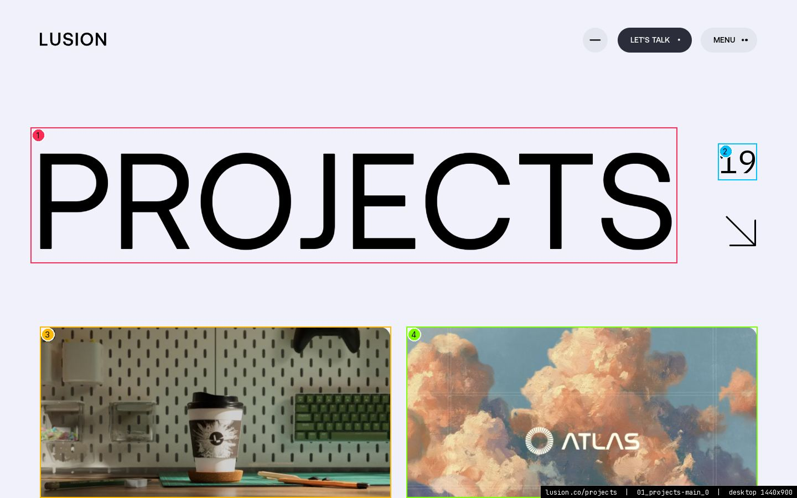
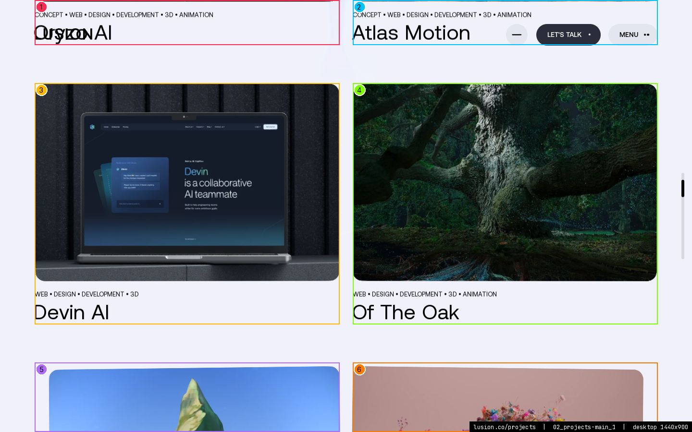
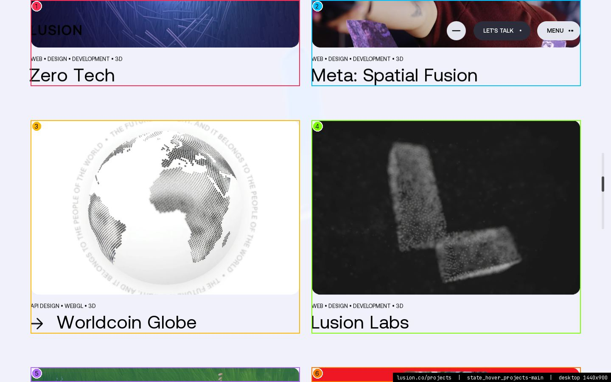
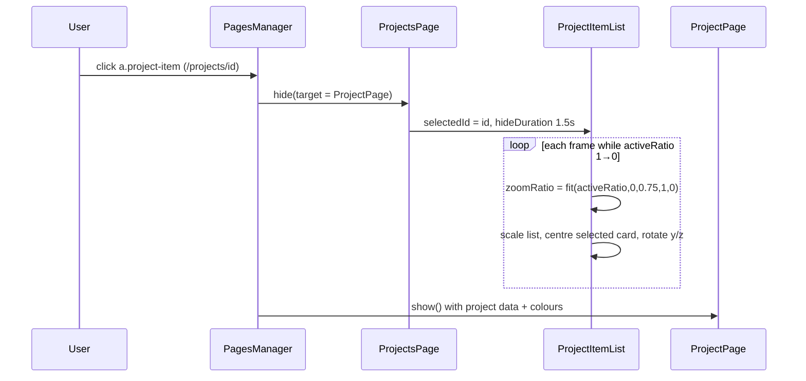
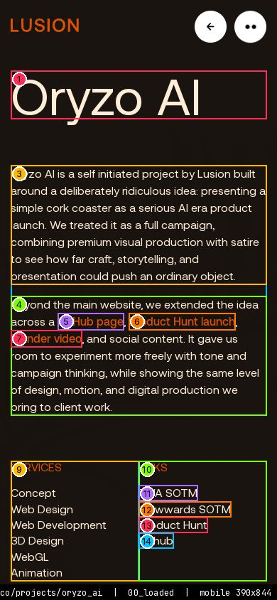

> **Read in Notion:** [15.3 Projects](https://shifatmasud.notion.site/3fe48559569d815884e7f0f2ddd6a104) · Part of [Lusion.co Decoded](https://shifatmasud.notion.site/Lusion-co-Decoded-Client-Side-Handbook-3fd48559569d81dd80b4c7407caf27cc) · [Repo home](https://github.com/shifatmasud/lusion-decoded)

<callout icon="🧭" color="gray_bg">
	Route `/projects` · page class `ProjectsPage` (module `110_ProjectsPage.js`, path `"projects"`) · one content section `ProjectsMainSection` (module `108`) plus the shared closing sections. Captured live at 1440×900 (desktop) and 390×844 (mobile) on 19 Oct 2026. **Confirmed** means read in the shipped CSS/JS or measured in the live DOM; **inferred** is marked wherever it appears. Numbered callouts on every screenshot match the table under it.
</callout>

**Related chapters:** [4. DOM to WebGL sync (Ufx)](https://shifatmasud.notion.site/3fd48559569d816eb890f8d968ec1fae), [5. Scroll, input and motion](https://shifatmasud.notion.site/3fd48559569d816d8a50c22e35b3ce7b), [6. Routing, pages and sections](https://shifatmasud.notion.site/3fd48559569d817280f5e9676aca01db), [8. Shaders and the post-processing pipeline](https://shifatmasud.notion.site/3fd48559569d81daa932c9558ddf8b9a), [10. CSS, layout and DOM state](https://shifatmasud.notion.site/3fd48559569d81289d5ff6769e1f1d55)

## Page at a glance

<table header-row="true">
<tr><td>Thing</td><td>Value</td><td>Source</td></tr>
<tr><td>DOM root</td><td>`#projects` → `#projects-main` (`.section`) → `#projects-main-title-top` + `.project-list` → 19 × `a.project-item`</td><td>live HTML</td></tr>
<tr><td>Header theme</td><td>`html.is-white-bg` (black header text)</td><td>measured; [chapter 10](https://shifatmasud.notion.site/3fd48559569d81289d5ff6769e1f1d55)</td></tr>
<tr><td>Page background</td><td>`#f0f1fa` (sampled pixel; same value as the site's off‑white token)</td><td>measured (whether CSS or the WebGL clear colour paints it: inferred WebGL, chapter 3)</td></tr>
<tr><td>Text colour</td><td>`#000000`</td><td>computed style</td></tr>
<tr><td>Grid</td><td>12 columns desktop / 6 columns ≤812px, side padding `--base-padding-x` = 72px at 1440, 25px at 401–812px, 15px at ≤400px</td><td>CSS; [chapter 10](https://shifatmasud.notion.site/3fd48559569d81289d5ff6769e1f1d55)</td></tr>
<tr><td>Cards</td><td>2 per row, 634×502 at 1440 (x = 72 and 734 → ~28px gutter)</td><td>measured</td></tr>
<tr><td>WebGL</td><td>Every thumbnail is a `ProjectItem` UfxMesh (module `039`), owned by `ProjectItemList` (module `040`) in the page's `postUfxContainer`. The HTML `.project-item-image` is an empty, rounded box the mesh is synced to.</td><td>code; [chapter 4](https://shifatmasud.notion.site/3fd48559569d816eb890f8d968ec1fae)</td></tr>
<tr><td>End visual</td><td>`endVisualUseTextured = true` (the shared end section uses its textured variant here)</td><td>code</td></tr>
<tr><td>Transition into a project</td><td>non‑generic, 1.5 s: the clicked card zooms to fill the screen (see 15.3.4)</td><td>code; [chapter 6](https://shifatmasud.notion.site/3fd48559569d817280f5e9676aca01db)</td></tr>
</table>

## 15.3.1 Title block



<table header-row="true">
<tr><td>#</td><td>Element</td><td>Text (live, may be mid-animation)</td><td>Type (computed)</td><td>Colour / background</td><td>Box x,y w×h</td></tr>
<tr><td>1</td><td>`h4#projects-main-title`</td><td>PROJECTS</td><td>Aeonik 244.8px/244.8px w400 ls normal</td><td>#000000 / transparent</td><td>55,230 1168x245</td></tr>
<tr><td>2</td><td>`span#projects-main-title-project-number`</td><td>19</td><td>IBMPlexMono 57.6px/66.24px w400 ls normal</td><td>#000000 / transparent</td><td>1297,259 70x66</td></tr>
<tr><td>3</td><td>`a.project-item.project-type-website`</td><td>CONCEPT • WEB • DESIGN • DEVELOPMENT • 3D • ANIMATION O O O </td><td>Aeonik 16px/18.4px w400 ls normal</td><td>#000000 / transparent</td><td>72,590 634x502</td></tr>
<tr><td>4</td><td>`a.project-item.project-type-website`</td><td>CONCEPT • WEB • DESIGN • DEVELOPMENT • 3D • ANIMATION A A A </td><td>Aeonik 16px/18.4px w400 ls normal</td><td>#000000 / transparent</td><td>734,590 634x502</td></tr>
</table>

**Rebuild spec**

- **Markup:** `#projects-main-title-top` (grid-column `1 / span 12`) → `#projects-main-title-wrapper` → `h4#projects-main-title` "PROJECTS" + `span#projects-main-title-project-number` "19" (hard‑coded in the HTML, not counted by JS) + the arrow `#projects-main-title-project-arrow`.
- **Spacing:** `margin-top: calc(var(--vh) * 20)` (180px at 900 tall); `#projects-main-title { left: -1vw }` (wrapper `left: -0.01em`) so the glyphs' side bearing lines up with the grid edge.
- **Type:** title Aeonik 400, `font-size: 17vw` (244.8px at 1440, measured), `line-height: 1em`, `overflow: hidden` (clips the rising letters). Count IBM Plex Mono `4vw` (57.6px), `position: absolute; top: 2vw; right: -9vw`. Arrow `4vw` square at `right: -9vw; bottom: 5vw`. 21:9 screens: count `2.7vw`.
- **Motion (confirmed, `108_ProjectsMainSection.js`):** SplitType breaks the title and the count into characters. A clock `time` runs while the title is on screen (`screenRatio > -1`), clamped to 0–2 s, and runs backwards when the section stops animating. Title letter *i*: `t = fit(time*1.5 − i/20 − 0.2, 0, 1, 0, 1, ease.lusion)`, `transform: translateY((1−t)*100%) rotate((1−t)*30deg)`. Count letter *i*: same with `time − i/20 − 0.5`. Arrow: `scale(elasticOut(saturate(time − 0.6)))`.
- **HTML vs WebGL:** pure HTML.
- **Mobile:** grid `1 / span 6`, `margin-top: 6em`, `margin-bottom: 2em`; measured title 66.3px, count 15.6px. No SplitType: letters are static and the arrow is at scale 1.

## 15.3.2 Project grid and card



<table header-row="true">
<tr><td>#</td><td>Element</td><td>Text (live, may be mid-animation)</td><td>Type (computed)</td><td>Colour / background</td><td>Box x,y w×h</td></tr>
<tr><td>1</td><td>`a.project-item.project-type-website`</td><td>CONCEPT • WEB • DESIGN • DEVELOPMENT • 3D • ANIMATION O O O </td><td>Aeonik 16px/18.4px w400 ls normal</td><td>#000000 / transparent</td><td>72,-409 634x502</td></tr>
<tr><td>2</td><td>`a.project-item.project-type-website`</td><td>CONCEPT • WEB • DESIGN • DEVELOPMENT • 3D • ANIMATION A A A </td><td>Aeonik 16px/18.4px w400 ls normal</td><td>#000000 / transparent</td><td>734,-409 634x502</td></tr>
<tr><td>3</td><td>`a.project-item.project-type-website`</td><td>WEB • DESIGN • DEVELOPMENT • 3D D D D D e e e e v v v v i i </td><td>Aeonik 16px/18.4px w400 ls normal</td><td>#000000 / transparent</td><td>72,173 634x502</td></tr>
<tr><td>4</td><td>`a.project-item.project-type-website`</td><td>WEB • DESIGN • DEVELOPMENT • 3D • ANIMATION O O O O f f f f </td><td>Aeonik 16px/18.4px w400 ls normal</td><td>#000000 / transparent</td><td>734,173 634x502</td></tr>
<tr><td>5</td><td>`a.project-item.project-type-website`</td><td>CONCEPT • WEB • DEDIODV E E E E v v v v e e e e r r r r s s </td><td>Aeonik 16px/18.4px w400 ls normal</td><td>#000000 / transparent</td><td>72,755 634x502</td></tr>
<tr><td>6</td><td>`a.project-item.project-type-website`</td><td>CONCEPT • 3D ILLUSE?J}% P P P P o o o o r r r r s s s s c c </td><td>Aeonik 16px/18.4px w400 ls normal</td><td>#000000 / transparent</td><td>734,755 634x502</td></tr>
</table>

**Card markup (live HTML, one per project)**

```html
<a class="project-item project-type-website" href="/projects/devin_ai" data-id="devin_ai"
   data-color-bg="#…" data-color-text="#…" data-color-shadow="#…">
  <div class="project-item-main"><div class="project-item-image"></div></div>
  <div class="project-item-footer">
    <div class="project-item-line-1">CONCEPT • WEB • DESIGN • DEVELOPMENT</div>
    <div class="project-item-line-2"><svg class="project-item-line-2-icon">…</svg>Devin AI</div>
  </div>
</a>
```

**Rebuild spec**

- **Layout:** `.project-item { float: left; grid-column: span 6 }` → two columns. `.project-item:nth-child(n+3) { margin-top: 5em }` (80px row gap; `10em` on 21:9).
- **Image box:** `.project-item-main { padding-top: 65% }` (412px tall on a 634px card, measured), image `border-radius: 15px` (the shader also rounds with `u_globalRadius`).
- **Footer type:** line 1 Aeonik uppercase `0.9vw` (≈13px), `margin: 1.5em 0 1em`; line 2 Aeonik `3vw` (43.2px), `height: 1em; overflow: hidden; left: -0.06em`; line‑2 arrow icon `0.8em`, parked at `left: -1em` (hidden until hover). 21:9: line 1 `0.6vw`, line 2 `2vw`.
- **Colours:** text `#000`. `data-color-bg` feeds the card shader's `u_colorBg`; `data-color-text` / `data-color-shadow` become the project page's CSS variables after the transition (**inferred** from the matching `data-color-*` names on `#project-details`, see 15.4).
- **WebGL thumbnail (confirmed, `039_ProjectItem.js`):** a UfxMesh with `renderOrder 10`, textures `/assets/projects/<id>/home.webp` and `home_depth.webp`. Fragment shader `ProjectItem__fragSl.frag.glsl`: depth‑map parallax occlusion (`PARALLAX_SAMPLES 12`) plus a depth‑of‑field blur (`BLUR_SAMPLES 6`), with `u_focusPos`, `u_zoom`, `u_dofRange`, `u_shift`, `u_rippleStrength`, `u_showRatio`, `u_hoverRatio`, `u_colorBg`. Each card's mesh is padded 1000px on one side (which side depends on its column), so the plane can draw outside its HTML box while it slides. See [chapter 4](https://shifatmasud.notion.site/3fd48559569d816eb890f8d968ec1fae) for the DOM→mesh sync and [chapter 8](https://shifatmasud.notion.site/3fd48559569d81daa932c9558ddf8b9a) for the shader pipeline.
- **Scroll entry (confirmed):** each card has its own `showTime` once it enters the viewport. `u_showRatio = expoOut(fit(showTime, 0, 1.5))`; with `C = expoOut(fit(showTime, 0, 2))` the mesh gets `position.x = (1−C)·((index%2)−0.5)·−viewportWidth·0.1` and `rotation.z = (1−C)·((index%2)−0.5)·0.1`. Both columns start 5% of the viewport width toward the centre, tilted ±0.05 rad, and glide out to their place and straighten over about 2 s.
- **Scroll ripple:** `u_rippleStrength = min(0.15, easedScrollStrength · 0.5)`: thumbnails wobble with scroll speed and settle when scrolling stops.
- **Line 1 typing:** characters type in at `LETTER_PER_SECOND = 40` per second with a tail of up to `MAX_RAND_LETTER_COUNT = 5` random ASCII characters (codes 33–125) ahead of the real text (constants in `038_DomHelper.js`).
- **Line 2 roll (desktop):** each letter is its own span. Its clock runs at 0.8× time; letter progress `g = saturate(time − cos(p)/TEXT_STAGGER)` with `TEXT_STAGGER = 20` and `p` running π/2…3π/2 across the word, then `translateY(−fit(g, 0, 1, 500, 0, expoInOut) %)`. Letters drop in from 500% above, the middle ones first and the ends last.

## 15.3.3 Card hover state (desktop only)



<table header-row="true">
<tr><td>#</td><td>Element</td><td>Text (live, may be mid-animation)</td><td>Type (computed)</td><td>Colour / background</td><td>Box x,y w×h</td></tr>
<tr><td>1</td><td>`a.project-item.project-type-website`</td><td>WEB • DESIGN • DEVELOPMENT • 3D Z Z Z Z e e e e r r r r o o </td><td>Aeonik 16px/18.4px w400 ls normal</td><td>#000000 / transparent</td><td>72,-300 634x502</td></tr>
<tr><td>2</td><td>`a.project-item.project-type-website`</td><td>WEB • DESIGN • DEVELOPMENT • 3D M M M M e e e e t t t t a a </td><td>Aeonik 16px/18.4px w400 ls normal</td><td>#000000 / transparent</td><td>734,-300 634x502</td></tr>
<tr><td>3</td><td>`a.project-item.project-type-website`</td><td>API DESIGN • WEBGL • 3D W W W W o o o o r r r r l l l l d d </td><td>Aeonik 16px/18.4px w400 ls normal</td><td>#000000 / transparent</td><td>72,283 634x502</td></tr>
<tr><td>4</td><td>`a.project-item.project-type-website`</td><td>WEB • DESIGN • DEVELOPMENT • 3D L L L L u u u u s s s s i i </td><td>Aeonik 16px/18.4px w400 ls normal</td><td>#000000 / transparent</td><td>734,283 634x502</td></tr>
<tr><td>5</td><td>`a.project-item.project-type-website`</td><td>CONCEPT • DESIGN • DEVELOPMENT • 3D M M M M y y y y L L L L </td><td>Aeonik 16px/18.4px w400 ls normal</td><td>#000000 / transparent</td><td>72,865 634x502</td></tr>
<tr><td>6</td><td>`a.project-item.project-type-website`</td><td>AR • DEVELOPMENT • 3D S S S S o o o o d d d d a a a a E E E </td><td>Aeonik 16px/18.4px w400 ls normal</td><td>#000000 / transparent</td><td>734,865 634x502</td></tr>
</table>

- **Two hover zones (confirmed):** `mouseenter` on `.project-item-main` sets `isHover` (only while no page transition is running and no card is zooming) and plays the `focus` UI sound. `mouseenter` on the whole `a.project-item` sets `isHoverDom`.
- **Image (WebGL):** `hoverRatio` ramps 0→1 at 1 per second. Zoom follows a second‑order spring (`SecondOrderDynamics(2.2, 0.7, 3)`) to `u_zoom = 1`. `u_focusPos` chases the pointer on a softer spring (`1, 0.6, 2`), with a small circular drift while `hoverRatio < 0.3`, so the depth parallax looks around the pointer. At hover thresholds the shader gets a random `u_shift` jolt that decays (a short glitch). DOF range moves to −0.5.
- **Text (HTML):** line‑2 letters slide right up to `1.5em`, each offset by 1/100 of the ratio per letter (`ease.lusion`); the arrow icon moves `translateX(0 → 1em)` as `hoverRatio` goes 0.3 → 1. Cursor: pointer.
- **Mobile:** no hover listeners. Line‑2 letters sit statically at `1.5em` with the icon visible at `1em`.

## 15.3.4 Click: card → project page

No screenshot: the move lasts 1.5 s and needs a real GPU to look right. Behaviour from the code (`110_ProjectsPage.js`, `040_ProjectItemList.js`), confirmed:

- **Hide:** when the next page is a project page, `selectedId` = the card's `data-id`, `hideDuration = 1.5`, and the generic page transition is skipped.
- **Zoom:** `zoomRatio = fit(projectsPage.activeRatio, 0, 0.75, 1, 0)`. The whole card list scales by `mix(1, max(vw/w, vh/h)·1.2, cubicInOut(zoom))`, is translated so the selected card is centred, and is rotated around y/z by `0.3 × offset`. The clicked thumbnail fills the screen and becomes the backdrop for the project page's own intro (15.4).
- **Coming back:** `show()` scrolls to `card.top − 0.25·vh` and plays the same zoom in reverse.



## 15.3.5 Closing sections

After the list, `/projects` reuses the shared end section (textured variant), footer and scroll‑nav. Their spec is in the Home page atlas (15.1); nothing on this page overrides them apart from `endVisualUseTextured`.

## 15.3.6 Mobile (390×844)



<table header-row="true">
<tr><td>#</td><td>Element</td><td>Text (live, may be mid-animation)</td><td>Type (computed)</td><td>Colour / background</td><td>Box x,y w×h</td></tr>
<tr><td>1</td><td>`h4#projects-main-title`</td><td>PROJECTS</td><td>Aeonik 66.3px/66.3px w400 ls normal</td><td>#000000 / transparent</td><td>10,111 305x66</td></tr>
<tr><td>2</td><td>`span#projects-main-title-project-number`</td><td>19</td><td>IBMPlexMono 15.6px/17.94px w400 ls normal</td><td>#000000 / transparent</td><td>334,119 20x18</td></tr>
<tr><td>3</td><td>`a.project-item.project-type-website`</td><td>CONCEPT • WEB • DESIGN • DEVELOPMENT • 3D • ANIMATION O O O </td><td>Aeonik 16px/18.4px w400 ls normal</td><td>#000000 / transparent</td><td>15,222 360x295</td></tr>
<tr><td>4</td><td>`a.project-item.project-type-website`</td><td>CONCEPT • WEB • DESIGN • DEVELOPMENT • 3D • ANIMATION A A A </td><td>Aeonik 16px/18.4px w400 ls normal</td><td>#000000 / transparent</td><td>15,548 360x295</td></tr>
</table>

- **Breakpoint:** ≤812px. The grid drops to 6 columns while `.project-item` keeps `span 6` → one card per row, 360×295 at 390 wide, card tops 326px apart (measured).
- **Type:** line 1 `2.5vw`, line 2 `6.5vw`; title 66.3px, count 15.6px (measured).
- **Behaviour:** no SplitType title animation, no hover, static line‑2 offset. The WebGL thumbnails, scroll entry and ripple run as on desktop.

## Rebuild checklist

1. Static HTML list of 19 `a.project-item` with `data-id` and `data-color-*`, in a 12/6‑column grid.
2. A WebGL layer that mirrors each `.project-item-main` rect ([chapter 4](https://shifatmasud.notion.site/3fd48559569d816eb890f8d968ec1fae)) and draws `home.webp` with `home_depth.webp` parallax and DOF.
3. Per‑card scroll entry (`showTime`), scroll‑speed ripple, line‑1 typing and line‑2 letter drop.
4. Desktop hover: springs for zoom and focus, glitch jolt, text shift and arrow.
5. A project‑bound page transition that zooms the selected card to fill the screen, and reverses on the way back.

## Confirmed vs inferred

<table header-row="true">
<tr><td>Claim</td><td>Status</td></tr>
<tr><td>Grid, spacing, type sizes, breakpoints</td><td>Confirmed (CSS + measured)</td></tr>
<tr><td>Title, card entry, ripple, hover and zoom formulas</td><td>Confirmed (modules 039, 040, 108, 110)</td></tr>
<tr><td>Background `#f0f1fa`</td><td>Measured pixel; painted by WebGL: inferred</td></tr>
<tr><td>`data-color-text` / `data-color-shadow` hand over to the project page</td><td>Inferred from matching attribute names</td></tr>
<tr><td>Text constants 40 letters/s, 5 random letters, stagger 20</td><td>Confirmed (`038_DomHelper.js`)</td></tr>
<tr><td>`.project-item-toggle` pill style in the CSS</td><td>Present in CSS, no matching element in the live HTML (unused)</td></tr>
</table>
