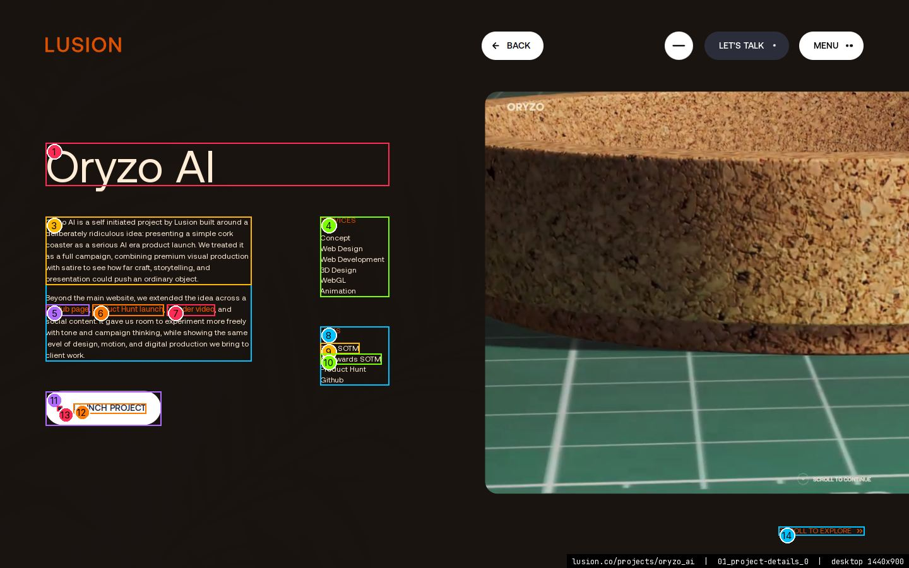
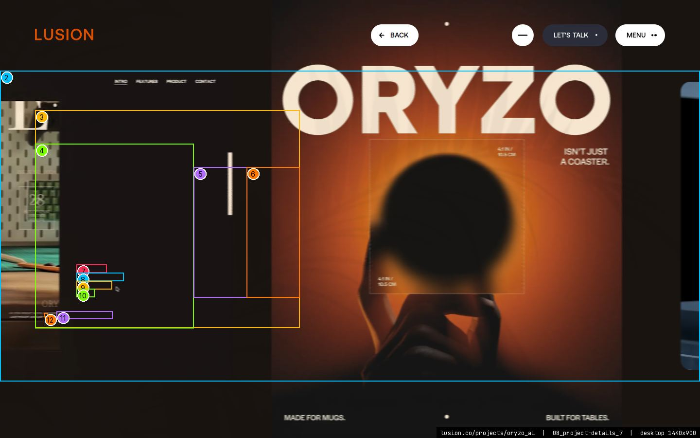
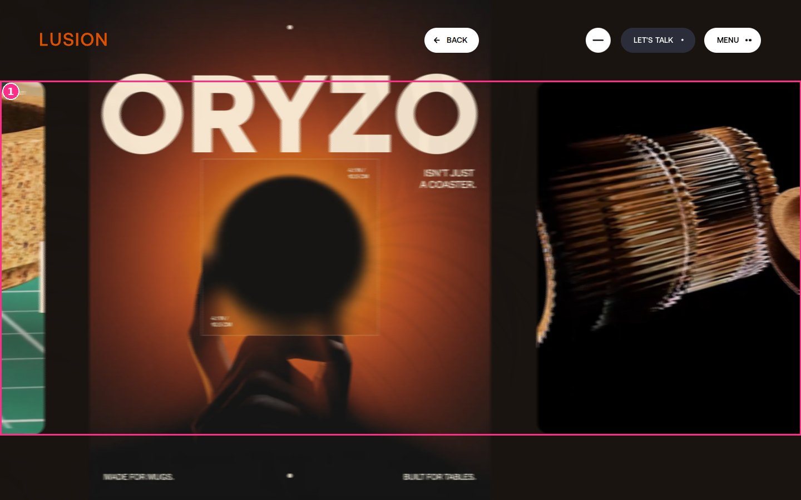
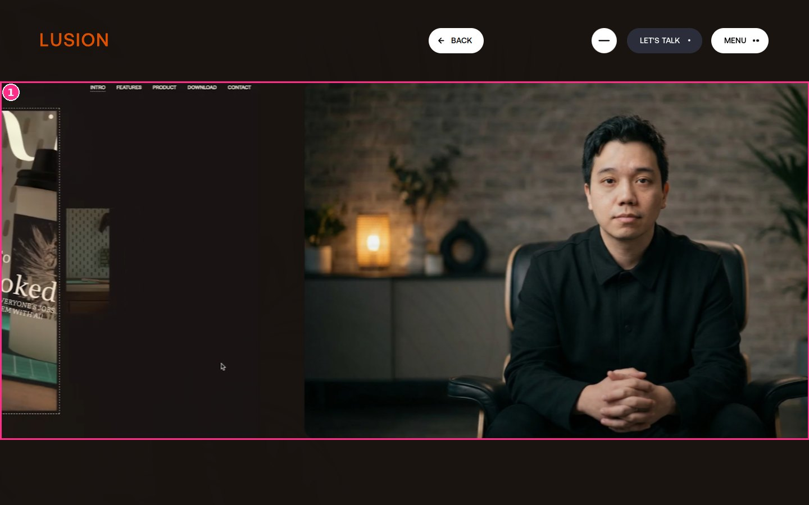
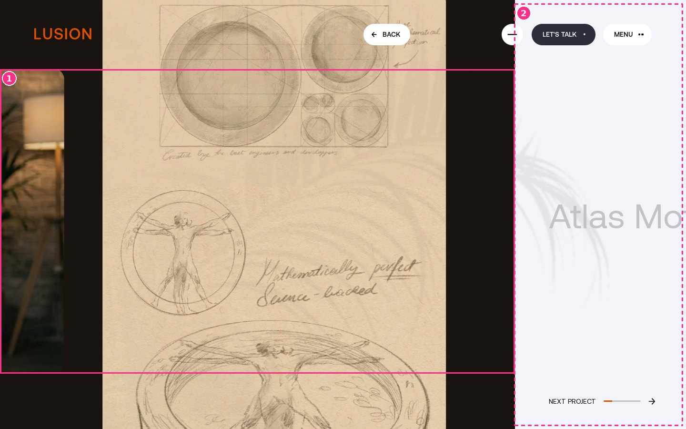
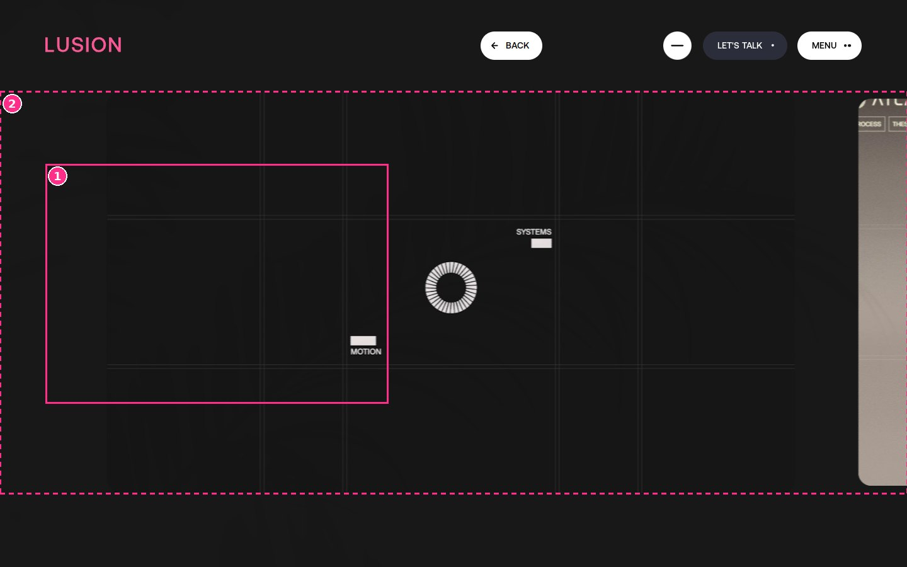
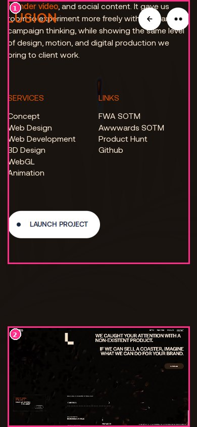
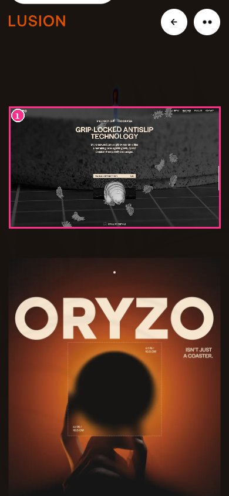

> **Read in Notion:** [15.4 Project page template](https://shifatmasud.notion.site/3fe48559569d816381a1cb2ae37987bd) · Part of [Lusion.co Decoded: Frontend Handbook](https://shifatmasud.notion.site/3fd48559569d81dd80b4c7407caf27cc) · [Repo home](https://github.com/shifatmasud/lusion-decoded)

# 15.4 Project page template

> 🧭 Route `/projects/<id>` · page class `ProjectPage` (module `076_ProjectPage.js`) · one section `#project-details` driven by `ProjectDetailsSection` (module `074`), with WebGL from `ProjectDetailsItems` / `ProjectDetailsItem` (modules `073` / `072`) and `ProjectDetailsScreen` (module `066`). Every project page is the same template filled with different data; this page documents it on **Oryzo AI** (`/projects/oryzo_ai`). 15.5 shows the first screens of all the other projects. Captured live at 1440×900 and 390×844 on 19 Oct 2026. **Confirmed** = read in the shipped CSS/JS or measured in the live DOM; **inferred** is marked.

**Related chapters:** [4. DOM to WebGL sync (Ufx)](../04_dom_to_webgl_sync_ufx.md), [5. Scroll, input and motion](../05_scroll_input_and_motion.md), [6. Routing, pages and sections](../06_routing_pages_and_sections.md), [8. Shaders and the post-processing pipeline](../08_shaders_and_post_processing_pipeline.md), [10. CSS, layout and DOM state](../10_css_layout_and_dom_state.md), [14. Special: Cursor fluid trail (ScreenPaint)](../14_special_cursor_fluid_trail_screenpaint.md)  ·  [15.5 Project pages gallery (the other 18)](15_5_gallery.md)

## Template at a glance

| Part | Desktop | Mobile (≤812px) | HTML / WebGL |
|---|---|---|---|
| Meta block (title, description, services, links, CTA) | Absolute, vertically centred, 34em wide; parallaxes left and fades as the rail moves | Normal flow at the top | HTML |
| Media rail (images and videos) | Horizontal strip, scrolled by wheel or drag | Vertical stack | WebGL planes synced to hidden DOM boxes |
| Next‑project preview | Slides in from the right over the last 25% of the viewport | Slides up from below | HTML text over a WebGL colour wipe |
| Background “screen” with plant shadows | Full‑screen background in the project colour, darkened by soft, swaying plant shadows | Same as desktop | WebGL |
| Back button | `#header-center-project-back-btn` in the header, returns to the last non‑project page (or `/`) | Same as desktop | HTML |

## 15.4.1 Per‑project data and theming

All per‑project values live as attributes on `#project-details`. On show, the code turns every `data-color-*` into a CSS variable on `<html>` named `--project-details-*` (camelCase → kebab‑case), and feeds `bg`, `text` and `highlight` into shared shader uniforms (`u_bgColor`, `u_textColor`, `u_highlightColor`). It also sets `--header-color` to the highlight and `--header-text-color` to the button text colour. Confirmed (`074`, `show()`).

| Attribute on `#project-details` | Oryzo AI value | Used for |
|---|---|---|
| `data-color-bg` (also inline `background-color`) | `#1a1411` | page background, `u_bgColor` |
| `data-color-text` | `#ffedd7` | body text, side list, `u_textColor` |
| `data-color-highlight` | `#dc5000` | links, list titles, “scroll to explore”, progress bar, header logo, `u_highlightColor` |
| `data-color-btn-bg` / `-btn-text` | `#ffedd7` / `#192743` | Launch CTA pill and back button |
| `data-color-btn-bg-hover` / `-btn-text-hover` | `#dc5000` / `#ffedd7` | CTA and back button hover |
| `data-color-icon-bg` / `-icon-color` | `#ffedd7` / `#192743` | CTA arrow circle |
| `data-shadow` | `0.9` | plant‑shadow strength in `ProjectDetailsScreen` |
| `#project-details-preview` `data-next-id`, `data-next-color-bg`, `data-next-color-text`, `data-next-shadow` | `atlas_motion`, `#181818`, `#FFFDE0`, `0.95` | next‑project preview and colour wipe |

The header is forced white while a project page shows (`header.forceWhite`, menu button background `#fff`, class `--is-projects` on the header). Confirmed (`076`, `show()`).

## 15.4.2 First screen: meta block

*Desktop 1440×900, first screen: title, two‑column meta block, Launch CTA and the “scroll to explore” hint. Callouts match the table.*

| # | Element | Text (live, may be mid-animation) | Type (computed) | Colour / background | Box x,y w×h |
|---|---|---|---|---|---|
| 1 | `h2#project-details-title` | Oryzo AI | Aeonik 72px/68.4px w400 ls normal | #ffedd7 / transparent | 72,226 544x68 |
| 2 | `div#project-details-desc` | Oryzo AI is a self initiated project by Lusion built around | Aeonik 12px/18px w400 ls normal | #ffedd7 / transparent | 72,343 326x229 |
| 3 | `p` | Oryzo AI is a self initiated project by Lusion built around | Aeonik 12px/18px w400 ls normal | #ffedd7 / transparent | 72,343 326x108 |
| 4 | `div#project-details-side-list-services` | SERVICES Concept Web Design Web Development 3D Design WebGL | Aeonik 12px/13.8px w400 ls normal | #ffedd7 / transparent | 507,343 109x127 |
| 5 | `a` | GitHub page | Aeonik 12px/18px w500 ls normal | #dc5000 / transparent | 72,482 69x18 |
| 6 | `a` | Product Hunt launch | Aeonik 12px/18px w500 ls normal | #dc5000 / transparent | 146,482 113x18 |
| 7 | `a` | founder video | Aeonik 12px/18px w500 ls normal | #dc5000 / transparent | 264,482 76x18 |
| 8 | `div#project-details-side-list-links` | LINKS FWA SOTM Awwwards SOTM Product Hunt Github | Aeonik 12px/13.8px w400 ls normal | #ffedd7 / transparent | 507,517 109x93 |
| 9 | `a.project-details-side-list-item` | FWA SOTM | Aeonik 12px/16.8px w400 ls normal | #ffedd7 / transparent | 507,543 62x17 |
| 10 | `a.project-details-side-list-item` | Awwwards SOTM | Aeonik 12px/16.8px w400 ls normal | #ffedd7 / transparent | 507,560 97x17 |
| 11 | `a#project-details-launch-cta` | LAUNCH PROJECT | Aeonik 16px/18.4px w500 ls normal uppercase | #192743 / #ffffff | 72,620 183x54 |
| 12 | `p#project-details-launch-cta-text` | LAUNCH PROJECT | Aeonik 14px/16.1px w500 ls normal uppercase | #192743 / transparent | 116,639 115x16 |
| 13 | `span#project-details-launch-cta-dot` |   | Aeonik 16px/18.4px w500 ls normal uppercase | #192743 / #192743 | 90,643 8x8 |
| 14 | `div#project-details-header-info` | SCROLL TO EXPLORE | Aeonik 12px/13.8px w400 ls normal uppercase | #dc5000 / transparent | 1233,834 136x14 |

**Rebuild spec**

- **Markup:** `#project-details-meta` → `h2#project-details-title` + `#project-details-left` (`#project-details-desc` with `
`s and inline `<a>`s, then the optional `a#project-details-launch-cta`) + `#project-details-right` (`#project-details-side-list` → `#project-details-side-list-services` and `#project-details-side-list-links`, each a `.project-details-side-list-title` and `a.project-details-side-list-item`s). A list with one entry or fewer is hidden (`visibility: hidden`).
- **Box:** `position: absolute; top: 50%; width: 34em; transform: translateY(-50%)` → measured 72,226, 544×447. Left column 326px, right column 218px with the list starting at x = 507 (measured).
- **Type (measured at 1440):** title Aeonik 400, `4.5em` = 72px, line‑height 0.95; description `0.75em` = 12px / 18px, paragraphs 1em apart, `margin: 4em 0`; inline links Aeonik 500 in the highlight colour; side list 12px, item line‑height 1.4, list titles uppercase in the highlight colour, links list `margin-top: 4em`.
- **Link hover:** a 1px underline (`:after`, highlight colour; text colour in the side list) grows from `scaleX(0)` to `scaleX(1)` in 0.3s. Only on `(hover: hover)` devices. Links ignore the pointer until the meta is active (`.is-active` once its opacity passes 0.5).
- **Launch CTA:** `display: none` unless the project has one. Pill `height: 3.375em` (183×54 measured), `padding: 1em 1.5em 1em 1.125em`, `border-radius: 100px`, CSS background `#fff`; text `0.875em` (14px) Aeonik 500 in `--project-details-btn-text`, with an 8px dot (`0.5em`) at left. Hover: background goes to `--project-details-highlight` and text to `--project-details-btn-text-hover` (0.5s, `cubic-bezier(0.35, 0, 0, 1)`), the text slides `translateX(-20%)` and a 1.5em arrow circle scales in at the right. It opens `ctaUrl` (internal routes go through the router).
- **“Scroll to explore”:** `#project-details-header-info`, 12px uppercase, highlight colour, bottom‑right, vertically centred in the gap under the rail by JS. Hidden ≤812px.
- **Intro motion (confirmed):** `ProjectPage.show()` tweens `showRatio` and `contentShowRatio` 0→1. The title starts vertically centred (`titleCenterOffsetY`) and moves to its place with `expoInOut` over `contentShowRatio` 0–0.65; the description, CTA and the two side lists fade in one after another over `contentShowRatio` 0.4–0.85, 0.45–0.9, 0.5–0.95 and 0.55–1 (`expoOut`); the back button rises 1em and fades in. Coming from the Projects grid, the zoomed card from 15.3.4 is underneath.

## 15.4.3 Media rail (desktop horizontal scroll)

*Desktop after 1,400px of horizontal scroll: the meta columns slide left at different speeds and fade while the first media item enters.*

| # | Element | Text (live, may be mid-animation) | Type (computed) | Colour / background | Box x,y w×h |
|---|---|---|---|---|---|
| 1 | `div#project-details-items-move-container` |   | Aeonik 16px/18.4px w400 ls normal | #ffedd7 / transparent | -1400,145 8388x638 |
| 2 | `div#project-details-items-wrapper` |   | Aeonik 16px/18.4px w400 ls normal | #ffedd7 / transparent | 0,145 1440x638 |
| 3 | `div#project-details-meta` | Oryzo AI Oryzo AI is a self initiated project by Lusion buil | Aeonik 16px/18.4px w400 ls normal | #ffedd7 / transparent | 72,226 544x447 |
| 4 | `div#project-details-left` | Oryzo AI is a self initiated project by Lusion built around | Aeonik 16px/18.4px w400 ls normal | #ffedd7 / transparent | 72,295 326x379 |
| 5 | `div#project-details-right` | SERVICES Concept Web Design Web Development 3D Design WebGL | Aeonik 16px/18.4px w400 ls normal | #ffedd7 / transparent | 398,343 218x268 |
| 6 | `div#project-details-side-list` | SERVICES Concept Web Design Web Development 3D Design WebGL | Aeonik 12px/13.8px w400 ls normal | #ffedd7 / transparent | 507,343 109x268 |
| 7 | `a.project-details-side-list-item` | FWA SOTM | Aeonik 12px/16.8px w400 ls normal | #ffedd7 / transparent | 157,543 62x17 |
| 8 | `a.project-details-side-list-item` | Awwwards SOTM | Aeonik 12px/16.8px w400 ls normal | #ffedd7 / transparent | 157,560 97x17 |
| 9 | `a.project-details-side-list-item` | Product Hunt | Aeonik 12px/16.8px w400 ls normal | #ffedd7 / transparent | 157,577 73x17 |
| 10 | `a.project-details-side-list-item` | Github | Aeonik 12px/16.8px w400 ls normal | #ffedd7 / transparent | 157,593 37x17 |
| 11 | `p#project-details-launch-cta-text` | LAUNCH PROJECT | Aeonik 14px/16.1px w500 ls normal uppercase | #192743 / transparent | 116,639 115x16 |
| 12 | `span#project-details-launch-cta-dot` |   | Aeonik 16px/18.4px w500 ls normal uppercase | #192743 / #192743 | 90,643 8x8 |

*Desktop rail at 1,800px: (1) `#project-details-items-wrapper`, measured top 145px, 638px tall, full width.*

*Desktop rail at 5,400px: media items sit edge to edge in a row with 5em gaps; (1) same rail box.*

**Rebuild spec**

- **Markup:** `#project-details-items-wrapper` → `#project-details-items-move-container` → `.project-details-item` (`is-image` or `is-video`, `data-type`, `data-filename`, `data-width`, `data-height`, optional `data-fullscreen`), or `.project-details-item-text` blocks. Oryzo AI has 7 media items: 4 images (1080×1440, 2× 1296×1620, 2043×1140; the three portrait ones `data-fullscreen`) and 3 videos (1250×720, 2× 1280×720).
- **Rail box:** wrapper `position: absolute; left: 0; width: 100%; top: calc(base-padding-y·2 + header-size·2.8); height: calc(100% − base-padding-y·4 − header-size·3.9)` → measured top 145, height 638 at 1440×900.
- **Row:** move container `padding-left: 48em` (768px, so the first item starts right of the meta), `white-space: nowrap`; items `display: inline-block; margin-left: 5em` (first 0), last item `margin-right: 10vw`. JS adds `padding-right = 0.25·viewportWidth` as the overscroll zone. Measured total width 8,388px for Oryzo AI.
- **Item sizing (confirmed, `072` resize):** each item is as tall as the rail and as wide as its aspect ratio gives (`data-width/data-height`). `data-fullscreen` items use the full viewport height and drop the corner radius, so they bleed above and below the rail.
- **WebGL:** the DOM items are `visibility: hidden`; each one is a `ProjectDetailsItem` plane (shader `ProjectDetailsItem__fragSe.frag.glsl`) synced to its box ([4. DOM to WebGL sync (Ufx)](../04_dom_to_webgl_sync_ufx.md)). Images load the `data-filename` texture; videos stream into a video texture. Each plane gets an inner parallax opposite to the scroll (`parallaxRatio`), so the picture drifts inside its rounded frame.
- **Scroll (confirmed):** a `ScrollPane` with `isVertical = false` on desktop. Wheel (`deltaWheel`) and horizontal drag (`deltaDragScrollX`) both move it; it is only active once `contentShowRatio > 0.75` and no next‑project move is running. Scroll physics are in [5. Scroll, input and motion](../05_scroll_input_and_motion.md).
- **Meta parallax (confirmed, matches the screenshot):** with rail offset `x`, the title moves `x/2`, the description `x/3`, the services list `x/5` and the links list `x/4` (measured: links moved 350px for 1,400px of rail = 1/4). Meta opacity falls to 0 over the first 25% of the viewport width.

## 15.4.4 End of the rail → next project

*Desktop at the end of the rail (6,948px): (1) last media items, (2) the overscroll zone, the right 25% of the viewport, where the NEXT PROJECT preview sits (zone computed from the code).*

*After scrolling on past the end: the page has switched to the next project, Atlas Motion. The background is now `#181818`, its `data-next-color-bg`. (1) its meta block, measured 72,260, 544×380; (2) the rail.*

- **Preview markup:** `#project-details-preview` → `#project-details-preview-inner` → `#project-details-preview-title` (the next project's name, "Atlas Motion", same 4.5em/0.95 type as the title, vertically centred) + `#project-details-preview-footer` (14em wide, bottom = base‑padding‑y) with "NEXT PROJECT" 0.875em in `--color-black`, a 3px progress bar (black track at 20% opacity, inner bar in the highlight colour, radius 16px) and an arrow.
- **Position (confirmed):** the preview is translated so it rides just after the last item and stops at the right 25% (`overScrollSize = 0.25·vw`).
- **Overscroll trigger (confirmed):** at the end of the rail, more wheel or drag in the forward direction fills `overScrollRatio` at 3/s; backwards drains it at 5/s; idle drains it at 0.2/s. The bar shows it (`scaleX(overScrollRatio)`). At 1 the router goes to `/projects/<next-id>` (prefetched on show).
- **Next‑project move (confirmed, `076`):** project → project skips the generic transition and tweens `nextProjectRatio` 0→1. The preview slides to the left edge (`quintInOut`), the preview title lines up with where the real title will be, and its colour lerps from `#c2c3c7` to the next text colour over the last 25%. The screen's background wipes to the next colour (`previewBgThreshold`, `previewColorRatio`) and the shadow strength blends to `data-next-shadow`. Observed live: the capture ended on Atlas Motion with the `#181818` background.

## 15.4.5 WebGL page screen and plant shadows

No separate screenshot: it is part of every frame above.

- **What it is (confirmed, `066_ProjectDetailsScreen.js`):** a full‑screen background mesh with shader `ProjectDetailsScreen__fragSf.frag.glsl`. It paints `u_bgColor`, does the next‑project colour wipe (`u_previewBgThreshold`, `previewColorRatio`) and darkens the colour with a shadow texture (`u_shadowTexture`, strength `u_plantsShadow` = `data-shadow`, 0.9 for Oryzo AI).
- **Plant shadows (confirmed):** one plant model (`MODEL_PATH + "plant.buf"`) is used for three meshes at x ≈ −0.45…−0.75, y −0.8, z −5 / 0 / +5. They are never drawn on screen. Each frame they are rendered from a shadow camera into `shadowRT`, with sway delays 0 / 0.2 / 0.5 and a shared `u_angleForce`. That mask is blurred three times (radius 2 at 1, 4 at 0.5, 4 at 0.75) and the three results are packed into the R, G and B channels of `shadowFinalRt`. Why three blur levels: **inferred**, so the shader can pick a softer shadow further from the plants. Light direction and the exact shader mix were not traced.
- **Pipeline:** the screen's output goes through the same post chain as every page ([8. Shaders and the post-processing pipeline](../08_shaders_and_post_processing_pipeline.md)), including the ScreenPaint cursor distortion ([14. Special: Cursor fluid trail (ScreenPaint)](../14_special_cursor_fluid_trail_screenpaint.md)).

## 15.4.6 Mobile (390×844)

*Mobile first screen: the meta block in normal flow. Callouts match the table.*

| # | Element | Text (live, may be mid-animation) | Type (computed) | Colour / background | Box x,y w×h |
|---|---|---|---|---|---|
| 1 | `h2#project-details-title` | Oryzo AI | Aeonik 72px/68.4px w400 ls normal | #ffedd7 / transparent | 15,99 360x68 |
| 2 | `div#project-details-desc` | Oryzo AI is a self initiated project by Lusion built around | Aeonik 16px/24px w400 ls normal | #ffedd7 / transparent | 15,232 360x352 |
| 3 | `p` | Oryzo AI is a self initiated project by Lusion built around | Aeonik 16px/24px w400 ls normal | #ffedd7 / transparent | 15,232 360x168 |
| 4 | `p` | Beyond the main website, we extended the idea across a GitHu | Aeonik 16px/24px w400 ls normal | #ffedd7 / transparent | 15,416 360x168 |
| 5 | `a` | GitHub page | Aeonik 16px/24px w500 ls normal | #dc5000 / transparent | 81,440 93x24 |
| 6 | `a` | Product Hunt launch | Aeonik 16px/24px w500 ls normal | #dc5000 / transparent | 181,440 150x24 |
| 7 | `a` | founder video | Aeonik 16px/24px w500 ls normal | #dc5000 / transparent | 15,464 100x24 |
| 8 | `div#project-details-side-list-services` | SERVICES Concept Web Design Web Development 3D Design WebGL | Aeonik 16px/18.4px w400 ls normal | #ffedd7 / transparent | 15,648 180x169 |
| 9 | `div#project-details-side-list` | SERVICES Concept Web Design Web Development 3D Design WebGL | Aeonik 16px/18.4px w400 ls normal | #ffedd7 / transparent | 15,648 360x169 |
| 10 | `div#project-details-side-list-links` | LINKS FWA SOTM Awwwards SOTM Product Hunt Github | Aeonik 16px/18.4px w400 ls normal | #ffedd7 / transparent | 195,648 180x169 |
| 11 | `a.project-details-side-list-item` | FWA SOTM | Aeonik 16px/22.4px w400 ls normal | #ffedd7 / transparent | 195,682 83x22 |
| 12 | `a.project-details-side-list-item` | Awwwards SOTM | Aeonik 16px/22.4px w400 ls normal | #ffedd7 / transparent | 195,705 130x22 |
| 13 | `a.project-details-side-list-item` | Product Hunt | Aeonik 16px/22.4px w400 ls normal | #ffedd7 / transparent | 195,727 97x22 |
| 14 | `a.project-details-side-list-item` | Github | Aeonik 16px/22.4px w400 ls normal | #ffedd7 / transparent | 195,749 49x22 |

*Mobile after one touch drag: (1) meta block, measured 970px tall in flow; (2) first media item, 360×207, entering.*

*Mobile after two drags: (1) the first media item in a vertical stack, 360px wide (full width minus 15px padding).*

- **Layout:** `#project-details-meta` becomes `position: relative`, full width, `padding-top: 10vh; padding-bottom: 50px`. Description and side list use `clamp(1rem, 1.5vw, 3rem)` (16px at 390, measured), the side list becomes a 2‑column grid, and the links list loses its top margin.
- **Media:** the move container becomes a normal vertical block (`width: calc(100vw − 2·base-padding-x)`), items get `margin-top: 50px` with the base padding on the left, and the last one `margin-bottom: 50px`.
- **Scroll:** the same `ScrollPane` with `isVertical = true`, driven by vertical drag (`deltaDragScrollY`) and the wheel. It is not the page's native scroll, so a native scroll gesture did not move it in the capture; raw touch drags did.
- **Preview:** inset by the base padding, and slides up from below instead of from the right. The overscroll zone is the preview's own height (added as `padding-bottom`), the title and footer are in normal flow, and the arrow is rotated 90°.
- **Hidden on mobile:** “scroll to explore”; the hover underline effects (no `(hover: hover)`).

## Rebuild checklist

1. A data‑driven template: one `#project-details` with `data-color-*`, `data-shadow`, a meta block, a media list and a next‑project preview. Map the colours to `--project-details-*` variables and shader uniforms.
2. A custom scroll pane: horizontal on desktop, vertical on mobile, active only after the intro.
3. WebGL planes for every media item (images and videos), synced to hidden DOM boxes and sized from `data-width/height`, with inner parallax.
4. Meta parallax at 1/2, 1/3, 1/5 and 1/4 of the rail offset, fading over the first quarter‑screen.
5. An overscroll meter that routes to the next project, then a project→project move that slides the preview into the title spot and wipes the colours.
6. A full‑screen background shader in the project colour, darkened by a blurred plant‑shadow mask (three blur levels in RGB) and scaled by `data-shadow`.

## Confirmed vs inferred

| Claim | Status |
|---|---|
| CSS boxes, sizes, colours, breakpoints | Confirmed (CSS + measured) |
| Colour attribute → CSS variable mapping, uniforms, header colours | Confirmed (`074 show()`) |
| Parallax factors, meta fade, overscroll rates, next‑project routing | Confirmed (`074`, `076`) and observed live |
| Rail and overscroll‑zone callouts on the extra frames | Rail measured; overscroll zone computed from the code (0.25·vw) |
| Plant shadows: meshes, positions, blur radii, RGB packing | Confirmed (`066`); why three blur levels, light direction and the shader mix: inferred / not traced |
| `ProjectDetailsItem` inner parallax amount | Mechanism confirmed; the number was not traced |
