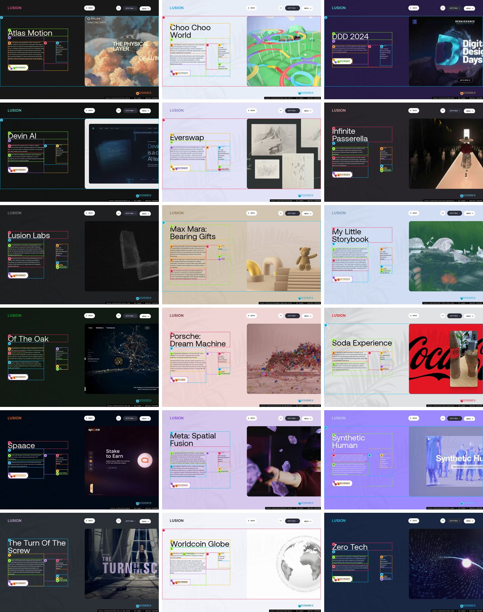
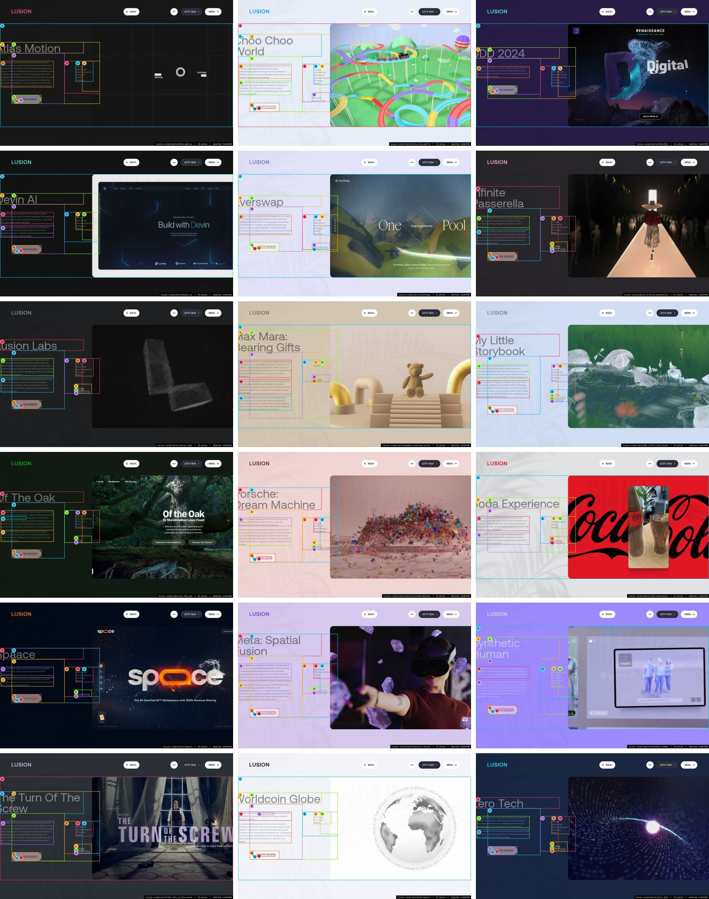

> **Read in Notion:** [15.5 Project pages gallery](https://shifatmasud.notion.site/3fe48559569d817a9a25eb56b9252c63) · Part of [Lusion.co Decoded](https://shifatmasud.notion.site/Lusion-co-Decoded-Client-Side-Handbook-3fd48559569d81dd80b4c7407caf27cc) · [Repo home](https://github.com/shifatmasud/lusion-decoded)

# 15.5 Project pages gallery (the other 18)

<callout icon="🖼️" color="blue_bg">
	Every project page uses the same `ProjectPage` template documented in 15.4. This page shows the first screen of each, plus one screen below it, so an agent can check the per-project data (title, description, meta list, media and colour variables) against the template. The values in the table were measured in the live page.
</callout>

[[IMG:notion/gallery__heroes.jpg|First screen of each project page, desktop 1440×900, alphabetical by slug]]

[[IMG:notion/gallery__below.jpg|One screen further down on each project page: media items start]]

## Per-project data (measured)

<table header-row="true">
<tr><td>Project</td><td>Route</td><td>Title size / weight</td><td>Title colour</td><td>Description (start)</td><td>Side list (first item)</td></tr>
<tr><td>[Atlas Motion](https://lusion.co/projects/atlas_motion)</td><td>`/projects/atlas_motion`</td><td>72px 400</td><td>#fffde0</td><td>Atlas is building next generation motion systems for drones, robotics,</td><td>SERVICES Concept Web Design Web Development 3D Design WebGL </td></tr>
<tr><td>[Choo Choo World](https://lusion.co/projects/choo_choo_world)</td><td>`/projects/choo_choo_world`</td><td>72px 400</td><td>#000000</td><td>Choo Choo World, a research project by Lusion, aimed to create an enjo</td><td>SERVICES Concept Game Design Web Design Web Development 3D D</td></tr>
<tr><td>[DDD 2024](https://lusion.co/projects/ddd_2024)</td><td>`/projects/ddd_2024`</td><td>72px 400</td><td>#ffffff</td><td>Digital Design Days is a 3-day experience that gathers in one place th</td><td>SERVICES UI/UX design 3D Visual design Creative Coding Front</td></tr>
<tr><td>[Devin AI](https://lusion.co/projects/devin_ai)</td><td>`/projects/devin_ai`</td><td>72px 400</td><td>#ffffff</td><td>We partnered with Cognition AI to create a modern website for Devin, t</td><td>SERVICES Concept Web Design Web Development 3D Design WebGL</td></tr>
<tr><td>[Everswap](https://lusion.co/projects/everswap)</td><td>`/projects/everswap`</td><td>72px 400</td><td>#000000</td><td>We were commissioned by the EverSwap team to create an immersive story</td><td>SERVICES Concept Web Design Web Development 3D Design WebGL </td></tr>
<tr><td>[Infinite Passerella](https://lusion.co/projects/infinite_passerella)</td><td>`/projects/infinite_passerella`</td><td>72px 400</td><td>#ffffff</td><td>A New Era in Fashion Showcase. Lusion's R&amp;D journey transforms fashion</td><td>SERVICES Concept Web Design Web Development 3D Design WebGL</td></tr>
<tr><td>[Lusion Labs](https://lusion.co/projects/lusion_labs)</td><td>`/projects/lusion_labs`</td><td>72px 400</td><td>#ffffff</td><td>Lusion's Dedication to Innovation and Exploration. Our dedicated space</td><td>SERVICES Concept Web Design Web Development 3D Design WebGL</td></tr>
<tr><td>[Max Mara: Bearing Gifts](https://lusion.co/projects/maxmara_bearings_gifts)</td><td>`/projects/maxmara_bearings_gifts`</td><td>72px 400</td><td>#000000</td><td>Collaborating with LOW: Transforming Digital Experiences. Our partners</td><td>SERVICES WebGL</td></tr>
<tr><td>[My Little Storybook](https://lusion.co/projects/my_little_story_book)</td><td>`/projects/my_little_story_book`</td><td>72px 400</td><td>#000000</td><td>Expanding Boundaries through Cinematic Innovation. An R&amp;D feat by Lusi</td><td>SERVICES Concept Web Design Web Development 3D Design WebGL</td></tr>
<tr><td>[Of The Oak](https://lusion.co/projects/of_the_oak)</td><td>`/projects/of_the_oak`</td><td>72px 400</td><td>#d9f3de</td><td>MLF approached us to create a web companion for Of The Oak, their phys</td><td>SERVICES Web Design Web Development 3D Design WebGL Animatio</td></tr>
<tr><td>[Porsche: Dream Machine](https://lusion.co/projects/porsche_dream_machine)</td><td>`/projects/porsche_dream_machine`</td><td>72px 400</td><td>#000000</td><td>Commissioned by Wallpaper* and Porsche GB, Lusion created a CG short f</td><td>SERVICES Concept 3D Design Motion Design Compositing</td></tr>
<tr><td>[Soda Experience](https://lusion.co/projects/soda_experience)</td><td>`/projects/soda_experience`</td><td>72px 400</td><td>#000000</td><td>Lusion teamed up with GoSpooky to embark on an exciting journey with C</td><td>SERVICES 3D Optimization WebGL WebAR</td></tr>
<tr><td>[Spaace](https://lusion.co/projects/spaace)</td><td>`/projects/spaace`</td><td>72px 400</td><td>#ffece2</td><td>We worked with Spaace to bring this immersive brand website for their </td><td>SERVICES Web Design Web Development 3D Design WebGL</td></tr>
<tr><td>[Meta: Spatial Fusion](https://lusion.co/projects/spatial_fusion)</td><td>`/projects/spatial_fusion`</td><td>72px 400</td><td>#000000</td><td>Lusion partnered with Phoria and Meta to create Spatial Fusion, an imm</td><td>SERVICES Web Design Web Development WebGL WebXR</td></tr>
<tr><td>[Synthetic Human](https://lusion.co/projects/synthetic_human)</td><td>`/projects/synthetic_human`</td><td>72px 400</td><td>#ffffff</td><td>We partnered with Fantasy to launch the campaign website for Synthetic</td><td>SERVICES Creative Coding Animation Frontend development 3D V</td></tr>
<tr><td>[The Turn Of The Screw](https://lusion.co/projects/the_turn_of_the_screw)</td><td>`/projects/the_turn_of_the_screw`</td><td>72px 400</td><td>#ffffff</td><td>In October 2019, Opera North, alongside the Audiolab of York Universit</td><td>SERVICES Web Design Web Development 3D Design WebGL</td></tr>
<tr><td>[Worldcoin Globe](https://lusion.co/projects/worldcoin)</td><td>`/projects/worldcoin`</td><td>72px 400</td><td>#000000</td><td>In collaboration with Tools for Humanity, we successfully integrated t</td><td>SERVICES API Design 3D Design WebGL</td></tr>
<tr><td>[Zero Tech](https://lusion.co/projects/zero_tech)</td><td>`/projects/zero_tech`</td><td>72px 400</td><td>#ffffff</td><td>Zero approached us to design an engaging interactive website for Zero.</td><td>SERVICES Concept Web Design Web Development 3D Design WebGL</td></tr>
</table>

## What changes per project and what stays fixed

- **Changes:** the title, description, meta (client, year, services), the media list (images, videos, text panels from `ProjectDetailsData`), the `--project-details-*` colour variables, whether there's a launch link (`has-cta`), and the next-project target.
- **Fixed:** the layout grid, type scale, title-centred intro (`ease.expoInOut`), media fade-in (`ease.expoOut`), the back button in the header, and the next-project swap at the bottom.
- **To check a rebuild:** render each route from data alone and compare it with the two thumbnails here. The title wrap, the description length and where the first media item sits should match.

## Figures

